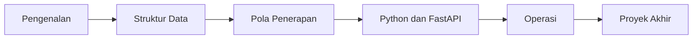

# Belajar Redis

Materi Redis untuk pemula, dari nol sampai penerapan di aplikasi nyata. Semua penjelasan dan contoh dalam bahasa Indonesia, dan rujukan teknisnya adalah [dokumentasi resmi Redis](https://redis.io/docs/latest/).

## Mulai dari sini

Bagian **Pengenalan** dibaca berurutan:

1. [Apa itu Redis](pengenalan/apa-itu-redis.md): konsep, kegunaan, dan struktur data.
2. [Instalasi dengan Docker](pengenalan/instalasi-dengan-docker.md): menjalankan Redis di komputermu.
3. [Menjalankan redis-cli pertama kali](pengenalan/menjalankan-redis-cli-pertama-kali.md): perintah pertama.
4. [Key dan expiry](pengenalan/key-dan-expiry.md): menamai key, `EXPIRE`, `TTL`, dan `SCAN`.

## Peta belajar

Ikuti bagian dari atas ke bawah. Tiap bagian mengandalkan bagian sebelumnya.

| Urutan | Bagian | Yang dipelajari | Status |
|---|---|---|---|
| 1 | [Pengenalan](pengenalan/index.md) | Dasar Redis, Docker, `redis-cli`, key dan expiry | Tersedia |
| 2 | [Struktur Data](struktur-data/index.md) | String, Hash, List, Set, Sorted Set, Bitmap/HyperLogLog/Geo (opsional), memilih struktur | Tersedia |
| 3 | [Pola Penerapan](pola-aplikasi/index.md) | Caching, session dan rate limiting, Pub/Sub, Streams, transaksi, Lua script (opsional) | Tersedia |
| 4 | [Python dan FastAPI](python/index.md) | `redis-py`, FastAPI, caching, rate limit | Tersedia |
| 5 | [Operasi](operasi/index.md) | Persistence, keamanan, monitoring, replikasi/Sentinel/Cluster (opsional) | Tersedia |
| 6 | [Proyek Akhir](proyek-akhir/index.md) | Membangun aplikasi dari awal sampai pengujian | Tersedia |

### Rincian bagian yang tersedia

| Bagian | Bab dalam urutan baca |
|---|---|
| Pengenalan | [Apa itu Redis](pengenalan/apa-itu-redis.md) → [Instalasi dengan Docker](pengenalan/instalasi-dengan-docker.md) → [Menjalankan redis-cli pertama kali](pengenalan/menjalankan-redis-cli-pertama-kali.md) → [Key dan expiry](pengenalan/key-dan-expiry.md) |
| Struktur Data | [String](struktur-data/string.md) → [Hash](struktur-data/hash.md) → [List](struktur-data/list.md) → [Set](struktur-data/set.md) → [Sorted Set](struktur-data/sorted-set.md) → [Bitmap, HyperLogLog, dan Geo](struktur-data/bitmap-hyperloglog-geo.md) *(opsional)* → [Memilih struktur data yang tepat](struktur-data/memilih-struktur-data-yang-tepat.md) |
| Pola Penerapan | [Caching](pola-aplikasi/caching.md) → [Session dan rate limiting](pola-aplikasi/session-dan-rate-limiting.md) → [Pub/Sub](pola-aplikasi/pub-sub.md) → [Streams dan consumer group](pola-aplikasi/streams-consumer-group.md) → [Transaksi](pola-aplikasi/transaksi.md) → [Lua script](pola-aplikasi/lua-script.md) *(opsional)* |
| Python dan FastAPI | [Dasar redis-py](python/dasar-redis-py.md) → [Struktur data di Python](python/struktur-data-di-python.md) → [Pipeline dan connection pool](python/pipeline-dan-connection-pool.md) → [Dasar FastAPI dengan Redis](python/dasar-fastapi-dengan-redis.md) → [FastAPI: caching dan rate limit](python/fastapi-caching-dan-rate-limit.md) → [FastAPI: fitur realtime dengan SSE](python/fastapi-fitur-realtime-dengan-sse.md) *(opsional)* |
| Operasi | [Persistence](operasi/persistence.md) → [Keamanan](operasi/keamanan.md) → [Monitoring](operasi/monitoring.md) → [Replikasi, Sentinel, dan Cluster](operasi/replikasi-sentinel-dan-cluster.md) *(opsional)* |
| Proyek Akhir | [Perancangan](proyek-akhir/perancangan.md) → [Implementasi API](proyek-akhir/implementasi-api.md) → [Fitur realtime](proyek-akhir/fitur-realtime.md) *(opsional)* → [Operasi dan pengujian](proyek-akhir/operasi-dan-pengujian.md) |

!!! info "Tentang output di bab"
    Output berlabel *terverifikasi* dijalankan di Redis 8.10.3 (`redis:latest`) pada 2026-10-27. Nilai seperti TTL dan ID bisa berbeda; bandingkan dengan hasil di komputermu.
