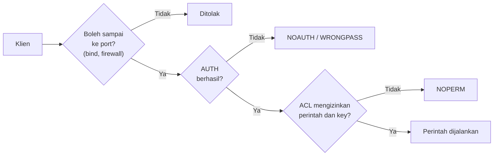

# Keamanan

## Tujuan belajar

Setelah bab ini kamu bisa:

- [ ] Menjelaskan model keamanan Redis: kenapa Redis hanya untuk klien tepercaya di jaringan tepercaya.
- [ ] Membatasi akses jaringan dengan `bind`, port yang dipetakan Docker, dan memahami *protected mode*.
- [ ] Memasang password pada pengguna `default`, lalu masuk dengan `AUTH`.
- [ ] Membuat pengguna ACL dengan izin minimum memakai `ACL SETUSER`, dan membaca galat `NOPERM` serta `WRONGPASS`.
- [ ] Menjelaskan fungsi TLS dan pengaturan dasar yang dibutuhkan, tanpa praktik mendalam.

## Prasyarat

- Sudah membaca [Instalasi dengan Docker](../pengenalan/instalasi-dengan-docker.md), terutama tentang pemetaan port dan varian `-p 127.0.0.1:6379:6379`.
- Sudah membaca [Menjalankan redis-cli pertama kali](../pengenalan/menjalankan-redis-cli-pertama-kali.md) dan [Persistence](persistence.md) (perlu untuk memahami kenapa pengaturan harus disimpan).
- Docker terpasang. ACL tersedia sejak Redis 6.0;[^3] fitur izin kunci `%R~` dan `%W~` serta *selector* butuh Redis 7.0 atau lebih baru.[^2] Image `redis:latest` memenuhi semuanya.
- Bab ini membuat container `redis-aman`. Container `redis` dari bab sebelumnya tidak tersentuh.

## Konsep

Redis dirancang untuk diakses oleh **klien tepercaya di dalam lingkungan tepercaya**. Dokumentasi resmi menyatakan bahwa umumnya bukan ide bagus membuka Redis langsung ke internet atau ke lingkungan yang klien tak tepercayanya bisa menjangkau port Redis.[^1] Pengguna aplikasi web seharusnya tidak berbicara ke Redis; aplikasi web-lah yang berbicara ke Redis atas nama mereka.

Kenapa seserius itu? Karena satu perintah seperti `FLUSHALL` cukup bagi penyerang untuk menghapus seluruh data.[^1] Maka keamanan Redis dibangun dalam lapisan, dari luar ke dalam:

| Lapisan | Pertanyaan yang dijawab | Alat |
|---|---|---|
| 1. Jaringan | Siapa yang boleh menyambung ke port? | `bind`, firewall, pemetaan port Docker |
| 2. Autentikasi | Siapa kamu? | password, `AUTH` |
| 3. Otorisasi | Apa yang boleh kamu lakukan? | ACL |
| 4. Enkripsi | Apakah isi komunikasi bisa disadap? | TLS |

### Analogi

Bayangkan gudang. Pagar di sekeliling kompleks adalah **jaringan**, kartu identitas di pintu adalah **autentikasi**, kunci per ruangan yang berbeda untuk tiap karyawan adalah **ACL**, dan kendaraan lapis baja pengantar barang adalah **TLS**. Pagar saja tidak cukup bila ada orang jahat di dalam; kunci per ruangan saja sia-sia bila pagarnya terbuka lebar.

!!! note "Batas analogi"
    Password Redis tidak melindungi dari penyadapan jaringan. Perintah `AUTH`, seperti perintah lain, dikirim tanpa enkripsi, sehingga penyerang yang bisa menyadap jaringan tetap bisa melihatnya.[^1] Itu tugas TLS.

## Cara kerja



### Jaringan

Port Redis harus tertutup bagi semua kecuali klien tepercaya. Pada satu komputer yang langsung terhubung ke internet, port Redis sebaiknya diblokir firewall dan hanya bisa diakses lewat antarmuka loopback. Di `redis.conf` kamu bisa mengikat Redis ke satu antarmuka dengan `bind 127.0.0.1`.[^1]

Sejak Redis 3.2.0 ada **protected mode**: bila Redis berjalan dengan konfigurasi bawaan (mengikat semua antarmuka) dan tanpa password, ia hanya menjawab klien dari loopback, dan klien dari alamat lain menerima galat yang menjelaskan cara mengonfigurasi dengan benar.[^1] Ini jaring pengaman, bukan pengganti firewall; administrator masih bisa mematikannya.

Di Docker, pengendali utamanya adalah **cara kamu memetakan port**. `-p 6379:6379` membuka port di semua antarmuka komputer, sedangkan `-p 127.0.0.1:6379:6379` hanya untuk komputer itu sendiri (lihat [Instalasi dengan Docker](../pengenalan/instalasi-dengan-docker.md)).

### Autentikasi dan ACL

Ada dua cara autentikasi:[^1]

- **ACL** (Access Control List), cara yang direkomendasikan sejak Redis 6: pengguna bernama dengan izin terperinci.
- **`requirepass`**, cara lama: satu password untuk semua klien. Sejak ACL ada, `requirepass` sekadar menetapkan password untuk pengguna `default`.[^2]

Secara bawaan hanya ada satu pengguna, `default`, yang aktif, tanpa password, dan boleh semuanya: `user default on nopass ~* &* +@all`.[^2] Artinya setiap koneksi baru langsung boleh menjalankan semua perintah. Itulah kondisi container Redis kamu sekarang.

Aturan ACL ditulis sebagai kata-kata yang dibaca **dari kiri ke kanan**; urutan penting.[^2] Aturan yang akan kita pakai:

| Aturan | Arti |
|---|---|
| `on` / `off` | Pengguna aktif / dinonaktifkan. Pengguna baru berstatus `off`. |
| `>kata` | Tambah password. Menghapus status `nopass`. |
| `~pola` | Pola key yang boleh disentuh, misalnya `~app:*`. |
| `+@kategori` / `-@kategori` | Izinkan / cabut satu kategori perintah (`@read`, `@write`, `@dangerous`, `@admin`, ...). |
| `+perintah` / `-perintah` | Izinkan / cabut satu perintah. |
| `+@all` | Semua perintah. |

Pengguna baru dibuat dengan izin sekecil-kecilnya: nonaktif, tanpa password, tanpa perintah, tanpa key.[^2] Ini bagus untuk keamanan: kamu menambah izin, bukan mencabutnya.

!!! warning "Pola key tidak membatasi perintah tanpa key"
    Pola `~app:*` hanya membatasi perintah yang menyebut key. Perintah yang bekerja pada seluruh database, seperti `FLUSHALL`, `FLUSHDB`, dan `SWAPDB`, tidak dibatasi pola key. Pengguna `~app:* +@all` tetap bisa menjalankan `FLUSHALL`. Cabut perintah itu secara eksplisit, atau jangan beri `+@all`.[^2]

Password ACL disimpan sebagai hash SHA-256. Karena itu Redis cepat memeriksanya, sehingga penyerang bisa mencoba banyak password per detik. Solusinya: pakai password yang **panjang dan acak**. `ACL GENPASS` membuat string acak 64 karakter dari generator acak kriptografis sistem.[^2][^4]

### Enkripsi: TLS

Redis mendukung TLS pada semua kanal komunikasi: koneksi klien, replikasi, dan bus Cluster.[^1] TLS adalah fitur opsional yang harus diaktifkan saat kompilasi (`make BUILD_TLS=yes`), tersedia sejak Redis 6.[^5] TLS menambah beban sehingga throughput per instans turun.[^5]

### Pengaman lain

- Menjalankan Redis sebagai pengguna biasa (`redis`), bukan root.[^1]
- Perintah `CONFIG` bisa mengubah folder kerja dan nama file dump, sehingga klien dengan akses penuh dapat menulis file RDB ke lokasi sembarang. Ini alasan lain untuk membatasi `@admin`.[^1]
- `rename-command` untuk menyembunyikan perintah sudah *deprecated*. Pakai ACL.[^1]

## Praktik langkah demi langkah

Output di bawah adalah output **terverifikasi**: dijalankan di Redis 8.10.3 pada 2026-10-27. Hasilmu bisa berbeda pada nilai yang berubah tiap eksekusi. Teks galat bisa sedikit berbeda antar versi, tetapi kata kuncinya (`NOAUTH`, `WRONGPASS`, `NOPERM`) sama. Password di bab ini selalu **placeholder**; ganti dengan nilai milikmu dan jangan pakai password nyata di contoh.

### Langkah 1: Jalankan container tanpa membuka port

**Lingkungan: terminal**

```bash
docker run -d --name redis-aman redis:latest
```

Kenapa langkah ini diperlukan: container baru tanpa `-p` tidak bisa dijangkau dari luar komputer. Untuk latihan, semua akses lewat `docker exec`, jadi lapisan jaringan sudah aman.

**Terverifikasi:** satu ID container yang panjang.

### Langkah 2: Lihat kondisi awal dan buat password acak

**Lingkungan: terminal, lalu redis-cli**

```bash
docker exec -it redis-aman redis-cli
```

```text
ACL LIST
ACL WHOAMI
ACL GENPASS
```

Kenapa: `ACL LIST` menunjukkan siapa saja pengguna dan izinnya, `ACL WHOAMI` menunjukkan kamu masuk sebagai siapa, dan `ACL GENPASS` memberi password acak yang kuat.[^4]

**Terverifikasi:**

```text
1) "user default on nopass sanitize-payload ~* &* +@all"
"default"
"<string heksadesimal 64 karakter>"
```

Cara membaca: `nopass` berarti siapa pun bisa masuk, dan `~* &* +@all` berarti semua key, channel, dan perintah diizinkan. Salin string dari `ACL GENPASS`; di langkah berikut, string itu disebut `PASSWORD_DARI_GENPASS`.

### Langkah 3: Pasang password pada pengguna `default`

**Lingkungan: redis-cli**

```text
ACL SETUSER default >PASSWORD_DARI_GENPASS
EXIT
```

Lalu masuk lagi dan coba tanpa dan dengan password:

```bash
docker exec -it redis-aman redis-cli
```

```text
PING
AUTH salah-sengaja
AUTH PASSWORD_DARI_GENPASS
PING
```

| Bagian | Fungsi dan alasan |
|---|---|
| `ACL SETUSER default >...` | Menambah password ke pengguna `default`. Tanda `>` menghapus status `nopass`, sehingga koneksi baru wajib `AUTH`.[^2] |
| `EXIT` lalu masuk lagi | Sesi lama sudah terlanjur terautentikasi. Koneksi baru membuktikan aturan baru berlaku. |
| `AUTH <password>` | Bentuk satu argumen. Redis menganggap pengguna `default`.[^3] |

**Terverifikasi:**

```text
(error) NOAUTH Authentication required.
(error) WRONGPASS invalid username-password pair or user is disabled.
OK
PONG
```

Cara membaca: `NOAUTH` berarti kamu belum `AUTH`. `WRONGPASS` berarti pasangan pengguna dan password salah. Setelah `OK`, perintah berjalan lagi.

!!! warning "Perubahan ini hilang saat restart"
    `ACL SETUSER` hanya mengubah server yang sedang berjalan. Container baru yang dibuat dari image yang sama akan kembali ke pengguna `default` tanpa password. Agar permanen, definisikan pengguna di `redis.conf` atau file ACL (`aclfile`), atau berikan `--requirepass` saat start.[^2] Prinsipnya sama dengan jebakan `CONFIG SET` di bab [Persistence](persistence.md).

### Langkah 4: Buat pengguna dengan izin minimum

**Lingkungan: redis-cli** (masih sebagai `default` yang sudah `AUTH`)

```text
ACL SETUSER aplikasi on >PASSWORD_APLIKASI ~app:* +@read +@write +@connection -@dangerous
ACL SETUSER pembaca on >PASSWORD_PEMBACA ~app:* +@read +@connection -@dangerous
ACL LIST
```

Ganti `PASSWORD_APLIKASI` dan `PASSWORD_PEMBACA` dengan dua string acak dari `ACL GENPASS`.

Kenapa dua pengguna: aplikasi yang menulis data tidak boleh sama kuasanya dengan layanan yang hanya membaca. Prinsipnya *least privilege*: beri izin sebatas yang dibutuhkan.

| Bagian | Fungsi dan alasan |
|---|---|
| `on` | Mengaktifkan pengguna; tanpa ini `AUTH` ditolak. |
| `>PASSWORD_...` | Password pengguna ini. |
| `~app:*` | Hanya boleh menyentuh key berawalan `app:`. |
| `+@read +@write` | Boleh perintah baca dan tulis. `pembaca` hanya `+@read`. |
| `+@connection` | Perlu agar `PING`, `AUTH`, dan sejenisnya tetap bisa dipakai. |
| `-@dangerous` | Dicabut **setelah** `+@read`/`+@write` karena urutan dibaca dari kiri ke kanan. Ini mencabut `FLUSHALL`, `KEYS`, `CONFIG`, dan kawan-kawan.[^2] |

**Terverifikasi:**

```text
OK
OK
1) "user aplikasi on sanitize-payload #<hash> ~app:* resetchannels -@all +@read +@write +@connection -@dangerous"
2) "user default on sanitize-payload #<hash> ~* &* +@all"
3) "user pembaca on sanitize-payload #<hash> ~app:* resetchannels -@all +@read +@connection -@dangerous"
```

Cara membaca: password tampil sebagai hash SHA-256 berawalan `#`, bukan teks asli. `resetchannels` berarti tidak boleh memakai channel Pub/Sub (pengguna baru di Redis 7.0+ tidak boleh by default).[^2] Susunan dan urutan baris bisa sedikit berbeda.

### Langkah 5: Buktikan batasannya

**Lingkungan: redis-cli**

```text
AUTH aplikasi PASSWORD_APLIKASI
ACL WHOAMI
SET app:1 "ok"
SET lain:1 "nope"
FLUSHALL
AUTH pembaca PASSWORD_PEMBACA
GET app:1
SET app:2 "nope"
```

Kenapa: aturan yang tidak pernah diuji hanyalah asumsi. Di sini kamu melihat tiga jenis penolakan: key di luar pola, perintah dicabut, dan pengguna read-only mencoba menulis.

**Terverifikasi:**

```text
OK
(error) NOPERM User aplikasi has no permissions to run the 'acl|whoami' command
OK
(error) NOPERM No permissions to access a key
(error) NOPERM User aplikasi has no permissions to run the 'flushall' command
OK
"ok"
(error) NOPERM User pembaca has no permissions to run the 'set' command
```

`ACL WHOAMI` ikut ditolak untuk `aplikasi` karena perintah itu tidak termasuk kategori `@read`, `@write`, atau `@connection`. Itu bukti bahwa pengguna hanya boleh apa yang diberikan secara eksplisit. Teks `NOPERM` di atas teramati di Redis 8.10.3.

Cara membaca: `NOPERM` selalu berarti *terautentikasi, tetapi tidak diizinkan*. Bedakan dari `NOAUTH` (belum login) dan `WRONGPASS` (login salah). Teks persis galat NOPERM berbeda antar versi.

### Langkah 6: Baca catatan pelanggaran dengan `ACL LOG`

**Lingkungan: redis-cli**

Sambung lagi sebagai `default`, lalu jalankan:

```text
AUTH default PASSWORD_DARI_GENPASS
ACL LOG 3
```

Kenapa: di produksi, kamu perlu tahu kalau ada percobaan masuk yang gagal atau perintah yang ditolak. `ACL LOG` mencatat kegagalan `AUTH` dan pelanggaran izin.[^6]

**Terverifikasi:** daftar entri terbaru dulu, masing-masing berisi medan seperti `count`, `reason` (`auth`, `command`, `key`, atau `channel`), `context`, `object`, `username`, dan `client-info`.[^6] Misalnya entri dengan `reason` bernilai `command` dan `object` bernilai `flushall` dari pengguna `aplikasi`, juga entri `reason` bernilai `auth` dari percobaan password salah di Langkah 3.

### Langkah 7: Beri password ke `redis-cli` dengan aman

**Lingkungan: terminal**

Keluar dari redis-cli (`EXIT`), lalu:

```bash
docker exec -e REDISCLI_AUTH=PASSWORD_DARI_GENPASS redis-aman redis-cli PING
```

Kenapa: opsi `-a <password>` menaruh password di baris perintah sehingga terlihat di daftar proses dan riwayat shell. Dokumentasi `redis-cli` menyarankan variabel lingkungan `REDISCLI_AUTH` untuk alasan keamanan.[^7] Variabel itu hanya berlaku untuk perintah `docker exec` ini.

**Terverifikasi:**

```text
PONG
```

### Langkah 8: Bersihkan

**Lingkungan: terminal**

```bash
docker rm -f redis-aman
```

!!! danger "Perintah ini menghapus data"
    `docker rm -f` menghapus container beserta isinya. Container ini hanya untuk latihan dan tidak memakai volume, jadi tidak ada yang perlu diselamatkan.

## TLS: konfigurasi dasar (tanpa praktik)

TLS melindungi isi komunikasi dari penyadapan. Dokumentasi resmi menjelaskan konfigurasinya; bagian ini hanya menunjukkan bentuknya, belum dijalankan di bab ini.

**Lingkungan: berkas `redis.conf`**

```conf
port 0
tls-port 6379
tls-cert-file /jalur/ke/redis.crt
tls-key-file /jalur/ke/redis.key
tls-ca-cert-file /jalur/ke/ca.crt
```

| Baris | Fungsi dan alasan |
|---|---|
| `port 0` | Mematikan port non-TLS sepenuhnya. Tanpa ini, port biasa tetap terbuka sehingga TLS bisa dilewati.[^5] |
| `tls-port 6379` | Menerima koneksi TLS di port itu. Port TLS bersifat *tambahan* terhadap `port`.[^5] |
| `tls-cert-file`, `tls-key-file` | Sertifikat X.509 dan kunci privat server. |
| `tls-ca-cert-file` | Sertifikat CA tepercaya untuk memvalidasi sertifikat. |

Secara bawaan Redis memakai **mutual TLS**: klien juga wajib menunjukkan sertifikat. Matikan dengan `tls-auth-clients no` bila perlu.[^5] Klien terhubung dengan:

**Lingkungan: terminal**

```bash
redis-cli --tls --cert ./redis.crt --key ./redis.key --cacert ./ca.crt
```

`--tls` mengaktifkan TLS, `--cacert` menentukan CA tepercaya, dan `--cert` serta `--key` dipakai bila server meminta sertifikat klien.[^7] Untuk replikasi dan Cluster ada pengaturan terpisah (`tls-replication yes`, `tls-cluster yes`).[^5] Sertifikat uji dapat dibuat dengan `./utils/gen-test-certs.sh` dari kode sumber Redis, tetapi sertifikat produksi harus dari CA yang kamu percayai. Dokumentasi mencatat TLS harus dikompilasi dengan `BUILD_TLS=yes`; periksa dokumentasi image Docker yang kamu pakai untuk memastikan dukungannya.

## Kesalahan umum dan troubleshooting

| Gejala | Penyebab dan solusi |
|---|---|
| `NOAUTH Authentication required` | Server butuh password. Jalankan `AUTH`, atau beri `REDISCLI_AUTH` saat memakai `redis-cli`. |
| `WRONGPASS` | Pengguna atau password salah, atau pengguna berstatus `off`. Pengguna baru dari `ACL SETUSER` belum aktif sebelum diberi `on`.[^2] |
| `NOPERM ... keys` | Key di luar pola `~...`. Tambahkan pola yang benar, atau periksa penulisan key. |
| `NOPERM ... run the '...' command` | Perintah tidak diizinkan. Periksa urutan aturan: `-@dangerous` yang muncul sebelum `+@read` tidak mencabut apa pun yang ditambahkan sesudahnya.[^2] |
| Pengguna baru tidak bisa login padahal sudah diberi password | Lupa `on`. Cek dengan `ACL LIST` apakah flag-nya `on`. |
| Pengguna dan password hilang setelah restart | `ACL SETUSER` tidak permanen. Simpan di `redis.conf` atau `aclfile` (lalu `ACL SAVE`).[^2] |
| `redis-cli` memperingatkan soal password di baris perintah | Itu karena `-a`. Pakai `REDISCLI_AUTH` atau `--askpass`.[^7] |
| Pengguna dengan `~tenant:* +@all` masih bisa `FLUSHALL` | Pola key tidak membatasi perintah tanpa key. Tambah `-flushall -flushdb -swapdb`.[^2] |
| Klien dari komputer lain ditolak dengan pesan *protected mode* | Itu perlindungan bawaan. Perbaiki dengan konfigurasi yang benar (`bind`, password, firewall), bukan sekadar mematikan protected mode.[^1] |

!!! note "Status verifikasi"
    Perintah, nilai balik, dan skrip di bab ini dijalankan di Redis 8.10.3 (`redis:latest`) pada 2026-10-27, dengan Python 3.12.3 dan redis-py 8.1.0. Sintaks juga dicocokkan dengan dokumentasi resmi Redis. Nilai yang berubah tiap eksekusi (ID, TTL, waktu, urutan, alamat IP) bisa berbeda di komputermu, dan teks galat bisa berbeda antarversi. Tampilan prompt interaktif `redis-cli` (prompt, Tab, riwayat) tidak teramati karena pengujian berjalan tanpa terminal interaktif.

## Latihan

1. Buat pengguna `laporan` yang hanya boleh `GET` dan `TTL` pada key berawalan `laporan:`. Uji dengan `GET` pada key lain dan lihat galatnya.
2. Sebelum menjalankan: bila kamu menulis `ACL SETUSER x on >pw ~* -@dangerous +@read`, apakah `FLUSHALL` ditolak? Jalankan `ACL SETUSER`, masuk sebagai `x`, dan buktikan.
3. Buat password acak dengan `ACL GENPASS` dan pasang ke pengguna baru dengan `>`. Lihat hasilnya di `ACL LIST`: apa yang kamu temukan tentang cara password disimpan?
4. Lakukan tiga percobaan `AUTH` salah, lalu baca `ACL LOG`. Apa nilai `count`, `reason`, dan `username`-nya?
5. Jelaskan dengan kata-katamu kenapa `-p 127.0.0.1:6379:6379` dan password sama-sama dibutuhkan, dan apa yang tidak dilindungi oleh keduanya.

??? success "Petunjuk"
    1. Pakai `+get +ttl ~laporan:*` dan jangan lupa `on` dan password.
    2. Ingat aturan dibaca dari kiri ke kanan, dan lihat apakah kategori `@read` mencakup `FLUSHALL`.
    3. Lihat awalan `#` pada hasil `ACL LIST`.
    4. Percobaan serupa dalam 60 detik digabung menjadi satu entri.
    5. Pikirkan lapisan jaringan, autentikasi, dan enkripsi satu per satu.

## Ringkasan

- Redis ditujukan untuk klien tepercaya di jaringan tepercaya. Jangan membuka portnya ke internet; batasi dengan `bind`, firewall, dan pemetaan port Docker.
- Secara bawaan pengguna `default` boleh semuanya tanpa password. Pasang password dengan `ACL SETUSER default >...` atau `--requirepass`, dan masuk dengan `AUTH`.
- ACL membuat pengguna bernama dengan izin minimum: `on`, `>password`, `~pola`, `+@kategori`, `-@dangerous`. Aturan dibaca dari kiri ke kanan. Galat `NOAUTH`, `WRONGPASS`, dan `NOPERM` punya arti berbeda.
- `ACL SETUSER` tidak permanen. Simpan di `redis.conf` atau `aclfile`. Pakai `ACL GENPASS` untuk password kuat dan `REDISCLI_AUTH` supaya password tidak muncul di baris perintah.
- `AUTH` dikirim tanpa enkripsi; TLS (`tls-port`, sertifikat, `port 0`) melindungi komunikasi dari penyadapan.

Berikutnya: [Monitoring](monitoring.md), yang membahas `INFO`, `SLOWLOG`, memori, dan latensi.

## Referensi resmi

[^1]: Redis, *Redis security*: <https://redis.io/docs/latest/operate/oss_and_stack/management/security/>
[^2]: Redis, *ACL*: <https://redis.io/docs/latest/operate/oss_and_stack/management/security/acl/>
[^3]: Redis, *AUTH*: <https://redis.io/docs/latest/commands/auth/>
[^4]: Redis, *ACL GENPASS*: <https://redis.io/docs/latest/commands/acl-genpass/>
[^5]: Redis, *TLS*: <https://redis.io/docs/latest/operate/oss_and_stack/management/security/encryption/>
[^6]: Redis, *ACL LOG*: <https://redis.io/docs/latest/commands/acl-log/>
[^7]: Redis, *Redis CLI*: <https://redis.io/docs/latest/develop/tools/cli/>

Bacaan tambahan: [`ACL SETUSER`](https://redis.io/docs/latest/commands/acl-setuser/), [`ACL WHOAMI`](https://redis.io/docs/latest/commands/acl-whoami/), [`ACL SAVE`](https://redis.io/docs/latest/commands/acl-save/).
