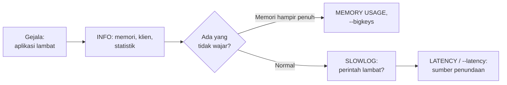

# Monitoring

## Tujuan belajar

Setelah bab ini kamu bisa:

- [ ] Menjelaskan apa yang perlu dipantau dari sebuah server Redis dan kenapa.
- [ ] Membaca bagian penting `INFO`: memori, klien, statistik, dan hit/miss.
- [ ] Mengukur ukuran sebuah key dengan `MEMORY USAGE` dan mencari key besar dengan `redis-cli --bigkeys`.
- [ ] Mengatur dan membaca `SLOWLOG` untuk menemukan perintah yang lambat.
- [ ] Mengukur latensi dengan `redis-cli --latency` dan mengenali kegunaan latency monitor.

## Prasyarat

- Sudah membaca [Caching](../pola-aplikasi/caching.md), terutama tentang `maxmemory`, eviction, dan hit/miss. Bab ini tidak mengulang penjelasannya.
- Sudah membaca [Persistence](persistence.md) dan [Keamanan](keamanan.md). `INFO` dan `SLOWLOG` termasuk perintah administratif; di server yang memakai ACL, pengguna pemantau perlu izin untuk menjalankannya.[^8]
- Docker terpasang. Bab ini membuat container `redis-pantau` dan menghapusnya di akhir.

## Konsep

Redis yang "jalan" belum tentu Redis yang "sehat". Server bisa diam-diam kehabisan memori, melayani satu perintah lambat sambil membuat semua klien menunggu, atau mulai menolak koneksi. **Monitoring** adalah kebiasaan memeriksa tanda-tanda itu *sebelum* pengguna mengeluh.

Redis sebagian besar berjalan dengan satu thread yang melayani perintah satu per satu.[^6] Akibatnya, satu perintah lambat membuat semua klien lain ikut menunggu. Karena itu pemantauan Redis berpusat pada empat pertanyaan:

| Pertanyaan | Alat |
|---|---|
| Berapa banyak memori yang dipakai, dan apakah mendekati batas? | `INFO memory`, `MEMORY USAGE`, `redis-cli --bigkeys` |
| Seberapa sibuk server dan berapa klien yang tersambung? | `INFO clients`, `INFO stats`, `redis-cli --stat` |
| Perintah apa yang lambat? | `SLOWLOG` |
| Seberapa lama klien menunggu jawaban? | `redis-cli --latency`, latency monitor |

### Analogi

Anggap Redis sebagai mobil. `INFO` adalah **panel dasbor** (bensin, suhu mesin, kecepatan). `SLOWLOG` adalah **catatan servis** yang mencatat kapan mesin tersendat. Pengukuran latensi seperti **stopwatch** untuk waktu tempuh. Dasbor memberi tahu kondisi sekarang; catatan servis menunjukkan apa penyebab masalah di masa lalu.

!!! note "Batas analogi"
    Dasbor mobil menampilkan angka langsung dengan batas merah. `INFO` hanya memberi angka mentah. Kamu yang menentukan batas wajar untuk aplikasimu, dan sebaiknya membandingkan angka dari waktu ke waktu, bukan hanya satu kali.

## Cara kerja



### `INFO`: dasbor Redis

`INFO` mengembalikan teks berisi baris `nama:nilai` yang dikelompokkan dalam bagian (*section*). Kamu bisa meminta satu bagian saja, misalnya `INFO memory`.[^1] Field yang akan kita pakai:[^1]

| Bagian | Field | Arti |
|---|---|---|
| `memory` | `used_memory` / `used_memory_human` | Byte yang dialokasikan Redis untuk datanya. |
| | `used_memory_rss` | Memori yang dilihat sistem operasi untuk proses Redis. |
| | `maxmemory`, `maxmemory_policy` | Batas memori dan kebijakan eviction. Batas `0` berarti tak terbatas. |
| | `mem_fragmentation_ratio` | Rasio `used_memory_rss` terhadap `used_memory`. |
| `clients` | `connected_clients` | Jumlah koneksi klien (tidak termasuk replika). |
| | `blocked_clients` | Klien yang menunggu panggilan blocking seperti `BLPOP`. |
| `stats` | `total_commands_processed` | Total perintah yang pernah diproses. |
| | `instantaneous_ops_per_sec` | Perintah per detik saat ini. |
| | `rejected_connections` | Koneksi yang ditolak karena batas jumlah klien. |
| | `evicted_keys` | Key yang dibuang karena batas `maxmemory`. |
| | `keyspace_hits` / `keyspace_misses` | Pencarian key yang berhasil / gagal. |
| | `expired_keys` | Total kejadian key kedaluwarsa. |
| | `latest_fork_usec` | Durasi `fork` terakhir (mikrodetik), yang dipakai persistence. |

**Cara membaca memori.** Idealnya `used_memory_rss` hanya sedikit lebih besar dari `used_memory`. Bila RSS jauh lebih besar, mungkin ada fragmentasi memori. Bila `used_memory` jauh lebih besar dari RSS, sebagian memori Redis sudah dipindahkan ke disk (*swap*) oleh sistem operasi, dan kamu bisa mengharapkan latensi yang buruk.[^1] Rasio fragmentasi tinggi tidak otomatis masalah bila selisih byte-nya kecil (beberapa megabyte).[^1]

**Cara membaca hit rate.** `keyspace_hits` dibagi (`keyspace_hits` + `keyspace_misses`) adalah persentase pencarian yang berhasil. Makna hit dan miss untuk cache sudah dibahas di [Caching](../pola-aplikasi/caching.md).

### `SLOWLOG`: catatan perintah lambat

Slow log mencatat perintah yang waktu eksekusinya melebihi ambang tertentu. Waktu yang dihitung **hanya waktu menjalankan perintah**, tidak termasuk I/O seperti berbicara dengan klien dan mengirim balasan.[^2] Jadi perintah yang lambat karena jaringan tidak muncul di sini.

Dua pengaturan menentukannya:[^4]

| Pengaturan | Bawaan | Arti |
|---|---|---|
| `slowlog-log-slower-than` | `10000` | Ambang dalam **mikrodetik** (10000 = 10 ms). `0` mencatat semua perintah; angka negatif mematikan slow log. |
| `slowlog-max-len` | `128` | Jumlah maksimum entri; yang terlama dibuang. |

Tiap entri berisi: ID urut, waktu Unix, durasi (mikrodetik), argumen perintah, alamat klien, dan nama klien bila ada.[^3] Argumen yang terlalu banyak dipotong (batas bawaan 32).[^3] ID tidak pernah direset sampai server restart, jadi skrip bisa memakainya untuk tidak memproses entri yang sama dua kali.[^3]

### Latensi

Latensi adalah jeda antara klien mengirim perintah dan menerima balasannya. Penyebab umum yang disebut dokumentasi:[^6]

- **Perintah lambat** pada value besar, misalnya `SORT`, `LREM`, atau `SUNION`. Sumber yang *sangat umum*: `KEYS` di produksi (gunakan `SCAN`).
- **`fork`** saat persistence, yang makin lama untuk dataset besar.
- **Swapping**, **transparent huge pages**, dan **I/O disk** dari AOF.
- Banyak key kedaluwarsa pada detik yang sama.
- **Latensi bawaan lingkungan** (*intrinsic latency*) dari kernel atau hypervisor, yang tidak bisa dilampaui Redis.

Redis menyediakan *latency monitor* yang mencatat lonjakan latensi per jenis kejadian (`command`, `fork`, `aof-fsync-always`, dan lain-lain). Fitur ini **mati secara bawaan** (`latency-monitor-threshold 0`); kamu menyalakannya dengan menetapkan ambang dalam **milidetik**.[^5][^4]

## Praktik langkah demi langkah

Output di bawah adalah output **terverifikasi**: dijalankan di Redis 8.10.3 pada 2026-10-27. Hasilmu bisa berbeda pada nilai yang berubah tiap eksekusi. Angka seperti ukuran memori, durasi, dan jumlah sampel pasti berbeda. Fokuslah pada bentuk dan cara membacanya. Perintah `docker exec` tanpa `-it` tidak berjalan di terminal, sehingga `redis-cli` memakai *raw output*: angka tampil tanpa `(integer)`, string tanpa tanda kutip, dan nilai kosong (`nil`) sebagai baris kosong.[^7]

### Langkah 1: Jalankan container dan isi data uji

**Lingkungan: terminal**

```bash
docker run -d --name redis-pantau redis:latest
docker exec redis-pantau sh -c 'for i in $(seq 1 500); do echo "SET produk:$i nilai-$i"; done | redis-cli > /dev/null'
docker exec redis-pantau sh -c 'for i in $(seq 1 20000); do echo "RPUSH antrean $i"; done | redis-cli > /dev/null'
docker exec redis-pantau redis-cli DBSIZE
```

Kenapa langkah ini diperlukan: tanpa data, angka di `INFO` hampir kosong dan tidak ada yang lambat. Perintah `redis-cli` yang menerima daftar perintah dari *stdin* menjalankannya berurutan, sehingga cukup satu pipa untuk ratusan perintah.[^7]

| Bagian | Fungsi dan alasan |
|---|---|
| `sh -c '...'` | Menjalankan loop shell di dalam container, bukan di komputermu (aman untuk Windows). |
| `seq 1 500` | Membuat 500 key `produk:1` ... `produk:500`. |
| `RPUSH antrean ...` 20000 kali | Membuat satu List besar (`antrean`) untuk dibaca lambat di Langkah 6. |
| `> /dev/null` | Membuang balasan `OK` / angka supaya layar tidak penuh. |

**Terverifikasi:**

```text
501
```

Cara membaca: 500 key `produk:*` ditambah satu key `antrean`.

### Langkah 2: Baca memori dengan `INFO memory`

**Lingkungan: terminal**

```bash
docker exec redis-pantau sh -c "redis-cli INFO memory | grep -E 'used_memory_human|used_memory_rss_human|maxmemory_human|maxmemory_policy|mem_fragmentation_ratio'"
```

Kenapa: `grep` menyaring puluhan baris `INFO memory` menjadi lima yang paling berguna untuk pemula.

**Terverifikasi** (angka akan berbeda):

```text
used_memory_human:1.53M
used_memory_rss_human:24.56M
maxmemory_human:0B
maxmemory_policy:noeviction
mem_fragmentation_ratio:16.26
```

Cara membaca: `maxmemory_human:0B` berarti **tidak ada batas**, dan `noeviction` berarti saat memori habis, penulisan akan ditolak dengan galat (lihat [Caching](../pola-aplikasi/caching.md)). Rasio fragmentasi besar di sini wajar karena data kecil: selisihnya hanya beberapa megabyte, sedangkan proses Redis punya biaya tetap (kode, pustaka). Catatan resmi: rasio tinggi dengan selisih byte kecil bukan tanda masalah.[^1]

### Langkah 3: Ukur dan cari key besar

**Lingkungan: terminal**

```bash
docker exec redis-pantau redis-cli MEMORY USAGE produk:1
docker exec redis-pantau redis-cli MEMORY USAGE antrean
docker exec redis-pantau redis-cli --bigkeys
```

Kenapa: ketika memori membengkak, yang perlu kamu cari adalah *key mana* penyebabnya. `MEMORY USAGE` memberi ukuran satu key; `--bigkeys` memindai seluruh keyspace.

| Bagian | Fungsi dan alasan |
|---|---|
| `MEMORY USAGE key` | Estimasi byte yang dibutuhkan key beserta value-nya, termasuk overhead administrasi. Untuk tipe bersarang, nilainya dirata-rata dari sampel (bawaan 5; `SAMPLES 0` memeriksa semua).[^9] |
| `--bigkeys` | Memindai dengan `SCAN` (jadi aman di server yang sibuk) dan melaporkan key terbesar per tipe, plus ringkasan jumlah per tipe.[^7] |

**Terverifikasi:**

```text
40
76322
...
Biggest list found 'antrean' has 20000 items
...
1 lists with 20000 items (00.20% of keys, avg size 20000.00)
500 strings with 2890 bytes (99.80% of keys, avg size 5.78)
```

Cara membaca: `antrean` jauh lebih besar dari `produk:1` (ratusan ribu byte dibanding puluhan byte). Pada aplikasi sungguhan, key semacam inilah yang diselidiki. Jumlah byte persis berbeda antar versi.

### Langkah 4: Hitung hit rate dari `INFO stats`

**Lingkungan: terminal**

```bash
docker exec redis-pantau redis-cli GET produk:1
docker exec redis-pantau redis-cli GET tidak-ada
docker exec redis-pantau sh -c "redis-cli INFO stats | grep -E 'keyspace_hits|keyspace_misses|total_commands_processed|instantaneous_ops_per_sec|rejected_connections|evicted_keys|expired_keys'"
```

Kenapa: dua `GET` pertama sengaja menghasilkan satu hit dan satu miss, sehingga kamu bisa melihat sendiri bagaimana counter bergerak.

**Terverifikasi:**

```text
nilai-1
<baris kosong>
total_commands_processed:20520
instantaneous_ops_per_sec:0
expired_keys:0
evicted_keys:0
keyspace_hits:1003
keyspace_misses:1
rejected_connections:0
```

Cara membaca: `keyspace_hits` sudah ratusan sebelum kamu membaca apa pun karena perintah pengisian data (misalnya `RPUSH` pada key yang sudah ada) ikut dihitung sebagai hit; hanya selisihnya yang berguna: `GET produk:1` menaikkan hits 1, `GET tidak-ada` menaikkan misses 1. Counter bersifat kumulatif sejak server menyala, jadi untuk melihat tren, bandingkan angka dua kali pengambilan. `evicted_keys` yang terus naik berarti `maxmemory` tercapai dan Redis membuang data. `rejected_connections` yang naik berarti server menolak klien karena batas koneksi.

### Langkah 5: Lihat klien dan pantau langsung

**Lingkungan: terminal**

```bash
docker exec redis-pantau sh -c "redis-cli INFO clients | grep -E 'connected_clients|blocked_clients'"
docker exec -it redis-pantau redis-cli --stat
```

Tekan `Ctrl+C` untuk berhenti. Kenapa: `--stat` mencetak satu baris per detik berisi jumlah key, memori, klien, dan permintaan, dengan selisih dari baris sebelumnya.[^7] Itu cara cepat melihat apakah beban naik.

**Terverifikasi:**

```text
connected_clients:1
blocked_clients:0
------- data ------ --------------------- load -------------------- - child -
keys       mem      clients blocked requests            connections
501        2.31M    1       0       20525 (+0)          10
501        2.31M    1       0       20526 (+1)          11
```

Cara membaca: kolom `requests (+n)` menunjukkan perintah per detik, dan `connections` bertambah setiap kali ada koneksi baru. Dalam `--stat`, `redis-cli` sendiri adalah satu klien.

### Langkah 6: Tangkap perintah lambat dengan `SLOWLOG`

**Lingkungan: terminal**

```bash
docker exec redis-pantau redis-cli CONFIG GET slowlog-log-slower-than
docker exec redis-pantau redis-cli CONFIG SET slowlog-log-slower-than 100
docker exec redis-pantau redis-cli SLOWLOG RESET
docker exec redis-pantau sh -c "redis-cli LRANGE antrean 0 -1 > /dev/null"
docker exec redis-pantau sh -c "redis-cli KEYS '*' > /dev/null"
docker exec redis-pantau redis-cli SLOWLOG LEN
docker exec -it redis-pantau redis-cli SLOWLOG GET 2
```

Kenapa: ambang bawaan 10 ms terlalu tinggi untuk mesin latihan yang cepat, jadi kita turunkan ke 100 mikrodetik agar perintah berat tertangkap. `LRANGE antrean 0 -1` membaca 20000 elemen sekaligus, dan `KEYS '*'` memindai semua key. Keduanya adalah contoh perintah yang membuat klien lain menunggu.[^6] Hanya `SLOWLOG GET` yang memakai `-it`, supaya balasan bersarangnya tampil sebagai daftar bernomor seperti di bawah; tanpa `-it`, `redis-cli` mencetaknya sebagai baris-baris biasa.[^7]

| Bagian | Fungsi dan alasan |
|---|---|
| `CONFIG SET slowlog-log-slower-than 100` | Mencatat perintah yang berjalan lebih dari 100 µs. Satuan mikrodetik.[^4] |
| `SLOWLOG RESET` | Mengosongkan catatan lama supaya hasil latihan bersih. |
| `SLOWLOG LEN` | Jumlah entri yang tercatat. |
| `SLOWLOG GET 2` | Dua entri terbaru. Tanpa angka, hasilnya sepuluh entri.[^3] |

**Terverifikasi** (angka berbeda):

```text
slowlog-log-slower-than
10000
OK
OK
1
1) 1) (integer) 0
   2) (integer) 1761562999
   3) (integer) 1039
   4) 1) "LRANGE"
      2) "antrean"
      3) "0"
      4) "-1"
   5) "127.0.0.1:41820"
   6) ""
   7) (integer) 4
```

Pada Redis 8.10.3 tiap entri punya **tujuh** elemen (elemen ketujuh adalah ID klien yang menjalankan perintah, dan angkanya tidak penting untuk latihan ini). Hanya `LRANGE` yang tercatat: `KEYS '*'` pada 501 key selesai sekitar 35 µs, di bawah ambang 100 µs. Jika kamu ingin melihat `KEYS` juga, turunkan ambang ke `0` (semua perintah tercatat, termasuk `SLOWLOG GET` itu sendiri) lalu kembalikan lagi.

Cara membaca setiap entri berurutan: nomor ID, waktu Unix, **durasi dalam mikrodetik** (1039 µs ≈ 1 ms), perintah dan argumennya, alamat klien, dan nama klien (kosong). Entri paling baru muncul di atas. Fokus pada kolom durasi dan perintahnya: perintah dengan durasi paling besar adalah kandidat untuk diganti, misalnya `KEYS` menjadi `SCAN`, atau `LRANGE` seluruh List menjadi potongan kecil.

!!! warning "Kembalikan ambang setelah latihan"
    Ambang yang terlalu rendah membuat slow log penuh entri biasa dan terus memakai memori. Setelah selesai, kembalikan: `docker exec redis-pantau redis-cli CONFIG SET slowlog-log-slower-than 10000`. Pengaturan ini juga hilang saat restart seperti `CONFIG SET` lain (lihat [Persistence](persistence.md)).

### Langkah 7: Ukur latensi

**Lingkungan: terminal**

```bash
docker exec -it redis-pantau redis-cli --latency
```

Tekan `Ctrl+C` setelah beberapa detik. Kenapa: mode ini mengirim `PING` berulang kali (sekitar 100 kali per detik) dan mencatat waktu balasan.[^7]

**Terverifikasi:**

```text
min: 0, max: 1, avg: 0.12 (1530 samples)
```

Cara membaca: satuan **milidetik**. `min`, `max`, dan `avg` adalah latensi terendah, tertinggi, dan rata-rata dari sampel. Nilai `max` yang melonjak jauh di atas `avg` menandakan ada penundaan sesaat. Catatan penting: ini mengukur jalur dari `redis-cli` ke server, termasuk penundaan penjadwal sistem pada mesin yang menjalankan `redis-cli`, jadi rata-rata sedikit melebih-lebihkan latensi sebenarnya.[^7]

Untuk melihat latensi dasar mesin (tanpa Redis), `redis-cli --intrinsic-latency <detik>` menguji kernel/hypervisor dan **harus dijalankan di mesin server**, bukan di klien.[^6][^7] Hasilnya adalah batas bawah yang tidak bisa dilampaui Redis.

### Langkah 8: Aktifkan latency monitor

**Lingkungan: terminal**

```bash
docker exec redis-pantau redis-cli CONFIG SET latency-monitor-threshold 1
docker exec redis-pantau redis-cli LATENCY LATEST
docker exec redis-pantau redis-cli LATENCY DOCTOR
```

Kenapa: slow log hanya mencatat *perintah*; latency monitor juga mencatat kejadian internal seperti `fork` dan penulisan AOF. Ambang `1` berarti mencatat kejadian yang memakan waktu 1 milidetik atau lebih.[^5]

**Terverifikasi:** karena server latihan ini ringan, `LATENCY LATEST` kemungkinan besar mengembalikan daftar kosong, dan `LATENCY DOCTOR` melaporkan bahwa belum ada data latensi yang perlu ditinjau. Bila ada lonjakan, `LATENCY LATEST` menampilkan nama kejadian (misalnya `command` atau `fork`), waktu, latensi terakhir, dan latensi maksimum, dan `LATENCY HISTORY <kejadian>` menampilkan deret waktunya.[^5]

### Langkah 9: Bersihkan

**Lingkungan: terminal**

```bash
docker rm -f redis-pantau
```

!!! danger "Perintah ini menghapus data"
    `docker rm -f` menghapus container dan semua datanya. Container latihan ini tidak memakai volume, jadi tidak ada yang perlu diselamatkan.

## Contoh lengkap

Skrip kecil untuk memeriksa kesehatan dasar sebuah container Redis.

**Lingkungan: shell (sh/bash)** · Kebutuhan: Docker, dan container Redis yang sedang berjalan

```bash title="cek-redis.sh"
#!/bin/sh
# Pemakaian: sh cek-redis.sh [nama-container]
KONTAINER="${1:-redis-pantau}"

info() {
  docker exec "$KONTAINER" redis-cli INFO "$1"
}

echo "== Memori =="
info memory | grep -E 'used_memory_human|maxmemory_human|maxmemory_policy'

echo "== Klien =="
info clients | grep -E 'connected_clients|blocked_clients'

echo "== Statistik =="
info stats | grep -E 'instantaneous_ops_per_sec|evicted_keys|rejected_connections'

HITS=$(info stats | grep '^keyspace_hits:' | cut -d: -f2 | tr -d '\r')
MISSES=$(info stats | grep '^keyspace_misses:' | cut -d: -f2 | tr -d '\r')
echo "== Hit rate =="
echo "hits=$HITS misses=$MISSES"

echo "== Slow log (jumlah entri) =="
docker exec "$KONTAINER" redis-cli SLOWLOG LEN
```

Penjelasan baris penting:

| Baris | Penjelasan |
|---|---|
| `KONTAINER="${1:-redis-pantau}"` | Memakai argumen pertama sebagai nama container; bila kosong, memakai `redis-pantau`. |
| `info() { ... }` | Fungsi pembungkus agar `INFO <bagian>` tidak ditulis berulang. |
| `grep -E '...'` | Menyaring baris yang kita perlukan dari keluaran `INFO`. |
| `cut -d: -f2` | Mengambil nilai setelah tanda titik dua. |
| `tr -d '\r'` | Membuang karakter *carriage return*, karena `INFO` memakai akhir baris `\r\n`. |

Cara menjalankan: `sh cek-redis.sh redis-pantau`. Hasil yang diharapkan: lima bagian berurutan dengan angka dari server-mu. Skrip ini belum dijalankan saat bab ditulis. Untuk pemantauan terus-menerus, jalankan skrip dari penjadwal (cron) dan simpan hasilnya, supaya kamu bisa membandingkan antar waktu.

## Kesalahan umum dan troubleshooting

| Gejala | Penyebab dan solusi |
|---|---|
| `SLOWLOG GET` kosong padahal terasa lambat | Ambang `slowlog-log-slower-than` (bawaan 10 ms) terlalu tinggi, atau lambatnya ada di jaringan/klien karena slow log tidak menghitung I/O.[^2] Turunkan ambang, atau ukur dengan `--latency`. |
| Slow log penuh entri biasa | Ambang terlalu rendah (mis. `0`, yang mencatat semua perintah).[^4] Naikkan lagi. |
| Entri lama hilang | Jumlah entri dibatasi `slowlog-max-len` (bawaan 128).[^4] |
| `LATENCY LATEST` selalu kosong | Latency monitor mati secara bawaan (ambang `0`). Aktifkan dengan `CONFIG SET latency-monitor-threshold <ms>`.[^5] |
| `mem_fragmentation_ratio` tinggi | Lihat selisih byte `mem_fragmentation_bytes`. Selisih kecil (beberapa MB) bukan masalah.[^1] |
| `used_memory` jauh di atas `used_memory_rss` | Sebagian memori ter-swap oleh sistem operasi, sehingga latensi buruk.[^1] Kurangi tekanan memori mesin. |
| `evicted_keys` terus naik | `maxmemory` tercapai. Tinjau ukuran data, TTL, atau kebijakan eviction (lihat [Caching](../pola-aplikasi/caching.md)). |
| `--intrinsic-latency` tidak memberi hasil bermakna | Perintah itu harus dijalankan di mesin server, bukan klien, dan tidak menyambung ke Redis.[^7] |
| `NOPERM` saat menjalankan `INFO` atau `SLOWLOG` | Pengguna ACL tidak punya izin. `INFO` termasuk kategori `@dangerous` dan `SLOWLOG GET` termasuk `@admin`.[^8][^3] Beri izin spesifik, jangan `+@all`. |

!!! note "Status verifikasi"
    Perintah, nilai balik, dan skrip di bab ini dijalankan di Redis 8.10.3 (`redis:latest`) pada 2026-10-27, dengan Python 3.12.3 dan redis-py 8.1.0. Sintaks juga dicocokkan dengan dokumentasi resmi Redis. Nilai yang berubah tiap eksekusi (ID, TTL, waktu, urutan, alamat IP) bisa berbeda di komputermu, dan teks galat bisa berbeda antarversi. Tampilan prompt interaktif `redis-cli` (prompt, Tab, riwayat) tidak teramati karena pengujian berjalan tanpa terminal interaktif.

## Latihan

1. Jalankan Langkah 1 lalu ambil `used_memory_human`. Tambahkan 5000 key baru, ambil lagi. Berapa selisihnya, dan berapa byte per key kira-kira?
2. Sebelum menjalankan: apa yang terjadi pada `keyspace_hits` dan `keyspace_misses` bila kamu menjalankan `EXISTS produk:1` dan `GET tidak-ada`? Jalankan dan bandingkan dengan prediksimu.
3. Turunkan `slowlog-log-slower-than` ke `0`, jalankan tiga perintah berbeda, lalu baca `SLOWLOG GET`. Perintah mana yang paling lama? Kembalikan ambang ke `10000`.
4. Ganti `KEYS '*'` pada Langkah 6 dengan `redis-cli --scan` dan bandingkan apakah ia tercatat di slow log. Kenapa `SCAN` lebih aman?
5. Jelaskan dengan kata-katamu kenapa `SLOWLOG` bisa kosong padahal klien mengeluh lambat, dan alat apa yang kamu pakai berikutnya.

??? success "Petunjuk"
    1. Bagi selisih byte dengan 5000.
    2. Cek dulu apakah `EXISTS` dihitung sebagai pencarian key di `INFO stats`; jangan menebak, jalankan dan lihat.
    3. Kolom ketiga setiap entri adalah durasi dalam mikrodetik.
    4. `SCAN` bekerja bertahap dan tidak memblokir server lama.
    5. Ingat apa yang tidak dihitung oleh slow log.

## Ringkasan

- Pantau empat hal: memori, beban dan klien, perintah lambat, dan latensi. Redis memproses perintah hampir satu per satu, jadi satu perintah lambat memperlambat semua klien.
- `INFO` adalah dasbor: pakai `INFO memory`, `INFO clients`, `INFO stats`. Perhatikan `used_memory`, `maxmemory`, `evicted_keys`, `rejected_connections`, serta hit dan miss. Counter bersifat kumulatif, jadi bandingkan antar waktu.
- `MEMORY USAGE` dan `redis-cli --bigkeys` mencari key besar. `SLOWLOG` (ambang bawaan 10 ms, 128 entri) mencatat perintah lambat tanpa menghitung I/O.
- `redis-cli --latency` mengukur latensi dalam milidetik; latency monitor harus dinyalakan dengan `latency-monitor-threshold`. Hindari `KEYS` di produksi dan gunakan `SCAN`.
- Semua `CONFIG SET` di bab ini hilang saat restart, dan perintah pemantau perlu izin ACL yang sesuai.

Berikutnya: [Replikasi, Sentinel, dan Cluster](replikasi-sentinel-dan-cluster.md) (opsional), tentang ketersediaan tinggi.

## Referensi resmi

[^1]: Redis, *INFO*: <https://redis.io/docs/latest/commands/info/>
[^2]: Redis, *SLOWLOG*: <https://redis.io/docs/latest/commands/slowlog/>
[^3]: Redis, *SLOWLOG GET*: <https://redis.io/docs/latest/commands/slowlog-get/>
[^4]: Redis, `redis.conf` (8.0): <https://raw.githubusercontent.com/redis/redis/8.0/redis.conf>
[^5]: Redis, *Redis latency monitoring*: <https://redis.io/docs/latest/operate/oss_and_stack/management/optimization/latency-monitor/>
[^6]: Redis, *Diagnosing latency issues*: <https://redis.io/docs/latest/operate/oss_and_stack/management/optimization/latency/>
[^7]: Redis, *Redis CLI*: <https://redis.io/docs/latest/develop/tools/cli/>
[^8]: Redis, *ACL*: <https://redis.io/docs/latest/operate/oss_and_stack/management/security/acl/>
[^9]: Redis, *MEMORY USAGE*: <https://redis.io/docs/latest/commands/memory-usage/>

Bacaan tambahan: [`LATENCY DOCTOR`](https://redis.io/docs/latest/commands/latency-doctor/), [`MEMORY STATS`](https://redis.io/docs/latest/commands/memory-stats/), [`SLOWLOG RESET`](https://redis.io/docs/latest/commands/slowlog-reset/).
