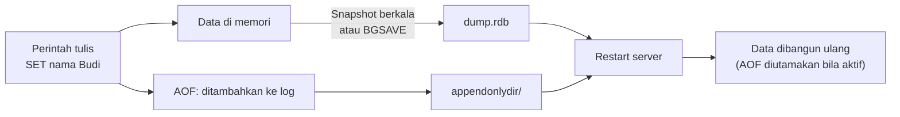

# Persistence

## Tujuan belajar

Setelah bab ini kamu bisa:

- [ ] Menjelaskan kenapa data Redis bisa hilang saat server mati dan apa yang dilakukan persistence.
- [ ] Membedakan RDB (snapshot) dan AOF (catatan setiap perintah tulis), termasuk kelebihan dan kekurangannya.
- [ ] Menjalankan Redis di Docker dengan volume, lalu memicu dan memeriksa snapshot dengan `BGSAVE`, `LASTSAVE`, dan `INFO persistence`.
- [ ] Mengaktifkan AOF, mengenali file di `appendonlydir`, dan menjalankan `BGREWRITEAOF`.
- [ ] Membuat cadangan file RDB dan menjelaskan kenapa pengaturan lewat `CONFIG SET` bisa hilang saat restart.

## Prasyarat

- Sudah membaca [Instalasi dengan Docker](../pengenalan/instalasi-dengan-docker.md), terutama risiko `docker rm` terhadap data, dan [Key dan expiry](../pengenalan/key-dan-expiry.md).
- Docker terpasang. Image `redis:latest` yang kamu pakai di bab sebelumnya sudah memenuhi syarat: tata letak file AOF yang dibahas di sini berlaku sejak Redis 7.0.[^1]
- Bab ini membuat container baru bernama `redis-persist` dan volume `redis-data`, jadi container `redis` dari bab sebelumnya tidak tersentuh. Pastikan kedua nama itu belum terpakai (`docker ps -a` dan `docker volume ls`).

## Konsep

Redis menyimpan data di memori (RAM). Memori itu hilang ketika server mati, container dihapus, atau listrik padam. Kalau Redis hanya dipakai sebagai cache, itu sering tidak masalah karena data bisa dibuat ulang. Tetapi untuk data yang tidak boleh hilang, misalnya antrean pekerjaan atau sesi, kamu butuh **persistence**: menulis data ke penyimpanan tahan lama seperti SSD.[^1]

Redis punya dua cara utama, dan keduanya boleh dipakai bersamaan:[^1]

- **RDB (Redis Database)**: mengambil *snapshot* seluruh data pada waktu tertentu dan menyimpannya di satu file, secara bawaan bernama `dump.rdb`.
- **AOF (Append Only File)**: mencatat setiap perintah tulis yang diterima server. Saat server menyala lagi, catatan itu diputar ulang untuk membangun kembali data.

### Analogi

RDB seperti **foto** lemari arsip yang kamu ambil tiap beberapa menit. Memulihkan dari foto itu cepat, tetapi apa pun yang berubah setelah foto terakhir tidak terekam. AOF seperti **buku catatan harian** yang mencatat setiap kali kamu menaruh atau mengambil berkas. Hasil pemulihannya lebih lengkap, tetapi bukunya makin tebal dan membacanya ulang lebih lama.

!!! note "Batas analogi"
    Buku catatan AOF tidak dibiarkan menebal tanpa batas. Redis bisa menulis ulang (*rewrite*) catatan itu menjadi versi paling ringkas yang menghasilkan data yang sama.[^1]

## Cara kerja

Perbandingan dari dokumentasi resmi:[^1]

| | RDB | AOF |
|---|---|---|
| Isi | Satu file padat berisi data pada satu titik waktu | Log perintah tulis |
| Risiko kehilangan data | Bisa kehilangan data beberapa menit terakhir, sesuai jarak antar snapshot | Dengan kebijakan bawaan, paling banyak sekitar 1 detik |
| Ukuran file | Lebih kecil | Biasanya lebih besar |
| Kecepatan restart pada data besar | Lebih cepat | Lebih lambat |
| Cocok untuk | Cadangan dan pemulihan bencana | Data yang harus sangat tahan kehilangan |

Dokumentasi resmi menyarankan memakai **keduanya** bila kamu menginginkan keamanan data yang sebanding dengan database seperti PostgreSQL. Bila kamu bisa menerima kehilangan beberapa menit data, RDB saja cukup. AOF saja tidak disarankan karena snapshot RDB berguna untuk cadangan dan restart lebih cepat.[^1] Bila RDB dan AOF aktif bersamaan lalu Redis restart, **file AOF yang dipakai** untuk membangun ulang data karena dianggap paling lengkap.[^1]



**Bagaimana snapshot dibuat.** Redis membuat proses anak lewat `fork`. Anak itu menulis data ke file sementara, lalu menggantikan file lama saat selesai. Proses utama terus melayani klien.[^1] Karena file lama baru diganti setelah file baru lengkap, `dump.rdb` tidak pernah setengah tertulis.

**Seberapa tahan AOF.** Pengaturan `appendfsync` menentukan seberapa sering log benar-benar dipaksa ke disk:[^1]

| Nilai | Arti | Kompromi |
|---|---|---|
| `always` | `fsync` setiap kali ada tulisan baru | Paling aman, sangat lambat |
| `everysec` | `fsync` tiap detik (**bawaan**) | Cepat, bisa kehilangan sekitar 1 detik data |
| `no` | Diserahkan ke sistem operasi | Paling cepat, paling tidak aman |

**Nilai bawaan tanpa file konfigurasi.** Container Redis yang kamu jalankan di [Instalasi dengan Docker](../pengenalan/instalasi-dengan-docker.md) tidak memakai file `redis.conf`, jadi berlaku nilai bawaan.[^2] Menurut `redis.conf` Redis 8.0:[^3]

| Pengaturan | Nilai bawaan | Arti |
|---|---|---|
| `save` | `3600 1 300 100 60 10000` | Snapshot jika ada ≥1 perubahan dalam 1 jam, ≥100 dalam 5 menit, atau ≥10000 dalam 1 menit. `save ""` mematikan snapshot. |
| `dbfilename` | `dump.rdb` | Nama file snapshot. |
| `dir` | `./` | Folder tempat file ditulis. |
| `appendonly` | `no` | AOF mati. |
| `appenddirname` | `appendonlydir` | Folder file AOF (sejak Redis 7.0). |
| `auto-aof-rewrite-percentage` / `auto-aof-rewrite-min-size` | `100` / `64mb` | Rewrite otomatis saat AOF tumbuh 100% dan sudah ≥ 64 MB. |

Sejak Redis 7.0, AOF terdiri dari beberapa file di satu folder: satu file *base* (data awal saat rewrite terakhir), satu atau lebih file *incr* (perubahan sesudahnya), dan satu file *manifest* yang mencatat daftarnya.[^1]

!!! warning "Data di dalam container ikut hilang"
    Di image resmi, data ditulis ke `/data`, yang dideklarasikan sebagai volume.[^2] Tanpa `-v`, Docker membuat volume anonim yang mudah terlupa dan tidak terbawa saat container dibuat ulang. Selalu pasang volume bernama bila datanya penting.

## Praktik langkah demi langkah

Output di bawah adalah output yang **diharapkan** berdasarkan dokumentasi, bukan hasil eksekusi di komputermu. Nilai seperti waktu, ukuran file, dan nomor urut file bisa berbeda. Semua perintah dijalankan dari terminal. Perintah `docker exec` tanpa `-it` tidak berjalan di terminal, sehingga `redis-cli` memakai *raw output*: string tampil tanpa tanda kutip, angka tanpa `(integer)`, dan nilai kosong (`nil`) sebagai baris kosong.[^11]

### Langkah 1: Jalankan Redis dengan volume dan snapshot

**Lingkungan: terminal**

```bash
docker run -d --name redis-persist -v redis-data:/data redis:latest redis-server --save 60 1
```

Kenapa langkah ini diperlukan: tanpa volume, file `dump.rdb` terkubur di dalam container. Dengan `-v redis-data:/data`, file disimpan di volume bernama yang bertahan walau container dihapus.[^2]

| Bagian | Fungsi dan alasan |
|---|---|
| `-v redis-data:/data` | Menempelkan volume `redis-data` ke folder `/data`, tempat Redis menulis file. |
| `redis-server --save 60 1` | Menimpa aturan snapshot bawaan: simpan setiap 60 detik bila ada minimal 1 perubahan. Dipilih supaya pengujian tidak menunggu satu jam.[^2] |
| Tanpa `-p` | Port tidak dibuka ke komputer. Kita memakai `docker exec`, sehingga lebih aman. |

**Diharapkan:** satu ID container yang panjang.

### Langkah 2: Periksa pengaturan persistence yang aktif

**Lingkungan: terminal**

```bash
docker exec redis-persist redis-cli CONFIG GET save
docker exec redis-persist redis-cli CONFIG GET appendonly
docker exec redis-persist redis-cli CONFIG GET dir
```

Kenapa: jangan menebak. `CONFIG GET` menunjukkan nilai yang benar-benar dipakai server, dan memastikan `--save 60 1` terbaca.

**Diharapkan:**

```text
save
60 1
appendonly
no
dir
/data
```

Cara membaca: `redis-cli` dalam mode satu kali jalan mencetak nama pengaturan lalu nilainya. `appendonly no` berarti AOF belum aktif. `dir` yang bernilai `/data` memastikan file jatuh ke volume.

### Langkah 3: Buat data lalu paksa snapshot dengan `BGSAVE`

**Lingkungan: terminal**

```bash
docker exec redis-persist redis-cli SET nama "Budi"
docker exec redis-persist redis-cli LASTSAVE
docker exec redis-persist redis-cli BGSAVE
docker exec redis-persist redis-cli LASTSAVE
docker exec redis-persist ls -l /data
```

Kenapa: `BGSAVE` membuat snapshot di latar belakang tanpa memblokir klien. `LASTSAVE` sebelum dan sesudahnya membuktikan snapshot benar-benar tersimpan.[^4][^5]

| Perintah | Fungsi dan alasan |
|---|---|
| `BGSAVE` | Fork lalu simpan di proses anak. Dipakai di produksi. Memakai `SAVE` akan memblokir semua klien.[^6] |
| `LASTSAVE` | Waktu Unix snapshot sukses terakhir. Bila angkanya naik, snapshot selesai.[^5] |
| `ls -l /data` | Melihat file di dalam volume. |

**Diharapkan:**

```text
OK
1761561600
Background saving started
1761561725
total 4
-rw-r--r-- 1 redis redis 88 Oct 27 10:02 dump.rdb
```

Cara membaca: dua angka `LASTSAVE` berbeda dan yang kedua lebih besar. Bila sama, snapshot belum selesai: tunggu sebentar lalu ulangi `LASTSAVE`. Ukuran file kecil karena datanya hanya satu key.

!!! danger "Jangan pakai `SAVE` di server yang melayani klien"
    `SAVE` bersifat sinkron dan memblokir semua klien sampai selesai.[^6] Dokumentasi resmi hanya menyebutnya sebagai pilihan terakhir bila `fork` gagal.

### Langkah 4: Lihat sendiri data yang hilang tanpa snapshot

**Lingkungan: terminal**

```bash
docker exec redis-persist redis-cli SET kota "Bandung"
docker kill redis-persist
docker start redis-persist
docker exec redis-persist redis-cli GET nama
docker exec redis-persist redis-cli GET kota
```

Kenapa: ini mensimulasikan listrik padam. `docker kill` mengirim `SIGKILL`, jadi Redis tidak sempat menyimpan apa pun. Jalankan semua perintah di atas **dalam 60 detik** setelah Langkah 3, sebelum aturan `save 60 1` memicu snapshot otomatis.

**Diharapkan:**

```text
OK
redis-persist
redis-persist
Budi
<baris kosong>
```

Cara membaca: `nama` selamat karena sudah masuk snapshot di Langkah 3. `kota` hilang karena ditulis setelah snapshot dan sebelum snapshot berikutnya. Inilah kelemahan RDB. Nilai kosong `kota` tampil sebagai baris kosong, bukan `(nil)`, karena mode raw. Bila kamu lambat lebih dari 60 detik, `kota` mungkin sudah tersimpan oleh aturan otomatis, dan itu wajar.

!!! note "Mematikan dengan baik berbeda"
    `docker stop` mengirim `SIGTERM`. Redis menanganinya seperti `SHUTDOWN`: bila ada save point, Redis menyimpan RDB dulu sebelum keluar.[^7] Data hanya hilang pada kematian mendadak seperti `kill -9`, listrik padam, atau crash.

### Langkah 5: Aktifkan AOF pada server yang sedang berjalan

**Lingkungan: terminal**

```bash
docker exec redis-persist redis-cli CONFIG SET appendonly yes
docker exec redis-persist sh -c "redis-cli INFO persistence | grep -E 'aof_enabled|aof_rewrite_in_progress|aof_last_bgrewrite_status'"
docker exec redis-persist ls -l /data/appendonlydir
```

Kenapa: dokumentasi resmi menyarankan mengaktifkan AOF lewat `CONFIG SET` pada server yang hidup, supaya Redis langsung membuat file AOF awal dari data di memori. Hanya mengubah konfigurasi lalu restart bisa menyebabkan kehilangan data.[^1][^8]

**Diharapkan:**

```text
OK
aof_enabled:1
aof_rewrite_in_progress:0
aof_last_bgrewrite_status:ok
total 12
-rw-r--r-- 1 redis redis 88 Oct 27 10:05 appendonly.aof.1.base.rdb
-rw-r--r-- 1 redis redis  0 Oct 27 10:05 appendonly.aof.1.incr.aof
-rw-r--r-- 1 redis redis 88 Oct 27 10:05 appendonly.aof.manifest
```

Cara membaca: `aof_enabled:1` berarti AOF aktif. Tunggu sampai `aof_rewrite_in_progress` bernilai `0` dan `aof_last_bgrewrite_status` bernilai `ok` sebelum menganggap file AOF awal siap.[^1] Tiga file di folder itu adalah file *base*, *incr*, dan *manifest*.

### Langkah 6: Pahami jebakan `CONFIG SET`, lalu buat ulang container dengan konfigurasi tetap

`CONFIG SET` hanya mengubah server yang sedang berjalan. Perintah awal container (`--save 60 1`) tidak berubah, jadi `docker restart` akan menyalakan Redis lagi **tanpa AOF**.[^9] Itu sebabnya dokumentasi resmi menekankan mengubah konfigurasi permanen juga.[^1] Di Docker, cara termudah adalah membuat ulang container dengan opsi yang benar. Volume `redis-data` tidak ikut terhapus.

**Lingkungan: terminal**

```bash
docker rm -f redis-persist
docker run -d --name redis-persist -v redis-data:/data redis:latest redis-server --save 60 1 --appendonly yes
docker exec redis-persist redis-cli GET nama
```

!!! danger "Risiko kehilangan data"
    `docker rm -f` menghapus container, bukan volume. Karena kita memakai `-v redis-data:/data`, datanya tetap ada. Jangan tambahkan `-v` pada `docker rm` atau menghapus volume `redis-data` sebelum selesai bab ini.

**Diharapkan:**

```text
redis-persist
<ID container panjang>
Budi
```

Cara membaca: `"Budi"` kembali karena Redis memuat data dari AOF (dan snapshot) di volume.

### Langkah 7: Buktikan AOF menahan kehilangan data

**Lingkungan: terminal**

```bash
docker exec redis-persist redis-cli SET kota "Bandung"
```

Tunggu 2–3 detik supaya `fsync` per detik sempat berjalan, lalu:

```bash
docker kill redis-persist
docker start redis-persist
docker exec redis-persist redis-cli GET kota
```

Kenapa menunggu: dengan `appendfsync everysec` (bawaan), kamu bisa kehilangan sekitar 1 detik tulisan terakhir.[^1]

**Diharapkan:**

```text
OK
redis-persist
redis-persist
Bandung
```

Cara membaca: berbeda dengan Langkah 4, `kota` selamat karena perintah `SET` sudah tercatat di file incr AOF.

### Langkah 8: Padatkan AOF dengan `BGREWRITEAOF`

**Lingkungan: terminal**

```bash
docker exec redis-persist redis-cli BGREWRITEAOF
docker exec redis-persist ls /data/appendonlydir
```

Kenapa: log AOF terus tumbuh. Bila sebuah counter dinaikkan 100 kali, log menyimpan 100 entri padahal hanya nilai akhir yang dibutuhkan. Rewrite membuat versi paling ringkas.[^1] Redis menjalankannya otomatis, tetapi kamu bisa memicunya manual.[^10]

**Diharapkan:**

```text
Background append only file rewriting started
appendonly.aof.2.base.rdb
appendonly.aof.2.incr.aof
appendonly.aof.manifest
```

Cara membaca: nomor file naik (misalnya dari `1` ke `2`) karena rewrite membuat file *base* baru lalu menghapus yang lama. Bila Redis sedang membuat snapshot, rewrite dijadwalkan dan baru mulai setelah snapshot selesai.[^10] Bila rewrite lain sedang berjalan, kamu mendapat galat.

### Langkah 9: Buat cadangan file RDB

**Lingkungan: terminal**

```bash
docker exec redis-persist redis-cli BGSAVE
docker exec redis-persist redis-cli LASTSAVE
docker cp redis-persist:/data/dump.rdb ./dump-cadangan.rdb
```

Kenapa: cadangan harus berada di luar volume, idealnya di luar mesin. Menyalin file RDB aman walau server sedang berjalan, karena file RDB tidak pernah diubah setelah dibuat dan file baru memakai nama sementara lalu di-*rename* secara atomik setelah selesai.[^1]

**Diharapkan:** `docker cp` tidak mencetak apa pun bila berhasil, dan file `dump-cadangan.rdb` muncul di folder tempat kamu menjalankannya. Pastikan `LASTSAVE` sudah naik sebelum menyalin.

Aturan cadangan dari dokumentasi resmi:[^1]

- Buat snapshot terjadwal, misalnya per jam dan per hari, dengan nama berisi tanggal dan jam, lalu hapus yang sudah terlalu lama.
- Minimal sekali sehari, pindahkan satu salinan **ke luar mesin** atau pusat data.
- Setelah memindahkan, periksa ukuran file (dan idealnya SHA1) dan pasang peringatan bila transfer gagal.

!!! warning "Cadangan AOF lebih rumit"
    Menyalin folder `appendonlydir` saat rewrite berlangsung bisa menghasilkan cadangan yang tidak valid. Dokumentasi resmi menyarankan mematikan rewrite otomatis sementara (`CONFIG SET auto-aof-rewrite-percentage 0`), memastikan `aof_rewrite_in_progress` bernilai `0`, menyalin folder, lalu mengembalikan nilai semula.[^1] Redis versi terbaru juga punya keluarga perintah `BACKUP` untuk ini; lihat dokumentasi persistence.[^1]

### Langkah 10: Bersihkan

**Lingkungan: terminal**

```bash
docker rm -f redis-persist
docker volume rm redis-data
```

!!! danger "Perintah ini menghapus data"
    `docker volume rm redis-data` menghapus seluruh file persistence (`dump.rdb` dan `appendonlydir`) secara permanen. Lakukan hanya bila kamu sudah selesai berlatih. `dump-cadangan.rdb` di folder kerjamu tidak terpengaruh.

## Kesalahan umum dan troubleshooting

| Gejala | Penyebab dan solusi |
|---|---|
| `LASTSAVE` tidak naik setelah `BGSAVE` | Snapshot belum selesai atau gagal. Cek `rdb_last_bgsave_status` di `INFO persistence`; nilainya harus `ok`. |
| `BGSAVE` membalas galat | Sudah ada `BGSAVE` atau rewrite AOF yang berjalan. Tunggu, atau pakai `BGSAVE SCHEDULE` agar dijadwalkan.[^4] |
| Data hilang setelah `docker rm` lalu `docker run` | Volume tidak dipasang atau namanya berbeda. Pakai `-v redis-data:/data` yang sama setiap kali. |
| AOF aktif lewat `CONFIG SET`, tetapi mati setelah `docker restart` | `CONFIG SET` tidak mengubah perintah awal container. Tambahkan `--appendonly yes` saat `docker run`, atau ubah `redis.conf` / `CONFIG REWRITE`.[^1][^8] |
| Data terbaru hilang setelah `docker kill` | Hanya RDB aktif, atau AOF memakai `everysec` sehingga ~1 detik tulisan terakhir bisa hilang. Pakai AOF, atau `appendfsync always` bila butuh lebih aman (lebih lambat).[^1] |
| Log: `short read while loading the AOF file` / `Truncating the AOF` | File AOF terpotong karena crash saat menulis. Redis versi baru tetap memuatnya dan membuang perintah terakhir yang tidak utuh.[^1] |
| Log: `Bad file format reading the append only file` | AOF rusak di tengah. Cadangkan file, jalankan `redis-check-aof` tanpa `--fix` untuk melihat masalahnya. `--fix` bisa membuang bagian file dari titik rusak hingga akhir.[^1] |
| Container tidak bisa menulis ke `/data` | Folder yang dipetakan harus bisa ditulis oleh proses Redis.[^2] |

!!! note "Status verifikasi"
    Sintaks perintah, nama pengaturan, nilai bawaan, dan perilaku dicocokkan dengan dokumentasi resmi Redis dan Docker Hub. Perintah dan blok output di bab ini belum dijalankan di Redis nyata saat bab ini ditulis, jadi bandingkan dengan hasilmu sendiri. Teks persis balasan `BGREWRITEAOF` dan nomor file AOF khususnya perlu dicocokkan.

## Latihan

1. Jalankan Langkah 1–3, lalu periksa `INFO persistence` dan temukan nilai `rdb_changes_since_last_save` sebelum dan sesudah `BGSAVE`. Apa artinya angka itu?
2. Sebelum menjalankan: bila kamu `SET x 1`, menunggu 2 detik, lalu `docker kill` pada server yang hanya memakai RDB dengan `save 3600 1`, apakah `x` selamat? Jalankan dan bandingkan.
3. Aktifkan AOF dengan `appendfsync always` lewat `CONFIG SET appendfsync always`, lalu jelaskan kenapa pengaturan ini lebih aman tetapi lebih lambat.
4. Lakukan `INCR hitung` sebanyak 50 kali, jalankan `BGREWRITEAOF`, dan bandingkan isi folder `appendonlydir` sebelum dan sesudahnya. Kenapa ukurannya bisa berbeda?
5. Jelaskan dengan kata-katamu kenapa sebaiknya memakai RDB dan AOF bersamaan, dan mana yang dipakai saat Redis restart.

??? success "Petunjuk"
    1. Angka itu menghitung perubahan sejak snapshot terakhir.
    2. Ingat: tanpa snapshot baru, hanya data dari snapshot terakhir yang ada.
    3. Pikirkan seberapa sering `fsync` terjadi pada tiap kebijakan.
    4. Rewrite menyimpan perintah minimal yang membentuk data saat ini.
    5. Lihat bagian "Cara kerja" untuk alasan dan urutan prioritas.

## Ringkasan

- Redis menyimpan data di memori; **persistence** menulisnya ke disk agar bertahan saat restart atau mati mendadak.
- **RDB** adalah snapshot berkala (`dump.rdb`): ringkas dan cocok untuk cadangan, tetapi bisa kehilangan data beberapa menit. **AOF** mencatat setiap perintah tulis: lebih tahan (bawaan `everysec`, ~1 detik), tetapi lebih besar. Gunakan keduanya bila data penting.
- `BGSAVE` dan `LASTSAVE` membuat dan memastikan snapshot; `CONFIG SET appendonly yes` mengaktifkan AOF pada server hidup; `BGREWRITEAOF` memadatkan log; `INFO persistence` memeriksa status.
- Di Docker, selalu pakai volume untuk `/data`, dan simpan pengaturan di perintah `docker run` atau `redis.conf`, karena `CONFIG SET` hilang saat restart.
- Cadangan: salin `dump.rdb` secara rutin dan simpan di luar mesin. Hindari `SAVE` di produksi dan hati-hati dengan `docker volume rm`.

Berikutnya: [Keamanan](keamanan.md), yang membahas ACL, password, jaringan, dan TLS.

## Referensi resmi

[^1]: Redis, *Redis persistence*: <https://redis.io/docs/latest/operate/oss_and_stack/management/persistence/>
[^2]: Docker Hub, *redis (Official Image)*: <https://hub.docker.com/_/redis>
[^3]: Redis, `redis.conf` (8.0): <https://raw.githubusercontent.com/redis/redis/8.0/redis.conf>
[^4]: Redis, *BGSAVE*: <https://redis.io/docs/latest/commands/bgsave/>
[^5]: Redis, *LASTSAVE*: <https://redis.io/docs/latest/commands/lastsave/>
[^6]: Redis, *SAVE*: <https://redis.io/docs/latest/commands/save/>
[^7]: Redis, *SHUTDOWN*: <https://redis.io/docs/latest/commands/shutdown/>
[^8]: Redis, *CONFIG SET*: <https://redis.io/docs/latest/commands/config-set/>
[^9]: Redis, *Redis configuration*: <https://redis.io/docs/latest/operate/oss_and_stack/management/config/>
[^10]: Redis, *BGREWRITEAOF*: <https://redis.io/docs/latest/commands/bgrewriteaof/>
[^11]: Redis, *Redis CLI* (`redis-cli` memakai raw output bila stdout bukan terminal): <https://redis.io/docs/latest/develop/tools/cli/>

Bacaan tambahan: [`INFO`](https://redis.io/docs/latest/commands/info/), [`CONFIG REWRITE`](https://redis.io/docs/latest/commands/config-rewrite/), [`SHUTDOWN`](https://redis.io/docs/latest/commands/shutdown/).
