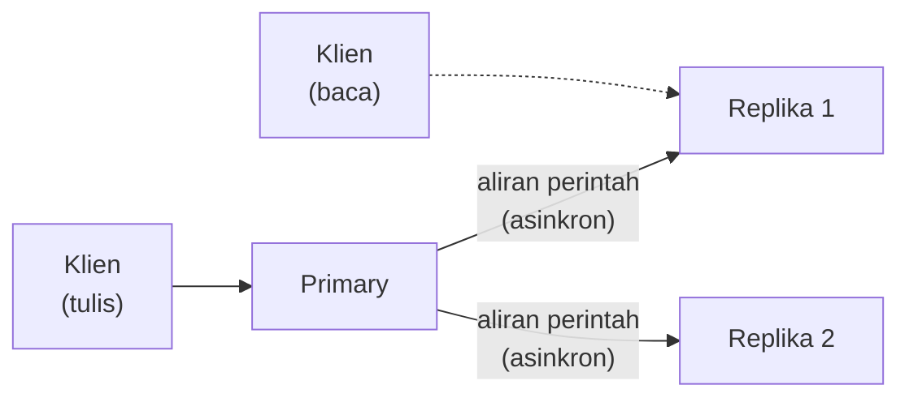

# Replikasi, Sentinel, dan Cluster

!!! info "Opsional"
    Bab ini boleh dilewati tanpa memutus alur belajar. Isinya konsep ketersediaan tinggi (*high availability*), dengan praktik ringan untuk replikasi saja. Sentinel dan Cluster hanya dijelaskan konsepnya, tanpa praktik mendalam.

## Tujuan belajar

Setelah bab ini kamu bisa:

- [ ] Menjelaskan kenapa satu server Redis saja menjadi titik kegagalan tunggal (*single point of failure*).
- [ ] Menjelaskan replikasi *primary–replica* dan sifat asinkronnya, termasuk risiko kehilangan tulisan.
- [ ] Menjalankan satu replika di Docker, memeriksanya dengan `ROLE` dan `INFO replication`, dan mempromosikannya dengan `REPLICAOF NO ONE`.
- [ ] Menjelaskan apa yang dikerjakan Sentinel, arti *quorum*, dan kenapa dibutuhkan minimal tiga Sentinel.
- [ ] Menjelaskan apa yang ditambahkan Cluster (sharding dengan 16384 hash slot) dan memilih antara ketiganya.

## Prasyarat

- Sudah membaca [Persistence](persistence.md), [Keamanan](keamanan.md), dan [Monitoring](monitoring.md). Replikasi sangat bergantung pada persistence, dan `INFO` serta `ROLE` dipakai untuk memeriksanya.
- Docker terpasang. Praktik membuat jaringan `redis-ha` serta container `redis-utama` dan `redis-replika`, lalu menghapusnya di akhir.
- Istilah: dokumentasi Redis memakai *master* dan *replica*, dan beberapa perintah lama masih memakai kata `slave` di keluarannya. Bab ini memakai istilah *primary* (utama) untuk instans sumber dan *replica* (replika) untuk salinannya.[^3]

## Konsep

Sampai bab ini, kita memakai satu server Redis. Bila server itu mati, aplikasi tidak bisa membaca atau menulis sampai kamu memperbaikinya. Dan walau [Persistence](persistence.md) menyelamatkan data di disk, server tetap tidak melayani apa pun selama mati. **Ketersediaan tinggi** berarti sistem tetap bisa melayani meskipun satu mesin gagal.

Redis menyediakan tiga lapisan, masing-masing menyelesaikan masalah yang berbeda:

| Lapisan | Masalah yang diselesaikan | Yang dilakukan |
|---|---|---|
| **Replikasi** | Hanya ada satu salinan data | Instans replika menjadi salinan persis dari primary |
| **Sentinel** | Replika harus dipromosikan secara manual saat primary mati | Memantau dan menjalankan *failover* otomatis |
| **Cluster** | Data terlalu besar untuk satu mesin | Membagi data ke banyak primary (*sharding*) sekaligus menyediakan failover |

### Analogi

Bayangkan satu juru kunci yang memegang buku besar di sebuah kantor. **Replikasi** adalah asisten yang terus menyalin buku itu. **Sentinel** adalah satpam yang mengecek juru kunci tiap saat dan, bila juru kunci jatuh sakit, menunjuk asisten menjadi juru kunci baru lalu memberi tahu semua karyawan. **Cluster** adalah kantor yang membagi buku besar menjadi banyak jilid dan membagikannya ke banyak juru kunci, masing-masing punya asisten.

!!! note "Batas analogi"
    Asisten menyalin dengan sedikit tertinggal. Redis memakai replikasi asinkron, jadi jika juru kunci tiba-tiba lenyap, beberapa catatan terakhir bisa belum sempat tersalin. Ini perbedaan paling penting yang perlu dipahami.

## Cara kerja

### Replikasi

Replikasi dasar bersifat *leader–follower*: replika adalah salinan persis dari primary.[^1] Cara kerjanya memakai tiga mekanisme:[^1]

1. Saat terhubung baik, primary mengirim aliran perintah ke replika untuk meniru semua perubahan: tulisan klien, key yang kedaluwarsa atau di-*evict*, dan perubahan lain.
2. Saat koneksi putus, replika menyambung ulang dan mencoba **sinkronisasi parsial**: hanya mengambil bagian aliran perintah yang terlewat.
3. Bila sinkronisasi parsial tidak mungkin, replika meminta **sinkronisasi penuh**: primary membuat snapshot seluruh datanya, mengirimkannya, lalu melanjutkan dengan aliran perintah.



Fakta penting dari dokumentasi resmi:[^1]

- Replikasi **asinkron**: primary tidak menunggu replika memproses tiap perintah. Cepat, tetapi tulisan yang sudah dibalas `OK` ke klien masih bisa hilang bila primary mati sebelum sempat sampai ke replika.
- Satu primary boleh punya banyak replika.
- Replika bersifat **hanya-baca** secara bawaan (`replica-read-only`). Replika yang bisa ditulis ada karena alasan sejarah dan tidak disarankan karena bisa membuat data tidak konsisten.
- Replika tidak mengeluarkan key kedaluwarsa sendiri; ia menunggu `DEL` dari primary.
- Replika, secara bawaan, mengabaikan `maxmemory`; eviction diurus primary. Pantau memori replika sendiri.[^1]
- `WAIT` bisa meminta konfirmasi bahwa N replika sudah menerima tulisan, tetapi itu **tidak** membuat Redis konsisten kuat: tulisan yang sudah dikonfirmasi pun masih bisa hilang saat failover.[^1]
- `min-replicas-to-write` dan `min-replicas-max-lag` membuat primary menolak tulisan bila replika yang sehat terlalu sedikit, untuk membatasi jendela kehilangan data.[^1]

!!! danger "Replikasi tanpa persistence bisa menghapus semua data"
    Bila primary tanpa persistence restart otomatis, ia hidup kembali dengan dataset **kosong**; replika lalu menyalin dataset kosong itu dan membuang data mereka. Dokumentasi resmi menyarankan persistence aktif di primary *dan* replika, atau mematikan restart otomatis bila persistence tidak mungkin.[^1] Lihat [Persistence](persistence.md).

### Sentinel

Replikasi saja tidak memindahkan peran secara otomatis. Bila primary mati, seseorang harus menjalankan `REPLICAOF NO ONE` pada sebuah replika dan memberi tahu semua aplikasi alamat barunya. **Redis Sentinel** mengotomatiskan itu. Tugasnya:[^2]

- **Monitoring**: memeriksa terus apakah primary dan replika bekerja.
- **Notification**: memberi tahu administrator atau program lain lewat API bila ada masalah.
- **Automatic failover**: bila primary bermasalah, mempromosikan satu replika, mengarahkan replika lain ke primary baru, dan memberi tahu aplikasi alamat barunya.
- **Configuration provider**: klien bertanya ke Sentinel "siapa primary sekarang?", dan Sentinel menjawab dengan alamat terbaru.

Konfigurasi dasarnya satu baris per primary yang dipantau:[^2]

**Lingkungan: berkas `sentinel.conf`**

```conf
sentinel monitor mymaster 127.0.0.1 6379 2
```

| Bagian | Arti |
|---|---|
| `mymaster` | Nama bebas untuk kelompok primary ini; klien memakai nama ini. |
| `127.0.0.1 6379` | Alamat primary yang dipantau. |
| `2` | **Quorum**: jumlah Sentinel yang harus sepakat bahwa primary tidak terjangkau. |

**Quorum hanya dipakai untuk mendeteksi kegagalan.** Untuk benar-benar menjalankan failover, satu Sentinel harus terpilih sebagai pemimpin dengan suara **mayoritas** dari seluruh proses Sentinel.[^2] Sentinel berjalan di port **26379** secara bawaan, dan port itu harus terbuka.[^2]

Aturan penting pemakaian Sentinel:[^2]

1. Perlu **minimal tiga** instans Sentinel agar tahan gangguan.
2. Ketiganya ditaruh di mesin atau mesin virtual yang gagalnya saling bebas (misalnya server fisik atau zona ketersediaan berbeda).
3. Sentinel + Redis **tidak menjamin** tulisan yang sudah dikonfirmasi tetap ada saat kegagalan, karena replikasinya asinkron.

Klien juga harus "sadar Sentinel": ia bertanya ke Sentinel, misalnya `SENTINEL get-master-addr-by-name mymaster`, untuk mengetahui primary yang aktif.[^2]

### Cluster

Replikasi dan Sentinel menyalin *seluruh* data ke setiap replika, jadi kapasitas tetap dibatasi satu mesin. **Redis Cluster** membagi data ke banyak primary, dan menyediakan sebagian ketersediaan saat sebagian node gagal.[^4]

- Ruang key dibagi menjadi **16384 hash slot**. Slot sebuah key dihitung dengan `CRC16(key) mod 16384`, dan tiap primary memegang sebagian slot.[^4]
- Setiap node memakai dua port: port klien (misalnya 6379) dan **cluster bus** pada port klien + 10000 (misalnya 16379). Klien tidak boleh menyambung ke port bus.[^4]
- Untuk perintah dengan beberapa key, semua key harus berada di slot yang sama. Gunakan **hash tag**: hanya bagian dalam `{...}` yang di-hash, sehingga `user:{123}:profile` dan `user:{123}:account` pasti satu slot.[^4]
- Minimal tiga primary; untuk produksi disarankan enam node: tiga primary dan tiga replika.[^4]
- Cluster juga memakai replikasi asinkron, sehingga bisa kehilangan tulisan yang sudah dikonfirmasi saat failover.[^4]

Pengaktifan dan pembuatan cluster, menurut dokumentasi:[^4]

**Lingkungan: berkas `redis.conf` dan terminal**

```conf
cluster-enabled yes
```

```bash
redis-cli --cluster create 127.0.0.1:7000 127.0.0.1:7001 127.0.0.1:7002 \
  127.0.0.1:7003 127.0.0.1:7004 127.0.0.1:7005 --cluster-replicas 1
```

`cluster-enabled yes` mengubah instans standalone menjadi node cluster, dan `redis-cli --cluster create` membagi 16384 slot ke node serta memasangkan replika (`--cluster-replicas 1` berarti satu replika per primary). Untuk berinteraksi dengan cluster dari `redis-cli`, pakai `-c` agar redirection `-MOVED` dan `-ASK` diikuti otomatis.[^5]

### Memilih yang mana

| Kebutuhan | Pilihan |
|---|---|
| Satu server cukup, data tidak kritis | Satu instans + [Persistence](persistence.md) |
| Ingin salinan data atau memindahkan beban baca | Replikasi |
| Perlu failover otomatis, data muat di satu mesin | Replikasi + Sentinel (3 Sentinel) |
| Data atau beban tulis melebihi satu mesin | Redis Cluster |

## Praktik langkah demi langkah

Praktik ini hanya mencakup **replikasi**. Output di bawah adalah output yang **diharapkan** berdasarkan dokumentasi, bukan hasil eksekusi di komputermu. Alamat IP, offset, dan nilai lain pasti berbeda. Kedua container tidak memakai volume, jadi data hilang saat container dihapus. Perintah `docker exec` tanpa `-it` tidak berjalan di terminal, sehingga `redis-cli` memakai *raw output* (string tanpa tanda kutip, angka tanpa `(integer)`).[^5] Karena itu perintah dengan balasan bersarang atau galat (`ROLE` dan `SET` ke replika) memakai `-it` agar bentuknya sama dengan blok di bawah.

### Langkah 1: Buat jaringan dan jalankan primary

**Lingkungan: terminal**

```bash
docker network create redis-ha
docker run -d --name redis-utama --network redis-ha redis:latest
```

Kenapa langkah ini diperlukan: container pada jaringan buatan sendiri bisa saling menemukan lewat **nama container**, sehingga replika cukup menulis `redis-utama` sebagai alamat primary tanpa mencari IP. Tidak ada `-p`, jadi tidak ada yang terbuka ke luar komputer.

**Diharapkan:** ID jaringan lalu ID container.

### Langkah 2: Jalankan replika

**Lingkungan: terminal**

```bash
docker run -d --name redis-replika --network redis-ha redis:latest redis-server --replicaof redis-utama 6379
```

| Bagian | Fungsi dan alasan |
|---|---|
| `redis-server --replicaof redis-utama 6379` | Menjalankan Redis sebagai replika dari host `redis-utama` port `6379`. Setara dengan baris `replicaof <host> <port>` di `redis.conf`.[^1] Argumen baris perintah memakai format yang sama dengan berkas konfigurasi, diawali `--`.[^6] |

**Diharapkan:** satu ID container.

### Langkah 3: Periksa peran dengan `ROLE` dan `INFO replication`

**Lingkungan: terminal**

```bash
docker exec -it redis-utama redis-cli ROLE
docker exec -it redis-replika redis-cli ROLE
docker exec redis-replika sh -c "redis-cli INFO replication | grep -E 'role|master_host|master_link_status'"
```

Kenapa: jangan menganggap replikasi jalan hanya karena container hidup. `ROLE` memberi status ringkas yang ramah mesin, sedangkan `INFO replication` memberi rincian.[^1]

**Diharapkan:**

```text
1) "master"
2) (integer) 700
3) 1) 1) "172.18.0.3"
      2) "6379"
      3) "700"
1) "slave"
2) "redis-utama"
3) (integer) 6379
4) "connected"
5) (integer) 700
role:slave
master_host:redis-utama
master_link_status:up
```

Cara membaca: pada primary, elemen pertama `master`, lalu offset replikasi, lalu daftar replika (IP, port, offset yang sudah dikonfirmasi). Pada replika, elemen pertama `slave` (kata itu masih ada demi kompatibilitas protokol), lalu alamat primary, dan status `connected` berarti replika sudah online.[^7] Angka offset sama atau hampir sama menandakan replika sudah mengejar.

### Langkah 4: Buktikan data tersalin dan replika hanya-baca

**Lingkungan: terminal**

```bash
docker exec redis-utama redis-cli SET kota "Bandung"
docker exec redis-replika redis-cli GET kota
docker exec -it redis-replika redis-cli SET kota "Jakarta"
```

Kenapa: perintah pertama menulis ke primary, yang kedua membaca dari replika untuk membuktikan salinan, dan yang ketiga mencoba menulis ke replika untuk membuktikan perlindungan hanya-baca.

**Diharapkan:**

```text
OK
Bandung
(error) READONLY You can't write against a read only replica.
```

Cara membaca: `GET` di replika mengembalikan nilai yang ditulis ke primary, sehingga replikasi bekerja. Galat `READONLY` berarti replika menolak tulisan, sesuai pengaturan `replica-read-only` yang aktif secara bawaan.[^1] Bila `GET` pertama masih `(nil)`, ulangi sejenak kemudian: replikasi asinkron butuh waktu singkat.

### Langkah 5: Simulasikan kegagalan dan failover manual

**Lingkungan: terminal**

```bash
docker stop redis-utama
docker exec redis-replika redis-cli REPLICAOF NO ONE
docker exec -it redis-replika redis-cli ROLE
docker exec redis-replika redis-cli SET kota "Jakarta"
docker exec redis-replika redis-cli GET kota
```

Kenapa: ini yang dilakukan administrator saat primary mati. `REPLICAOF NO ONE` menghentikan replikasi dan menjadikan server sebagai primary **tanpa membuang data yang sudah tersalin**.[^8] Sentinel mengotomatiskan langkah ini.

**Diharapkan:**

```text
redis-utama
OK
1) "master"
2) (integer) <offset>
3) (empty array)
OK
Jakarta
```

Cara membaca: replika kini berperan `master` dan menerima tulisan. Angka `<offset>` kemungkinan besar melanjutkan hitungan replikasi dari primary lama, bukan mulai dari 0: replika yang dipromosikan mengingat ID dan offset lamanya, lalu hanya mengganti ID replikasi dengan yang baru.[^1] Daftar replika di elemen ketiga kosong karena belum ada replika yang tersambung ke primary baru. Aplikasi harus diarahkan ke alamat barunya. Hal ini yang diurus Sentinel lewat "configuration provider". Perhatikan juga bahwa `redis-utama` yang lama belum diperbaiki: bila ia hidup lagi sebagai primary, kamu punya dua primary dengan data berbeda. Pengaturan yang benar adalah menjadikannya replika dari primary baru (`REPLICAOF redis-replika 6379`). Perintah `REPLICAOF host port` pada server yang sudah menjadi replika menghentikan replikasi lama lalu **membuang dataset lama** untuk menyinkronkan ulang dengan yang baru.[^8]

### Langkah 6: Bersihkan

**Lingkungan: terminal**

```bash
docker rm -f redis-utama redis-replika
docker network rm redis-ha
```

!!! danger "Perintah ini menghapus data"
    `docker rm -f` menghapus kedua container beserta datanya. Keduanya tidak memakai volume, jadi tidak ada yang perlu diselamatkan.

## Kesalahan umum dan troubleshooting

| Gejala | Penyebab dan solusi |
|---|---|
| `READONLY You can't write against a read only replica` | Kamu menulis ke replika. Tulis ke primary. Jangan mematikan `replica-read-only` untuk "menyiasati" karena bisa membuat data tidak konsisten.[^1] |
| `master_link_status:down` | Replika tidak bisa terhubung ke primary: cek nama/alamat, jaringan, atau port. Pada jaringan Docker bawaan, nama container tidak otomatis dikenali; pakai jaringan buatan sendiri. |
| Primary memakai password, replika tidak sinkron | Replika perlu `masterauth <password>` (di `redis.conf` atau lewat `CONFIG SET`).[^1] Lihat [Keamanan](keamanan.md). |
| Tulisan terakhir hilang setelah failover | Replikasi asinkron. Kurangi risikonya dengan `WAIT`, `min-replicas-to-write`, dan persistence, tetapi tidak bisa dihilangkan sepenuhnya.[^1] |
| Semua data hilang setelah primary restart | Primary tanpa persistence restart kosong lalu replika menyalin dataset kosong. Aktifkan persistence atau matikan restart otomatis.[^1] |
| Replika di Docker/NAT muncul dengan IP salah di primary | Atur `replica-announce-ip` dan `replica-announce-port`.[^1] |
| Sentinel dengan hanya dua instans | Tidak tahan gangguan: mayoritas tidak tercapai saat salah satu mati. Pakai minimal tiga di mesin berbeda.[^2] |
| Perintah multi-key di Cluster ditolak | Key berada di slot berbeda. Pakai hash tag `{...}` agar satu slot.[^4] |
| Replika memakai memori lebih besar dari `maxmemory` | Replika mengabaikan `maxmemory` secara bawaan. Pantau memorinya sendiri (lihat [Monitoring](monitoring.md)).[^1] |

!!! note "Status verifikasi"
    Sintaks, nama pengaturan, dan perilaku dicocokkan dengan dokumentasi resmi Redis. Perintah dan blok output di bab ini belum dijalankan di Redis nyata saat bab ini ditulis. Teks galat `READONLY` dan nilai `ROLE`/`INFO` perlu dicocokkan dengan hasilmu. Bagian Sentinel dan Cluster tidak dipraktikkan.

## Latihan

1. Ulangi Langkah 1–4, lalu tambahkan replika kedua (`redis-replika2`). Periksa `ROLE` di primary: berapa replika yang terdaftar?
2. Sebelum menjalankan: bila kamu menjalankan `INFO replication` di primary, field apa yang menunjukkan jumlah replika yang tersambung? Jalankan dan cocokkan dengan prediksimu.
3. Setelah Langkah 5, jadikan `redis-utama` replika dari `redis-replika` dengan `REPLICAOF redis-replika 6379` (jalankan `docker start redis-utama` lebih dulu). Apa yang terjadi dengan data lamanya?
4. Pada setup Sentinel dengan 5 instans dan quorum 2, berapa Sentinel yang harus tersedia agar failover benar-benar bisa dijalankan? Kenapa quorum saja tidak cukup?
5. Hitung secara kasar: kenapa `user:{123}:profile` dan `user:{123}:account` pasti berada di slot yang sama, sedangkan `user:123:profile` dan `user:123:account` belum tentu?

??? success "Petunjuk"
    1. Elemen ketiga hasil `ROLE` di primary adalah daftar replika.
    2. Cari field yang berawalan `connected_`.
    3. Baca aturan `REPLICAOF host port` pada server yang sudah menjadi replika.
    4. Quorum hanya mendeteksi kegagalan; failover butuh suara mayoritas.
    5. Ingat bagian mana dari nama key yang di-hash bila ada `{...}`.

## Ringkasan

- Satu server adalah titik kegagalan tunggal. Replikasi, Sentinel, dan Cluster menambah ketersediaan, tiap lapisan menyelesaikan masalah berbeda.
- **Replikasi** membuat salinan asinkron primary → replika. Replika hanya-baca secara bawaan. `ROLE` dan `INFO replication` memeriksanya, dan `REPLICAOF NO ONE` mempromosikan replika. Tulisan yang sudah dikonfirmasi tetap bisa hilang saat failover.
- **Sentinel** memantau, memberi notifikasi, menjalankan failover otomatis, dan menjadi sumber alamat primary untuk klien. Pakai minimal tiga Sentinel di mesin berbeda; quorum mendeteksi, mayoritas memutuskan.
- **Cluster** membagi data ke 16384 hash slot di banyak primary; hash tag `{...}` menjaga key terkait di slot yang sama.
- Replikasi tanpa persistence berbahaya. Aktifkan persistence di primary dan replika, dan ingat password (`masterauth`) serta pemantauan memori replika.

Berikutnya: bagian [Proyek Akhir](../proyek-akhir/index.md), yang memakai hampir semua materi sebelumnya dalam satu aplikasi.

## Referensi resmi

[^1]: Redis, *Redis replication*: <https://redis.io/docs/latest/operate/oss_and_stack/management/replication/>
[^2]: Redis, *High availability with Redis Sentinel*: <https://redis.io/docs/latest/operate/oss_and_stack/management/sentinel/>
[^3]: Redis, *ROLE* (catatan tentang kata *slave*): <https://redis.io/docs/latest/commands/role/>
[^4]: Redis, *Scale with Redis Cluster*: <https://redis.io/docs/latest/operate/oss_and_stack/management/scaling/>
[^5]: Redis, *Redis CLI*: <https://redis.io/docs/latest/develop/tools/cli/>
[^6]: Redis, *Redis configuration*: <https://redis.io/docs/latest/operate/oss_and_stack/management/config/>
[^7]: Redis, *ROLE*: <https://redis.io/docs/latest/commands/role/>
[^8]: Redis, *REPLICAOF*: <https://redis.io/docs/latest/commands/replicaof/>

Bacaan tambahan: [`WAIT`](https://redis.io/docs/latest/commands/wait/), [`INFO`](https://redis.io/docs/latest/commands/info/), [Redis Cluster specification](https://redis.io/docs/latest/operate/oss_and_stack/reference/cluster-spec/).
