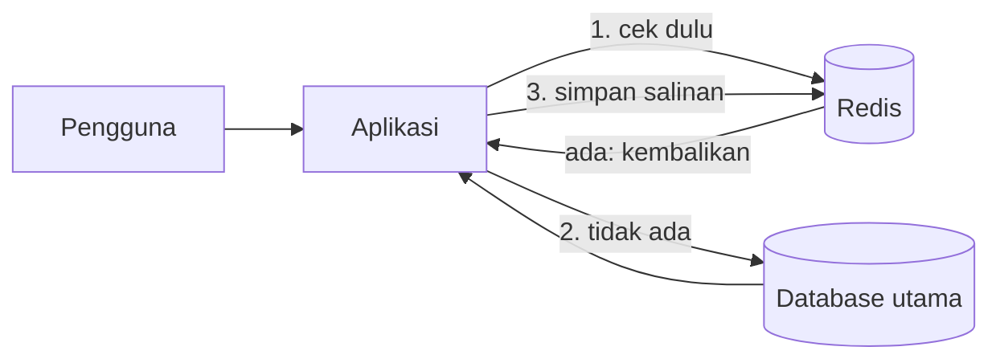

# Apa itu Redis

## Tujuan belajar

Setelah bab ini kamu bisa:

- [ ] Menjelaskan apa itu Redis dengan kata-katamu sendiri.
- [ ] Menjelaskan arti *in-memory* dan kenapa itu membuat Redis cepat.
- [ ] Menyebutkan kegunaan umum Redis dan membedakannya dari database biasa.
- [ ] Mengenali struktur data utama yang ada di Redis.
- [ ] Membaca contoh perintah `redis-cli` yang paling sederhana.

## Prasyarat

- Pernah memakai terminal (membuka dan mengetik perintah).
- Tahu secara garis besar apa itu database dan aplikasi web. Tidak perlu mahir.
- **Belum perlu** menginstal apa pun. Instalasi dibahas di bab berikutnya (Instalasi dengan Docker).

## Konsep: Redis dalam satu kalimat

Redis adalah *in-memory data store*: tempat menyimpan data yang berada di memori (RAM), sehingga baca dan tulisnya sangat cepat. Menurut dokumentasi resmi, Redis dipakai sebagai cache, database (dokumen dan vektor), *streaming engine*, dan *message broker*.[^1]

### Analogi: meja kerja dan lemari arsip

Bayangkan sebuah kantor:

- **Lemari arsip** di gudang menyimpan semua dokumen. Isinya lengkap dan aman, tetapi mengambil dokumen butuh waktu. Ini mirip database di disk, seperti PostgreSQL atau MySQL.
- **Meja kerja** hanya muat beberapa dokumen, tetapi semuanya langsung terjangkau tangan. Ini mirip Redis.

Dokumen yang sering dibuka ditaruh di meja kerja. Akibatnya kamu jarang perlu berjalan ke gudang.

!!! note "Analogi tidak sempurna"
    Redis bukan hanya "meja sementara". Redis bisa menyimpan data ke disk (persistence) dan dipakai sebagai database utama. Persistence dibahas di bab tersendiri pada bagian Operasi.

### Arti *in-memory*

Memori (RAM) jauh lebih cepat diakses daripada disk. Redis menyimpan data kerjanya di memori, sehingga operasinya sangat cepat. Konsekuensinya:

| Hal | Dampak |
|---|---|
| Kecepatan | Sangat cepat karena data ada di RAM |
| Kapasitas | Dibatasi ukuran RAM, yang biasanya lebih kecil dan lebih mahal daripada disk |
| Keawetan data | Perlu pengaturan persistence agar data tidak hilang saat Redis dimatikan |

### Redis menyimpan struktur data, bukan hanya teks

Redis disebut *data structure server*. Di Redis kamu menyimpan nilai dalam bentuk struktur yang sudah disediakan, bukan sekadar baris tabel.[^2] Beberapa yang akan kita pelajari:

| Struktur | Gambaran singkat | Contoh pemakaian |
|---|---|---|
| String | Urutan byte, bisa teks atau angka | Cache halaman, counter |
| Hash | Kumpulan pasangan field dan nilai | Data profil pengguna |
| List | Daftar string berurutan sesuai penyisipan | Antrean tugas |
| Set | Kumpulan string unik tanpa urutan | Tag, daftar pengguna unik |
| Sorted set | Kumpulan unik yang diurutkan berdasarkan skor | Papan peringkat |
| Stream | Log yang hanya bisa ditambah (*append-only*) | Pencatatan event |

Redis juga punya tipe lain (misalnya bitmap, geospatial, JSON, dan time series). Daftar lengkapnya ada di dokumentasi resmi.[^2] Kita mulai dari yang paling dasar.

### Di mana Redis berada dalam aplikasi



Pola ini disebut *caching*. Aplikasi bertanya ke Redis dulu. Jika datanya ada, jawaban cepat. Jika tidak, aplikasi bertanya ke database utama lalu menyimpan salinannya di Redis. Pola ini dibahas penuh di bab Caching.

### Kegunaan umum

Dokumentasi resmi menyebut Redis dipakai sebagai cache, document database, vector database, streaming engine, dan message broker.[^1] Untuk pemula, empat kegunaan pertama ini yang paling sering ditemui:

1. **Cache**: menyimpan hasil yang mahal dihitung atau diambil.
2. **Session dan counter**: misalnya sesi login atau penghitung jumlah permintaan.
3. **Antrean dan pesan**: mengirim tugas atau pesan antarbagian aplikasi.
4. **Pencatatan event**: merekam kejadian berurutan dengan Streams.

## Praktik langkah demi langkah

Kita belum menjalankan Redis, jadi bagian ini fokus membaca. Tujuannya agar kamu mengenali bentuk perintah sebelum mengetiknya sendiri.

### Langkah 1: Baca contoh perintah

Contoh berikut ditulis untuk lingkungan **redis-cli**. Ini hanya contoh bacaan. Kamu akan menjalankannya sendiri di bab Instalasi dan bab `redis-cli` pertama.

```text title="redis-cli (contoh bacaan, jangan dijalankan dulu)"
127.0.0.1:6379> PING
PONG
127.0.0.1:6379> SET nama "Budi"
OK
127.0.0.1:6379> GET nama
"Budi"
```

### Langkah 2: Pahami setiap baris

| Bagian | Penjelasan |
|---|---|
| `127.0.0.1:6379>` | Prompt `redis-cli`. Artinya terhubung ke Redis di komputer sendiri (`127.0.0.1`) lewat port `6379`, port bawaan Redis. Bukan bagian yang diketik. |
| `PING` | Menanyakan "apakah server hidup?". Dipakai pertama kali untuk memastikan koneksi berhasil. |
| `PONG` | Balasan server bahwa ia hidup. |
| `SET nama "Budi"` | Menyimpan nilai `"Budi"` pada key `nama`. Key adalah nama untuk menemukan data kembali. |
| `OK` | Server mengonfirmasi data tersimpan. |
| `GET nama` | Mengambil nilai milik key `nama`. Tanpa `GET`, kamu tidak bisa membuktikan data tersimpan. |
| `"Budi"` | Nilai yang dikembalikan. Tanda kutip adalah cara `redis-cli` menampilkan string. |

### Langkah 3: Interpretasi

Alurnya selalu sama: kamu mengirim **perintah**, server mengirim **balasan**. Pola "key menunjuk ke nilai" adalah dasar seluruh Redis. Struktur data lain hanya mengganti bentuk nilainya.

!!! info "Output di atas belum diverifikasi di sini"
    Blok di atas adalah output yang diharapkan berdasarkan dokumentasi, bukan hasil eksekusi di komputermu. Pada bab praktik, kita jalankan dan bandingkan hasilnya.

## Kesalahan umum dan salah paham

??? question "“Redis hanya untuk cache.”"
    Tidak. Cache adalah kegunaan paling populer, tetapi Redis juga dipakai sebagai message broker, streaming engine, dan database.[^1]

??? question "“Data Redis pasti hilang kalau dimatikan.”"
    Tidak selalu. Redis punya beberapa tingkat persistence ke disk.[^1] Yang benar: tanpa pengaturan yang tepat, kamu bisa kehilangan data. Detailnya ada di bab Persistence.

??? question "“Redis sama dengan database SQL yang lebih cepat.”"
    Bukan. Redis menyimpan struktur data dengan operasi khusus untuk tiap struktur. Cara memodelkan data berbeda dari tabel dan relasi SQL.

??? question "“Semua data aplikasi sebaiknya masuk Redis.”"
    Tidak. Kapasitas dibatasi RAM. Simpan di Redis data yang butuh akses cepat, dan pertimbangkan database utama untuk sisanya.

!!! warning "Data sensitif"
    Jangan menaruh data rahasia di Redis tanpa pengamanan. Keamanan dibahas di bab tersendiri. Pada contoh materi ini, nilai rahasia selalu memakai placeholder.

## Troubleshooting

Bab ini tidak menjalankan perangkat lunak, jadi tidak ada galat teknis. Jika sesuatu terasa membingungkan:

| Masalah | Yang bisa dilakukan |
|---|---|
| Bingung beda Redis dan database biasa | Baca ulang analogi meja kerja dan lemari arsip, lalu kerjakan Latihan 2 |
| Istilah *in-memory* terasa abstrak | Lihat tabel "Arti in-memory", lalu kerjakan Latihan 1 |
| Tidak yakin perintah di contoh | Baca Langkah 2 baris demi baris |

## Latihan

1. Dengan kalimatmu sendiri, jelaskan kenapa data di RAM bisa diakses lebih cepat daripada di disk, dan apa kekurangannya.
2. Tulis tiga contoh data di aplikasi toko online. Untuk tiap data, tentukan lebih cocok di Redis atau di database utama, lalu beri alasan.
3. Dari contoh `redis-cli` tadi, jelaskan apa yang terjadi jika `GET nama` dijalankan sebelum `SET nama "Budi"`. Tulis tebakanmu, lalu uji di bab praktik berikutnya.

??? success "Petunjuk"
    1. Pikirkan jarak "meja kerja" versus "gudang arsip". Kekurangannya terkait kapasitas dan keawetan.
    2. Data yang sering dibaca dan boleh dibangun ulang cocok untuk Redis. Data yang harus tahan lama dan lengkap cocok untuk database utama.
    3. Key yang belum ada punya jawaban khusus. Jangan menyimpulkan sebelum mencobanya.

## Ringkasan

- Redis adalah *in-memory data store*: data kerjanya ada di memori sehingga sangat cepat.
- Redis dipakai sebagai cache, database, streaming engine, dan message broker.
- Redis menyimpan struktur data (string, hash, list, set, sorted set, stream, dan lainnya), bukan hanya teks.
- Semua interaksi berpola: kirim perintah, terima balasan. Key menunjuk ke nilai.
- Karena memakai RAM, kapasitas dan keawetan data perlu dipertimbangkan.

Berikutnya: [Instalasi dengan Docker](instalasi-dengan-docker.md).

## Referensi resmi

[^1]: Redis Open Source, *Get started*: <https://redis.io/docs/latest/get-started/>
[^2]: Redis, *Redis data types*: <https://redis.io/docs/latest/develop/data-types/>

Bacaan tambahan dari dokumentasi resmi: [Redis data types](https://redis.io/docs/latest/develop/data-types/) dan [Install Redis on Docker](https://redis.io/docs/latest/operate/oss_and_stack/install/install-stack/docker).
