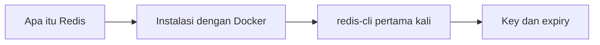

# Pengenalan

Bagian ini membawamu dari nol sampai bisa menjalankan Redis sendiri dan memakai perintah dasarnya. Tidak perlu pengalaman dengan Redis sebelumnya.

## Tujuan bagian

Setelah menyelesaikan bagian ini kamu bisa:

- [ ] Menjelaskan apa itu Redis dan kapan dipakai.
- [ ] Menjalankan Redis di Docker dan memastikan ia hidup.
- [ ] Memakai `redis-cli` untuk menyimpan dan mengambil data.
- [ ] Menamai key dengan rapi, memberi masa hidup, dan menelusuri key dengan aman.

## Prasyarat

- Bisa membuka terminal dan menjalankan perintah.
- Docker terpasang (dibutuhkan mulai bab Instalasi dengan Docker).
- Pengetahuan dasar tentang database dan aplikasi web membantu, tetapi tidak wajib.

## Daftar bab

Kerjakan berurutan; setiap bab memakai hasil bab sebelumnya.

| Urutan | Bab | Yang dipelajari |
|---|---|---|
| 1 | [Apa itu Redis](apa-itu-redis.md) | Konsep, arti *in-memory*, kegunaan, dan struktur data |
| 2 | [Instalasi dengan Docker](instalasi-dengan-docker.md) | Menjalankan, memeriksa, dan menghentikan container Redis |
| 3 | [Menjalankan redis-cli pertama kali](menjalankan-redis-cli-pertama-kali.md) | `PING`, `SET`, `GET`, `HELP`, dan membaca balasan |
| 4 | [Key dan expiry](key-dan-expiry.md) | Penamaan key, `EXPIRE`, `TTL`, `SCAN` |

## Setelah bagian ini

Lanjut ke bagian Struktur Data, yang dimulai dari String. Bagian itu belum ditulis.

!!! info "Tentang output di bab"
    Output berlabel *terverifikasi* dijalankan di Redis 8.10.3 (`redis:latest`) pada 2026-10-27. Nilai seperti TTL dan ID bisa berbeda; bandingkan dengan hasil di komputermu.
