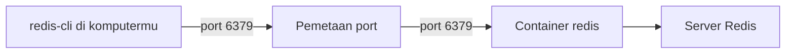

# Instalasi dengan Docker

## Tujuan belajar

Setelah bab ini kamu bisa:

- [ ] Menjelaskan apa itu image, container, dan pemetaan port.
- [ ] Menjalankan server Redis di Docker dengan satu perintah.
- [ ] Memeriksa bahwa container Redis berjalan.
- [ ] Menghentikan, menjalankan ulang, dan menghapus container Redis dengan sadar akan risikonya.

## Prasyarat

- Sudah membaca [Apa itu Redis](apa-itu-redis.md).
- Docker terpasang dan **sedang berjalan**. Panduan instalasi untuk Linux, macOS, dan Windows ada di dokumentasi resmi (lihat referensi).[^1]
- Di Windows, Docker harus dalam mode **Linux containers**.[^1]
- Pengguna terminal dasar: membuka terminal dan menjalankan perintah.

## Konsep

### Kenapa Docker?

Menginstal Redis langsung ke sistem operasi berbeda di tiap platform. Dengan Docker, Redis berjalan di dalam lingkungan terisolasi yang sama di mana pun. Kamu tidak mengotori sistem, dan bisa menghapusnya dengan bersih.

### Tiga istilah

| Istilah | Analogi | Arti |
|---|---|---|
| **Image** | Resep kue beserta bahan jadinya | Paket berisi Redis yang siap dijalankan. Namanya `redis`. |
| **Container** | Kue yang sedang dibuat dari resep itu | Hasil menjalankan image. Dari satu image kamu bisa membuat banyak container. |
| **Port mapping** | Nomor ekstensi telepon kantor | Menghubungkan port di komputermu ke port di dalam container. |

Redis di dalam container mendengarkan di port `6379` (port bawaan Redis). Container itu terisolasi, jadi kamu harus "membuka pintu" dengan pemetaan port agar program di komputermu bisa menjangkaunya.



## Praktik langkah demi langkah

### Langkah 1: Pastikan Docker hidup

**Lingkungan: terminal**

```bash
docker --version
docker info
```

- `docker --version` hanya mengecek program Docker terpasang.
- `docker info` menghubungi *daemon* Docker. Kita pakai ini karena perintah ini gagal jika Docker belum dijalankan, sehingga masalah ketahuan sejak awal.

Jika `docker info` menampilkan keterangan *Client* dan *Server*, lanjut. Jika tampil galat, lihat bagian Troubleshooting.

### Langkah 2: Jalankan Redis

**Lingkungan: terminal**

```bash
docker run -d --name redis -p 6379:6379 redis:latest
```

Ini adalah perintah dari dokumentasi resmi, dengan `<version>` diganti `latest`.[^1]

| Bagian | Fungsi dan alasan |
|---|---|
| `docker run` | Membuat container baru dari sebuah image lalu menjalankannya. |
| `-d` | *Detached*: container berjalan di latar belakang. Tanpa ini, terminalmu terkunci oleh log server. |
| `--name redis` | Memberi nama `redis`. Nama ini kita pakai di perintah berikutnya, sehingga tidak perlu mengetik ID acak. |
| `-p 6379:6379` | Format `port-komputer:port-container`. Tanpa ini, `redis-cli` dari komputermu tidak bisa terhubung. |
| `redis:latest` | Image `redis` dengan tag `latest`. Docker mengunduhnya otomatis jika belum ada. |

!!! tip "Versi tetap untuk produksi"
    `latest` praktis untuk belajar. Untuk proyek sungguhan, pilih tag versi tertentu dari [halaman Redis di Docker Hub](https://hub.docker.com/_/redis) supaya lingkunganmu bisa diulang dengan hasil yang sama.

!!! warning "Siapa yang bisa menjangkau Redis-mu"
    `-p 6379:6379` membuka port di semua antarmuka jaringan komputer. Untuk belajar di laptop, lebih aman membatasinya ke komputer sendiri dengan `-p 127.0.0.1:6379:6379`. Pembahasan keamanan lengkap ada di bab Keamanan.

**Output terverifikasi:** Docker mengunduh image (hanya pertama kali) lalu mencetak satu baris ID container panjang, misalnya `3f9c1a...` (nilainya berbeda di tiap komputer).

### Langkah 3: Periksa container berjalan

**Lingkungan: terminal**

```bash
docker ps
```

`docker ps` menampilkan container yang sedang berjalan. Kita periksa karena `docker run -d` tidak memberi tahu apakah server benar-benar hidup.

**Output terverifikasi:** ada satu baris dengan nama `redis`, image `redis:latest`, status `Up ...`, dan kolom port berisi pemetaan `6379->6379/tcp`.

Catat juga versi Redis yang kamu pakai, karena sebagian perintah bergantung pada versi:

```bash
docker exec redis redis-server --version
```

`redis-server --version` mencetak versi server di dalam container. **Terverifikasi:** satu baris yang memuat nomor versi (nilainya tergantung image yang terunduh).

### Langkah 4: Lihat log server

**Lingkungan: terminal**

```bash
docker logs redis
```

Log membuktikan server sudah siap. Cari baris yang menyatakan server siap menerima koneksi (kalimat persisnya dapat berbeda antarversi Redis).

### Langkah 5: Uji koneksi

**Lingkungan: terminal**

```bash
docker exec -it redis redis-cli
```

| Bagian | Fungsi |
|---|---|
| `docker exec` | Menjalankan perintah di dalam container yang sudah berjalan. |
| `-it` | Membuat sesi interaktif (`-i`) dengan terminal (`-t`). Tanpa ini, kamu tidak bisa mengetik. |
| `redis` | Nama container dari Langkah 2. |
| `redis-cli` | Program klien Redis yang sudah ada di dalam image, jadi tidak perlu dipasang di komputermu.[^1] |

Di prompt, ketik `PING`.

**Output terverifikasi:**

```text
127.0.0.1:6379> PING
PONG
```

`PONG` berarti server hidup. Keluar dengan mengetik `exit`. Pemakaian `redis-cli` dibahas di bab berikutnya: [Menjalankan redis-cli pertama kali](menjalankan-redis-cli-pertama-kali.md).

### Langkah 6: Mengelola container

**Lingkungan: terminal**

```bash
docker stop redis     # menghentikan
docker start redis    # menjalankan lagi
docker rm redis       # menghapus (harus dalam keadaan berhenti)
```

!!! danger "Risiko kehilangan data"
    Data Redis di container ini hidup di dalam container. Setelah `docker rm redis`, **data ikut hilang**, kecuali kamu memasang volume. Opsi penyimpanan lokal ada di dokumentasi resmi:[^1] `-v /local-data/:/data`. Persistence dibahas penuh di bab Persistence.

Gunakan `docker stop` lalu `docker start` untuk istirahat tanpa menghapus. Gunakan `docker rm` hanya jika kamu ingin membuat ulang dari awal.

## Memakai `redis-cli` yang sudah terpasang di komputer

Jika kamu sudah punya `redis-cli` di komputer, kamu bisa terhubung langsung lewat port yang dipetakan:[^1]

```bash
redis-cli -h 127.0.0.1 -p 6379
```

`-h` adalah host dan `-p` adalah port. Keduanya adalah nilai bawaan `redis-cli`, jadi `redis-cli` saja sudah cukup.[^2]

## Troubleshooting

| Gejala | Penyebab dan solusi |
|---|---|
| `failed to connect to the docker API ... The system cannot find the file specified` | Daemon Docker belum berjalan. Buka Docker Desktop, tunggu sampai siap, ulangi `docker info`. Pesan ini muncul ketika Docker Desktop belum dihidupkan. |
| `container name "/redis" is already in use` | Container bernama `redis` sudah ada. Pakai `docker start redis`, atau hapus dengan `docker rm redis` bila datanya tidak dibutuhkan. |
| `port is already allocated` atau `address already in use` | Port 6379 dipakai program lain (misalnya Redis lain). Hentikan program itu, atau pakai port lain: `-p 6380:6379`, lalu sambung dengan `-p 6380` di `redis-cli`. |
| `docker ps` tidak menampilkan `redis` | Container sudah berhenti. Cek `docker ps -a`, lalu `docker logs redis` untuk melihat sebabnya. |
| `Could not connect to Redis at 127.0.0.1:6379: Connection refused` | Container belum berjalan atau port tidak dipetakan. Cek `docker ps`. |
| Di Windows, error terkait image/platform | Pastikan Docker memakai **Linux containers**.[^1] |

!!! note "Status verifikasi"
    Perintah, nilai balik, dan skrip di bab ini dijalankan di Redis 8.10.3 (`redis:latest`) pada 2026-10-27, dengan Python 3.12.3 dan redis-py 8.1.0. Sintaks juga dicocokkan dengan dokumentasi resmi Redis. Nilai yang berubah tiap eksekusi (ID, TTL, waktu, urutan, alamat IP) bisa berbeda di komputermu, dan teks galat bisa berbeda antarversi. Tampilan prompt interaktif `redis-cli` (prompt, Tab, riwayat) tidak teramati karena pengujian berjalan tanpa terminal interaktif.

## Latihan

1. Jalankan Redis dengan perintah Langkah 2, lalu buktikan ia hidup lewat `docker ps` dan `PING`.
2. Hentikan container, lalu coba `docker exec -it redis redis-cli`. Apa yang terjadi, dan kenapa?
3. Hapus container, lalu buat lagi dengan pemetaan port ke `6380` sebagai ganti `6379`. Bagaimana kamu terhubung kali ini?
4. Jelaskan dengan kata-katamu: apa beda `docker stop` dan `docker rm`, dan mana yang berisiko menghapus data?

??? success "Petunjuk"
    2. Container yang berhenti tidak punya proses yang bisa dijalankan perintahnya.
    3. Port komputer ada di sebelah kiri tanda titik dua. Sesuaikan `-p` pada `redis-cli`.

## Ringkasan

- Image adalah paket Redis, container adalah hasil menjalankannya, `-p` menghubungkan port komputer ke port container.
- `docker run -d --name redis -p 6379:6379 redis:latest` menjalankan Redis di latar belakang.
- `docker exec -it redis redis-cli` membuka klien Redis di dalam container.
- `docker stop` dan `docker start` aman. `docker rm` menghapus container beserta datanya jika tanpa volume.
- Batasi port ke `127.0.0.1` saat belajar, dan jangan menaruh data penting tanpa persistence.

Berikutnya: [Menjalankan redis-cli pertama kali](menjalankan-redis-cli-pertama-kali.md).

## Referensi resmi

[^1]: Redis, *Run Redis Open Source on Docker*: <https://redis.io/docs/latest/operate/oss_and_stack/install/install-stack/docker/>
[^2]: Redis, *Redis CLI*: <https://redis.io/docs/latest/develop/tools/cli/>

Bacaan tambahan: [Redis di Docker Hub](https://hub.docker.com/_/redis).
