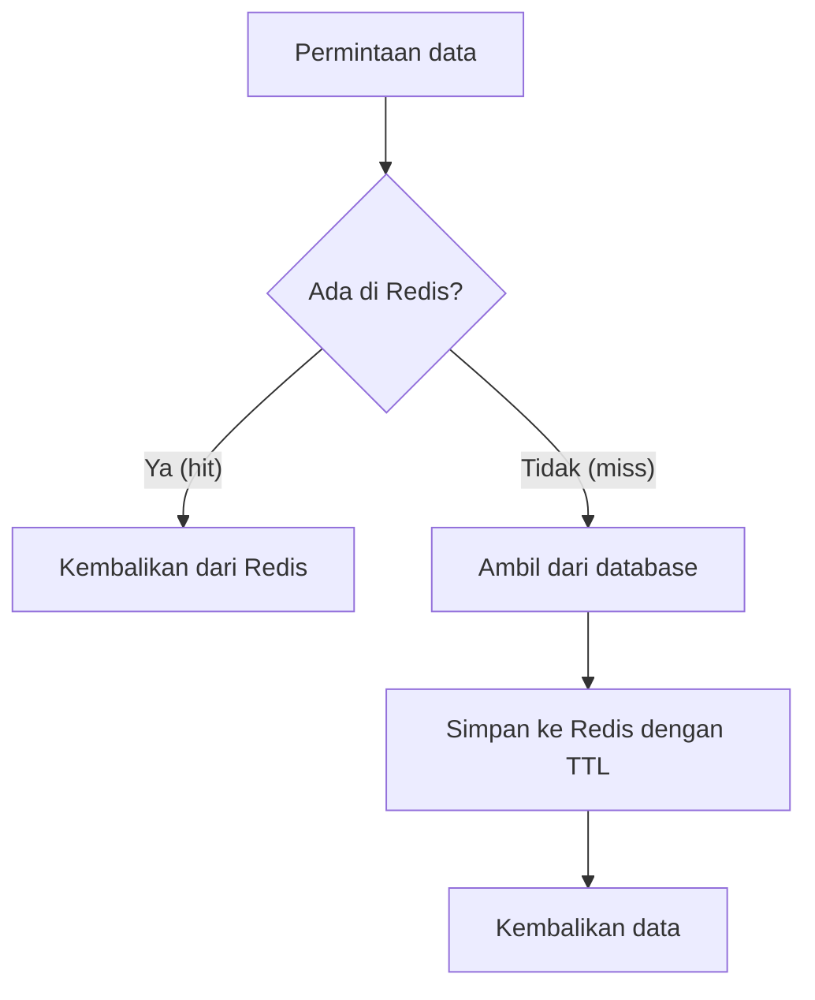

# Caching

## Tujuan belajar

Setelah bab ini kamu bisa:

- [ ] Menjelaskan apa itu cache dan kenapa Redis cocok dipakai sebagai cache.
- [ ] Menerapkan pola *cache-aside* secara manual di `redis-cli` dan lewat kode Python.
- [ ] Memilih TTL untuk data cache dan menjelaskan akibat TTL yang terlalu pendek atau terlalu panjang.
- [ ] Menghapus (*invalidasi*) cache saat data sumber berubah.
- [ ] Menjelaskan eviction, memeriksa `maxmemory` dan `maxmemory-policy`, serta membaca *hit* dan *miss* dari `INFO stats`.

## Prasyarat

- Sudah membaca [Key dan expiry](../pengenalan/key-dan-expiry.md), terutama `SET ... EX`, `TTL`, dan `DEL`. Bab ini tidak mengulang cara kerjanya.
- Sudah membaca [String](../struktur-data/string.md), karena data cache di bab ini disimpan sebagai String (teks JSON).
- Container Redis berjalan dan kamu bisa masuk dengan `docker exec -it redis redis-cli` (lihat [Instalasi dengan Docker](../pengenalan/instalasi-dengan-docker.md)).
- Versi Redis: perintah di bab ini tersedia di Redis yang kamu pasang lewat `redis:latest`. Kebijakan eviction `allkeys-lfu` dan `volatile-lfu` tersedia sejak Redis 4.0.[^3]
- Kondisi awal: tidak ada key berawalan `cache:` yang kamu perlukan.
- Untuk contoh Python: Python 3 dan paket `redis` (`pip install redis`).

## Konsep

**Cache** adalah salinan data yang disimpan di tempat yang lebih cepat daripada sumber aslinya. Sumber aslinya biasanya database atau layanan lain yang lambat atau mahal dipanggil. Redis menyimpan datanya di memori, jadi membaca satu key biasanya jauh lebih cepat daripada menjalankan kueri database.[^1]

Kenapa dibutuhkan: banyak permintaan meminta data yang sama berulang kali, misalnya detail satu produk. Tanpa cache, setiap permintaan membebani database. Dengan cache, hanya permintaan pertama yang lambat; sisanya dilayani dari memori.

### Pola cache-aside

Ada beberapa pola cache. Yang paling umum dan paling mudah untuk pemula adalah **cache-aside** (disebut juga *lazy loading*). Aplikasi sendiri yang mengelola cache:[^1]

1. Aplikasi mencari data di Redis.
2. Jika ada (**hit**), pakai langsung.
3. Jika tidak ada (**miss**), ambil dari database, simpan ke Redis **dengan TTL**, lalu kembalikan.
4. Saat data di database berubah, **hapus** key cache-nya (invalidasi) agar permintaan berikutnya mengambil data baru.

### Analogi

Bayangkan kamu sering ditanya teman soal jadwal kereta. Pertama kali kamu membuka aplikasi untuk mencari jawabannya (database), lalu menulisnya di sticky note di meja (cache). Pertanyaan berikutnya cukup dijawab dari sticky note. Kalau jadwal berubah, kamu membuang sticky note lama supaya tidak memberi jawaban basi.

!!! note "Batas analogi"
    Sticky note tidak otomatis kedaluwarsa, sedangkan cache Redis bisa diberi TTL. Redis juga bisa membuang data sendiri bila memori penuh (eviction), sesuatu yang tidak dilakukan sticky note.

## Cara kerja



| Istilah | Arti |
|---|---|
| Hit / miss | Data ditemukan / tidak ditemukan di cache |
| TTL | Masa hidup key cache (lihat [Key dan expiry](../pengenalan/key-dan-expiry.md)) |
| Invalidasi | Menghapus atau memperbarui cache saat data sumber berubah |
| Eviction | Redis membuang key sendiri saat memori mencapai batas `maxmemory`[^3] |
| Hit ratio | `hit / (hit + miss)`; makin tinggi, makin efektif cache |

### Memilih TTL

TTL adalah kompromi antara kesegaran data dan beban database:

| TTL | Keuntungan | Risiko |
|---|---|---|
| Pendek (detik hingga menit) | Data cepat segar | Banyak miss, database tetap sering dipanggil |
| Panjang (jam hingga hari) | Hit ratio tinggi | Data basi lebih lama jika invalidasi terlewat |

TTL juga berfungsi sebagai **jaring pengaman**: jika kode invalidasimu lupa dijalankan, data basi tetap hilang saat TTL habis. Itu sebabnya cache-aside hampir selalu memakai TTL.

### Eviction: saat memori penuh

Memori server terbatas. Konfigurasi `maxmemory` menentukan batas pemakaian memori data, dan `maxmemory-policy` menentukan apa yang terjadi saat batas tercapai.[^3] Nilai `maxmemory` 0 berarti tanpa batas pada sistem 64-bit. Kebijakan yang umum:[^3]

| Kebijakan | Perilaku |
|---|---|
| `noeviction` | Tidak membuang apa pun; perintah yang menambah data ditolak dengan galat |
| `allkeys-lru` | Membuang key yang paling lama tidak dipakai, dari semua key |
| `allkeys-lfu` | Membuang key yang paling jarang dipakai, dari semua key |
| `volatile-lru` / `volatile-lfu` / `volatile-ttl` | Hanya membuang key yang punya expiry |
| `allkeys-random` / `volatile-random` | Membuang key acak |

Untuk cache murni, `allkeys-lru` adalah titik awal yang umum karena key cache boleh dibuang kapan saja. Kebijakan `volatile-*` hanya cocok bila kamu mencampur data cache (ber-TTL) dengan data penting tanpa TTL di Redis yang sama.[^3]

!!! warning "Cache bukan penyimpanan utama"
    Key cache bisa hilang kapan saja karena TTL, eviction, atau restart. Aplikasi harus selalu bisa membangun ulang data dari sumber aslinya. Jangan menyimpan satu-satunya salinan data penting sebagai cache.

## Praktik langkah demi langkah

Output di bawah adalah output **terverifikasi**: dijalankan di Redis 8.10.3 pada 2026-10-27. Hasilmu bisa berbeda pada nilai yang berubah tiap eksekusi. Bandingkan dengan hasilmu sendiri.

**Lingkungan: terminal**

```bash
docker exec -it redis redis-cli
```

Langkah 1 sampai 5 di **redis-cli**. Di sini kamu berperan sebagai aplikasi: mengerjakan sendiri langkah cache-aside yang nanti diotomatiskan oleh kode.

### Langkah 1: Cek cache, ternyata miss

```text
127.0.0.1:6379> GET cache:produk:1
```

Kenapa langkah ini diperlukan: cache-aside selalu mulai dengan bertanya ke Redis. **Terverifikasi:** `(nil)`. Artinya miss, jadi aplikasi harus mengambil data dari database.

### Langkah 2: Isi cache dengan TTL

Anggap database mengembalikan data produk berikut. Kita simpan sebagai teks JSON:

```text
127.0.0.1:6379> SET cache:produk:1 '{"nama":"Kopi","harga":25000}' EX 60
127.0.0.1:6379> TTL cache:produk:1
```

| Bagian | Fungsi dan alasan |
|---|---|
| `cache:produk:1` | Skema `jenis:objek:id`; awalan `cache:` memisahkan key cache dari data lain agar mudah dikenali dan dibersihkan. |
| `'{"nama":"Kopi","harga":25000}'` | Nilai berupa JSON di dalam tanda kutip tunggal agar tanda kutip ganda di dalamnya tidak bentrok. |
| `EX 60` | Expiry 60 detik, diatur dalam perintah yang sama sehingga key tidak sempat hidup tanpa TTL.[^2] |

**Terverifikasi:** `OK`, lalu angka sekitar `60`.

### Langkah 3: Baca lagi, sekarang hit

```text
127.0.0.1:6379> GET cache:produk:1
```

**Terverifikasi:** `"{\"nama\":\"Kopi\",\"harga\":25000}"`. Redis menampilkan tanda kutip ganda di dalam nilai dengan garis miring terbalik; isi aslinya tetap JSON biasa. Kali ini aplikasi tidak perlu ke database.

### Langkah 4: Invalidasi saat data berubah

Misalkan harga di database berubah. Hapus cache agar tidak menyajikan harga lama:

```text
127.0.0.1:6379> DEL cache:produk:1
127.0.0.1:6379> GET cache:produk:1
```

**Terverifikasi:** `(integer) 1`, lalu `(nil)`. Permintaan berikutnya akan miss dan memuat data baru dari database.

Kenapa `DEL` dan bukan menulis nilai baru: menghapus lebih sederhana dan aman. Jika kamu menulis ulang cache dari dua tempat, urutan yang salah bisa menyisakan nilai lama. Dengan `DEL`, data baru selalu dimuat dari sumber yang benar.

!!! danger "`DEL` tidak bisa dibatalkan"
    Pastikan hanya menghapus key cache (berawalan `cache:`). Jangan menghapus key data penting dengan pola yang sama.

### Langkah 5: Baca statistik hit dan miss

```text
127.0.0.1:6379> INFO stats
```

`INFO stats` mencetak banyak baris. Cari tiga baris ini:[^5]

| Baris | Arti |
|---|---|
| `keyspace_hits` | Jumlah pembacaan key yang ditemukan |
| `keyspace_misses` | Jumlah pembacaan key yang tidak ditemukan |
| `evicted_keys` | Jumlah key yang dibuang karena `maxmemory` |

**Terverifikasi:** ketiganya berupa angka. Nilainya bergantung pada aktivitas Redis-mu sejak dijalankan, jadi tidak ada angka pasti. Setelah Langkah 1 sampai 4, `keyspace_misses` bertambah minimal 2 (Langkah 1 dan akhir Langkah 4) dan `keyspace_hits` bertambah minimal 1 (Langkah 3). Hit ratio dihitung `hits / (hits + misses)`.

### Langkah 6: Lihat pengaturan eviction

```text
127.0.0.1:6379> CONFIG GET maxmemory
127.0.0.1:6379> CONFIG GET maxmemory-policy
```

**Terverifikasi** pada Redis dari Docker tanpa konfigurasi tambahan (bisa berbeda bila image dikonfigurasi lain):

```text
1) "maxmemory"
2) "0"
1) "maxmemory-policy"
2) "noeviction"
```

Cara membaca output: `maxmemory` `0` berarti tidak ada batas, jadi eviction tidak pernah terjadi. Nilai `noeviction` baru terasa bila batas diatur.[^3]

### Langkah 7 (opsional): Mencoba eviction

Langkah ini mengubah konfigurasi server sementara. Lakukan hanya di container latihan, dan **selalu jalankan Langkah 8 untuk mengembalikannya**.

Pertama, lihat memori yang sedang terpakai:

```text
127.0.0.1:6379> INFO memory
```

Cari `used_memory_human`. Pilih batas yang sedikit di atasnya, misalnya `used_memory` + 3 MB. Contoh bila pemakaian sekitar 1 MB:

```text
127.0.0.1:6379> CONFIG SET maxmemory 4mb
127.0.0.1:6379> CONFIG SET maxmemory-policy allkeys-lru
```

Kenapa dua perintah: yang pertama memasang batas kecil agar eviction mudah terlihat; yang kedua membuat Redis membuang key lama alih-alih menolak penulisan. **Terverifikasi:** `OK` untuk keduanya.[^4]

Sekarang isi Redis melebihi batas. Keluar dari `redis-cli` (`exit`), lalu jalankan skrip berikut di terminal:

**Lingkungan: Python** · Kebutuhan: Python 3 dan paket `redis`.

```python title="isi_cache.py"
import redis

r = redis.Redis(host="localhost", port=6379, decode_responses=True)

nilai = "x" * 1024  # sekitar 1 KB per key

for i in range(8000):
    r.set(f"cache:uji:{i}", nilai)

print("jumlah key cache:uji:*  :", sum(1 for _ in r.scan_iter("cache:uji:*")))
print("evicted_keys           :", r.info("stats")["evicted_keys"])

for kunci in r.scan_iter("cache:uji:*"):
    r.delete(kunci)
```

Penjelasan baris penting:

| Baris | Penjelasan |
|---|---|
| `"x" * 1024` | Membuat String sekitar 1 KB agar memori cepat terisi. |
| `for i in range(8000)` | Menulis sekitar 8 MB data, lebih besar dari batas 4 MB. |
| `r.set(f"cache:uji:{i}", nilai)` | Menulis tanpa TTL; yang menyingkirkan key lama adalah eviction. |
| `r.scan_iter("cache:uji:*")` | Menghitung key yang tersisa dengan `SCAN` (aman, tidak memblokir seperti `KEYS`). |
| `r.info("stats")["evicted_keys"]` | Membaca jumlah key yang dibuang. |
| `for kunci in r.scan_iter(...): r.delete(kunci)` | Membersihkan key uji yang tersisa agar memori tidak terpakai terus. Hanya menghapus key berawalan `cache:uji:`. |

Cara menjalankan: `python isi_cache.py`.

**Terverifikasi:** jumlah key yang tersisa **kurang dari 8000** dan `evicted_keys` lebih dari 0. Angka persisnya tidak bisa diprediksi karena bergantung pada memori dasar Redis dan algoritma pengambilan sampel.[^3]

Jika memakai `noeviction`, penulisan akan gagal dengan galat `OOM command not allowed when used memory > 'maxmemory'`. Itu perilaku yang benar untuk kebijakan tersebut.

### Langkah 8: Kembalikan konfigurasi dan bersihkan

```text
127.0.0.1:6379> CONFIG SET maxmemory 0
127.0.0.1:6379> CONFIG SET maxmemory-policy noeviction
127.0.0.1:6379> SCAN 0 MATCH cache:uji:* COUNT 100
```

`maxmemory 0` menghapus batas, dan `noeviction` adalah nilai bawaan. Skrip `isi_cache.py` sudah menghapus key uji di akhir, jadi `SCAN` di atas hanya memastikan tidak ada yang tersisa. **Terverifikasi:** kursor `"0"` dan daftar kosong. Jika skrip berhenti di tengah dan masih ada sisa, hapus key uji satu per satu, atau buat ulang container latihan (lihat [Instalasi dengan Docker](../pengenalan/instalasi-dengan-docker.md)).

!!! danger "Risiko kehilangan data"
    Kebijakan eviction membuang key tanpa bertanya. Jangan memasang `allkeys-lru` pada Redis yang menyimpan data penting tanpa cadangan. `CONFIG SET` hanya berlaku sampai server di-restart atau container dibuat ulang, kecuali disimpan ke file konfigurasi.[^4]

## Contoh lengkap

Contoh ini menerapkan cache-aside end-to-end. "Database" disimulasikan dengan fungsi yang sengaja lambat (1 detik), supaya selisih hit dan miss terlihat.

**Lingkungan: Python** · Kebutuhan: Python 3, paket `redis` (`pip install redis`), dan Redis berjalan di `localhost:6379`.

```python title="cache_aside.py"
import json
import time

import redis

r = redis.Redis(host="localhost", port=6379, decode_responses=True)

TTL_DETIK = 60
DB = {1: {"nama": "Kopi", "harga": 25000}}  # pura-pura database


def ambil_dari_db(produk_id):
    time.sleep(1)  # simulasi kueri lambat
    return DB.get(produk_id)


def kunci_cache(produk_id):
    return f"cache:produk:{produk_id}"


def get_produk(produk_id):
    kunci = kunci_cache(produk_id)
    tersimpan = r.get(kunci)
    if tersimpan is not None:
        return json.loads(tersimpan), "HIT"

    data = ambil_dari_db(produk_id)
    if data is not None:
        r.set(kunci, json.dumps(data), ex=TTL_DETIK)
    return data, "MISS"


def ubah_harga(produk_id, harga_baru):
    DB[produk_id]["harga"] = harga_baru
    r.delete(kunci_cache(produk_id))  # invalidasi


def tampilkan(produk_id):
    mulai = time.perf_counter()
    data, status = get_produk(produk_id)
    lama = time.perf_counter() - mulai
    print(f"{status:4} {lama:.3f} dtk  {data}")


r.delete(kunci_cache(1))  # mulai dari cache kosong

tampilkan(1)  # miss
tampilkan(1)  # hit
ubah_harga(1, 30000)
tampilkan(1)  # miss, data baru
tampilkan(1)  # hit

r.delete(kunci_cache(1))
```

Penjelasan baris penting:

| Baris | Penjelasan |
|---|---|
| `r.get(kunci)` lalu `is not None` | Langkah "cek cache". Memakai `is not None`, bukan `if tersimpan`, supaya nilai kosong tidak salah dibaca sebagai miss. |
| `json.loads` / `json.dumps` | Redis menyimpan String, jadi dict Python diubah ke teks JSON saat disimpan dan dikembalikan saat dibaca. |
| `r.set(kunci, ..., ex=TTL_DETIK)` | Menyimpan hasil database dengan TTL, sama seperti `SET ... EX` di redis-cli. |
| `if data is not None` | Tidak menyimpan hasil kosong; lihat catatan tentang *negative caching* di troubleshooting. |
| `r.delete(kunci_cache(produk_id))` di `ubah_harga` | Invalidasi: cache dibuang setiap data sumber berubah. |
| `time.perf_counter()` | Mengukur waktu untuk membandingkan hit dan miss. |
| `r.delete(...)` di awal dan akhir | Memastikan contoh mulai dan berakhir dengan cache bersih; menghapus key itu. |

Cara menjalankan: `python cache_aside.py`.

**Terverifikasi** (waktu perkiraan, bisa berbeda di komputermu):

```text
MISS 1.00x dtk  {'nama': 'Kopi', 'harga': 25000}
HIT  0.00x dtk  {'nama': 'Kopi', 'harga': 25000}
MISS 1.00x dtk  {'nama': 'Kopi', 'harga': 30000}
HIT  0.00x dtk  {'nama': 'Kopi', 'harga': 30000}
```

Cara membaca output: miss pertama lambat (sekitar 1 detik karena "database"). Hit kedua nyaris seketika. Setelah harga diubah dan cache dihapus, miss berikutnya mengambil harga baru, lalu hit lagi.

## Kesalahan umum dan troubleshooting

| Gejala | Penyebab dan solusi |
|---|---|
| Aplikasi menampilkan data lama setelah data diubah | Cache tidak diinvalidasi. Pastikan setiap jalur yang mengubah data juga menghapus key cache, dan tetap pakai TTL sebagai jaring pengaman. |
| Hit ratio rendah | TTL terlalu pendek, key cache terlalu spesifik (mis. mengandung waktu), atau data jarang diminta ulang. Periksa nama key dan TTL. |
| Cache tak pernah kedaluwarsa | `SET` tanpa `EX`, atau key ditimpa `SET` yang menghapus expiry (lihat [Key dan expiry](../pengenalan/key-dan-expiry.md)). Cek `TTL`. |
| `(error) OOM command not allowed when used memory > 'maxmemory'` | `maxmemory` tercapai dengan kebijakan `noeviction`. Naikkan batas, hapus data, atau pakai kebijakan seperti `allkeys-lru` bila data memang boleh dibuang.[^3] |
| Data penting hilang dari Redis | Kebijakan `allkeys-*` ikut membuang data non-cache. Pisahkan Redis untuk cache dari Redis untuk data penting, atau pakai `volatile-*`.[^3] |
| Banyak permintaan menghantam database serentak saat satu key populer habis | Gejala *cache stampede*: banyak miss bersamaan. Mitigasi sederhana: beri TTL sedikit acak (mis. 60 ± 10 detik) agar key tidak habis serempak. Pola yang lebih lengkap berada di luar bab ini. |
| Data yang tidak ada di database selalu miss | Hasil kosong tidak disimpan, jadi tiap permintaan ke database. Solusi (*negative caching*): simpan penanda kosong dengan TTL pendek. |
| Python: `redis.exceptions.ConnectionError` | Container Redis belum berjalan atau port 6379 tidak terbuka. Cek dengan `docker ps`. |
| Setelah restart container, `maxmemory` kembali ke nilai awal | `CONFIG SET` tidak permanen.[^4] Atur lewat argumen server atau file konfigurasi bila ingin permanen. |

!!! note "Status verifikasi"
    Perintah, nilai balik, dan skrip di bab ini dijalankan di Redis 8.10.3 (`redis:latest`) pada 2026-10-27, dengan Python 3.12.3 dan redis-py 8.1.0. Sintaks juga dicocokkan dengan dokumentasi resmi Redis. Nilai yang berubah tiap eksekusi (ID, TTL, waktu, urutan, alamat IP) bisa berbeda di komputermu, dan teks galat bisa berbeda antarversi. Tampilan prompt interaktif `redis-cli` (prompt, Tab, riwayat) tidak teramati karena pengujian berjalan tanpa terminal interaktif.

## Latihan

1. Di `redis-cli`, simulasikan cache-aside untuk `cache:pengguna:7`: cek (miss), isi dengan JSON dan TTL 30 detik, baca lagi (hit), lalu amati `TTL` sampai key hilang.
2. Sebelum menjalankan: di `cache_aside.py`, berapa kali `ambil_dari_db` terpanggil jika `tampilkan(1)` dijalankan lima kali berturut-turut tanpa `ubah_harga`? Jalankan lalu buktikan.
3. Ubah `cache_aside.py` agar TTL dipilih acak antara 50 dan 70 detik. Jelaskan masalah apa yang dikurangi.
4. Tambahkan fungsi yang menyimpan penanda kosong (negative caching) selama 10 detik untuk produk yang tidak ada di `DB`. Apa risikonya jika produk itu baru ditambahkan 5 detik kemudian?
5. Jelaskan perbedaan `allkeys-lru` dan `volatile-lru`, dan kapan masing-masing aman dipakai.

??? success "Petunjuk"
    1. Pakai `SET ... EX 30` dan ulangi `TTL`.
    2. Hanya miss yang memanggil database.
    3. Modul `random` dan `random.randint`. Pikirkan kejadian banyak key habis serempak.
    4. Simpan nilai khusus (mis. `"null"`) dengan `ex=10`; pikirkan data baru yang tidak langsung terlihat.
    5. Lihat tabel kebijakan eviction: satu memilih dari semua key, satu hanya dari key ber-expiry.

## Ringkasan

- Cache adalah salinan data di Redis agar permintaan berulang tidak membebani database; cache-aside: cek Redis, bila miss ambil dari database lalu simpan dengan TTL.
- TTL menyeimbangkan kesegaran dan beban database, sekaligus menjadi jaring pengaman bila invalidasi terlewat.
- Invalidasi dengan `DEL` saat data sumber berubah lebih aman daripada menulis ulang cache dari banyak tempat.
- `maxmemory` dan `maxmemory-policy` menentukan perilaku saat memori penuh; `allkeys-lru` umum untuk cache murni, dan `noeviction` menolak penulisan. `INFO stats` menunjukkan `keyspace_hits`, `keyspace_misses`, dan `evicted_keys`.
- Cache bisa hilang kapan saja, jadi aplikasi harus bisa membangun ulang data dari sumber asli. Eviction dan `DEL` tidak bisa dibatalkan.

Berikutnya: Session dan rate limiting (bab belum ditulis).

## Referensi resmi

[^1]: Redis, *Key eviction* (penjelasan penggunaan Redis sebagai cache): <https://redis.io/docs/latest/develop/reference/eviction/>
[^2]: Redis, *SET*: <https://redis.io/docs/latest/commands/set/>
[^3]: Redis, *Key eviction*: <https://redis.io/docs/latest/develop/reference/eviction/>
[^4]: Redis, *CONFIG SET*: <https://redis.io/docs/latest/commands/config-set/>
[^5]: Redis, *INFO*: <https://redis.io/docs/latest/commands/info/>

Bacaan tambahan: [`CONFIG GET`](https://redis.io/docs/latest/commands/config-get/), [`EXPIRE`](https://redis.io/docs/latest/commands/expire/), [`SCAN`](https://redis.io/docs/latest/commands/scan/).
