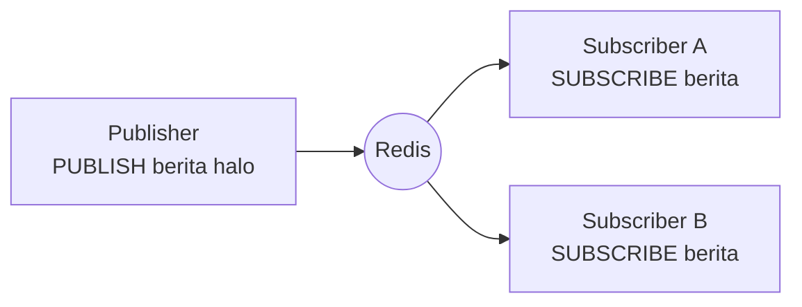

# Pub/Sub

## Tujuan belajar

Setelah bab ini kamu bisa:

- [ ] Menjelaskan model *publish/subscribe* dan perannya (publisher, subscriber, channel).
- [ ] Memakai `SUBSCRIBE`, `PSUBSCRIBE`, dan `PUBLISH` dari dua terminal `redis-cli`.
- [ ] Membaca balasan `PUBLISH` dan memeriksa channel dengan `PUBSUB`.
- [ ] Menjelaskan batasan pengiriman Pub/Sub: pesan tidak disimpan dan hilang bila tidak ada pelanggan.
- [ ] Menulis pelanggan dan penerbit sederhana di Python.

## Prasyarat

- Sudah membaca [Session dan rate limiting](session-dan-rate-limiting.md) dan [String](../struktur-data/string.md), terutama arti balasan `(integer)`.
- Container Redis berjalan dan kamu bisa masuk dengan `docker exec -it redis redis-cli` (lihat [Instalasi dengan Docker](../pengenalan/instalasi-dengan-docker.md)).
- Praktik memerlukan **dua terminal** yang sama-sama terhubung ke Redis.
- Versi Redis: `SUBSCRIBE`, `PSUBSCRIBE`, dan `PUBLISH` sudah ada sejak Redis versi awal, jadi tersedia di `redis:latest`.
- Untuk contoh Python: Python 3 dan paket `redis` (`pip install redis`).

## Konsep

**Pub/Sub** adalah cara mengirim pesan antar program lewat Redis. Pengirim (**publisher**) mengirim pesan ke sebuah **channel** (nama saluran). Penerima (**subscriber**) yang sedang berlangganan channel itu langsung menerima pesannya. Pengirim tidak tahu siapa penerimanya, dan penerima tidak tahu siapa pengirimnya.[^1]

Kenapa berguna: beberapa bagian aplikasi perlu diberi tahu saat sesuatu terjadi, misalnya pesan obrolan baru, notifikasi, atau perintah "muat ulang konfigurasi", tanpa saling memanggil langsung.

### Analogi

Seperti siaran radio. Stasiun (publisher) memancarkan di satu frekuensi (channel). Siapa pun yang pada saat itu menyalakan radio dan menyetel frekuensi tersebut (subscriber) mendengarnya.

!!! warning "Batas analogi yang penting"
    Siaran radio yang kamu lewatkan tidak bisa diputar ulang. Pub/Sub Redis sama: pesan **tidak disimpan**. Jika tidak ada pelanggan saat pesan dikirim, pesan hilang. Pelanggan yang terputus juga tidak mendapat pesan yang dikirim selama terputus.[^1] Kalau kamu butuh pesan yang tahan hilang, gunakan Streams di bab [Streams dan consumer group](streams-consumer-group.md).

## Cara kerja



| Perintah | Fungsi | Balasan |
|---|---|---|
| `SUBSCRIBE channel [channel ...]` | Berlangganan satu atau lebih channel.[^2] | Konfirmasi, lalu pesan masuk terus-menerus |
| `PSUBSCRIBE pola [pola ...]` | Berlangganan semua channel yang cocok pola glob, mis. `berita.*`.[^3] | Konfirmasi, lalu pesan masuk |
| `PUBLISH channel pesan` | Mengirim pesan ke channel.[^4] | Jumlah pelanggan yang menerima |
| `UNSUBSCRIBE` / `PUNSUBSCRIBE` | Berhenti berlangganan. | Konfirmasi |
| `PUBSUB CHANNELS` / `PUBSUB NUMSUB channel` | Melihat channel aktif / jumlah pelanggan.[^5] | Daftar / angka |

Aturan penting:

- **At-most-once**: tiap pesan dikirim paling banyak satu kali ke tiap pelanggan. Tidak ada konfirmasi dan tidak ada pengiriman ulang.[^1]
- Klien yang sedang berlangganan masuk ke mode khusus. Pada protokol RESP2 (bawaan `redis-cli`), klien itu hanya boleh menjalankan perintah langganan, `PING`, dan keluar. Untuk menjalankan perintah lain, pakai koneksi lain.[^2]
- Channel tidak perlu dibuat dulu. Ia ada selama ada yang berlangganan.
- Pub/Sub tidak berkaitan dengan nomor database dan tidak memengaruhi key space.[^1]

## Praktik langkah demi langkah

Output di bawah adalah output yang **diharapkan** berdasarkan dokumentasi, bukan hasil eksekusi di komputermu.

Buka **dua terminal**. Di masing-masing, masuk dengan:

**Lingkungan: terminal**

```bash
docker exec -it redis redis-cli
```

Sebut saja **Terminal A** (pelanggan) dan **Terminal B** (penerbit).

### Langkah 1: Berlangganan di Terminal A

**Terminal A (redis-cli):**

```text
127.0.0.1:6379> SUBSCRIBE berita
```

Kenapa dulu: pelanggan harus sudah aktif sebelum pesan dikirim, karena pesan tidak disimpan.

**Diharapkan:**

```text
Reading messages... (press Ctrl-C to quit or any other key to type a command)
1) "subscribe"
2) "berita"
3) (integer) 1
```

Cara membaca output: baris pertama bertuliskan jenis balasan (`subscribe`), lalu nama channel, lalu jumlah channel yang kini kamu langgani (`1`). Terminal A sekarang menunggu, jadi jangan diketik apa pun.

### Langkah 2: Kirim pesan dari Terminal B

**Terminal B (redis-cli):**

```text
127.0.0.1:6379> PUBLISH berita "halo semua"
```

**Diharapkan di Terminal B:** `(integer) 1`. Angka itu adalah jumlah pelanggan yang menerima pesan, bukan jumlah pesan.

**Diharapkan di Terminal A:**

```text
1) "message"
2) "berita"
3) "halo semua"
```

Cara membaca output: jenis `message`, channel asal, lalu isi pesan.

### Langkah 3: Kirim ke channel tanpa pelanggan

**Terminal B:**

```text
127.0.0.1:6379> PUBLISH sepi "tidak ada yang dengar"
```

**Diharapkan:** `(integer) 0`. Tidak ada galat, tetapi pesan hilang karena tidak ada penerima. Ini bukti bahwa Pub/Sub tidak menyimpan pesan.

### Langkah 4: Langganan dengan pola

Tekan Ctrl-C di Terminal A untuk keluar dari mode langganan, lalu:

**Terminal A:**

```text
127.0.0.1:6379> PSUBSCRIBE berita.*
```

**Terminal B:**

```text
127.0.0.1:6379> PUBLISH berita.olahraga "gol!"
127.0.0.1:6379> PUBLISH berita.cuaca "hujan"
127.0.0.1:6379> PUBLISH hiburan "tidak cocok pola"
```

Kenapa `PSUBSCRIBE`: satu perintah menangkap banyak channel bernama serupa tanpa menyebutnya satu per satu.

**Diharapkan di Terminal B:** `(integer) 1`, `(integer) 1`, lalu `(integer) 0` (channel `hiburan` tidak cocok pola).

**Diharapkan di Terminal A** (dua pesan pertama saja):

```text
1) "pmessage"
2) "berita.*"
3) "berita.olahraga"
4) "gol!"
1) "pmessage"
2) "berita.*"
3) "berita.cuaca"
4) "hujan"
```

Cara membaca output: jenis `pmessage`, pola yang cocok, channel sebenarnya, lalu isi pesan.

### Langkah 5: Periksa channel dari Terminal B

Dengan Terminal A masih berlangganan:

**Terminal B:**

```text
127.0.0.1:6379> PUBSUB NUMSUB berita
127.0.0.1:6379> PUBSUB NUMPAT
```

**Diharapkan:** untuk `NUMSUB`, `1) "berita"` dan `2) (integer) 0` (tidak ada yang berlangganan channel itu secara langsung karena Terminal A memakai pola). Untuk `NUMPAT`, `(integer) 1` (satu pola aktif).

### Langkah 6: Berhenti berlangganan

Tekan Ctrl-C di Terminal A. Jika kamu memakai `redis-cli` versi lama dan mode langganan tidak keluar, tutup terminal itu dan buka lagi.

!!! note "Tidak ada data yang perlu dibersihkan"
    Pub/Sub tidak membuat key, jadi tidak ada yang perlu dihapus dari Redis.

## Contoh lengkap

**Lingkungan: Python** · Kebutuhan: Python 3, paket `redis` (`pip install redis`), dan Redis berjalan di `localhost:6379`.

```python title="pubsub_demo.py"
import threading
import time

import redis

r = redis.Redis(host="localhost", port=6379, decode_responses=True)

CHANNEL = "berita"
siap = threading.Event()


def pelanggan():
    ps = r.pubsub()
    ps.subscribe(CHANNEL)
    diterima = 0
    batas = time.time() + 10
    while diterima < 3 and time.time() < batas:
        pesan = ps.get_message(timeout=1)
        if pesan is None:
            continue
        if pesan["type"] == "subscribe":
            siap.set()
        elif pesan["type"] == "message":
            print("diterima:", pesan["data"])
            diterima += 1
    ps.close()


t = threading.Thread(target=pelanggan)
t.start()
siap.wait(timeout=5)

for i in range(1, 4):
    jumlah = r.publish(CHANNEL, f"pesan-{i}")
    print(f"dikirim pesan-{i} ke {jumlah} pelanggan")

t.join()
print("tanpa pelanggan:", r.publish(CHANNEL, "terlambat"))
```

Penjelasan baris penting:

| Baris | Penjelasan |
|---|---|
| `r.pubsub()` | Membuat objek langganan dengan koneksi tersendiri, karena koneksi yang berlangganan tidak bisa dipakai untuk perintah lain. |
| `ps.get_message(timeout=1)` | Menunggu sampai 1 detik; mengembalikan `None` bila tidak ada pesan. |
| `pesan["type"] == "subscribe"` | Konfirmasi langganan. Kita memberi sinyal `siap` agar penerbit mulai mengirim hanya setelah langganan aktif. |
| `siap.wait(timeout=5)` | Mencegah pesan terkirim sebelum langganan aktif (yang akan hilang). |
| `r.publish(CHANNEL, ...)` | Mengembalikan jumlah pelanggan yang menerima. |
| `batas = time.time() + 10` | Pengaman agar program tidak menunggu selamanya jika pesan tak datang. |
| `ps.close()` | Menutup langganan. |

Cara menjalankan: `python pubsub_demo.py`.

**Diharapkan** (urutan baris `dikirim` dan `diterima` bisa berselang-seling):

```text
dikirim pesan-1 ke 1 pelanggan
dikirim pesan-2 ke 1 pelanggan
dikirim pesan-3 ke 1 pelanggan
diterima: pesan-1
diterima: pesan-2
diterima: pesan-3
tanpa pelanggan: 0
```

## Kesalahan umum dan troubleshooting

| Gejala | Penyebab dan solusi |
|---|---|
| `PUBLISH` membalas `0` | Tidak ada pelanggan saat pesan dikirim, atau nama channel berbeda (peka huruf besar-kecil). Pastikan langganan aktif lebih dulu dan nama sama persis. |
| Pesan yang dikirim saat pelanggan terputus tidak pernah sampai | Perilaku Pub/Sub: tidak ada penyimpanan atau pengiriman ulang.[^1] Pakai Streams bila butuh jaminan. |
| Terminal pelanggan tampak "menggantung" | Itu menunggu pesan. Tekan Ctrl-C. |
| Perintah lain ditolak di klien yang berlangganan (`Can't execute 'get': only (P|S)SUBSCRIBE / (P|S)UNSUBSCRIBE / PING / QUIT / RESET are allowed in this context` atau serupa) | Klien dalam mode langganan hanya boleh perintah langganan.[^2] Pakai koneksi lain. Teks pesan persisnya bisa berbeda antarversi. |
| Pesan diterima dua kali | Klien berlangganan channel langsung **dan** lewat pola yang mencakupnya. |
| Pelanggan lambat tertinggal atau diputus | Redis menahan pesan di buffer keluaran per klien dan bisa memutus klien yang terlalu lambat (`client-output-buffer-limit`).[^6] Proses pesan secepatnya dan jangan menahan koneksi. |
| `redis.exceptions.ConnectionError` | Container Redis belum berjalan atau port 6379 tidak terbuka. Cek dengan `docker ps`. |
| Contoh Python berhenti tanpa "diterima" | `siap` tidak terpicu atau waktu habis. Pastikan Redis berjalan dan jalankan ulang. |

!!! note "Status verifikasi"
    Sintaks, bentuk balasan, dan aturan mode langganan dicocokkan dengan dokumentasi resmi Redis. Blok output dan skrip Python belum dijalankan di Redis sungguhan saat bab ini ditulis; urutan baris pada contoh Python bisa berbeda. Bandingkan dengan hasilmu sendiri.

## Latihan

1. Berlangganan channel `obrolan` di Terminal A, lalu kirim tiga pesan dari Terminal B. Berapa balasan tiap `PUBLISH`?
2. Sebelum menjalankan: buka dua pelanggan untuk channel `obrolan`. Apa balasan `PUBLISH obrolan "hai"`? Jalankan lalu bandingkan.
3. Kirim pesan ke `obrolan` **sebelum** ada pelanggan, lalu berlangganan. Apakah pesannya sampai? Kenapa?
4. Dengan `PSUBSCRIBE kamar.*`, channel mana saja yang tertangkap: `kamar.1`, `kamar.a.b`, `kamar`? Cobalah.
5. Jelaskan satu kasus yang cocok dan satu yang tidak cocok untuk Pub/Sub.

??? success "Petunjuk"
    1. Balasan `PUBLISH` adalah jumlah penerima.
    2. Hitung jumlah pelanggan.
    3. Ingat bahwa pesan tidak disimpan.
    4. Tanda `*` pada pola glob mencocokkan sembarang karakter, tetapi pola `kamar.*` mewajibkan titik.
    5. Pikirkan apakah kehilangan pesan bisa diterima.

## Ringkasan

- Pub/Sub mengirim pesan dari publisher ke subscriber lewat channel; keduanya tidak saling mengenal.
- `SUBSCRIBE`/`PSUBSCRIBE` berlangganan, `PUBLISH` mengirim dan membalas jumlah penerima, `PUBSUB` memeriksa status.
- Pengiriman *at-most-once*: pesan tidak disimpan; tanpa pelanggan atau saat terputus, pesan hilang.
- Klien yang berlangganan hanya boleh perintah langganan; gunakan koneksi lain untuk perintah biasa.
- Untuk pesan yang harus bertahan dan dikonfirmasi, pakai Streams.

Berikutnya: [Streams dan consumer group](streams-consumer-group.md).

## Referensi resmi

[^1]: Redis, *Redis Pub/Sub*: <https://redis.io/docs/latest/develop/interact/pubsub/>
[^2]: Redis, *SUBSCRIBE*: <https://redis.io/docs/latest/commands/subscribe/>
[^3]: Redis, *PSUBSCRIBE*: <https://redis.io/docs/latest/commands/psubscribe/>
[^4]: Redis, *PUBLISH*: <https://redis.io/docs/latest/commands/publish/>
[^5]: Redis, *PUBSUB NUMSUB*: <https://redis.io/docs/latest/commands/pubsub-numsub/>
[^6]: Redis, *Client handling* (bagian *Output buffer limits*): <https://redis.io/docs/latest/develop/reference/clients/>

Bacaan tambahan: [`UNSUBSCRIBE`](https://redis.io/docs/latest/commands/unsubscribe/), [`SSUBSCRIBE`](https://redis.io/docs/latest/commands/ssubscribe/) (sharded Pub/Sub, Redis 7.0+), [`PUBSUB CHANNELS`](https://redis.io/docs/latest/commands/pubsub-channels/).
