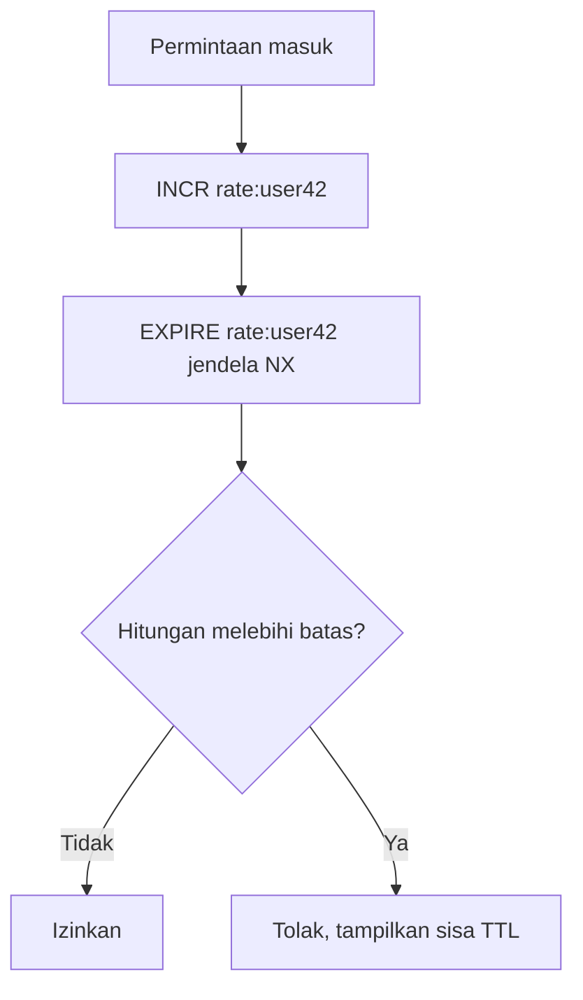

# Session dan rate limiting

## Tujuan belajar

Setelah bab ini kamu bisa:

- [ ] Menjelaskan apa itu sesi login dan kenapa Redis cocok untuk menyimpannya.
- [ ] Membuat, membaca, memperpanjang, dan menghapus sesi memakai Hash dan expiry.
- [ ] Menjelaskan apa itu pembatas laju (*rate limiter*) jendela tetap dan cara kerjanya dengan `INCR` dan `EXPIRE`.
- [ ] Menulis pembatas laju sederhana di Python dan membaca sisa waktu tunggu dari `TTL`.
- [ ] Menyebut kelemahan pembatas jendela tetap dan risiko `INCR` lalu `EXPIRE`.

## Prasyarat

- Sudah membaca [Hash](../struktur-data/hash.md) dan [String](../struktur-data/string.md), terutama `HSET`, `HGETALL`, dan `INCR`.
- Sudah membaca [Key dan expiry](../pengenalan/key-dan-expiry.md), terutama `EXPIRE`, `TTL`, dan aturan bahwa `SET` yang menimpa key menghapus expiry.
- Sudah membaca [Caching](caching.md) agar terbiasa dengan key ber-TTL sebagai data sementara.
- Container Redis berjalan dan kamu bisa masuk dengan `docker exec -it redis redis-cli` (lihat [Instalasi dengan Docker](../pengenalan/instalasi-dengan-docker.md)).
- Versi Redis: opsi `NX` pada `EXPIRE` membutuhkan Redis 7.0.0 atau lebih baru.[^3] Versi dari `redis:latest` memenuhi syarat ini.
- Kondisi awal: tidak ada key berawalan `sesi:` atau `rate:` yang kamu perlukan.
- Untuk contoh Python: Python 3 dan paket `redis` versi terbaru (`pip install redis`).

## Konsep

### Sesi

Protokol web tidak mengingat siapa yang mengirim permintaan sebelumnya. Setelah pengguna login, aplikasi memberi **token sesi** (deretan karakter acak) kepada pengguna dan menyimpan data sesinya, misalnya ID pengguna, di server. Pada permintaan berikutnya pengguna mengirim token, dan aplikasi mencari data sesinya.

Kenapa Redis cocok: sesi dibaca di hampir setiap permintaan, jadi harus cepat. Sesi juga bersifat sementara, sehingga cukup diberi TTL dan hilang sendiri ketika tidak dipakai. Dua hal itu adalah kekuatan Redis.

Satu sesi berisi beberapa atribut, jadi [Hash](../struktur-data/hash.md) adalah pilihan alami: satu key per sesi, satu field per atribut.[^1]

**Sliding expiration**: setiap kali sesi dipakai, TTL diperpanjang. Pengguna yang aktif tidak ter-logout, sedangkan sesi yang tidak dipakai akan kedaluwarsa.

### Rate limiting

**Rate limiting** membatasi berapa kali sesuatu boleh dilakukan dalam kurun waktu tertentu, misalnya maksimal 5 percobaan login per menit. Tujuannya melindungi layanan dari penyalahgunaan dan beban berlebih.

Pola paling sederhana adalah **jendela tetap** (*fixed window*): satu counter per pengguna per jendela waktu. Counter dinaikkan setiap permintaan, dan bila angkanya melewati batas, permintaan ditolak. Saat jendela berakhir, key counter kedaluwarsa dan hitungan mulai dari nol.[^2]

### Analogi

Sesi seperti gelang tanda masuk di taman hiburan: petugas (aplikasi) mengenali kamu dari gelangnya, dan gelang berlaku sampai waktu tertentu. Rate limiting seperti kartu cap yang dibatasi lima cap per jam: setelah cap kelima, kamu harus menunggu jam berikutnya.

!!! note "Batas analogi"
    Gelang fisik tidak bisa dipalsukan sembarangan, sedangkan token sesi bisa ditebak bila tidak dibuat dengan acak yang kuat. Selain itu, pada kartu cap kamu tidak tahu persis kapan jam berikutnya dimulai; pada Redis, `TTL` memberi tahu sisa waktunya.

## Cara kerja



| Kebutuhan | Perintah | Alasan |
|---|---|---|
| Simpan sesi | `HSET sesi:token field value ...` + `EXPIRE` | Satu key per sesi, hilang sendiri |
| Baca sesi | `HGETALL sesi:token` | Mengambil semua atribut |
| Perpanjang sesi | `EXPIRE sesi:token detik` | Sliding expiration |
| Logout | `DEL sesi:token` | Menghapus sesi segera |
| Hitung permintaan | `INCR rate:user` | Atomik, key baru mulai dari 0 |
| Batas jendela | `EXPIRE rate:user detik NX` | Memberi TTL hanya bila belum ada[^3] |
| Sisa waktu tunggu | `TTL rate:user` | Kapan jendela berakhir[^4] |

## Praktik langkah demi langkah

Output di bawah adalah output **terverifikasi**: dijalankan di Redis 8.10.3 pada 2026-10-27. Hasilmu bisa berbeda pada nilai yang berubah tiap eksekusi. Angka sisa TTL bisa sedikit berbeda.

**Lingkungan: terminal**

```bash
docker exec -it redis redis-cli
```

Semua langkah berikutnya di **redis-cli**. Kita memakai TTL pendek agar hasilnya cepat terlihat. Di aplikasi nyata sesi biasanya hidup menit hingga jam.

### Langkah 1: Buat sesi

```text
127.0.0.1:6379> HSET sesi:token-contoh-abc123 user_id 42 nama "Budi"
127.0.0.1:6379> EXPIRE sesi:token-contoh-abc123 30
127.0.0.1:6379> TTL sesi:token-contoh-abc123
```

| Bagian | Fungsi dan alasan |
|---|---|
| `sesi:token-contoh-abc123` | Key sesi dengan skema `jenis:id`. Ini hanya **placeholder**; token nyata harus acak dan tidak bisa ditebak (lihat contoh Python). |
| `user_id 42 nama "Budi"` | Atribut yang dibutuhkan aplikasi untuk mengenali pengguna. Jangan menyimpan password. |
| `EXPIRE ... 30` | Sesi hidup 30 detik. Tanpa ini sesi menumpuk selamanya di memori. |

**Terverifikasi:** `(integer) 2`, `(integer) 1`, lalu angka sekitar `30`.

### Langkah 2: Baca sesi dan perpanjang

```text
127.0.0.1:6379> HGETALL sesi:token-contoh-abc123
127.0.0.1:6379> EXPIRE sesi:token-contoh-abc123 30
127.0.0.1:6379> TTL sesi:token-contoh-abc123
```

Kenapa dua langkah: `HGETALL` membaca data, sedangkan `EXPIRE` mengembalikan TTL ke 30 detik karena sesi baru saja dipakai (sliding expiration). **Terverifikasi:**

```text
1) "user_id"
2) "42"
3) "nama"
4) "Budi"
(integer) 1
(integer) 30
```

(Urutan field tidak dijamin; `TTL` bisa `30` atau `29`.)

### Langkah 3: Sesi kedaluwarsa sendiri

Tunggu lebih dari 30 detik tanpa memperpanjang, lalu:

```text
127.0.0.1:6379> HGETALL sesi:token-contoh-abc123
```

**Terverifikasi:** `(empty array)`. Aplikasi menganggap pengguna belum login dan meminta login ulang.

### Langkah 4: Logout dengan `DEL`

```text
127.0.0.1:6379> HSET sesi:token-contoh-xyz789 user_id 7 nama "Sari"
127.0.0.1:6379> EXPIRE sesi:token-contoh-xyz789 1800
127.0.0.1:6379> DEL sesi:token-contoh-xyz789
127.0.0.1:6379> EXISTS sesi:token-contoh-xyz789
```

Kenapa `DEL`: saat logout, sesi harus langsung tidak berlaku, bukan menunggu TTL. **Terverifikasi:** `(integer) 2`, `(integer) 1`, `(integer) 1`, lalu `(integer) 0`.

!!! danger "`DEL` tidak bisa dibatalkan"
    Menghapus sesi membuat pengguna harus login ulang. Pastikan nama key benar.

### Langkah 5: Rate limiter jendela tetap

Batas contoh: **3 permintaan per 10 detik** untuk pengguna `user42`.

```text
127.0.0.1:6379> INCR rate:user42
127.0.0.1:6379> EXPIRE rate:user42 10 NX
127.0.0.1:6379> INCR rate:user42
127.0.0.1:6379> EXPIRE rate:user42 10 NX
127.0.0.1:6379> INCR rate:user42
127.0.0.1:6379> INCR rate:user42
127.0.0.1:6379> TTL rate:user42
```

| Bagian | Fungsi dan alasan |
|---|---|
| `INCR rate:user42` | Menaikkan counter secara atomik; key baru mulai dari 0 (lihat [String](../struktur-data/string.md)). |
| `EXPIRE ... 10 NX` | `NX` membuat expiry hanya dipasang bila key belum punya expiry.[^3] Jadi jendela dimulai dari permintaan pertama dan tidak diperpanjang oleh permintaan berikutnya. |
| `TTL rate:user42` | Sisa detik sampai jendela berakhir; berguna untuk memberi tahu klien berapa lama menunggu. |

**Terverifikasi:**

```text
(integer) 1
(integer) 1
(integer) 2
(integer) 0
(integer) 3
(integer) 4
(integer) 7
```

Cara membaca output: `EXPIRE ... NX` pertama membalas `1` (expiry dipasang). Yang kedua membalas `0` karena key sudah punya expiry, dan itu benar. Hitungan ke-4 (`4`) melebihi batas 3, jadi **aplikasi** menolak permintaan itu. Redis sendiri tidak menolak apa pun; keputusan menolak ada pada kode aplikasi. `TTL` bernilai sekitar sisa dari 10 detik (di sini contohnya `7`).

### Langkah 6: Jendela berakhir

Tunggu hingga `TTL` habis, lalu:

```text
127.0.0.1:6379> GET rate:user42
127.0.0.1:6379> INCR rate:user42
```

**Terverifikasi:** `(nil)`, lalu `(integer) 1`. Key kedaluwarsa, hitungan mulai lagi dari awal.

### Langkah 7: Bersihkan data latihan

```text
127.0.0.1:6379> DEL sesi:token-contoh-abc123 sesi:token-contoh-xyz789 rate:user42
```

**Terverifikasi:** `(integer)` sejumlah key yang masih ada (bisa 0 sampai 1 karena lainnya sudah kedaluwarsa atau dihapus).

!!! danger "Risiko kehilangan data"
    Perintah ini menyebut key satu per satu agar tidak ada key lain yang ikut terhapus.

## Contoh lengkap

**Lingkungan: Python** · Kebutuhan: Python 3, paket `redis` versi terbaru, dan Redis 7.0+ berjalan di `localhost:6379`.

```python title="sesi_dan_rate_limit.py"
import secrets
import time

import redis

r = redis.Redis(host="localhost", port=6379, decode_responses=True)

SESI_TTL = 30  # detik; di aplikasi nyata biasanya lebih lama


def kunci_sesi(token):
    return f"sesi:{token}"


def buat_sesi(user_id, nama):
    token = secrets.token_urlsafe(32)  # acak dan sulit ditebak
    pipe = r.pipeline()
    pipe.hset(kunci_sesi(token), mapping={"user_id": user_id, "nama": nama})
    pipe.expire(kunci_sesi(token), SESI_TTL)
    pipe.execute()
    return token


def ambil_sesi(token):
    data = r.hgetall(kunci_sesi(token))
    if not data:
        return None
    r.expire(kunci_sesi(token), SESI_TTL)  # sliding expiration
    return data


def hapus_sesi(token):
    return r.delete(kunci_sesi(token))


def boleh_lewat(user_id, batas, jendela_detik):
    kunci = f"rate:{user_id}"
    hitungan = r.incr(kunci)
    r.expire(kunci, jendela_detik, nx=True)
    return hitungan <= batas


# --- demo sesi ---
token = buat_sesi(42, "Budi")
print("sesi dibaca:", ambil_sesi(token))
hapus_sesi(token)
print("setelah logout:", ambil_sesi(token))

# --- demo rate limit: 3 permintaan per 5 detik ---
r.delete("rate:user42")
for i in range(1, 6):
    ok = boleh_lewat("user42", batas=3, jendela_detik=5)
    print(f"permintaan {i}:", "boleh" if ok else "DITOLAK")
print("sisa tunggu (detik):", r.ttl("rate:user42"))

time.sleep(5.5)
print("setelah jendela berakhir:", "boleh" if boleh_lewat("user42", 3, 5) else "DITOLAK")
r.delete("rate:user42")
```

Penjelasan baris penting:

| Baris | Penjelasan |
|---|---|
| `secrets.token_urlsafe(32)` | Membuat token acak yang aman secara kriptografis. Jangan memakai ID berurutan atau `random`, karena token bisa ditebak. |
| `r.pipeline()` ... `pipe.execute()` | Mengirim `HSET` dan `EXPIRE` bersamaan. Secara bawaan `redis-py` membungkusnya dalam `MULTI`/`EXEC` (dibahas di bab Transaksi), sehingga sesi tidak sempat ada tanpa expiry. |
| `if not data: return None` | `HGETALL` pada key tidak ada mengembalikan dict kosong; itu tanda sesi tidak ada atau sudah kedaluwarsa. |
| `r.expire(..., SESI_TTL)` di `ambil_sesi` | Memperpanjang sesi setiap dipakai. |
| `r.incr(kunci)` | Menaikkan counter atomik dan mengembalikan nilai baru. |
| `r.expire(kunci, jendela_detik, nx=True)` | Memasang TTL hanya bila belum ada (Redis 7.0+). Dipanggil setiap permintaan agar key tidak pernah tersisa tanpa TTL. |
| `hitungan <= batas` | Keputusan izin ada di aplikasi. |
| `r.ttl("rate:user42")` | Sisa jendela, bisa dikirim ke klien sebagai waktu tunggu. |

Cara menjalankan: `python sesi_dan_rate_limit.py`.

**Terverifikasi:**

```text
sesi dibaca: {'user_id': '42', 'nama': 'Budi'}
setelah logout: None
permintaan 1: boleh
permintaan 2: boleh
permintaan 3: boleh
permintaan 4: DITOLAK
permintaan 5: DITOLAK
sisa tunggu (detik): 5
setelah jendela berakhir: boleh
```

Nilai `sisa tunggu` bisa `4` atau `5` tergantung waktu eksekusi.

## Kesalahan umum dan troubleshooting

| Gejala | Penyebab dan solusi |
|---|---|
| Sesi tidak pernah kedaluwarsa | `EXPIRE` terlewat, atau key ditimpa `SET` (khusus sesi String). Cek `TTL` (`-1` berarti tanpa expiry). Buat key dan expiry bersamaan seperti pada contoh. |
| Pengguna ter-logout padahal aktif | Sesi tidak diperpanjang saat dipakai, atau TTL terlalu pendek. Panggil `EXPIRE` di setiap akses yang valid. |
| `(error) ERR wrong number of arguments for 'expire' command` | Mengirim `NX` pada Redis di bawah 7.0. Perbarui Redis atau pakai pola `INCR`, lalu `EXPIRE` hanya jika hasilnya `1`. |
| Counter rate limit hidup tanpa TTL (`TTL` = `-1`) | Aplikasi berhenti di antara `INCR` dan `EXPIRE` (pola lama). Dengan `EXPIRE ... NX` di tiap permintaan, permintaan berikutnya memperbaikinya. |
| Pengguna bisa mengirim hingga 2 kali batas dalam waktu singkat | Kelemahan jendela tetap: permintaan di akhir jendela lama dan awal jendela baru dihitung terpisah. Untuk akurasi lebih tinggi ada pola jendela geser (*sliding window*) dengan Sorted Set, di luar bab ini. |
| Semua pengguna terkena batas yang sama | Key `rate:` tidak mengandung identitas pengguna atau IP. Sertakan identitasnya di nama key. |
| `redis.exceptions.ConnectionError` | Container Redis belum berjalan atau port 6379 tidak terbuka. Cek dengan `docker ps`. |
| Python: `TypeError: expire() got an unexpected keyword argument 'nx'` | Versi `redis-py` lama. Jalankan `pip install --upgrade redis`. |

!!! warning "Keamanan sesi"
    Token sesi setara kunci rumah. Buat dengan generator acak yang kuat, kirim lewat HTTPS, simpan di cookie dengan atribut `HttpOnly`, dan jangan menyimpan password atau data sensitif di dalam sesi. Detail keamanan Redis dibahas di bagian Operasi.

!!! note "Status verifikasi"
    Perintah, nilai balik, dan skrip di bab ini dijalankan di Redis 8.10.3 (`redis:latest`) pada 2026-10-27, dengan Python 3.12.3 dan redis-py 8.1.0. Sintaks juga dicocokkan dengan dokumentasi resmi Redis. Nilai yang berubah tiap eksekusi (ID, TTL, waktu, urutan, alamat IP) bisa berbeda di komputermu, dan teks galat bisa berbeda antarversi. Tampilan prompt interaktif `redis-cli` (prompt, Tab, riwayat) tidak teramati karena pengujian berjalan tanpa terminal interaktif.

## Latihan

1. Buat sesi `sesi:token-latihan` berisi `user_id` dan `peran`, TTL 20 detik. Baca, perpanjang sekali, lalu biarkan kedaluwarsa. Apa balasan `HGETALL` setelahnya?
2. Sebelum menjalankan: dengan batas 3 per 10 detik, apa balasan `INCR` ke-5 dan apa keputusan aplikasi? Jalankan lalu bandingkan.
3. Ubah `boleh_lewat` agar mengembalikan juga sisa detik tunggu (dari `ttl`) saat ditolak.
4. Tulis ulang `boleh_lewat` untuk Redis di bawah 7.0 tanpa `NX`: pasang `EXPIRE` hanya bila `INCR` mengembalikan `1`. Apa kelemahannya dibanding versi `NX`?
5. Jelaskan skenario di mana pembatas jendela tetap membolehkan 2 kali batas dalam waktu sangat singkat.

??? success "Petunjuk"
    1. Ingat `HGETALL` pada key tidak ada.
    2. Hitungan 5 melebihi batas 3.
    3. Kembalikan tuple `(diizinkan, sisa)`.
    4. Pikirkan apa yang terjadi bila aplikasi berhenti setelah `INCR` pertama.
    5. Bayangkan 3 permintaan di detik ke-9 dan 3 lagi di detik ke-11.

## Ringkasan

- Sesi: satu Hash per sesi (`sesi:<token>`) dengan `EXPIRE`; baca dengan `HGETALL`, perpanjang dengan `EXPIRE` (sliding expiration), akhiri dengan `DEL`.
- Token sesi harus acak dan sulit ditebak; jangan menyimpan password di sesi.
- Rate limiter jendela tetap: `INCR` counter per pengguna, `EXPIRE ... NX` untuk jendela (Redis 7.0+), aplikasi menolak bila hitungan melebihi batas, dan `TTL` memberi sisa waktu tunggu.
- Kelemahan: lonjakan di batas antar jendela dan risiko key tanpa TTL bila `EXPIRE` terlewat.
- `DEL` menghapus permanen; sesi yang dihapus tidak bisa dipulihkan.

Berikutnya: Pub/Sub (bab belum ditulis).

## Referensi resmi

[^1]: Redis, *HSET*: <https://redis.io/docs/latest/commands/hset/>
[^2]: Redis, *INCR* (bagian *Pattern: Rate limiter*): <https://redis.io/docs/latest/commands/incr/>
[^3]: Redis, *EXPIRE*: <https://redis.io/docs/latest/commands/expire/>
[^4]: Redis, *TTL*: <https://redis.io/docs/latest/commands/ttl/>

Bacaan tambahan: [`HGETALL`](https://redis.io/docs/latest/commands/hgetall/), [`DEL`](https://redis.io/docs/latest/commands/del/), [Python `secrets`](https://docs.python.org/3/library/secrets.html).
