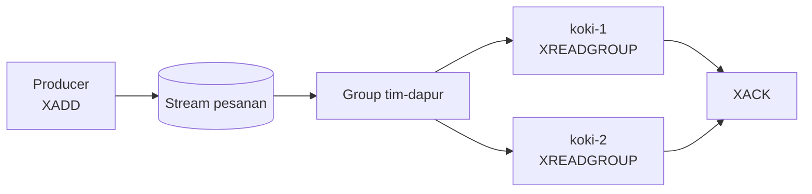

# Streams dan consumer group

## Tujuan belajar

Setelah bab ini kamu bisa:

- [ ] Menjelaskan apa itu Stream dan bedanya dengan Pub/Sub dan List.
- [ ] Menambah entri dengan `XADD` dan membaca dengan `XRANGE` dan `XREAD`.
- [ ] Membuat consumer group dan membaca dengan `XREADGROUP`.
- [ ] Mengonfirmasi pemrosesan dengan `XACK` dan memeriksa pesan tertunda dengan `XPENDING`.
- [ ] Mengambil alih pesan dari consumer yang gagal dengan `XAUTOCLAIM`.

## Prasyarat

- Sudah membaca [Pub/Sub](pub-sub.md), terutama bahwa pesannya tidak disimpan.
- Sudah membaca [List](../struktur-data/list.md) dan [Hash](../struktur-data/hash.md) agar paham antrean sederhana dan pasangan field-value.
- Container Redis berjalan dan kamu bisa masuk dengan `docker exec -it redis redis-cli` (lihat [Instalasi dengan Docker](../pengenalan/instalasi-dengan-docker.md)).
- Versi Redis: Streams tersedia sejak Redis 5.0, sedangkan `XAUTOCLAIM` sejak 6.2.0.[^9] Versi dari `redis:latest` memenuhi keduanya.
- Kondisi awal: tidak ada key bernama `pesanan` yang kamu perlukan.
- Untuk contoh Python: Python 3 dan paket `redis` (`pip install redis`).

## Konsep

**Stream** adalah catatan kejadian yang hanya bisa ditambah di akhir (*append-only log*). Setiap entri punya **ID** unik yang berurutan dan sekumpulan pasangan field-value, mirip satu baris Hash. Berbeda dengan Pub/Sub, entri **disimpan** di Redis sampai kamu menghapusnya, jadi pembaca yang datang terlambat tetap bisa membaca dari awal.[^1]

Kenapa dibutuhkan: dengan [List](../struktur-data/list.md), satu elemen yang sudah diambil hilang dan tidak ada tanda terima. Dengan Stream dan **consumer group**, beberapa pekerja (*consumer*) membagi beban, tiap entri dikirim ke satu consumer saja, dan entri baru dianggap selesai setelah pekerja **mengonfirmasi** (`XACK`). Bila pekerja mati sebelum konfirmasi, entri itu tetap tercatat sebagai *pending* dan bisa diambil alih pekerja lain.[^1]

### Analogi

Stream seperti buku pesanan di dapur restoran: setiap pesanan ditulis berurutan dan tidak dihapus begitu saja. Consumer group adalah tim koki. Tiap lembar pesanan diberikan ke satu koki, dan baru dicoret (di-`XACK`) setelah masakannya jadi. Lembar yang belum dicoret masih ketahuan siapa yang memegangnya.

!!! note "Batas analogi"
    Buku pesanan tidak membatasi ukurannya, sedangkan Stream menempati memori. Entri lama perlu dipangkas (`XTRIM`) agar memori tidak terus membesar.

## Cara kerja



| Perintah | Fungsi | Catatan |
|---|---|---|
| `XADD key ID field value ...` | Menambah entri.[^2] | `ID` `*` berarti Redis membuat ID otomatis dari waktu |
| `XLEN key` | Jumlah entri. | |
| `XRANGE key awal akhir [COUNT n]` | Membaca entri pada rentang ID.[^3] | `-` awal terkecil, `+` akhir terbesar |
| `XREAD [COUNT n] [BLOCK ms] STREAMS key ID` | Membaca entri setelah `ID`.[^4] | `$` berarti "hanya yang baru" |
| `XGROUP CREATE key grup ID` | Membuat consumer group.[^5] | `0` baca dari awal, `$` hanya entri baru |
| `XREADGROUP GROUP g c STREAMS key >` | Consumer `c` mengambil entri yang belum dikirim ke group.[^6] | `>` artinya "entri baru untuk group" |
| `XACK key grup ID` | Menandai entri selesai diproses.[^7] | Mengeluarkannya dari daftar pending |
| `XPENDING key grup` | Ringkasan entri yang belum di-ACK.[^8] | |
| `XAUTOCLAIM key grup consumer min-idle start` | Mengambil alih entri pending yang menganggur.[^9] | Redis 6.2+ |

Format ID: `<milidetik>-<urutan>`, misalnya `1700000000000-0`. ID harus selalu bertambah.[^2]

## Praktik langkah demi langkah

Output di bawah adalah output yang **diharapkan** berdasarkan dokumentasi, bukan hasil eksekusi di komputermu.

Agar output bisa dibandingkan, kita memberi ID eksplisit (`1-1`, `2-1`, `3-1`) pada latihan ini. Di aplikasi nyata hampir selalu memakai `*` supaya Redis membuat ID dari waktu.[^2]

**Lingkungan: terminal**

```bash
docker exec -it redis redis-cli
```

Semua langkah berikutnya di **redis-cli**, kecuali dinyatakan lain.

### Langkah 1: Tambah entri dengan `XADD`

```text
127.0.0.1:6379> XADD pesanan 1-1 item "kopi" jumlah 2
127.0.0.1:6379> XADD pesanan 2-1 item "teh" jumlah 1
127.0.0.1:6379> XADD pesanan 3-1 item "roti" jumlah 3
127.0.0.1:6379> XLEN pesanan
```

| Bagian | Fungsi dan alasan |
|---|---|
| `pesanan` | Nama key Stream; dibuat otomatis pada `XADD` pertama. |
| `1-1` | ID entri yang kita tentukan sendiri untuk latihan. |
| `item "kopi" jumlah 2` | Pasangan field-value, seperti Hash. |

**Diharapkan:** `"1-1"`, `"2-1"`, `"3-1"`, lalu `(integer) 3`. `XADD` membalas ID entri yang dibuat.

### Langkah 2: Baca dengan `XRANGE`

```text
127.0.0.1:6379> XRANGE pesanan - + COUNT 2
```

**Diharapkan:**

```text
1) 1) "1-1"
   2) 1) "item"
      2) "kopi"
      3) "jumlah"
      4) "2"
2) 1) "2-1"
   2) 1) "item"
      2) "teh"
      3) "jumlah"
      4) "1"
```

Cara membaca output: tiap entri berisi ID dan daftar field-value selang-seling. `- +` berarti dari ID terkecil sampai terbesar, dan `COUNT 2` membatasi jumlah. Entri **tidak** hilang setelah dibaca; bandingkan dengan `LPOP` pada List.

### Langkah 3: Baca dengan `XREAD`

```text
127.0.0.1:6379> XREAD COUNT 1 STREAMS pesanan 1-1
```

Kenapa `XREAD`: ia membaca entri **setelah** ID yang kamu beri, cocok untuk membaca lanjutan. **Diharapkan:** entri `2-1` (teh), dalam bentuk daftar bersarang dengan nama key `"pesanan"` di paling luar.

### Langkah 4: Buat consumer group

```text
127.0.0.1:6379> XGROUP CREATE pesanan tim-dapur 0
```

Kenapa ID `0`: group akan membaca dari entri paling awal, jadi ketiga pesanan tersedia untuk dikerjakan. `$` hanya akan menyertakan entri yang ditambahkan sesudahnya.[^5] **Diharapkan:** `OK`.

### Langkah 5: Dua consumer mengambil pesanan

```text
127.0.0.1:6379> XREADGROUP GROUP tim-dapur koki-1 COUNT 1 STREAMS pesanan >
127.0.0.1:6379> XREADGROUP GROUP tim-dapur koki-2 COUNT 1 STREAMS pesanan >
```

| Bagian | Fungsi dan alasan |
|---|---|
| `GROUP tim-dapur koki-1` | Nama group dan nama consumer. Consumer dibuat otomatis saat pertama kali dipakai. |
| `COUNT 1` | Setiap koki mengambil satu entri. |
| `>` | Hanya entri yang belum pernah dikirim ke consumer mana pun di group. Inilah yang membuat entri tidak dikerjakan dua kali. |

**Diharapkan:** `koki-1` mendapat `1-1` (kopi) dan `koki-2` mendapat `2-1` (teh), masing-masing dalam bentuk:

```text
1) 1) "pesanan"
   2) 1) 1) "1-1"
         2) 1) "item"
            2) "kopi"
            3) "jumlah"
            4) "2"
```

### Langkah 6: Lihat pesan yang tertunda

```text
127.0.0.1:6379> XPENDING pesanan tim-dapur
```

Kenapa penting: entri yang sudah diambil tetapi belum di-ACK tercatat sebagai pending. Itulah jaring pengaman Stream. **Diharapkan:**

```text
1) (integer) 2
2) "1-1"
3) "2-1"
4) 1) 1) "koki-1"
      2) "1"
   2) 1) "koki-2"
      2) "1"
```

Cara membaca output: 2 entri pending, ID terkecil `1-1`, ID terbesar `2-1`, dan tiap consumer memegang 1 entri.

### Langkah 7: Konfirmasi dengan `XACK`

```text
127.0.0.1:6379> XACK pesanan tim-dapur 1-1
127.0.0.1:6379> XPENDING pesanan tim-dapur
```

`koki-1` selesai memasak, jadi entrinya dikonfirmasi. **Diharapkan:** `(integer) 1`, lalu ringkasan pending sekarang hanya berisi 1 entri (`2-1`, milik `koki-2`).

### Langkah 8: Ambil alih pesan dari consumer yang gagal

Anggap `koki-2` mati sebelum menyelesaikan `2-1`:

```text
127.0.0.1:6379> XAUTOCLAIM pesanan tim-dapur koki-3 0 0-0 COUNT 10
```

| Bagian | Fungsi dan alasan |
|---|---|
| `koki-3` | Consumer yang mengambil alih. |
| `0` | `min-idle-time` dalam milidetik. Pada latihan ini `0` agar langsung berhasil. Di aplikasi nyata pakai nilai besar (mis. 60000) agar tidak merebut pesan yang masih dikerjakan.[^9] |
| `0-0` | Mulai memeriksa dari ID paling awal. |

**Diharapkan** (Redis 7.0+; Redis 6.2 hanya membalas dua elemen pertama):

```text
1) "0-0"
2) 1) 1) "2-1"
      2) 1) "item"
         2) "teh"
         3) "jumlah"
         4) "1"
3) (empty array)
```

Cara membaca output: elemen pertama adalah kursor berikutnya (`0-0` artinya selesai), lalu entri yang diambil alih, lalu daftar ID yang sudah terhapus dari Stream.

Lalu `koki-3` menyelesaikan dan mengonfirmasi:

```text
127.0.0.1:6379> XACK pesanan tim-dapur 2-1
127.0.0.1:6379> XREADGROUP GROUP tim-dapur koki-1 COUNT 1 STREAMS pesanan >
127.0.0.1:6379> XACK pesanan tim-dapur 3-1
```

**Diharapkan:** `(integer) 1`, entri `3-1` (roti) untuk `koki-1`, lalu `(integer) 1`.

### Langkah 9: Cek bahwa tidak ada yang tertunda

```text
127.0.0.1:6379> XPENDING pesanan tim-dapur
```

**Diharapkan:** `1) (integer) 0` diikuti `(nil)` untuk tiga elemen berikutnya, artinya semua pesanan sudah dikonfirmasi. Entri tetap ada di Stream (`XLEN` masih 3).

### Langkah 10 (opsional): Tunggu entri baru dengan `BLOCK`

Gunakan dua terminal. **Terminal A:**

```text
127.0.0.1:6379> XREAD BLOCK 10000 STREAMS pesanan $
```

**Terminal B**, dalam 10 detik:

```text
127.0.0.1:6379> XADD pesanan 4-1 item "susu" jumlah 1
```

`BLOCK 10000` menunggu hingga 10 detik, dan `$` berarti hanya entri yang tiba sesudah perintah ini. **Diharapkan di Terminal A:** entri `4-1` (susu). Jika tidak ada kiriman sampai waktu habis, balasannya `(nil)`.

### Langkah 11: Bersihkan

```text
127.0.0.1:6379> DEL pesanan
```

**Diharapkan:** `(integer) 1`.

!!! danger "Risiko kehilangan data"
    `DEL` menghapus Stream beserta seluruh entri dan consumer group-nya, dan tidak bisa dibatalkan. Untuk hanya memangkas entri lama gunakan `XTRIM`, dan pastikan entri yang dipangkas sudah diproses.

## Contoh lengkap

**Lingkungan: Python** · Kebutuhan: Python 3, paket `redis` (`pip install redis`), dan Redis berjalan di `localhost:6379`.

```python title="stream_group.py"
import redis

r = redis.Redis(host="localhost", port=6379, decode_responses=True)

STREAM = "pesanan"
GROUP = "tim-dapur"

r.delete(STREAM)
r.xgroup_create(STREAM, GROUP, id="0", mkstream=True)

for item in ["kopi", "teh", "roti", "susu"]:
    r.xadd(STREAM, {"item": item})


def kerjakan(consumer, jumlah):
    hasil = r.xreadgroup(GROUP, consumer, {STREAM: ">"}, count=jumlah)
    for _nama_stream, entri in hasil:
        for entri_id, data in entri:
            print(f"{consumer} memasak {data['item']}")
            r.xack(STREAM, GROUP, entri_id)


kerjakan("koki-1", 2)
kerjakan("koki-2", 2)

print("pending:", r.xpending(STREAM, GROUP)["pending"])
print("panjang stream:", r.xlen(STREAM))

r.delete(STREAM)
```

Penjelasan baris penting:

| Baris | Penjelasan |
|---|---|
| `r.delete(STREAM)` di awal dan akhir | Memulai dan mengakhiri dari kondisi bersih; menghapus Stream beserta group-nya. |
| `xgroup_create(..., id="0", mkstream=True)` | Membuat group yang membaca dari awal; `mkstream` membuat Stream bila belum ada. |
| `r.xadd(STREAM, {"item": item})` | Menambah entri dengan ID otomatis (`*`). |
| `xreadgroup(GROUP, consumer, {STREAM: ">"}, count=jumlah)` | Mengambil entri baru untuk group; hasilnya daftar `[nama_stream, [(id, data), ...]]`. |
| `r.xack(STREAM, GROUP, entri_id)` | Konfirmasi setelah diproses; tanpa ini entri tetap pending. |
| `r.xpending(STREAM, GROUP)["pending"]` | Jumlah entri yang belum dikonfirmasi. |

Cara menjalankan: `python stream_group.py`.

**Diharapkan:**

```text
koki-1 memasak kopi
koki-1 memasak teh
koki-2 memasak roti
koki-2 memasak susu
pending: 0
panjang stream: 4
```

## Kesalahan umum dan troubleshooting

| Gejala | Penyebab dan solusi |
|---|---|
| `(error) NOGROUP No such key 'pesanan' or consumer group 'tim-dapur' in XREADGROUP with GROUP option` | Group atau Stream belum ada. Buat dengan `XGROUP CREATE` (tambahkan `MKSTREAM` bila Stream belum ada). |
| `(error) BUSYGROUP Consumer Group name already exists` | Group sudah dibuat. Abaikan, atau hapus dengan `XGROUP DESTROY`. |
| `(error) ERR The ID specified in XADD is equal or smaller than the target stream top item` | ID eksplisit tidak lebih besar dari ID terakhir.[^2] Pakai `*`. |
| `XREADGROUP ... >` membalas `(nil)` | Tidak ada entri baru untuk group, atau semua sudah dikirim. Normal. |
| Entri menumpuk di `XPENDING` | Consumer tidak mengirim `XACK`, atau mati. Pastikan `XACK` setelah proses sukses, dan ambil alih dengan `XAUTOCLAIM`. |
| Group tidak membaca entri lama | Group dibuat dengan `$`. Buat dengan `0` bila perlu membaca dari awal. |
| Memori Redis terus naik | Stream tidak pernah dipangkas. Pakai `XTRIM` (mis. `XTRIM pesanan MAXLEN ~ 1000`) atau argumen `MAXLEN` pada `XADD`.[^2] |
| `(error) WRONGTYPE Operation against a key holding the wrong kind of value` | Key bukan Stream. Cek dengan `TYPE key` (harus `stream`). |
| `XAUTOCLAIM` tidak dikenal | Redis di bawah 6.2. Perbarui, atau pakai `XPENDING` dan `XCLAIM`. |
| `redis.exceptions.ConnectionError` | Container Redis belum berjalan atau port 6379 tidak terbuka. Cek dengan `docker ps`. |

!!! note "Status verifikasi"
    Sintaks, bentuk balasan, dan versi minimum dicocokkan dengan dokumentasi resmi Redis. Blok output dan skrip Python belum dijalankan di Redis sungguhan saat bab ini ditulis; bentuk bersarang balasan dan teks galat bisa sedikit berbeda antarversi. Bandingkan dengan hasilmu sendiri.

## Latihan

1. Buat Stream `log:login` dengan tiga entri memakai `*`. Baca semuanya dengan `XRANGE - +`. Apa bentuk ID yang dihasilkan?
2. Sebelum menjalankan: group dibuat dengan `$` setelah tiga entri ada. Apa hasil `XREADGROUP ... >` pertama? Jalankan lalu bandingkan.
3. Ambil satu entri dengan `XREADGROUP` tetapi jangan `XACK`. Apa yang ditampilkan `XPENDING`? Lalu `XACK` dan periksa lagi.
4. Jelaskan perbedaan Pub/Sub, List, dan Stream untuk antrean tugas: mana yang kehilangan pesan, mana yang memberi konfirmasi.
5. Pangkas Stream agar hanya menyisakan sekitar 2 entri terakhir dengan `XTRIM`. Apa risikonya bila ada entri pending yang ikut terpangkas?

??? success "Petunjuk"
    1. Bentuknya `<milidetik>-<urutan>`.
    2. `$` artinya hanya entri yang ditambahkan sesudah group dibuat.
    3. Entri pending tetap ada sampai di-ACK.
    4. Lihat bab [Pub/Sub](pub-sub.md) dan [List](../struktur-data/list.md).
    5. Gunakan `XTRIM log:login MAXLEN 2`; pikirkan entri yang belum diproses.

## Ringkasan

- Stream adalah log yang hanya bertambah; entri bertahan setelah dibaca dan punya ID berurutan.
- `XADD` menambah, `XRANGE` dan `XREAD` membaca tanpa menghapus.
- Consumer group (`XGROUP CREATE`, `XREADGROUP ... >`) membagi entri antar consumer; tiap entri dikirim ke satu consumer.
- `XACK` mengonfirmasi, `XPENDING` menunjukkan yang belum, dan `XAUTOCLAIM` mengambil alih yang terbengkalai.
- Pangkas Stream (`XTRIM`) agar memori terkendali; `DEL` menghapus seluruh Stream permanen.

Berikutnya: [Transaksi](transaksi.md).

## Referensi resmi

[^1]: Redis, *Redis Streams*: <https://redis.io/docs/latest/develop/data-types/streams/>
[^2]: Redis, *XADD*: <https://redis.io/docs/latest/commands/xadd/>
[^3]: Redis, *XRANGE*: <https://redis.io/docs/latest/commands/xrange/>
[^4]: Redis, *XREAD*: <https://redis.io/docs/latest/commands/xread/>
[^5]: Redis, *XGROUP CREATE*: <https://redis.io/docs/latest/commands/xgroup-create/>
[^6]: Redis, *XREADGROUP*: <https://redis.io/docs/latest/commands/xreadgroup/>
[^7]: Redis, *XACK*: <https://redis.io/docs/latest/commands/xack/>
[^8]: Redis, *XPENDING*: <https://redis.io/docs/latest/commands/xpending/>
[^9]: Redis, *XAUTOCLAIM*: <https://redis.io/docs/latest/commands/xautoclaim/>

Bacaan tambahan: [`XTRIM`](https://redis.io/docs/latest/commands/xtrim/), [`XINFO GROUPS`](https://redis.io/docs/latest/commands/xinfo-groups/), [`XCLAIM`](https://redis.io/docs/latest/commands/xclaim/).
