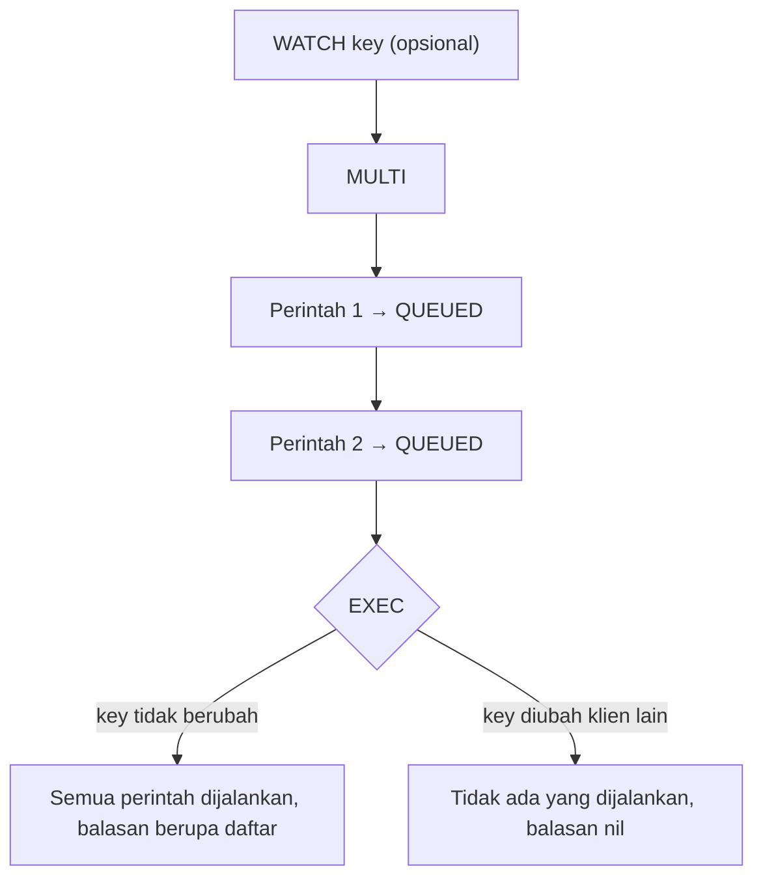

# Transaksi

## Tujuan belajar

Setelah bab ini kamu bisa:

- [ ] Menjelaskan apa yang dijamin dan tidak dijamin oleh transaksi Redis.
- [ ] Menjalankan beberapa perintah sekaligus dengan `MULTI` dan `EXEC`, serta membatalkannya dengan `DISCARD`.
- [ ] Membedakan galat saat perintah diantrekan dan galat saat dijalankan, serta menjelaskan kenapa tidak ada *rollback*.
- [ ] Memakai `WATCH` untuk mendeteksi perubahan dari klien lain (*optimistic locking*).
- [ ] Menulis pola "baca, periksa, tulis" dengan percobaan ulang di Python.

## Prasyarat

- Sudah membaca [String](../struktur-data/string.md), terutama `INCRBY`, `DECRBY`, dan arti `INCR` yang atomik.
- Sudah membaca [Session dan rate limiting](session-dan-rate-limiting.md), karena bab ini menutup celah "dua perintah yang bisa terputus di tengah".
- Container Redis berjalan dan kamu bisa masuk dengan `docker exec -it redis redis-cli` (lihat [Instalasi dengan Docker](../pengenalan/instalasi-dengan-docker.md)).
- Praktik langkah 5 memerlukan **dua terminal** yang sama-sama terhubung ke Redis.
- Versi Redis: `MULTI`, `EXEC`, `DISCARD`, dan `WATCH` tersedia sejak Redis 2.x, jadi aman di `redis:latest`.
- Kondisi awal: tidak ada key berawalan `akun:` yang kamu perlukan.
- Untuk contoh Python: Python 3 dan paket `redis` (`pip install redis`).

## Konsep

Satu perintah Redis, seperti `INCR`, sudah atomik. Tetapi pekerjaan nyata sering butuh beberapa perintah sekaligus, misalnya memindahkan saldo: kurangi akun A, tambah akun B. Jika dua perintah itu dikirim terpisah, klien lain bisa menyela di tengahnya, atau aplikasi bisa berhenti setelah perintah pertama.

**Transaksi** Redis mengelompokkan perintah agar dijalankan **berurutan dan tanpa disela** perintah klien lain. Caranya:[^1]

1. `MULTI` memulai transaksi.
2. Perintah berikutnya tidak dijalankan, hanya diantrekan (Redis membalas `QUEUED`).
3. `EXEC` menjalankan semua perintah di antrean sekaligus dan mengembalikan semua balasannya.

### Apa yang berbeda dari transaksi SQL

| Hal | Transaksi Redis | Transaksi SQL |
|---|---|---|
| Dijalankan tanpa disela klien lain | Ya, saat `EXEC` | Tergantung level isolasi |
| Rollback bila satu perintah gagal | **Tidak ada**; perintah lain tetap jalan[^1] | Ada |
| Membaca di tengah transaksi | Tidak bisa: perintah hanya diantrekan, hasilnya baru ada setelah `EXEC` | Bisa |
| Mendeteksi perubahan klien lain | Lewat `WATCH` | Lewat level isolasi dan kunci |

### Analogi

`MULTI` seperti menulis daftar belanja di kertas, dan `EXEC` seperti menyerahkan kertas itu ke kasir yang akan memprosesnya satu kali penuh tanpa melayani orang lain di tengah. Tetapi jika satu barang ternyata kosong, kasir tidak membatalkan barang lain.

!!! note "Batas analogi"
    Selama kamu menulis daftar, orang lain masih bisa mengubah harga atau stok. Karena itu kita butuh `WATCH`: tanda yang membatalkan penyerahan kertas bila barang yang kamu amati berubah.

## Cara kerja



| Perintah | Fungsi | Balasan |
|---|---|---|
| `MULTI` | Mulai antrean transaksi.[^1] | `OK` |
| `EXEC` | Jalankan antrean.[^2] | Daftar balasan, atau `(nil)` bila `WATCH` terpicu |
| `DISCARD` | Buang antrean.[^3] | `OK` |
| `WATCH key [key ...]` | Awasi key sebelum `MULTI`.[^4] | `OK` |
| `UNWATCH` | Berhenti mengawasi.[^5] | `OK` |

Dua jenis galat:[^1]

- **Saat mengantre** (perintah salah ketik, salah jumlah argumen): `EXEC` menolak seluruh transaksi dengan `EXECABORT`.
- **Saat menjalankan** (misalnya `INCR` pada teks): hanya perintah itu yang gagal; perintah lain tetap dijalankan. Tidak ada rollback.

## Praktik langkah demi langkah

Output di bawah adalah output yang **diharapkan** berdasarkan dokumentasi, bukan hasil eksekusi di komputermu.

**Lingkungan: terminal**

```bash
docker exec -it redis redis-cli
```

Semua langkah berikutnya di **redis-cli**, kecuali dinyatakan lain. Saat berada di dalam transaksi, prompt `redis-cli` biasanya berubah menjadi `127.0.0.1:6379(TX)>`.

### Langkah 1: Pindahkan saldo dengan `MULTI` dan `EXEC`

```text
127.0.0.1:6379> SET akun:A 500
127.0.0.1:6379> SET akun:B 100
127.0.0.1:6379> MULTI
127.0.0.1:6379(TX)> DECRBY akun:A 100
127.0.0.1:6379(TX)> INCRBY akun:B 100
127.0.0.1:6379(TX)> EXEC
```

Kenapa langkah ini diperlukan: pengurangan dan penambahan harus terjadi bersama tanpa disela. Kita mengantrekan keduanya agar dijalankan satu paket.

**Diharapkan:**

```text
OK
OK
OK
QUEUED
QUEUED
1) (integer) 400
2) (integer) 200
```

Cara membaca output: `MULTI` membalas `OK`, tiap perintah membalas `QUEUED` (belum dijalankan), lalu `EXEC` mengembalikan balasan semua perintah berurutan: saldo A kini 400 dan B 200.

### Langkah 2: Batalkan dengan `DISCARD`

```text
127.0.0.1:6379> MULTI
127.0.0.1:6379(TX)> SET percobaan "batal"
127.0.0.1:6379(TX)> DISCARD
127.0.0.1:6379> GET percobaan
```

**Diharapkan:** `OK`, `QUEUED`, `OK`, lalu `(nil)`. Karena `DISCARD`, perintah di antrean tidak pernah dijalankan.

### Langkah 3: Tidak ada rollback

```text
127.0.0.1:6379> SET catatan "teks biasa"
127.0.0.1:6379> MULTI
127.0.0.1:6379(TX)> INCR catatan
127.0.0.1:6379(TX)> SET akun:C 1
127.0.0.1:6379(TX)> EXEC
127.0.0.1:6379> GET akun:C
```

Kenapa dicoba: untuk membuktikan bahwa satu perintah yang gagal tidak membatalkan yang lain. **Diharapkan:**

```text
1) (error) ERR value is not an integer or out of range
2) OK
"1"
```

Cara membaca output: `INCR` gagal karena isinya teks, tetapi `SET akun:C 1` tetap dijalankan, dan `GET` membuktikannya. Jangan berharap Redis memulihkan keadaan seperti di SQL.[^1]

### Langkah 4: Galat saat mengantre

```text
127.0.0.1:6379> MULTI
127.0.0.1:6379(TX)> SET akun:D
127.0.0.1:6379(TX)> SET akun:E 1
127.0.0.1:6379(TX)> EXEC
```

**Diharapkan:** `OK`, lalu `(error) ERR wrong number of arguments for 'set' command`, lalu `QUEUED`, dan akhirnya:

```text
(error) EXECABORT Transaction discarded because of previous errors.
```

Cara membaca output: karena ada galat saat mengantre, `EXEC` membuang **seluruh** transaksi. `GET akun:E` akan membalas `(nil)`.[^1]

### Langkah 5: `WATCH` mendeteksi perubahan klien lain (dua terminal)

**Terminal A:**

```text
127.0.0.1:6379> WATCH akun:A
127.0.0.1:6379> GET akun:A
127.0.0.1:6379> MULTI
127.0.0.1:6379(TX)> DECRBY akun:A 100
```

**Terminal B**, sebelum Terminal A menjalankan `EXEC`:

```text
127.0.0.1:6379> INCRBY akun:A 10
```

**Terminal A:**

```text
127.0.0.1:6379(TX)> EXEC
127.0.0.1:6379> GET akun:A
```

Kenapa dipakai `WATCH`: Terminal A membaca saldo lalu memutuskan sesuatu berdasarkan angka itu. Jika saldo diubah klien lain di antara pembacaan dan `EXEC`, keputusan itu mungkin tidak berlaku lagi. `WATCH` membuat `EXEC` gagal agar aplikasi bisa mengulang dari awal.[^4]

**Diharapkan:** Terminal A: `OK`, `"400"`, `OK`, `QUEUED`. Terminal B: `(integer) 410`. Terminal A: `EXEC` membalas `(nil)`, dan `GET akun:A` membalas `"410"`. Perintah `DECRBY` tidak dijalankan sama sekali.

### Langkah 6: Ulangi tanpa gangguan

**Terminal A:**

```text
127.0.0.1:6379> WATCH akun:A
127.0.0.1:6379> GET akun:A
127.0.0.1:6379> MULTI
127.0.0.1:6379(TX)> DECRBY akun:A 100
127.0.0.1:6379(TX)> EXEC
```

**Diharapkan:** `OK`, `"410"`, `OK`, `QUEUED`, lalu `1) (integer) 310`. Tidak ada yang mengubah `akun:A`, jadi transaksi berhasil. Setelah `EXEC` atau `DISCARD`, semua key otomatis berhenti diawasi.[^4]

### Langkah 7: Bersihkan data latihan

```text
127.0.0.1:6379> DEL akun:A akun:B akun:C catatan percobaan
```

**Diharapkan:** `(integer) 4` (`percobaan` tidak pernah dibuat).

!!! danger "`DEL` tidak bisa dibatalkan"
    Perintah ini menyebut key satu per satu agar tidak ada key lain yang ikut terhapus.

## Contoh lengkap

**Lingkungan: Python** · Kebutuhan: Python 3, paket `redis` (`pip install redis`), dan Redis berjalan di `localhost:6379`.

```python title="transaksi_watch.py"
import redis

r = redis.Redis(host="localhost", port=6379, decode_responses=True)

KEY = "akun:A"


def tarik(jumlah, ganggu=False):
    percobaan = 0
    with r.pipeline() as pipe:
        while True:
            percobaan += 1
            try:
                pipe.watch(KEY)
                saldo = int(pipe.get(KEY))
                if saldo < jumlah:
                    pipe.unwatch()
                    return "saldo kurang", percobaan
                if ganggu and percobaan == 1:
                    r.incrby(KEY, 50)  # klien lain mengubah key
                pipe.multi()
                pipe.decrby(KEY, jumlah)
                pipe.execute()
                return "berhasil", percobaan
            except redis.WatchError:
                continue


r.set(KEY, 100)
print("saldo awal:", r.get(KEY))

hasil, percobaan = tarik(30, ganggu=True)
print(f"hasil: {hasil}, percobaan: {percobaan}")
print("saldo akhir:", r.get(KEY))

hasil, percobaan = tarik(500)
print(f"hasil: {hasil}, percobaan: {percobaan}")

r.delete(KEY)
```

Penjelasan baris penting:

| Baris | Penjelasan |
|---|---|
| `r.pipeline()` | Objek pipeline yang mendukung `WATCH` dan `MULTI`/`EXEC`. |
| `pipe.watch(KEY)` | Mulai mengawasi key. Setelah `watch`, pipeline berjalan langsung (bukan antre) sampai `multi()` dipanggil, jadi `pipe.get` mengembalikan nilai nyata. |
| `if saldo < jumlah` | Pemeriksaan yang tidak bisa dilakukan di dalam `MULTI` karena perintah hanya diantrekan. `unwatch()` melepas pengawasan sebelum keluar. |
| `r.incrby(KEY, 50)` | Mensimulasikan klien lain yang mengubah saldo pada percobaan pertama (lewat koneksi lain). |
| `pipe.multi()` ... `pipe.execute()` | Mengantre `DECRBY` lalu menjalankan transaksi. |
| `except redis.WatchError` | `EXEC` ditolak karena key berubah; loop mengulang dari `watch` dengan saldo baru. |
| `r.delete(KEY)` | Membersihkan key contoh; menghapus key itu. |

Cara menjalankan: `python transaksi_watch.py`.

**Diharapkan:**

```text
saldo awal: 100
hasil: berhasil, percobaan: 2
saldo akhir: 120
hasil: saldo kurang, percobaan: 1
```

Cara membaca output: percobaan pertama gagal karena saldo diubah (100 menjadi 150), percobaan kedua berhasil (150 - 30 = 120). Permintaan 500 ditolak oleh pemeriksaan aplikasi karena saldo hanya 120.

## Kesalahan umum dan troubleshooting

| Gejala | Penyebab dan solusi |
|---|---|
| `EXEC` membalas `(nil)` | `WATCH` terpicu: key yang diawasi berubah sebelum `EXEC`. Ulangi dari `WATCH`. Itu perilaku normal, bukan galat. |
| `(error) EXECABORT Transaction discarded because of previous errors.` | Ada perintah salah saat mengantre. Perbaiki perintahnya dan ulangi dari `MULTI`.[^1] |
| Satu perintah dalam hasil `EXEC` berisi `(error) ...` tetapi yang lain sukses | Tidak ada rollback. Rancang perintah agar aman, dan periksa semua balasan `EXEC`. |
| `(error) ERR MULTI calls can not be nested` | `MULTI` dipanggil di dalam transaksi. Jalankan `EXEC` atau `DISCARD` dulu. |
| `(error) ERR EXEC without MULTI` / `DISCARD without MULTI` | Belum memanggil `MULTI` (atau sudah berakhir). |
| `(error) ERR WATCH inside MULTI is not allowed` | `WATCH` harus dipanggil sebelum `MULTI`.[^4] |
| Membaca nilai di tengah `MULTI` hanya mendapat `QUEUED` | Hasil baru tersedia setelah `EXEC`. Baca dulu di luar transaksi (dengan `WATCH`). |
| Transaksi terus gagal berulang | Key sangat sering berubah (konflik tinggi). Pertimbangkan Lua script (bab berikutnya) atau perintah atomik tunggal. |
| `redis.exceptions.ConnectionError` | Container Redis belum berjalan atau port 6379 tidak terbuka. Cek dengan `docker ps`. |

!!! note "Status verifikasi"
    Sintaks, nilai balik, dan perilaku (`QUEUED`, `EXECABORT`, tanpa rollback, `WATCH`) dicocokkan dengan dokumentasi resmi Redis. Blok output dan skrip Python belum dijalankan di Redis sungguhan saat bab ini ditulis; teks galat persis dan tampilan prompt `(TX)` bisa berbeda antarversi. Bandingkan dengan hasilmu sendiri.

## Latihan

1. Siapkan `akun:X` bernilai 200 dan `akun:Y` bernilai 0. Pindahkan 75 dari X ke Y dengan `MULTI`/`EXEC`. Apa isi balasan `EXEC`?
2. Sebelum menjalankan: `MULTI`, `INCR akun:X`, `LPUSH akun:X 1`, `EXEC`. Perintah mana yang gagal dan apakah `INCR` tetap berlaku? Jalankan lalu bandingkan.
3. Lakukan skenario `WATCH` dengan dua terminal, tetapi Terminal B hanya **membaca** `akun:X` (`GET`). Apakah `EXEC` di Terminal A berhasil? Kenapa?
4. Ubah `transaksi_watch.py` agar mencetak jumlah percobaan maksimal 5 dan berhenti dengan pesan bila terus gagal.
5. Jelaskan dengan kata-katamu kenapa `MULTI`/`EXEC` saja tidak cukup untuk pola "baca saldo, cek cukup, lalu kurangi".

??? success "Petunjuk"
    1. Balasan `EXEC` berupa daftar dua angka.
    2. `LPUSH` pada key String menghasilkan `WRONGTYPE`; ingat tidak ada rollback.
    3. `WATCH` hanya terpicu oleh perubahan, bukan pembacaan.
    4. Ganti `while True` dengan `for` atau batasi `percobaan`.
    5. Pikirkan bahwa hasil baca tidak tersedia di tengah `MULTI` dan saldo bisa berubah antara baca dan `EXEC`.

## Ringkasan

- `MULTI` memulai antrean, `EXEC` menjalankan semuanya berurutan tanpa disela klien lain, `DISCARD` membuang antrean.
- Redis tidak punya rollback: galat saat mengantre membatalkan seluruh transaksi (`EXECABORT`), tetapi galat saat menjalankan hanya menggagalkan perintah itu.
- `WATCH` memasang pengawasan sebelum `MULTI`; bila key berubah, `EXEC` membalas `(nil)` dan tidak ada yang dijalankan, sehingga aplikasi mengulang.
- Pola umum: `WATCH`, baca, periksa, `MULTI`, tulis, `EXEC`, ulangi bila `WatchError`.
- Untuk logika yang rumit atau konflik tinggi, Lua script bisa lebih sederhana.

Berikutnya: [Lua script](lua-script.md) (opsional).

## Referensi resmi

[^1]: Redis, *Transactions*: <https://redis.io/docs/latest/develop/using-commands/transactions/>
[^2]: Redis, *EXEC*: <https://redis.io/docs/latest/commands/exec/>
[^3]: Redis, *DISCARD*: <https://redis.io/docs/latest/commands/discard/>
[^4]: Redis, *WATCH*: <https://redis.io/docs/latest/commands/watch/>
[^5]: Redis, *UNWATCH*: <https://redis.io/docs/latest/commands/unwatch/>

Bacaan tambahan: [`MULTI`](https://redis.io/docs/latest/commands/multi/), [`DECRBY`](https://redis.io/docs/latest/commands/decrby/).
