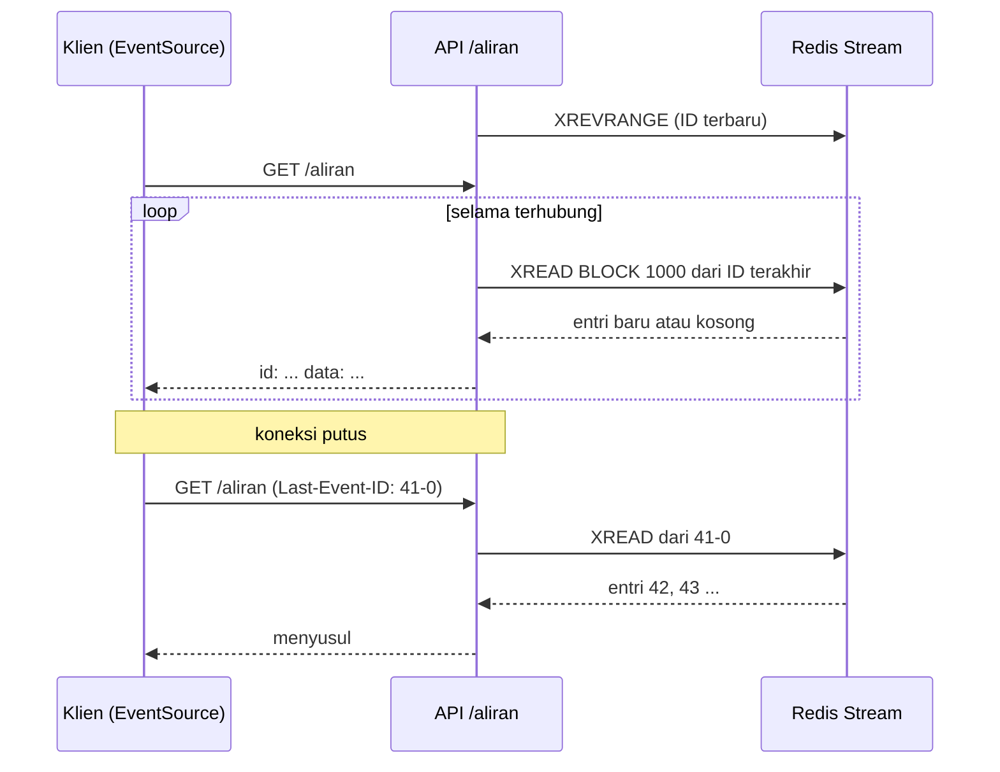

# Fitur realtime

!!! info "Opsional"
    Bab ini boleh dilewati tanpa memutus alur belajar. API katalog sudah lengkap tanpa notifikasi realtime, dan bab Operasi dan pengujian tidak bergantung padanya.

## Tujuan belajar

Setelah bab ini kamu bisa:

- [ ] Menjelaskan kenapa notifikasi perubahan harga dibaca dari Stream, bukan Pub/Sub.
- [ ] Membaca Stream dari FastAPI dengan `XREAD ... BLOCK` dan mengalirkannya ke klien lewat SSE.
- [ ] Mengirim `id:` pada setiap peristiwa dan memakai `Last-Event-ID` agar klien yang terputus bisa menyusul.
- [ ] Menghindari jebakan ID `$` yang dipakai berulang, dan memvalidasi header dari klien.
- [ ] Menguji aliran dengan skrip, termasuk skenario putus lalu menyusul.

## Prasyarat

- Sudah membaca [Implementasi API](implementasi-api.md). Endpoint `PUT /produk/{id}/harga` di sana sudah **menulis** peristiwa ke Stream `katalog:peristiwa`; bab ini menambahkan sisi **pembaca**.
- Sudah membaca [Streams dan consumer group](../pola-aplikasi/streams-consumer-group.md) (`XADD`, `XREAD`, ID entri) dan [FastAPI: fitur realtime dengan SSE](../python/fastapi-fitur-realtime-dengan-sse.md) (format SSE, komentar *keep-alive*, `is_disconnected`). Bab ini tidak mengulang penjelasannya.
- Redis 7.0 atau lebih baru, dan `redis` 5.0.1 atau lebih baru. Kode proyek (`kunci.py`, `sumber.py`, `main.py`) dari bab sebelumnya.
- Kondisi awal: Redis berjalan di `localhost:6379` dan API dari bab sebelumnya bisa dijalankan.

## Konsep

Saat harga produk berubah, klien yang sedang membuka katalog ingin tahu seketika. **SSE** (*Server-Sent Events*) cocok untuk itu: server mendorong teks lewat satu koneksi HTTP yang tetap terbuka. Pertanyaan perancangannya adalah: dari mana server mendapat peristiwa, dan apa yang terjadi bila klien terputus sebentar?

Pub/Sub tidak menyimpan pesan, sehingga klien yang terputus kehilangan semua yang terkirim saat ia pergi (lihat [Pub/Sub](../pola-aplikasi/pub-sub.md)). Karena itu [Perancangan](perancangan.md) memilih **Stream**: setiap peristiwa punya ID urut dan tetap tersimpan. SSE punya mekanisme yang pas: setiap peristiwa boleh memuat bidang `id:`, dan saat peramban menyambung ulang secara otomatis, ia mengirim header `Last-Event-ID` berisi ID terakhir yang ia terima.[^1] Server tinggal membaca Stream mulai dari ID itu, dan klien menyusul tanpa kehilangan apa pun.

### Analogi

Bayangkan papan pengumuman dengan **nomor urut** dan buku log yang menyimpan semua pengumuman. Pembaca yang pulang sebentar mencatat nomor terakhir yang ia baca. Saat kembali, ia berkata "saya terakhir membaca nomor 41", dan petugas memberikan nomor 42 dan seterusnya. Pub/Sub seperti pengeras suara: yang tidak sedang di tempat tidak mendengar apa-apa.

!!! note "Batas analogi"
    Buku log punya halaman terbatas. Stream dipangkas oleh `MAXLEN ~ 1000`, jadi klien yang pergi terlalu lama bisa menemukan entri yang ia lewatkan sudah terhapus. Ia tetap melanjutkan dari entri tertua yang masih ada, tetapi sebagian sudah tidak bisa dikejar.

## Cara kerja



Keputusan penting dan alasannya:

| Keputusan | Alasan |
|---|---|
| Ubah `$` menjadi ID konkret saat koneksi dibuka (`XREVRANGE ... COUNT 1`) | Dokumentasi menegaskan `$` hanya untuk panggilan **pertama**; bila dipakai berulang, entri yang masuk di antara dua panggilan terlewat.[^2] Dengan ID konkret, panggilan berikutnya selalu melanjutkan dari entri terakhir yang sudah dikirim. |
| `BLOCK 1000` (1 detik) | `BLOCK` menahan koneksi sampai ada data atau waktu habis.[^2] Klien dibuat dengan `socket_timeout=2`; `BLOCK` yang lebih lama dari itu dapat memicu `TimeoutError` (perilaku persisnya bergantung versi `redis-py` dan belum diuji di bab ini; lihat Latihan 2). Satu detik juga memberi kesempatan memeriksa `is_disconnected()`. |
| `Last-Event-ID` dipakai bila ada | Inilah mekanisme menyusul. Bila tidak ada, klien hanya menerima peristiwa baru. |
| Header divalidasi dengan regex | Nilai yang bukan ID Stream (mis. teks acak) membuat Redis mengembalikan galat dan API berakhir `500`. Lebih baik menolak dengan `400`. |
| `id:` dan `data:` saja, tanpa `event:` | `onmessage` di peramban hanya menerima peristiwa tanpa nama. Jenis peristiwa cukup berada di dalam JSON. |
| `/aliran` tidak dikenai pembatas laju router | Koneksi panjang bukan "permintaan" berulang; pembatasannya berbentuk jumlah koneksi (lihat Latihan 5). |

## Praktik langkah demi langkah

Output di bawah diperoleh dari menjalankan kode yang sama terhadap `fakeredis`, bukan Redis asli (lihat "Status verifikasi"). Nilai ID entri akan berbeda di komputermu.

### Langkah 1: Buat `realtime.py`, mulai dari ID terbaru

**Lingkungan: Python**

```python title="realtime.py (bagian 1)"
async def id_terbaru(r: redis.Redis) -> str:
    entri = await r.xrevrange(kunci.peristiwa(), count=1)
    return entri[0][0] if entri else "0-0"
```

Kenapa langkah ini diperlukan: ini pengganti `$` yang aman. `XREVRANGE ... COUNT 1` mengambil entri terakhir Stream; kita mulai membaca dari ID-nya, sehingga hanya entri yang lebih baru yang dikirim.

| Baris | Fungsi dan alasan |
|---|---|
| `r.xrevrange(kunci.peristiwa(), count=1)` | Mengambil satu entri dari ujung terbaru. Hasilnya daftar `(id, isi)`. |
| `entri[0][0]` | ID entri terakhir. |
| `"0-0"` | Bila Stream masih kosong, mulai dari awal: semua entri yang nanti muncul akan lebih besar dari `0-0`. |

### Langkah 2: Alirkan peristiwa dengan `XREAD BLOCK`

**Lingkungan: Python**

```python title="realtime.py (bagian 2)"
async def aliran_peristiwa(request: Request, r: redis.Redis, terakhir: str):
    yield ": terhubung\n\n"

    kosong = 0
    while True:
        if await request.is_disconnected():
            break
        hasil = await r.xread({kunci.peristiwa(): terakhir}, count=50, block=1000)
        if not hasil:
            kosong += 1
            if kosong % 15 == 0:
                yield ": ping\n\n"
            continue
        kosong = 0
        for _, entri in hasil:
            for id_entri, isi in entri:
                terakhir = id_entri
                yield f"id: {id_entri}\ndata: {json.dumps(isi)}\n\n"
```

| Baris | Fungsi dan alasan |
|---|---|
| `yield ": terhubung\n\n"` | Komentar SSE yang langsung mengirim byte pertama, sehingga klien tahu koneksi sudah hidup. |
| `request.is_disconnected()` | Berhenti bila klien pergi, sehingga loop dan koneksi Redis tidak menggantung. |
| `r.xread({key: terakhir}, count=50, block=1000)` | Setara `XREAD COUNT 50 BLOCK 1000 STREAMS key terakhir`. Mengembalikan hanya entri dengan ID **lebih besar** dari `terakhir`; bila tidak ada, menunggu hingga 1 detik lalu mengembalikan kosong.[^2] |
| `kosong % 15 == 0` | Setiap sekitar 15 detik tanpa peristiwa, kirim komentar `: ping` agar proxy tidak memutus koneksi diam. |
| `terakhir = id_entri` | Memajukan penanda baca. Inilah yang membuat panggilan berikutnya tidak membaca ulang entri yang sama dan tidak melewatkan yang baru. |
| `f"id: ...\ndata: ...\n\n"` | Satu peristiwa SSE: bidang `id:` untuk `Last-Event-ID`, `data:` berisi JSON dari bidang entri, dan baris kosong sebagai penutup.[^1] |

### Langkah 3: Pasang endpoint, validasi, dan daftarkan router

**Lingkungan: Python**

```python title="realtime.py (bagian 3)"
@router.get("/aliran")
async def aliran(request: Request, r: redis.Redis = Depends(get_redis)):
    terakhir = request.headers.get("last-event-id") or None
    if terakhir is None:
        terakhir = await id_terbaru(r)
    elif not re.fullmatch(r"\d+(-\d+)?", terakhir):
        raise HTTPException(status_code=400, detail="Last-Event-ID tidak valid")
    return StreamingResponse(
        aliran_peristiwa(request, r, terakhir),
        media_type="text/event-stream",
        headers={"Cache-Control": "no-cache", "X-Accel-Buffering": "no"},
    )
```

Lalu di `main.py` tambahkan dua baris (impor dan pendaftaran router):

```python title="main.py (tambahan)"
import realtime
...
app.include_router(realtime.router)
```

| Baris | Fungsi dan alasan |
|---|---|
| `request.headers.get("last-event-id") or None` | Membaca header yang dikirim peramban saat menyambung ulang; string kosong dianggap tidak ada. |
| `re.fullmatch(r"\d+(-\d+)?", ...)` | ID Stream berbentuk `angka` atau `angka-angka`. Selain itu ditolak dengan `400` sebelum menyentuh Redis. |
| `StreamingResponse(..., media_type="text/event-stream")` | Menjadikan generator sebagai respons SSE yang terus mengalir.[^3] |
| `Cache-Control: no-cache`, `X-Accel-Buffering: no` | Mencegah cache dan *buffering* di proxy (mis. Nginx) yang menahan peristiwa. |
| `app.include_router(realtime.router)` | Mendaftarkan `/aliran` dan `/`. Router ini sengaja tanpa `batasi`. |

### Langkah 4: Amati dengan dua terminal

**Lingkungan: terminal**

Jalankan API (`fastapi dev main.py`). Di terminal kedua:

```bash
curl -N http://127.0.0.1:8000/aliran
```

Di terminal ketiga, ubah harga:

```bash
curl -X PUT http://127.0.0.1:8000/produk/1/harga \
  -H "content-type: application/json" -d '{"harga": 48000}'
```

Kenapa: `-N` mematikan *buffering* `curl` agar peristiwa tampil seketika. Di PowerShell, tulis `curl.exe`, dan bila kutip JSON bermasalah pakai skrip di Langkah 5.

**Diharapkan:** terminal kedua langsung mencetak `: terhubung`, lalu setelah `PUT`:

```text
: terhubung

id: 1761566400000-0
data: {"produk": "1", "jenis": "harga", "nilai": "48000"}

```

Cara membaca: bidang Stream bertipe string, jadi semua nilai di `data` berupa string (`"48000"`). Baris `id:` adalah ID entri Stream.

### Langkah 5: Uji putus lalu menyusul dengan skrip

**Lingkungan: Python**

Simpan sebagai `uji_aliran.py`, jalankan `python uji_aliran.py` (API berjalan, dengan `httpx` terpasang).

```python title="uji_aliran.py"
import asyncio
import json

import httpx

BASIS = "http://127.0.0.1:8000"


async def baca(klien, jumlah, last_id=None):
    header = {"Last-Event-ID": last_id} if last_id else {}
    hasil = []
    id_terakhir = None
    async with klien.stream("GET", BASIS + "/aliran", headers=header, timeout=None) as r:
        async for baris in r.aiter_lines():
            if baris.startswith("id: "):
                id_terakhir = baris[4:]
            elif baris.startswith("data: "):
                hasil.append((id_terakhir, json.loads(baris[6:])))
                if len(hasil) == jumlah:
                    break
    return hasil


async def ubah_harga(klien, harga):
    r = await klien.put(BASIS + "/produk/1/harga", json={"harga": harga})
    return r.status_code


async def main():
    async with httpx.AsyncClient() as k:
        pembaca = asyncio.create_task(baca(k, 3))
        await asyncio.sleep(1)  # beri waktu pembaca tersambung
        for harga in (48000, 49000, 50000):
            print("PUT harga", harga, "->", await ubah_harga(k, harga))
        pesan = await pembaca
        for id_entri, isi in pesan:
            print("diterima:", id_entri, isi)

        awal = pesan[0][0]
        kejar = await baca(k, 2, last_id=awal)
        print("menyusul setelah", awal, "->", [isi["nilai"] for _, isi in kejar])

        r = await k.get(BASIS + "/aliran", headers={"Last-Event-ID": "bukan-id"})
        print("Last-Event-ID tidak valid ->", r.status_code)


asyncio.run(main())
```

| Bagian | Fungsi dan alasan |
|---|---|
| `baca(klien, jumlah, last_id)` | Membuka `/aliran`, mengurai baris `id:` dan `data:`, berhenti setelah `jumlah` peristiwa. Keluar dari `async with` memutus koneksi, seperti peramban yang ditutup. |
| `asyncio.create_task(baca(k, 3))` lalu `sleep(1)` | Pembaca disambungkan dulu, baru tiga `PUT` dikirim, sehingga ketiganya diterima sebagai peristiwa baru. |
| `baca(k, 2, last_id=awal)` | Menyambung ulang dengan `Last-Event-ID` entri pertama: server harus mengirim hanya entri **sesudahnya**. |
| `Last-Event-ID: bukan-id` | Membuktikan validasi: harus `400`, bukan `500`. |

**Diharapkan** (ID berbeda di komputermu):

```text
PUT harga 48000 -> 200
PUT harga 49000 -> 200
PUT harga 50000 -> 200
diterima: 1793079932901-0 {'produk': '1', 'jenis': 'harga', 'nilai': '48000'}
diterima: 1793079932904-0 {'produk': '1', 'jenis': 'harga', 'nilai': '49000'}
diterima: 1793079932906-0 {'produk': '1', 'jenis': 'harga', 'nilai': '50000'}
menyusul setelah 1793079932901-0 -> ['49000', '50000']
Last-Event-ID tidak valid -> 400
```

Cara membaca: tiga peristiwa diterima berurutan. Setelah koneksi diputus dan disambung ulang dengan ID pertama, hanya dua yang lain dikirim: pembaca **menyusul** tanpa kehilangan dan tanpa duplikat. Ini yang tidak bisa dilakukan Pub/Sub.

### Langkah 6: Periksa Stream di Redis

**Lingkungan: redis-cli**

```text
XLEN katalog:peristiwa
XRANGE katalog:peristiwa - + COUNT 2
```

Kenapa: peristiwa tetap ada di Stream meski sudah dikirim, itulah yang memungkinkan penyusulan.

**Diharapkan:** `XLEN` mengembalikan jumlah `PUT` yang pernah kamu lakukan (bukan nol), dan `XRANGE` menampilkan dua entri pertama dengan bidang `produk`, `jenis`, dan `nilai`. Entri **tidak** terhapus setelah dibaca; hanya `MAXLEN ~ 1000` yang memangkasnya.

### Langkah 7: Coba di peramban (opsional)

Buka `http://127.0.0.1:8000/`, lalu ubah harga dengan `curl`/skrip. Setiap `PUT` seharusnya menambah satu baris di halaman. Halaman ini memakai `EventSource`, yang otomatis menyambung ulang dan mengirim `Last-Event-ID`. Halaman belum diuji di peramban saat bab ini ditulis.

## Contoh lengkap

**Lingkungan: Python** · Kebutuhan: proyek dari [Implementasi API](implementasi-api.md) (`kunci.py`, `main.py`, `sumber.py`), `fastapi[standard]`, `redis` 5.0.1+, Redis 7.0+.

```python title="realtime.py"
"""realtime.py: aliran peristiwa katalog (SSE) yang dibaca dari Stream."""

import json
import re

import redis.asyncio as redis
from fastapi import APIRouter, Depends, HTTPException, Request
from fastapi.responses import HTMLResponse, StreamingResponse

import kunci

router = APIRouter()

HALAMAN = """<!doctype html>
<meta charset="utf-8">
<title>Peristiwa katalog</title>
<h1>Peristiwa katalog</h1>
<ul id="daftar"></ul>
<script>
  const sumber = new EventSource("/aliran");
  sumber.onmessage = (e) => {
    const p = JSON.parse(e.data);
    const li = document.createElement("li");
    li.textContent = "Produk " + p.produk + ": " + p.jenis + " menjadi " + p.nilai;
    document.getElementById("daftar").appendChild(li);
  };
</script>
"""


def get_redis(request: Request) -> redis.Redis:
    return request.app.state.redis


async def id_terbaru(r: redis.Redis) -> str:
    entri = await r.xrevrange(kunci.peristiwa(), count=1)
    return entri[0][0] if entri else "0-0"


async def aliran_peristiwa(request: Request, r: redis.Redis, terakhir: str):
    yield ": terhubung\n\n"

    kosong = 0
    while True:
        if await request.is_disconnected():
            break
        hasil = await r.xread({kunci.peristiwa(): terakhir}, count=50, block=1000)
        if not hasil:
            kosong += 1
            if kosong % 15 == 0:
                yield ": ping\n\n"
            continue
        kosong = 0
        for _, entri in hasil:
            for id_entri, isi in entri:
                terakhir = id_entri
                yield f"id: {id_entri}\ndata: {json.dumps(isi)}\n\n"


@router.get("/aliran")
async def aliran(request: Request, r: redis.Redis = Depends(get_redis)):
    terakhir = request.headers.get("last-event-id") or None
    if terakhir is None:
        terakhir = await id_terbaru(r)
    elif not re.fullmatch(r"\d+(-\d+)?", terakhir):
        raise HTTPException(status_code=400, detail="Last-Event-ID tidak valid")
    return StreamingResponse(
        aliran_peristiwa(request, r, terakhir),
        media_type="text/event-stream",
        headers={"Cache-Control": "no-cache", "X-Accel-Buffering": "no"},
    )


@router.get("/", response_class=HTMLResponse)
async def beranda():
    return HALAMAN
```

Penjelasan bagian yang belum dibahas di langkah:

| Bagian | Penjelasan |
|---|---|
| `get_redis` di sini | Duplikat kecil dari `main.py`, agar `realtime.py` tidak mengimpor `main` (hindari impor melingkar). |
| `HALAMAN` | Halaman kecil dengan `EventSource`; `onmessage` menerima peristiwa tanpa nama. |
| `@router.get("/")` | Memberi beranda untuk melihat aliran di peramban. |

Cara menjalankan: `fastapi dev main.py` (setelah dua baris tambahan di `main.py`), lalu `python uji_aliran.py` di terminal lain. Hasil yang diharapkan sama dengan Langkah 5.

## Kesalahan umum dan troubleshooting

| Gejala | Penyebab dan solusi |
|---|---|
| `TimeoutError` / respons `503` setelah ±2 detik pada `/aliran` | Dugaan utama: `BLOCK` lebih lama dari `socket_timeout` klien (belum diuji; periksa jejak galatnya). Pertahankan `block=1000` (di bawah 2 detik) atau naikkan `socket_timeout` dengan sadar. |
| Peristiwa kadang terlewat | `$` dipakai di setiap putaran. Selalu pakai ID konkret dan majukan dengan `terakhir = id_entri`.[^2] |
| `/aliran` membalas `400` | Header `Last-Event-ID` bukan ID Stream. Klien yang benar mengirim ID persis seperti yang diterima. |
| `500` dengan pesan galat ID dari Redis | Validasi header tidak dipasang. Pastikan regex di endpoint. |
| Peramban tidak menampilkan apa-apa | `onmessage` tidak menerima peristiwa bernama (`event: ...`). Tulis hanya `id:` dan `data:`. |
| Peristiwa tertahan lalu datang sekaligus | *Buffering* di proxy. Pertahankan `X-Accel-Buffering: no` dan `Cache-Control: no-cache`; pastikan proxy tidak menyangga respons. |
| Koneksi putus tiap sekitar 60 detik | Proxy memutus koneksi diam. Komentar `: ping` setiap ±15 detik mencegahnya; sesuaikan jika proxy lebih agresif. |
| Klien yang lama pergi tidak menerima beberapa peristiwa | `XADD ... MAXLEN ~ 1000` memangkas entri tertua.[^4] Naikkan batas atau sediakan endpoint riwayat dari database. |
| `connected_clients` di `INFO clients` terus naik | Setiap klien SSE menahan satu koneksi Redis dari pool. Pantau ([Monitoring](../operasi/monitoring.md)) dan batasi jumlah koneksi (Latihan 5). |
| Data berbentuk string, bukan angka | Bidang Stream selalu string. Ubah di klien bila perlu (`Number(p.nilai)`). |

!!! note "Status verifikasi"
    Kode `realtime.py` dan `uji_aliran.py` **dijalankan** (Python 3.14.7, FastAPI 0.162.0, `redis` 8.1.0, Uvicorn 0.54.0, httpx 0.28.1), dan output Langkah 5 adalah hasil nyata. Server uji memakai **fakeredis 2.40.0**, bukan Redis asli (Docker tidak aktif saat bab ditulis), jadi yang terbukti adalah logika aplikasi, bukan perilaku Redis asli. Blok `curl`, `redis-cli`, dan halaman peramban **belum dijalankan**. Perilaku `XREAD`, `BLOCK`, dan ID dicocokkan dengan dokumentasi resmi.

## Latihan

1. Jalankan Langkah 4 dengan tiga terminal. Ubah harga dua kali, lalu hentikan `curl -N` (`Ctrl+C`), ubah harga sekali lagi, dan sambungkan ulang dengan `curl -N -H "Last-Event-ID: <ID entri pertama>" http://127.0.0.1:8000/aliran`. Entri mana saja yang muncul?
2. Sebelum menjalankan: apa yang terjadi bila `block` diubah menjadi `5000` sedangkan `socket_timeout=2`? Coba dan cocokkan.
3. Ubah `aliran_peristiwa` agar hanya mengirim peristiwa produk tertentu (parameter `?produk=1`). Di mana penyaringan sebaiknya dilakukan, di Redis atau di Python, dan kenapa?
4. Ubah `PUT` agar juga menulis peristiwa `stok` dengan nilai acak. Apakah `uji_aliran.py` perlu diubah? Jelaskan.
5. Rancang pembatas jumlah koneksi `/aliran` per klien memakai Redis (kunci baru di kamus). Struktur data dan TTL apa yang kamu pilih?

??? success "Petunjuk"
    1. `XREAD` mengembalikan entri dengan ID **lebih besar** dari ID yang diberikan.
    2. Baca urutan: `socket_timeout` berlaku pada pembacaan balasan.
    3. Stream tidak bisa menyaring per bidang; baca semuanya lalu saring, atau pakai Stream per produk bila beban besar.
    4. Skrip membaca bidang `nilai`; pikirkan peristiwa dengan `jenis` berbeda.
    5. Counter dengan `INCR` dan `DECR` saat koneksi ditutup, atau Sorted Set berisi id koneksi dengan skor waktu; ingat TTL agar tidak bocor bila proses mati.

## Ringkasan

- Notifikasi yang tidak boleh hilang dibaca dari **Stream**, bukan Pub/Sub, karena entri tetap tersimpan dan punya ID urut.
- Server mengalirkan peristiwa lewat SSE dengan bidang `id:` dan `data:`; peramban yang menyambung ulang mengirim `Last-Event-ID`, dan server membaca Stream dari ID itu.
- Pakai `XREAD ... BLOCK` dengan nilai di bawah `socket_timeout`, ubah `$` menjadi ID konkret saat koneksi dibuka, dan majukan penanda baca setiap entri.
- Validasi `Last-Event-ID` agar header palsu menghasilkan `400`, bukan `500`.
- Stream dipangkas oleh `MAXLEN ~`, jadi penyusulan terbatas pada entri yang masih ada.

Berikutnya: [Operasi dan pengujian](operasi-dan-pengujian.md), yang menjaga seluruh proyek tetap tahan, aman, dan teruji.

## Referensi resmi

[^1]: MDN, *Using server-sent events*: <https://developer.mozilla.org/en-US/docs/Web/API/Server-sent_events/Using_server-sent_events>
[^2]: Redis, *XREAD*: <https://redis.io/docs/latest/commands/xread/>
[^3]: FastAPI, *Custom Response: StreamingResponse*: <https://fastapi.tiangolo.com/advanced/custom-response/>
[^4]: Redis, *XADD*: <https://redis.io/docs/latest/commands/xadd/>

Bacaan tambahan: [`XREVRANGE`](https://redis.io/docs/latest/commands/xrevrange/), [`XRANGE`](https://redis.io/docs/latest/commands/xrange/), [Redis Streams](https://redis.io/docs/latest/develop/data-types/streams/).
