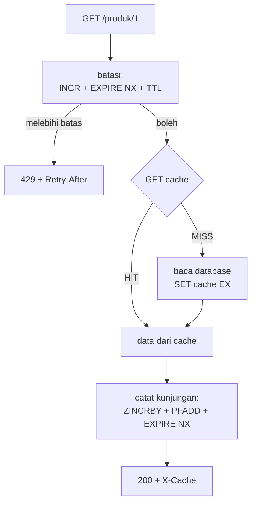

# Implementasi API

## Tujuan belajar

Setelah bab ini kamu bisa:

- [ ] Menyusun proyek FastAPI menjadi beberapa modul yang memakai kamus key dari bab Perancangan.
- [ ] Menerapkan cache-aside (F1) dan pembatas laju (F2) pada satu API, dengan satu pintu untuk nama key.
- [ ] Mencatat peringkat produk (F3) dan pengunjung unik (F4) tanpa memperlambat respons.
- [ ] Menulis peristiwa perubahan harga ke Stream (F5) dengan urutan operasi yang benar.
- [ ] Menguji seluruh API dengan skrip dan mencocokkan hasilnya dengan kamus key.

## Prasyarat

- Sudah membaca [Perancangan](perancangan.md). Bab ini memakai `kunci.py` dari sana **tanpa perubahan** dan tidak mengulang alasan pemilihan tipe datanya.
- Sudah membaca [Dasar FastAPI dengan Redis](../python/dasar-fastapi-dengan-redis.md) dan [FastAPI: caching dan rate limit](../python/fastapi-caching-dan-rate-limit.md). Cara kerja `lifespan`, `Depends`, cache-aside, dan pembatas laju sudah dijelaskan di sana; bab ini fokus pada **merakitnya jadi aplikasi proyek**.
- Perangkat lunak: Python 3, `pip`, Docker. Paket yang dipasang: `fastapi[standard]`, `redis` (versi dengan `aclose()`, yaitu 5.0.1 atau lebih baru), dan `httpx`.
- Redis 7.0 atau lebih baru (opsi `NX` pada `EXPIRE` butuh 7.0). Image `redis:latest` memenuhinya.
- Kondisi awal: tidak ada key berawalan `katalog:` di Redis yang akan kamu pakai.

## Konsep

Di bab FastAPI sebelumnya, setiap fitur dilatih satu per satu di satu berkas kecil. Aplikasi sungguhan berbeda: **satu permintaan sering menyentuh beberapa fitur sekaligus**. Permintaan `GET /produk/1` harus dicek batas lajunya, dilayani dari cache atau database, lalu dicatat sebagai kunjungan untuk peringkat dan hitungan pengunjung. Yang baru di bab ini bukan perintah Redisnya, melainkan **keputusan perakitan**:

1. **Urutan operasi.** Hal murah dan pelindung dikerjakan lebih dulu (batas laju), pekerjaan utama sesudahnya, pencatatan terakhir.
2. **Mana yang harus atomik.** Pembatas laju memakai transaksi (`MULTI`/`EXEC`) agar `INCR` dan `EXPIRE` tidak terpisah. Pencatatan statistik tidak perlu atomik, jadi cukup dikirim bersama dalam satu pipeline untuk menghemat perjalanan jaringan (lihat [Pipeline dan connection pool](../python/pipeline-dan-connection-pool.md)).
3. **Satu pintu untuk nama key.** Kode aplikasi tidak pernah menulis string seperti `"katalog:rate:..."`; ia memanggil fungsi dari `kunci.py`.
4. **Sumber kebenaran tetap di database.** Redis hanya cache dan penyimpan statistik; ubah data di database dulu, baru sinkronkan Redis.

### Analogi

Bayangkan kasir toko. Satu pelanggan datang: kasir mengecek apakah pelanggan itu sudah terlalu sering bolak-balik (batas laju), mengambil barang dari rak depan bila ada (cache) atau dari gudang bila tidak (database), lalu mencatat di buku kunjungan. Kasir tidak menunda pelanggan hanya demi mencatat, dan semua catatan memakai format yang sama dari satu buku panduan (`kunci.py`).

!!! note "Batas analogi"
    Kasir bisa berhenti sejenak bila bukunya rusak. Di aplikasi ini, bila Redis tidak terjangkau, API mengembalikan `503` untuk semua endpoint yang memakai Redis. Itu pilihan sederhana; aplikasi yang lebih matang bisa memilih tetap melayani dari database tanpa cache (lihat Latihan 5).

## Cara kerja



Keputusan perakitan dan alasannya:

| Keputusan | Alasan |
|---|---|
| `batasi` dipasang di `APIRouter`, bukan di tiap endpoint | Semua endpoint data otomatis terbatasi; `/kesehatan` dan `PUT` sengaja di luar router. |
| Catat kunjungan **setelah** data siap | Produk yang tidak ada (404) tidak dihitung sebagai kunjungan. |
| Pencatatan memakai `pipeline(transaction=False)` | Tiga perintah, satu perjalanan jaringan, tanpa biaya `MULTI`/`EXEC` karena tidak perlu atomik. |
| `EXPIRE ... NX` pada key pengunjung | TTL dipasang sekali; tanpa `NX`, TTL diperpanjang di setiap kunjungan dan key tidak pernah habis. |
| Urutan `PUT`: database, hapus cache, lalu `XADD` | Pembaca yang menerima peristiwa selalu membaca data baru, bukan cache lama. |
| `host.replace(":", "-")` | Alamat IPv6 memuat `:`, yang ditolak `kunci.rate()` agar dua key tidak tertukar. |

## Praktik langkah demi langkah

Output di bawah diperoleh dari menjalankan kode yang sama terhadap `fakeredis`, bukan Redis asli (lihat catatan "Status verifikasi"). Waktu dalam milidetik dan sisa waktu akan berbeda di komputermu. Folder latihan dibuat di luar repository materi.

### Langkah 1: Siapkan folder, lingkungan, dan Redis

**Lingkungan: terminal**

```bash
mkdir katalog-api && cd katalog-api
python -m venv .venv
source .venv/bin/activate     # Windows PowerShell: .venv\Scripts\Activate.ps1
pip install "fastapi[standard]" redis httpx
docker run -d --name redis-proyek -p 127.0.0.1:6379:6379 redis:latest
```

Salin `kunci.py` dari bab [Perancangan](perancangan.md) ke folder ini tanpa mengubahnya.

Kenapa: lingkungan virtual menjaga paket proyek terpisah dari sistem. Pemetaan `127.0.0.1:6379:6379` membuat Redis hanya terjangkau dari komputermu sendiri (lihat [Keamanan](../operasi/keamanan.md)). Container `redis-proyek` memakai nama baru agar tidak bentrok dengan container `redis` dari bab lain.

**Terverifikasi:** ID container yang panjang. `pip` mencetak daftar paket yang terpasang.

### Langkah 2: Buat database sumber (simulasi)

**Lingkungan: Python**

```python title="sumber.py"
"""sumber.py: database sumber (disimulasikan). Di aplikasi nyata diganti SQL."""

import asyncio

_PRODUK = {
    1: {"id": 1, "nama": "Kopi Arabika", "harga": 45000},
    2: {"id": 2, "nama": "Teh Melati", "harga": 18000},
    3: {"id": 3, "nama": "Gula Aren", "harga": 22000},
}
PANGGILAN = {"jumlah": 0}
LATENSI = 0.5  # detik; tes di bab berikutnya mengubahnya menjadi 0


async def ambil_produk(produk_id):
    await asyncio.sleep(LATENSI)  # meniru kueri database yang lambat
    PANGGILAN["jumlah"] += 1
    produk = _PRODUK.get(produk_id)
    return dict(produk) if produk else None


async def ubah_harga(produk_id, harga):
    produk = _PRODUK.get(produk_id)
    if produk is None:
        return None
    produk["harga"] = harga
    return dict(produk)
```

| Baris | Fungsi dan alasan |
|---|---|
| `await asyncio.sleep(LATENSI)` | Meniru database lambat (0,5 detik), sehingga selisih MISS (lambat) dan HIT (cepat) terlihat jelas. Berupa konstanta agar tes bisa membuatnya 0. |
| `PANGGILAN` | Penghitung panggilan database, supaya kamu bisa membuktikan cache bekerja. |
| `dict(produk)` | Mengembalikan salinan; pemanggil tidak bisa mengubah data sumber tanpa lewat `ubah_harga`. |

### Langkah 3: Dasar aplikasi, koneksi Redis, dan pembatas laju

**Lingkungan: Python**

Buat `main.py` dengan bagian pertama berikut (lengkapnya ada di "Contoh lengkap"). Bagian `lifespan`, `get_redis`, dan penanganan `503` sama dengan [Dasar FastAPI dengan Redis](../python/dasar-fastapi-dengan-redis.md).

```python title="main.py (bagian 1)"
BATAS = int(os.environ.get("BATAS_PER_JENDELA", "10"))


def id_klien(request: Request) -> str:
    host = request.client.host if request.client else "tidak-diketahui"
    return host.replace(":", "-")  # alamat IPv6 memuat ':'


def hari_ini() -> str:
    return datetime.now(timezone.utc).strftime("%Y%m%d")


async def batasi(
    request: Request, response: Response, r: redis.Redis = Depends(get_redis)
):
    key = kunci.rate(id_klien(request))
    async with r.pipeline(transaction=True) as pipe:
        pipe.incr(key)
        pipe.expire(key, kunci.TTL_RATE, nx=True)
        pipe.ttl(key)
        hitungan, _, sisa_waktu = await pipe.execute()
    # ... header X-RateLimit-* dan penolakan 429: lihat "Contoh lengkap"
```

| Baris | Fungsi dan alasan |
|---|---|
| `BATAS` dari variabel lingkungan | Batas bisa diubah tanpa mengedit kode (mis. untuk pengujian). |
| `kunci.rate(id_klien(request))` | Nama key hanya dari `kunci.py`; `id_klien` membersihkan `:`. |
| `pipeline(transaction=True)` | `INCR`, `EXPIRE NX`, dan `TTL` dikirim sebagai satu transaksi, sehingga key tidak bisa tersisa tanpa TTL bila proses berhenti di antaranya (risiko pola dua perintah di [Session dan rate limiting](../pola-aplikasi/session-dan-rate-limiting.md)). |
| `kunci.TTL_RATE` | Panjang jendela diambil dari kamus key, bukan angka 60 yang ditulis ulang. |

### Langkah 4: Endpoint produk dengan cache dan pencatatan kunjungan

**Lingkungan: Python**

```python title="main.py (bagian 2)"
async def catat_kunjungan(r: redis.Redis, produk_id: int, klien: str):
    hari = hari_ini()
    async with r.pipeline(transaction=False) as pipe:
        pipe.zincrby(kunci.populer(), 1, f"produk:{produk_id}")
        pipe.pfadd(kunci.pengunjung(hari), klien)
        pipe.expire(kunci.pengunjung(hari), kunci.TTL_PENGUNJUNG, nx=True)
        await pipe.execute()


router = APIRouter(dependencies=[Depends(batasi)])


@router.get("/produk/{produk_id}")
async def get_produk(produk_id: int, request: Request, response: Response,
                     r: redis.Redis = Depends(get_redis)):
    key = kunci.cache_produk(produk_id)
    tersimpan = await r.get(key)
    if tersimpan is not None:
        data = json.loads(tersimpan)
        response.headers["X-Cache"] = "HIT"
    else:
        data = await sumber.ambil_produk(produk_id)
        if data is None:
            raise HTTPException(status_code=404, detail="Produk tidak ada")
        await r.set(key, json.dumps(data), ex=kunci.TTL_CACHE_PRODUK)
        response.headers["X-Cache"] = "MISS"

    await catat_kunjungan(r, produk_id, id_klien(request))
    return data
```

| Baris | Fungsi dan alasan |
|---|---|
| `hari = hari_ini()` | Tanggal dihitung sekali, supaya `PFADD` dan `EXPIRE` memakai key yang sama walau lewat tengah malam. |
| `pipe.zincrby(...)` | Menambah skor produk di peringkat (F3). |
| `pipe.pfadd(...)` | Mencatat klien sebagai pengunjung unik hari ini (F4). |
| `pipe.expire(..., nx=True)` | Memasang TTL tujuh hari satu kali. |
| `APIRouter(dependencies=[Depends(batasi)])` | Semua endpoint di router ini terbatasi, tanpa mengulang `Depends` di tiap fungsi.[^1] |
| `ex=kunci.TTL_CACHE_PRODUK` | Cache selalu ditulis dengan TTL; `SET` tanpa `EX` akan menghapus TTL ([Key dan expiry](../pengenalan/key-dan-expiry.md)). |
| `raise HTTPException(404)` sebelum `catat_kunjungan` | Produk tidak ada tidak dihitung sebagai kunjungan. |

### Langkah 5: Peringkat, pengunjung, dan perubahan harga

**Lingkungan: Python**

```python title="main.py (bagian 3)"
@router.get("/populer")
async def populer(jumlah: int = Query(3, ge=1, le=20), r: redis.Redis = Depends(get_redis)):
    peringkat = await r.zrange(kunci.populer(), 0, jumlah - 1, desc=True, withscores=True)
    return [{"produk_id": int(a.split(":")[1]), "dilihat": int(s)} for a, s in peringkat]


@app.put("/produk/{produk_id}/harga")
async def ubah_harga(produk_id: int, baru: HargaBaru, r: redis.Redis = Depends(get_redis)):
    data = await sumber.ubah_harga(produk_id, baru.harga)
    if data is None:
        raise HTTPException(status_code=404, detail="Produk tidak ada")
    await r.delete(kunci.cache_produk(produk_id))
    await r.xadd(
        kunci.peristiwa(),
        {"produk": produk_id, "jenis": "harga", "nilai": baru.harga},
        maxlen=kunci.PANJANG_STREAM,
        approximate=True,
    )
    return data
```

| Baris | Fungsi dan alasan |
|---|---|
| `r.zrange(..., desc=True, withscores=True)` | Setara `ZRANGE ... REV WITHSCORES`: produk teratas dari skor tertinggi. |
| `Query(3, ge=1, le=20)` | Membatasi jumlah hasil agar tidak ada yang meminta peringkat sangat panjang.[^2] |
| `sumber.ubah_harga` dipanggil pertama | Database adalah sumber kebenaran; Redis menyusul. |
| `r.delete(cache)` | Menghapus cache lama, sehingga pembacaan berikutnya menjadi MISS dan mengambil harga baru. |
| `r.xadd(..., maxlen=..., approximate=True)` | Setara `XADD ... MAXLEN ~ 1000 *`: menulis peristiwa dan membatasi panjang Stream.[^3] Pembacaan peristiwa ini dikerjakan di bab Fitur realtime. |

### Langkah 6: Jalankan server dan uji dengan skrip

**Lingkungan: terminal**

```bash
fastapi dev main.py
```

Di terminal kedua (dengan lingkungan virtual yang sama), simpan skrip berikut sebagai `uji_katalog.py` lalu jalankan `python uji_katalog.py`.

**Lingkungan: Python**

```python title="uji_katalog.py"
import time
from datetime import datetime, timezone

import httpx

BASIS = "http://127.0.0.1:8000"


def minta(klien, metode, jalur, **kw):
    mulai = time.perf_counter()
    r = klien.request(metode, BASIS + jalur, **kw)
    return r, (time.perf_counter() - mulai) * 1000


with httpx.Client() as k:
    for nomor in (1, 2):
        r, ms = minta(k, "GET", "/produk/1")
        print(f"GET /produk/1 #{nomor}: {r.status_code} {r.headers['x-cache']} {ms:.0f} ms")

    r, _ = minta(k, "PUT", "/produk/1/harga", json={"harga": 47000})
    print("PUT harga:", r.status_code, r.json()["harga"])

    r, _ = minta(k, "GET", "/produk/1")
    print("GET setelah PUT:", r.status_code, r.headers["x-cache"], r.json()["harga"])

    minta(k, "GET", "/produk/2")
    r, _ = minta(k, "GET", "/populer?jumlah=2")
    print("populer:", r.json())

    hari = datetime.now(timezone.utc).strftime("%Y%m%d")
    r, _ = minta(k, "GET", f"/pengunjung/{hari}")
    print("pengunjung:", r.json())

    status = []
    for _ in range(8):
        r, _ = minta(k, "GET", "/produk/1")
        status.append(r.status_code)
    print("banjir 8 permintaan:", status)
    print("Retry-After:", r.headers.get("retry-after"))

    r, _ = minta(k, "GET", "/statistik")
    print("panggilan database:", r.json()["jumlah"])
```

Kenapa: skrip menjalankan seluruh jalur API berurutan dan mencetak ringkasan yang bisa dibandingkan dengan perhitunganmu. Sebelum `banjir`, skrip sudah memakai 6 permintaan terbatas, sehingga 4 berikutnya lolos dan sisanya ditolak (batas 10).

**Terverifikasi** (waktu dan nilai `Retry-After` berbeda):

```text
GET /produk/1 #1: 200 MISS 532 ms
GET /produk/1 #2: 200 HIT 2 ms
PUT harga: 200 47000
GET setelah PUT: 200 MISS 47000
populer: [{'produk_id': 1, 'dilihat': 3}, {'produk_id': 2, 'dilihat': 1}]
pengunjung: {'tanggal': '20261027', 'perkiraan': 1}
banjir 8 permintaan: [200, 200, 200, 200, 429, 429, 429, 429]
Retry-After: 58
panggilan database: 3
```

Cara membaca: permintaan pertama MISS dan lambat (database), kedua HIT dan cepat. Setelah harga diubah, cache dihapus sehingga permintaan berikutnya MISS lagi dengan harga baru. `/populer` menunjukkan produk 1 dilihat 3 kali (dua sebelum `PUT`, satu sesudahnya) dan produk 2 satu kali. Satu klien berarti `pengunjung` 1. Dari 8 permintaan beruntun, 4 lolos (total 10) dan 4 ditolak dengan `429`; `Retry-After` adalah sisa detik jendela. `panggilan database` 3 karena hanya tiga MISS. Jalankan ulang skrip setelah 60 detik; sebelum itu sisa kuota membuat hasilnya berbeda.

### Langkah 7: Periksa key di Redis

**Lingkungan: terminal, lalu redis-cli**

```bash
docker exec -it redis-proyek redis-cli
```

```text
SCAN 0 MATCH katalog:* COUNT 100
TYPE katalog:populer
XLEN katalog:peristiwa
ZRANGE katalog:populer 0 -1 REV WITHSCORES
```

Kenapa: ini menutup lingkaran dengan [Perancangan](perancangan.md): key yang benar-benar dibuat aplikasi harus sama dengan kamus key.

**Terverifikasi:**

```text
1) "0"
2) 1) "katalog:rate:127.0.0.1"
   2) "katalog:populer"
   3) "katalog:pengunjung:20261027"
   4) "katalog:peristiwa"
   5) "katalog:cache:produk:1"
   6) "katalog:cache:produk:2"
"zset"
(integer) 1
1) "produk:1"
2) "7"
3) "produk:2"
4) "1"
```

Cara membaca: ada lima jenis key sesuai kamus (urutan bisa berbeda). `XLEN` bernilai 1 karena satu kali `PUT`. Skor `produk:1` adalah 7: tiga kunjungan sebelum "banjir" ditambah empat permintaan "banjir" yang lolos.

### Langkah 8: Bersihkan

**Lingkungan: terminal**

Hentikan server (`Ctrl+C`), lalu:

```bash
docker rm -f redis-proyek
```

!!! danger "Perintah ini menghapus data"
    `docker rm -f` menghapus container beserta isinya. Container ini tidak memakai volume, jadi tidak ada yang perlu diselamatkan.

## Contoh lengkap

**Lingkungan: Python** · Kebutuhan: Python 3, `fastapi[standard]`, `redis` 5.0.1+, Redis 7.0+ di `localhost:6379` (atau `REDIS_URL`), serta `kunci.py` dan `sumber.py` di folder yang sama.

```python title="main.py"
import json
import os
from contextlib import asynccontextmanager
from datetime import datetime, timezone

import redis.asyncio as redis
from fastapi import APIRouter, Depends, FastAPI, HTTPException, Path, Query, Request, Response
from fastapi.responses import JSONResponse
from pydantic import BaseModel, Field
from redis.exceptions import ConnectionError as RedisConnectionError
from redis.exceptions import TimeoutError as RedisTimeoutError

import kunci
import sumber

BATAS = int(os.environ.get("BATAS_PER_JENDELA", "10"))


@asynccontextmanager
async def lifespan(app: FastAPI):
    url = os.environ.get("REDIS_URL", "redis://localhost:6379/0")
    app.state.redis = redis.from_url(
        url, decode_responses=True, socket_connect_timeout=2, socket_timeout=2
    )
    yield
    await app.state.redis.aclose()


app = FastAPI(lifespan=lifespan)


def get_redis(request: Request) -> redis.Redis:
    return request.app.state.redis


async def redis_tidak_tersedia(request: Request, exc: Exception):
    return JSONResponse(status_code=503, content={"detail": "Redis tidak tersedia"})


for kelas in (RedisConnectionError, RedisTimeoutError):
    app.add_exception_handler(kelas, redis_tidak_tersedia)


def id_klien(request: Request) -> str:
    host = request.client.host if request.client else "tidak-diketahui"
    return host.replace(":", "-")  # alamat IPv6 memuat ':'


def hari_ini() -> str:
    return datetime.now(timezone.utc).strftime("%Y%m%d")


async def batasi(
    request: Request, response: Response, r: redis.Redis = Depends(get_redis)
):
    key = kunci.rate(id_klien(request))
    async with r.pipeline(transaction=True) as pipe:
        pipe.incr(key)
        pipe.expire(key, kunci.TTL_RATE, nx=True)
        pipe.ttl(key)
        hitungan, _, sisa_waktu = await pipe.execute()

    header = {
        "X-RateLimit-Limit": str(BATAS),
        "X-RateLimit-Remaining": str(max(0, BATAS - hitungan)),
    }
    if hitungan > BATAS:
        header["Retry-After"] = str(max(sisa_waktu, 1))
        raise HTTPException(
            status_code=429, detail="Terlalu banyak permintaan", headers=header
        )
    for nama, nilai in header.items():
        response.headers[nama] = nilai


async def catat_kunjungan(r: redis.Redis, produk_id: int, klien: str):
    hari = hari_ini()
    async with r.pipeline(transaction=False) as pipe:
        pipe.zincrby(kunci.populer(), 1, f"produk:{produk_id}")
        pipe.pfadd(kunci.pengunjung(hari), klien)
        pipe.expire(kunci.pengunjung(hari), kunci.TTL_PENGUNJUNG, nx=True)
        await pipe.execute()


router = APIRouter(dependencies=[Depends(batasi)])


@router.get("/produk/{produk_id}")
async def get_produk(
    produk_id: int,
    request: Request,
    response: Response,
    r: redis.Redis = Depends(get_redis),
):
    key = kunci.cache_produk(produk_id)
    tersimpan = await r.get(key)
    if tersimpan is not None:
        data = json.loads(tersimpan)
        response.headers["X-Cache"] = "HIT"
    else:
        data = await sumber.ambil_produk(produk_id)
        if data is None:
            raise HTTPException(status_code=404, detail="Produk tidak ada")
        await r.set(key, json.dumps(data), ex=kunci.TTL_CACHE_PRODUK)
        response.headers["X-Cache"] = "MISS"

    await catat_kunjungan(r, produk_id, id_klien(request))
    return data


@router.get("/populer")
async def populer(
    jumlah: int = Query(3, ge=1, le=20), r: redis.Redis = Depends(get_redis)
):
    peringkat = await r.zrange(kunci.populer(), 0, jumlah - 1, desc=True, withscores=True)
    return [
        {"produk_id": int(anggota.split(":")[1]), "dilihat": int(skor)}
        for anggota, skor in peringkat
    ]


@router.get("/pengunjung/{tanggal}")
async def pengunjung(
    tanggal: str = Path(pattern=r"^\d{8}$"), r: redis.Redis = Depends(get_redis)
):
    return {"tanggal": tanggal, "perkiraan": await r.pfcount(kunci.pengunjung(tanggal))}


app.include_router(router)


class HargaBaru(BaseModel):
    harga: int = Field(gt=0)


@app.put("/produk/{produk_id}/harga")
async def ubah_harga(
    produk_id: int, baru: HargaBaru, r: redis.Redis = Depends(get_redis)
):
    data = await sumber.ubah_harga(produk_id, baru.harga)
    if data is None:
        raise HTTPException(status_code=404, detail="Produk tidak ada")
    await r.delete(kunci.cache_produk(produk_id))
    await r.xadd(
        kunci.peristiwa(),
        {"produk": produk_id, "jenis": "harga", "nilai": baru.harga},
        maxlen=kunci.PANJANG_STREAM,
        approximate=True,
    )
    return data


@app.get("/kesehatan")
async def kesehatan(r: redis.Redis = Depends(get_redis)):
    return {"redis": await r.ping()}


@app.get("/statistik")
async def statistik():
    return sumber.PANGGILAN
```

Penjelasan bagian yang belum dibahas di langkah:

| Bagian | Penjelasan |
|---|---|
| `Path(pattern=r"^\d{8}$")` | Menolak tanggal yang bukan 8 digit sebelum sampai ke `kunci.pengunjung`, sehingga tidak ada key aneh.[^2] |
| `@router.get("/pengunjung/...")` | `PFCOUNT` mengembalikan jumlah **perkiraan** pengunjung unik. |
| `@app.get("/kesehatan")` | Di luar router agar pemeriksaan kesehatan tidak ikut dibatasi dan tidak menaikkan statistik. |
| `app.include_router(router)` | Harus dipanggil setelah semua endpoint router didaftarkan. |

Cara menjalankan: `fastapi dev main.py`, lalu `python uji_katalog.py` di terminal lain. Hasil yang diharapkan sama dengan Langkah 6.

## Kesalahan umum dan troubleshooting

| Gejala | Penyebab dan solusi |
|---|---|
| `ModuleNotFoundError: No module named 'kunci'` | `kunci.py` tidak ada di folder yang sama dengan `main.py`, atau server dijalankan dari folder lain. Jalankan `fastapi dev main.py` dari folder proyek. |
| `ValueError: bagian key tidak boleh kosong atau memuat ':'` | Id klien atau produk memuat `:` (mis. alamat IPv6). Bersihkan dulu seperti `id_klien`. |
| Semua permintaan `503` dengan detail `Redis tidak tersedia` | Redis tidak berjalan atau port salah. Cek `docker ps`, lalu `REDIS_URL`. |
| `429` muncul sejak permintaan pertama | Sisa jendela dari uji sebelumnya. Tunggu 60 detik, atau hapus key: `DEL katalog:rate:127.0.0.1` di `redis-cli`. |
| `X-Cache` selalu `MISS` | TTL tidak terpasang, key salah, atau cache terus dihapus. Cek `TTL katalog:cache:produk:1` (harus sekitar 300). |
| Harga lama tetap muncul setelah `PUT` | `delete` cache tidak jalan atau `PUT` hanya mengubah database di proses lain. Pastikan urutan database, hapus cache, `XADD` seperti di kode. |
| `ERR syntax error` pada `EXPIRE ... NX` | Redis di bawah 7.0. Pakai 7.0+, atau pasang TTL hanya bila `INCR` membalas 1. |
| `katalog:pengunjung:...` tidak punya TTL | `EXPIRE ... NX` tidak sempat jalan (pipeline gagal). Periksa `TTL`; perilaku ini mirip risiko pola dua perintah di bab rate limit. |
| `422 Unprocessable Entity` pada `/pengunjung/2026-10-27` | Tanggal harus 8 digit tanpa tanda hubung (`20261027`). |

!!! note "Status verifikasi"
    Perintah, nilai balik, dan skrip di bab ini dijalankan di Redis 8.10.3 (`redis:latest`) pada 2026-10-27, dengan Python 3.12.3 dan redis-py 8.1.0, FastAPI 0.162.0, Uvicorn 0.54.0, pytest 9.1.1, fakeredis 2.40.0. Sintaks juga dicocokkan dengan dokumentasi resmi Redis. Nilai yang berubah tiap eksekusi (ID, TTL, waktu, urutan, alamat IP) bisa berbeda di komputermu, dan teks galat bisa berbeda antarversi. Tampilan prompt interaktif `redis-cli` (prompt, Tab, riwayat) tidak teramati karena pengujian berjalan tanpa terminal interaktif.

## Latihan

1. Jalankan Langkah 6 dua kali berturut-turut (tanpa menunggu 60 detik). Prediksikan dulu hasil `banjir` pada kali kedua, lalu bandingkan.
2. Ubah `BATAS_PER_JENDELA` menjadi 3 lewat variabel lingkungan dan jalankan ulang. Pada permintaan ke berapa `429` pertama muncul?
3. Tambahkan endpoint `DELETE /produk/{id}/cache` yang menghapus cache satu produk. Haruskah dikenai pembatas laju? Jelaskan pilihanmu.
4. Ubah `catat_kunjungan` agar produk yang sama dari klien yang sama tidak menaikkan skor lebih dari sekali per menit. Struktur data apa yang kamu tambahkan, dan ke kamus key mana?
5. Bila Redis mati, `/produk/1` kini mengembalikan `503`. Ubah `get_produk` agar tetap melayani dari database (tanpa cache dan tanpa statistik) saat Redis tidak terjangkau. Apa risikonya untuk database?

??? success "Petunjuk"
    1. Ingat sisa kuota jendela 60 detik.
    2. Hitung permintaan yang sudah dipakai oleh `/produk/1` pertama dan seterusnya.
    3. Pikirkan siapa yang boleh memanggilnya dan apakah `PUT` juga dibatasi.
    4. Cari pola `SET ... NX EX` dengan key gabungan klien dan produk; tambahkan baris ke `kunci.py` dan kamus key.
    5. Tangkap `RedisConnectionError` dan `RedisTimeoutError` di dalam `get_produk`; pikirkan apa yang terjadi bila semua permintaan langsung menghantam database.

## Ringkasan

- Aplikasi dirakit dari modul: `kunci.py` (nama key), `sumber.py` (database simulasi), dan `main.py` (API). Kode tidak pernah menulis nama key sendiri.
- Urutan permintaan: batasi, cek cache atau database, catat kunjungan. Pembatas laju memakai transaksi; pencatatan memakai pipeline biasa.
- `EXPIRE ... NX` memasang TTL sekali untuk counter laju dan pengunjung. `PUT` mengubah database, menghapus cache, lalu menulis peristiwa ke Stream dengan batas panjang.
- Verifikasi dengan skrip: MISS lalu HIT, harga baru memicu MISS, peringkat benar, dan banjir permintaan berhenti di `429` dengan `Retry-After`.
- Peristiwa di Stream belum dibaca siapa pun; itu pekerjaan bab berikutnya.

Berikutnya: [Fitur realtime](fitur-realtime.md) *(opsional)*, yang membaca Stream `katalog:peristiwa` dan mengalirkannya ke klien lewat SSE. Bila kamu melewatinya, lanjut ke [Operasi dan pengujian](operasi-dan-pengujian.md).

## Referensi resmi

[^1]: FastAPI, *Bigger Applications - Multiple Files* (`APIRouter` dengan `dependencies`): <https://fastapi.tiangolo.com/tutorial/bigger-applications/>
[^2]: FastAPI, *Query Parameters and String Validations*: <https://fastapi.tiangolo.com/tutorial/query-params-str-validations/>
[^3]: Redis, *XADD*: <https://redis.io/docs/latest/commands/xadd/>

Bacaan tambahan: [`INCR`](https://redis.io/docs/latest/commands/incr/), [`ZINCRBY`](https://redis.io/docs/latest/commands/zincrby/), [`PFADD`](https://redis.io/docs/latest/commands/pfadd/), [`EXPIRE`](https://redis.io/docs/latest/commands/expire/).
