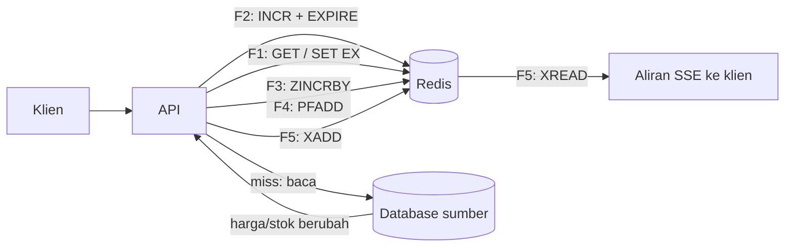

# Perancangan

## Tujuan belajar

Setelah bab ini kamu bisa:

- [ ] Menjelaskan kenapa merancang Redis dimulai dari *pola akses*, bukan dari bentuk data.
- [ ] Mengubah daftar fitur aplikasi menjadi kamus key: nama, tipe data, TTL, dan dampak bila data hilang.
- [ ] Memberi nama key yang konsisten dan aman untuk dibatasi dengan ACL.
- [ ] Menguji rancangan dengan satu perintah `redis-cli` per pola akses, lalu memeriksa tipe, TTL, dan ukurannya.
- [ ] Memusatkan penyusunan nama key di satu modul Python yang akan dipakai bab-bab berikutnya.

## Prasyarat

- Sudah menyelesaikan bagian [Struktur Data](../struktur-data/index.md), [Pola Penerapan](../pola-aplikasi/index.md), [Python dan FastAPI](../python/index.md), dan [Operasi](../operasi/index.md). Bab ini merangkum dan tidak mengulang penjelasannya; tiap keputusan di bawah menautkan bab asalnya.
- Docker terpasang dan kamu bisa membuat container (lihat [Instalasi dengan Docker](../pengenalan/instalasi-dengan-docker.md)). Praktik memakai container baru `redis-proyek`.
- Redis 7.0 atau lebih baru. Opsi `NX` pada `EXPIRE` baru ada sejak 7.0.[^2] Image `redis:latest` memenuhinya.
- Python 3 untuk contoh lengkap. Contoh itu tidak membutuhkan paket tambahan dan tidak menyambung ke Redis.

## Konsep

Di database SQL, kamu biasanya merancang tabel dulu (apa saja datanya), baru memikirkan kuerinya. Di Redis urutannya dibalik. Redis tidak punya kueri bebas; setiap pembacaan harus lewat perintah yang bekerja pada *satu key dengan satu tipe*. Karena itu kamu mulai dari pertanyaan: "bagaimana aplikasi akan membaca dan menulis data ini?" Jawabannya (pola akses) menentukan tipe data, nama key, dan masa hidupnya.

Rancangan yang baik menjawab enam pertanyaan untuk setiap kebutuhan data:

| Pertanyaan | Menentukan |
|---|---|
| Siapa menulis dan siapa membaca? | Tipe data dan perintah yang dipakai |
| Seberapa sering? | Apakah cocok di Redis, dan risiko key panas |
| Berapa lama data berguna? | TTL |
| Berapa banyak dan seberapa besar? | Memori dan risiko key raksasa |
| Apa yang terjadi bila data hilang? | Perlu [Persistence](../operasi/persistence.md) atau tidak |
| Siapa yang boleh menyentuhnya? | Pola nama key untuk [ACL](../operasi/keamanan.md) |

### Analogi

Bayangkan menata dapur restoran. Kamu tidak menata rak berdasarkan "jenis barang menurut katalog toko", melainkan berdasarkan *cara koki mengambilnya*: bumbu yang dipakai tiap menit di dekat kompor, bahan yang dipakai seminggu sekali di gudang belakang, bahan basi dibuang tiap hari. Rancangan Redis sama: tata data menurut cara aplikasi memakainya.

!!! note "Batas analogi"
    Dapur bisa ditata ulang kapan saja tanpa merusak resep. Mengubah nama key di aplikasi yang sudah berjalan berarti data lama "hilang dari pandangan" (key lama tetap ada tetapi tidak dibaca lagi). Itu sebabnya nama key dirancang dari awal dan dibuat di satu tempat saja.

## Cara kerja

### Aplikasi yang dirancang: Katalog Produk

Proyek akhir ini membangun API katalog produk kecil. Sumber kebenaran data produk adalah database di luar Redis (di bab implementasi disimulasikan dengan kode Python). Redis dipakai untuk lima keperluan:

| Kode | Fitur | Cara Redis membantu |
|---|---|---|
| F1 | Detail produk | Cache agar tidak selalu membaca database ([Caching](../pola-aplikasi/caching.md)) |
| F2 | Batas permintaan per klien | Pembatas laju jendela tetap ([Session dan rate limiting](../pola-aplikasi/session-dan-rate-limiting.md)) |
| F3 | Produk terpopuler | Peringkat berdasarkan jumlah dilihat ([Sorted Set](../struktur-data/sorted-set.md)) |
| F4 | Jumlah pengunjung unik per hari | Hitungan perkiraan ([Bitmap, HyperLogLog, dan Geo](../struktur-data/bitmap-hyperloglog-geo.md)) |
| F5 | Notifikasi perubahan harga dan stok | Log peristiwa yang bisa dikejar klien ([Streams dan consumer group](../pola-aplikasi/streams-consumer-group.md)) |



### Kamus key

Hasil perancangan berupa satu tabel: kamus key. Inilah dokumen yang dibaca semua orang di tim.

| Fitur | Key | Tipe | TTL | Pembaca/penulis | Bila hilang |
|---|---|---|---|---|---|
| F1 | `katalog:cache:produk:<id>` | String (JSON) | 300 detik | API baca dan tulis | Aman: dibuat ulang dari database |
| F2 | `katalog:rate:<klien>` | String (angka) | 60 detik | API tulis dan baca | Aman: jendela hitung mulai ulang |
| F3 | `katalog:populer` | Sorted Set | tanpa TTL | API tulis; halaman peringkat baca | Kehilangan riwayat peringkat; tidak fatal |
| F4 | `katalog:pengunjung:<YYYYMMDD>` | HyperLogLog | 7 hari | API tulis; laporan baca | Hitungan hari itu hilang |
| F5 | `katalog:peristiwa` | Stream | tanpa TTL, panjang dibatasi | Layanan harga/stok tulis; SSE baca | Notifikasi yang belum terkirim hilang |

Alasan di balik pilihan tipe:

- **F1 String JSON, bukan Hash.** Detail produk selalu dibaca dan ditulis utuh, jadi satu `GET` cukup. Hash baru lebih baik bila sering mengubah satu field saja (lihat [Memilih struktur data yang tepat](../struktur-data/memilih-struktur-data-yang-tepat.md)).
- **F2 String counter.** `INCR` bersifat atomik, dan expiry membuat jendela berakhir sendiri.
- **F3 Sorted Set.** Skor adalah jumlah dilihat; urutan peringkat dijaga Redis, tidak dihitung ulang aplikasi.
- **F4 HyperLogLog, bukan Set.** Kita hanya butuh jumlah *perkiraan*, dan HyperLogLog memakai memori kecil dan tetap, berapa pun jumlah pengunjungnya. Set menyimpan semua anggota.
- **F5 Stream, bukan Pub/Sub.** Pub/Sub tidak menyimpan pesan, sehingga klien yang sedang terputus kehilangan notifikasi. Stream menyimpan riwayat yang bisa dikejar.

### Aturan penamaan

1. **Awalan aplikasi** (`katalog:`) pada semua key. Satu pola `katalog:*` cukup untuk membatasi ACL, mencari key dengan `SCAN`, dan membedakan dari aplikasi lain di server yang sama.
2. Pemisah `:` dan urutan **fungsi → objek → id** (`cache:produk:42`), sesuai konvensi [Key dan expiry](../pengenalan/key-dan-expiry.md).[^1]
3. Huruf kecil, tanpa spasi. Tanggal ditulis `YYYYMMDD` agar urut alfabet sama dengan urut waktu.
4. **Jangan memasukkan data pribadi** (email, nomor telepon) ke nama key. Nama key muncul di log dan di `SLOWLOG` ([Monitoring](../operasi/monitoring.md)). Pakai id.
5. Jangan beri nama dengan `:` di dalam bagian variabel (mis. id klien berisi `:`), karena bisa membuat dua key berbeda tampak sama.
6. Nama key disusun di **satu modul**, bukan ditulis ulang di tiap tempat.

### Rencana operasi

Keputusan dari bagian [Operasi](../operasi/index.md) yang sudah bisa ditentukan sejak rancangan:

| Aspek | Keputusan | Alasan |
|---|---|---|
| Persistence | RDB dan AOF aktif | `populer`, `pengunjung`, dan `peristiwa` bernilai; cache dan rate memang bisa hilang ([Persistence](../operasi/persistence.md)) |
| ACL | Pengguna aplikasi dibatasi `~katalog:*`, tanpa kategori `@dangerous` | Kebocoran kredensial tidak membuka seluruh data ([Keamanan](../operasi/keamanan.md)) |
| Monitoring | Pantau `evicted_keys`, `SLOWLOG`, dan ukuran `katalog:populer` | Cache dan peringkat adalah yang pertama membengkak ([Monitoring](../operasi/monitoring.md)) |

## Praktik langkah demi langkah

Perintah di Langkah 2 sampai 4 dijalankan di sesi interaktif `redis-cli` (`docker exec -it`), sehingga bentuk keluarannya sama dengan blok di bawah. Output di bawah **terverifikasi**: dijalankan di Redis 8.10.3 pada 2026-10-27. Nilai seperti sisa TTL, ID Stream, dan ukuran byte akan berbeda.

### Langkah 1: Tulis pola akses sebelum menyentuh Redis

**Lingkungan: dokumen (tanpa perintah)**

Untuk setiap fitur F1 sampai F5, isi tabel enam pertanyaan dari bagian Konsep. Contoh untuk F2:

| Pertanyaan | Jawaban F2 |
|---|---|
| Siapa menulis dan membaca? | API, pada setiap permintaan |
| Seberapa sering? | Sekali per permintaan: sering |
| Berapa lama berguna? | 60 detik (satu jendela) |
| Berapa banyak? | Satu key kecil per klien aktif |
| Bila hilang? | Jendela mulai ulang; tidak masalah |
| Siapa boleh menyentuh? | Hanya pengguna aplikasi |

Kenapa langkah ini diperlukan: tabel inilah yang membuat pilihan "String + `INCR`" terbukti masuk akal, bukan sekadar kebiasaan. Bila jawaban "bila hilang?" ternyata "tidak boleh hilang", rancangannya berubah (mis. data itu seharusnya di database, bukan hanya di Redis).

### Langkah 2: Siapkan container

**Lingkungan: terminal**

```bash
docker run -d --name redis-proyek redis:latest
docker exec -it redis-proyek redis-cli
```

Kenapa: container baru memastikan hanya key rancangan ini yang ada, sehingga hasil `DBSIZE` dan `SCAN` bisa dibandingkan dengan kamus key. Perintah kedua membuka sesi interaktif tempat semua perintah berikut dijalankan.

**Terverifikasi:** ID container yang panjang, lalu prompt `127.0.0.1:6379>`.

### Langkah 3: Prototipekan tiap pola akses dengan satu perintah

**Lingkungan: redis-cli**

```text
SET katalog:cache:produk:1 "{\"id\":1,\"nama\":\"Kopi Arabika\",\"harga\":45000}" EX 300
GET katalog:cache:produk:1
INCR katalog:rate:klien-1
EXPIRE katalog:rate:klien-1 60 NX
INCR katalog:rate:klien-1
EXPIRE katalog:rate:klien-1 60 NX
ZINCRBY katalog:populer 1 produk:1
ZINCRBY katalog:populer 1 produk:1
ZINCRBY katalog:populer 1 produk:2
ZRANGE katalog:populer 0 2 REV WITHSCORES
PFADD katalog:pengunjung:20261027 klien-1 klien-2 klien-1
PFCOUNT katalog:pengunjung:20261027
EXPIRE katalog:pengunjung:20261027 604800
XADD katalog:peristiwa MAXLEN ~ 1000 * produk 1 jenis harga nilai 47000
XADD katalog:peristiwa MAXLEN ~ 1000 * produk 2 jenis stok nilai 0
XRANGE katalog:peristiwa - +
```

Kenapa langkah ini diperlukan: satu perintah per pola akses membuktikan bahwa setiap kebutuhan di kamus key bisa dipenuhi *tanpa* kueri tambahan. Bila untuk satu fitur kamu butuh banyak perintah rumit, tipe datanya mungkin keliru.

| Perintah | Fungsi dan alasan |
|---|---|
| `SET ... EX 300` | Menulis cache dan TTL-nya sekaligus, dalam satu langkah atomik (lihat [Key dan expiry](../pengenalan/key-dan-expiry.md)). |
| `INCR` lalu `EXPIRE ... 60 NX` | Menaikkan counter, lalu memasang TTL **hanya bila belum ada**. `NX` mencegah jendela diperpanjang di setiap permintaan, tetapi opsi ini butuh Redis 7.0.[^2] |
| `ZINCRBY ... 1 produk:1` | Menambah skor satu produk; key dibuat otomatis bila belum ada.[^4] |
| `ZRANGE ... 0 2 REV WITHSCORES` | Tiga produk teratas dari skor tertinggi, beserta skornya. |
| `PFADD` / `PFCOUNT` | Mencatat pengunjung (duplikat tidak dihitung dua kali) dan membaca jumlah perkiraannya.[^5] |
| `XADD ... MAXLEN ~ 1000 *` | Menambah peristiwa dengan ID otomatis (`*`) dan membatasi panjang Stream sekitar 1000 entri. Tanda `~` berarti pemangkasan perkiraan, lebih murah.[^3] |

**Terverifikasi:**

```text
OK
"{\"id\":1,\"nama\":\"Kopi Arabika\",\"harga\":45000}"
(integer) 1
(integer) 1
(integer) 2
(integer) 0
"1"
"2"
"1"
1) "produk:1"
2) "2"
3) "produk:2"
4) "1"
(integer) 1
(integer) 2
(integer) 1
"1761566400000-0"
"1761566400001-0"
1) 1) "1761566400000-0"
   2) 1) "produk"
      2) "1"
      3) "jenis"
      4) "harga"
      5) "nilai"
      6) "47000"
2) 1) "1761566400001-0"
   2) 1) "produk"
      2) "2"
      3) "jenis"
      4) "stok"
      5) "nilai"
      6) "0"
```

Cara membaca: `INCR` pertama bernilai 1 dan `EXPIRE ... NX` membalas `1` (TTL terpasang); `INCR` kedua bernilai 2 dan `EXPIRE ... NX` membalas `0` karena TTL sudah ada dan tidak disentuh. `ZINCRBY` membalas skor baru sebagai string. `PFADD` membalas `1` karena isi berubah, dan `PFCOUNT` membalas `2` meski `klien-1` dimasukkan dua kali. Dua ID Stream di atas hanya ilustrasi; nilai nyatanya berbeda.

### Langkah 4: Periksa rancangan terhadap kamus key

**Lingkungan: redis-cli**

```text
SCAN 0 MATCH katalog:* COUNT 100
DBSIZE
TYPE katalog:cache:produk:1
TYPE katalog:rate:klien-1
TYPE katalog:populer
TYPE katalog:pengunjung:20261027
TYPE katalog:peristiwa
TTL katalog:cache:produk:1
TTL katalog:populer
MEMORY USAGE katalog:cache:produk:1
```

Kenapa: ini "uji penerimaan" rancangan. Setiap baris kamus key (nama, tipe, TTL) dicocokkan dengan kenyataan di Redis.

| Perintah | Fungsi dan alasan |
|---|---|
| `SCAN 0 MATCH katalog:* COUNT 100` | Mendaftar key berawalan `katalog:` secara bertahap, tanpa memblokir server (berbeda dari `KEYS`).[^6] |
| `TYPE` | Mengecek tipe tiap key. |
| `TTL` | `-1` berarti tanpa expiry, `-2` berarti key tidak ada. |
| `MEMORY USAGE` | Perkiraan byte satu key; berguna untuk menghitung kebutuhan memori (lihat [Monitoring](../operasi/monitoring.md)). |

**Terverifikasi:**

```text
1) "0"
2) 1) "katalog:rate:klien-1"
   2) "katalog:populer"
   3) "katalog:cache:produk:1"
   4) "katalog:pengunjung:20261027"
   5) "katalog:peristiwa"
(integer) 5
string
string
zset
string
stream
(integer) 300
(integer) -1
(integer) 97
```

Cara membaca: kursor `0` berarti iterasi selesai, dan urutan key bisa berbeda. `DBSIZE` bernilai 5 (lima key kamus). `TYPE` untuk key HyperLogLog adalah `string` karena HyperLogLog disimpan sebagai String; itu wajar. Sisa TTL bisa beberapa detik di bawah 300. Angka `MEMORY USAGE` hanya ilustrasi.

### Langkah 5: Bersihkan

**Lingkungan: redis-cli, lalu terminal**

```text
EXIT
```

```bash
docker rm -f redis-proyek
```

!!! danger "Perintah ini menghapus data"
    `docker rm -f` menghapus container dan semua datanya. Container ini hanya untuk latihan dan tidak memakai volume, jadi tidak ada yang perlu diselamatkan.

## Contoh lengkap

Modul Python yang menjadi satu-satunya tempat penyusunan nama key. Bab-bab berikutnya akan mengimpornya.

**Lingkungan: Python** · Kebutuhan: Python 3, tanpa paket tambahan

```python title="kunci.py"
"""kunci.py: satu-satunya tempat yang boleh menyusun nama key proyek katalog."""

AWALAN = "katalog"

# TTL dalam detik. None berarti key tidak kedaluwarsa sendiri.
TTL_CACHE_PRODUK = 300
TTL_RATE = 60
TTL_PENGUNJUNG = 7 * 24 * 3600
PANJANG_STREAM = 1000


def _susun(*bagian):
    teks = [str(b) for b in bagian]
    for b in teks:
        if not b or ":" in b:
            raise ValueError(f"bagian key tidak boleh kosong atau memuat ':': {b!r}")
    return ":".join([AWALAN, *teks])


def cache_produk(produk_id):
    return _susun("cache", "produk", produk_id)


def rate(klien):
    return _susun("rate", klien)


def populer():
    return _susun("populer")


def pengunjung(tanggal):
    return _susun("pengunjung", tanggal)


def peristiwa():
    return _susun("peristiwa")


KAMUS = [
    ("cache_produk", cache_produk(42), "String", TTL_CACHE_PRODUK),
    ("rate", rate("klien-1"), "String", TTL_RATE),
    ("populer", populer(), "Sorted Set", None),
    ("pengunjung", pengunjung("20261027"), "HyperLogLog", TTL_PENGUNJUNG),
    ("peristiwa", peristiwa(), "Stream", None),
]


if __name__ == "__main__":
    print(f"{'fungsi':<14}{'contoh key':<32}{'tipe':<13}ttl")
    for fungsi, key, tipe, ttl in KAMUS:
        print(f"{fungsi:<14}{key:<32}{tipe:<13}{ttl if ttl else '-'}")
    try:
        rate("klien:1")
    except ValueError as galat:
        print("ditolak:", galat)
```

Penjelasan baris penting:

| Baris | Penjelasan |
|---|---|
| `AWALAN = "katalog"` | Awalan semua key. Mengubahnya di sini mengubah seluruh aplikasi, dan satu pola ACL `katalog:*` tetap berlaku. |
| `TTL_*` dan `PANJANG_STREAM` | Angka kamus key dikumpulkan sebagai konstanta bernama, bukan angka "ajaib" yang tersebar di kode. |
| `_susun(*bagian)` | Satu-satunya fungsi yang menggabungkan bagian dengan `:`. Bagian kosong atau yang memuat `:` ditolak dengan `ValueError`, sehingga dua key berbeda tidak bisa tampak sama. |
| `cache_produk`, `rate`, `populer`, `pengunjung`, `peristiwa` | Satu fungsi per baris kamus key. Aplikasi memanggil fungsi, bukan menulis string nama key. |
| `KAMUS` | Daftar yang bisa dicetak dan diuji, sehingga dokumentasi dan kode tidak mudah berbeda. |
| `if __name__ == "__main__"` | Blok ini hanya jalan bila file dijalankan langsung, bukan saat diimpor modul lain. |

Cara menjalankan: simpan sebagai `kunci.py` lalu jalankan `python kunci.py`. Hasil yang diharapkan (**terverifikasi**: dijalankan dengan Python 3.14.7 pada 27 Oktober 2026):

```text
fungsi        contoh key                      tipe         ttl
cache_produk  katalog:cache:produk:42         String       300
rate          katalog:rate:klien-1            String       60
populer       katalog:populer                 Sorted Set   -
pengunjung    katalog:pengunjung:20261027     HyperLogLog  604800
peristiwa     katalog:peristiwa               Stream       -
ditolak: bagian key tidak boleh kosong atau memuat ':': 'klien:1'
```

Cara membaca: lima baris pertama cocok dengan kamus key. Baris terakhir membuktikan `rate("klien:1")` ditolak karena id mengandung `:`. Kolom `ttl` memakai detik; `604800` adalah 7 hari, dan `-` berarti tanpa TTL.

## Kesalahan umum dan troubleshooting

| Gejala | Penyebab dan solusi |
|---|---|
| `WRONGTYPE Operation against a key holding the wrong kind of value` | Dua fitur memakai nama key yang sama dengan tipe berbeda. Beri awalan fungsi yang berbeda di kamus key. |
| `EXPIRE ... NX` membalas `ERR wrong number of arguments for 'expire' command` | Redis di bawah 7.0, opsi `NX` belum ada.[^2] Pakai Redis 7.0+, atau pasang TTL hanya saat `INCR` membalas `1`. |
| Counter `katalog:rate:<klien>` tidak pernah kedaluwarsa | `INCR` berhasil tetapi `EXPIRE` tidak sempat jalan (proses berhenti di antaranya). Ini risiko pola dua perintah di [Session dan rate limiting](../pola-aplikasi/session-dan-rate-limiting.md); atasi dengan transaksi atau Lua script. |
| TTL cache hilang setelah diperbarui | `SET` tanpa `EX` menimpa key dan menghapus TTL-nya ([Key dan expiry](../pengenalan/key-dan-expiry.md)). Selalu sertakan `EX` saat menulis cache. |
| Stream `katalog:peristiwa` terus membesar | `XADD` tanpa `MAXLEN` tidak membatasi panjang.[^3] Selalu tambahkan batas. |
| `katalog:populer` makin besar tanpa batas | Sorted Set tidak punya TTL. Rencanakan pemangkasan (mis. `ZREMRANGEBYRANK`) atau periode peringkat per hari. |
| Setelah mengganti nama key, data lama "hilang" | Aplikasi membaca nama baru, sementara key lama masih ada. Karena itu nama key dibuat satu kali di `kunci.py` dan tidak diubah sembarangan. |
| `SCAN` tidak menampilkan semua key dalam sekali panggil | Wajar: `SCAN` bertahap. Lanjutkan sampai kursor `0`.[^6] |

!!! note "Status verifikasi"
    Contoh `kunci.py` dan semua perintah `redis-cli` di bab ini dijalankan di Redis 8.10.3 pada 2026-10-27 (Python 3.12.3). Angka sisa TTL, ID Stream, dan ukuran byte berbeda di tiap komputer.

## Latihan

1. Tambahkan fitur F6 "keranjang belanja per pengguna": jawab enam pertanyaan, pilih tipe data (Hash atau lainnya), tentukan nama key dan TTL, lalu tambahkan fungsinya ke `kunci.py`.
2. Sebelum menjalankan: apa yang dikembalikan `TYPE katalog:pengunjung:20261027` untuk key HyperLogLog? Jalankan Langkah 3 dan 4, lalu bandingkan.
3. Ubah `kunci.py` agar `pengunjung()` menolak tanggal yang bukan 8 digit angka. Uji dengan `pengunjung("2026-10-27")`.
4. Untuk F5, hitung kasar: bila satu entri Stream sekitar 100 byte dan batasnya 1000 entri, berapa kira-kira memori maksimum? Lalu ukur satu entri sebenarnya dengan `MEMORY USAGE` dan bandingkan dengan perkiraanmu.
5. Jelaskan dengan kata-katamu kenapa F5 memakai Stream, bukan Pub/Sub, dan kapan jawabannya akan berbeda.

??? success "Petunjuk"
    1. Keranjang sering diubah per item, jadi pertimbangkan Hash; tentukan juga dampak bila hilang.
    2. Ingat HyperLogLog dibangun di atas String.
    3. Periksa `len(tanggal) == 8` dan `tanggal.isdigit()` sebelum memanggil `_susun`.
    4. Kalikan jumlah entri dengan ukuran per entri; ingat `MAXLEN ~` bersifat perkiraan.
    5. Pikirkan klien yang sedang terputus saat pesan dikirim.

## Ringkasan

- Rancangan Redis dimulai dari **pola akses**, lalu tipe data, nama key, TTL, ukuran, dan dampak bila data hilang. Hasilnya satu tabel: kamus key.
- Proyek akhir ini punya lima keperluan: cache produk (String JSON), pembatas laju (String counter), peringkat (Sorted Set), pengunjung unik (HyperLogLog), dan peristiwa (Stream dengan batas panjang).
- Penamaan: awalan aplikasi `katalog:`, urutan fungsi → objek → id, huruf kecil, tanpa data pribadi, dan disusun di satu modul `kunci.py`.
- Uji rancangan dengan satu perintah per pola akses, lalu periksa `TYPE`, `TTL`, `SCAN`, dan `MEMORY USAGE`.
- Keputusan operasional (persistence, ACL, monitoring) ditentukan sejak awal, bukan sesudah aplikasi jadi.

Berikutnya: [Implementasi API](implementasi-api.md), yang memakai kamus key dan `kunci.py` ini untuk membangun cache dan pembatas laju di FastAPI.

## Referensi resmi

[^1]: Redis, *Keys and values*: <https://redis.io/docs/latest/develop/using-commands/keyspace/>
[^2]: Redis, *EXPIRE*: <https://redis.io/docs/latest/commands/expire/>
[^3]: Redis, *XADD*: <https://redis.io/docs/latest/commands/xadd/>
[^4]: Redis, *ZINCRBY*: <https://redis.io/docs/latest/commands/zincrby/>
[^5]: Redis, *PFADD*: <https://redis.io/docs/latest/commands/pfadd/>
[^6]: Redis, *SCAN*: <https://redis.io/docs/latest/commands/scan/>

Bacaan tambahan: [`ZRANGE`](https://redis.io/docs/latest/commands/zrange/), [`PFCOUNT`](https://redis.io/docs/latest/commands/pfcount/), [`MEMORY USAGE`](https://redis.io/docs/latest/commands/memory-usage/).
