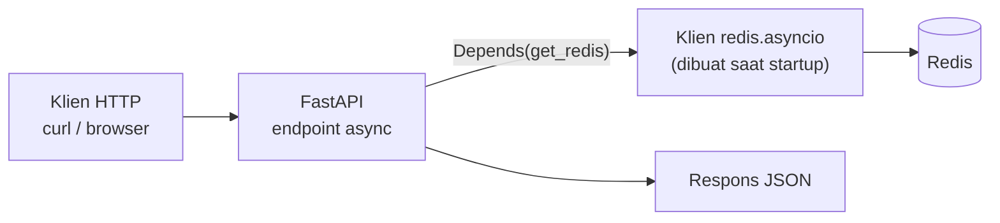

# Dasar FastAPI dengan Redis

## Tujuan belajar

Setelah bab ini kamu bisa:

- [ ] Menjalankan aplikasi FastAPI sederhana dan membuka dokumentasi interaktifnya.
- [ ] Menghubungkan FastAPI ke Redis dengan klien asinkron (`redis.asyncio`) yang dibuat sekali saat aplikasi mulai.
- [ ] Membagikan klien Redis ke endpoint lewat *dependency* `Depends`.
- [ ] Membuat endpoint dasar (health check, counter, catatan ber-TTL) dan mengembalikan kode status yang tepat.
- [ ] Mengubah galat koneksi Redis menjadi respons `503` yang jelas.

## Prasyarat

- Sudah membaca [Dasar redis-py](dasar-redis-py.md), [Struktur data di Python](struktur-data-di-python.md), dan [Pipeline dan connection pool](pipeline-dan-connection-pool.md). Bab ini tidak mengulang koneksi, tipe balikan, dan connection pool.
- Container Redis berjalan dan port 6379 dipetakan ke komputermu (lihat [Instalasi dengan Docker](../pengenalan/instalasi-dengan-docker.md)).
- Perangkat lunak: Python 3 (cek persyaratan versi di dokumentasi FastAPI) dan `pip`.
- Pengetahuan dasar Python, termasuk fungsi dan *type hint*. Mengenal `async`/`await` membantu, tetapi dijelaskan secukupnya di sini.
- Kondisi awal: tidak ada key berawalan `api:` yang kamu perlukan.

## Konsep

**FastAPI** adalah kerangka kerja Python untuk membuat API web. Kamu menulis fungsi, dan FastAPI mengubahnya menjadi endpoint HTTP lengkap dengan validasi input dan dokumentasi otomatis.[^1]

FastAPI berjalan secara **asinkron**: satu proses bisa melayani banyak permintaan sekaligus selama sebagian permintaan menunggu (misalnya menunggu balasan Redis). Agar tidak menghalangi permintaan lain, panggilan ke Redis memakai `await`. Karena itu kita memakai klien asinkron `redis.asyncio`, bukan `redis.Redis` biasa. Nama metodenya sama, hanya dipanggil dengan `await`.[^2]

Tiga ide penting di bab ini:

1. **Klien dibuat sekali, dipakai semua endpoint.** Seperti dijelaskan di [Pipeline dan connection pool](pipeline-dan-connection-pool.md), membuat klien baru di setiap permintaan itu boros. FastAPI menyediakan *lifespan* untuk menjalankan kode saat aplikasi mulai dan berhenti.[^3]
2. **Dependency injection.** Endpoint cukup menyatakan "aku butuh klien Redis" lewat `Depends(get_redis)`, dan FastAPI menyediakannya. Ini membuat endpoint mudah diuji dan diganti.[^4]
3. **Galat ditangani di satu tempat.** Bila Redis mati, semua endpoint seharusnya membalas `503` dengan pesan yang sama, bukan `500` dengan jejak galat.

### Analogi

FastAPI seperti resepsionis hotel yang melayani banyak tamu bergantian. Saat satu tamu menunggu kunci dari gudang (Redis), resepsionis melayani tamu lain, bukan berdiri diam. Lifespan adalah jam buka dan tutup hotel: kunci gudang diambil sekali di pagi hari dan dikembalikan saat tutup.

!!! note "Batas analogi"
    Resepsionis asinkron tetap hanya satu orang. Kalau ada pekerjaan berat yang menghabiskan waktunya (perhitungan lama tanpa `await`), semua tamu ikut menunggu.

## Cara kerja



| Bagian | Fungsi |
|---|---|
| `lifespan` | Membuat klien Redis saat aplikasi mulai dan menutupnya saat berhenti |
| `app.state.redis` | Tempat menyimpan klien agar bisa diakses semua endpoint |
| `get_redis` | Fungsi dependency yang mengembalikan klien itu |
| `await r.incr(...)` | Perintah Redis asinkron; harus di dalam fungsi `async def` |
| `HTTPException` | Mengubah kondisi (mis. key tidak ada) menjadi respons `404` |
| *exception handler* | Mengubah galat koneksi Redis menjadi respons `503` |

## Praktik langkah demi langkah

Output di bawah adalah output yang **diharapkan** berdasarkan dokumentasi, bukan hasil eksekusi di komputermu. Nomor port klien pada log server akan berbeda.

### Langkah 1: Siapkan folder dan pasang paket

**Lingkungan: terminal**

```bash
mkdir latihan-fastapi
cd latihan-fastapi
python -m venv .venv
```

Aktifkan lingkungan virtual (Windows: `.venv\Scripts\activate`; Linux atau macOS: `source .venv/bin/activate`), lalu:

```bash
pip install "fastapi[standard]" redis
```

| Bagian | Fungsi dan alasan |
|---|---|
| Folder di luar repository materi | Agar `.venv` dan kode latihan tidak ikut tercatat di Git. |
| `"fastapi[standard]"` | Memasang FastAPI beserta server pengembangan dan alat bantu yang disarankan dokumentasinya (termasuk `httpx`, yang kita pakai untuk menguji).[^1] Tanda kutip mencegah shell menafsirkan kurung siku. |
| `redis` | Pustaka klien; versi terbaru sudah menyertakan `redis.asyncio`. |

**Diharapkan:** `pip` menyelesaikan instalasi tanpa galat. Nomor versi bergantung pada saat kamu memasang.

### Langkah 2: Aplikasi paling kecil tanpa Redis

**Lingkungan: Python** · simpan sebagai `main.py`

```python title="main.py"
from fastapi import FastAPI

app = FastAPI()


@app.get("/")
async def beranda():
    return {"pesan": "FastAPI hidup"}
```

Jalankan di terminal (di folder yang sama, lingkungan virtual aktif):

```bash
fastapi dev main.py
```

Kenapa langkah ini dulu: memastikan FastAPI sendiri sudah jalan sebelum menambah Redis, sehingga bila ada galat nanti kamu tahu penyebabnya.

**Diharapkan:** server berjalan di `http://127.0.0.1:8000`. Buka alamat itu di browser dan kamu melihat `{"pesan":"FastAPI hidup"}`. Buka `http://127.0.0.1:8000/docs` untuk dokumentasi interaktif yang dibuat otomatis. Hentikan server dengan Ctrl+C.

### Langkah 3: Hubungkan Redis lewat lifespan dan dependency

Ganti isi `main.py`:

**Lingkungan: Python**

```python title="main.py"
import os
from contextlib import asynccontextmanager

import redis.asyncio as redis
from fastapi import Depends, FastAPI, Request


@asynccontextmanager
async def lifespan(app: FastAPI):
    url = os.environ.get("REDIS_URL", "redis://localhost:6379/0")
    app.state.redis = redis.from_url(
        url,
        decode_responses=True,
        socket_connect_timeout=2,
        socket_timeout=2,
    )
    yield
    await app.state.redis.aclose()


app = FastAPI(lifespan=lifespan)


def get_redis(request: Request) -> redis.Redis:
    return request.app.state.redis


@app.get("/health")
async def health(r: redis.Redis = Depends(get_redis)):
    return {"status": "ok", "redis": await r.ping()}
```

| Baris | Penjelasan |
|---|---|
| `import redis.asyncio as redis` | Memakai klien asinkron dengan nama `redis`. |
| `@asynccontextmanager` + `yield` | Kode sebelum `yield` berjalan saat aplikasi mulai; kode sesudahnya saat aplikasi berhenti.[^3] |
| `redis.from_url(...)` | Membuat klien dari URL, sama seperti di [Dasar redis-py](dasar-redis-py.md). Batas waktu mencegah permintaan menggantung bila Redis tidak menjawab. |
| `app.state.redis = ...` | Menyimpan klien di objek aplikasi agar dipakai bersama. |
| `await app.state.redis.aclose()` | Menutup klien dan koneksinya saat aplikasi berhenti. |
| `FastAPI(lifespan=lifespan)` | Mendaftarkan lifespan ke aplikasi. |
| `get_redis(request)` | Fungsi dependency: mengambil klien dari `app.state`. |
| `r: redis.Redis = Depends(get_redis)` | Menyuntikkan klien ke endpoint. Endpoint tidak perlu tahu cara membuatnya. |

Jalankan ulang `fastapi dev main.py` (atau biarkan mode pengembangan memuat ulang otomatis), lalu di terminal lain:

**Lingkungan: terminal**

```bash
curl http://127.0.0.1:8000/health
```

(Di PowerShell, tulis `curl.exe`, karena `curl` adalah alias perintah lain.)

**Diharapkan:**

```text
{"status":"ok","redis":true}
```

Cara membaca output: `redis: true` artinya `await r.ping()` berhasil, jadi FastAPI benar-benar bisa menjangkau Redis.

### Langkah 4: Endpoint counter dengan validasi nama

Tambahkan di bawah `health`:

**Lingkungan: Python**

```python
from typing import Annotated

from fastapi import HTTPException, Path

NamaPath = Annotated[
    str, Path(min_length=1, max_length=40, pattern=r"^[a-z0-9-]+$")
]


@app.post("/counter/{nama}/naik")
async def naik(nama: NamaPath, r: redis.Redis = Depends(get_redis)):
    nilai = await r.incr(f"api:counter:{nama}")
    return {"nama": nama, "nilai": nilai}


@app.get("/counter/{nama}")
async def baca(nama: NamaPath, r: redis.Redis = Depends(get_redis)):
    nilai = await r.get(f"api:counter:{nama}")
    if nilai is None:
        raise HTTPException(status_code=404, detail="Counter tidak ada")
    return {"nama": nama, "nilai": int(nilai)}
```

| Baris | Penjelasan |
|---|---|
| `Path(..., pattern=r"^[a-z0-9-]+$")` | Membatasi `nama` pada huruf kecil, angka, dan tanda hubung. Nama berasal dari URL, jadi kita tidak mau pengguna menyusun nama key sembarangan. |
| `f"api:counter:{nama}"` | Awalan `api:counter:` memisahkan key aplikasi dari data lain. |
| `await r.incr(...)` | Counter atomik; mengembalikan `int`. |
| `if nilai is None: raise HTTPException(404, ...)` | Key tidak ada berarti sumber daya tidak ditemukan. |
| `int(nilai)` | Nilai dari `get` berupa `str`, jadi diubah menjadi angka. |

### Langkah 5: Catatan ber-TTL dengan `PUT`, `GET`, `DELETE`

Tambahkan juga:

**Lingkungan: Python**

```python
from pydantic import BaseModel, Field


class Catatan(BaseModel):
    isi: str = Field(min_length=1, max_length=500)
    ttl_detik: int = Field(default=300, gt=0, le=86400)


@app.put("/catatan/{id}")
async def simpan(id: NamaPath, catatan: Catatan, r: redis.Redis = Depends(get_redis)):
    await r.set(f"api:catatan:{id}", catatan.isi, ex=catatan.ttl_detik)
    return {"id": id, "ttl_detik": catatan.ttl_detik}


@app.get("/catatan/{id}")
async def ambil(id: NamaPath, r: redis.Redis = Depends(get_redis)):
    isi = await r.get(f"api:catatan:{id}")
    if isi is None:
        raise HTTPException(status_code=404, detail="Catatan tidak ada")
    return {"id": id, "isi": isi, "sisa_ttl_detik": await r.ttl(f"api:catatan:{id}")}


@app.delete("/catatan/{id}")
async def hapus(id: NamaPath, r: redis.Redis = Depends(get_redis)):
    if await r.delete(f"api:catatan:{id}") == 0:
        raise HTTPException(status_code=404, detail="Catatan tidak ada")
    return {"dihapus": True}
```

| Baris | Penjelasan |
|---|---|
| `class Catatan(BaseModel)` | Model yang menjelaskan isi badan permintaan; FastAPI memvalidasi dan menolak data yang salah dengan `422`. |
| `Field(default=300, gt=0, le=86400)` | `ttl_detik` harus lebih dari 0 (Redis menolak `EX 0`) dan maksimal satu hari. |
| `ex=catatan.ttl_detik` | Catatan hilang sendiri setelah waktunya, seperti di [Key dan expiry](../pengenalan/key-dan-expiry.md). |
| `await r.delete(...) == 0` | `DEL` mengembalikan jumlah key terhapus; `0` berarti tidak ada yang dihapus. |

!!! danger "`DELETE` menghapus permanen"
    Endpoint `DELETE /catatan/{id}` memakai `DEL` dan tidak bisa dibatalkan. Dalam aplikasi nyata, batasi siapa yang boleh memanggilnya.

### Langkah 6: Uji semua endpoint dengan skrip

**Lingkungan: Python** · simpan sebagai `uji_api.py` (jalankan di terminal lain, sementara server hidup)

```python title="uji_api.py"
import httpx

with httpx.Client(base_url="http://127.0.0.1:8000") as c:
    print(c.get("/health").json())
    print(c.post("/counter/tamu/naik").json())
    print(c.post("/counter/tamu/naik").json())
    print(c.put("/catatan/belajar", json={"isi": "belajar redis", "ttl_detik": 60}).json())

    r = c.get("/catatan/belajar")
    print(r.status_code, r.json())
    print(c.delete("/catatan/belajar").json())

    r = c.get("/catatan/belajar")
    print(r.status_code, r.json())

    print(c.get("/counter/Tidak Valid").status_code)
```

Kenapa memakai skrip, bukan `curl`: perintah `curl` dengan badan JSON dan tanda kutip berbeda antar shell. `httpx` jalan sama di semua sistem.

**Diharapkan** (setelah menghapus `api:counter:tamu` bila sudah pernah dijalankan):

```text
{'status': 'ok', 'redis': True}
{'nama': 'tamu', 'nilai': 1}
{'nama': 'tamu', 'nilai': 2}
{'id': 'belajar', 'ttl_detik': 60}
200 {'id': 'belajar', 'isi': 'belajar redis', 'sisa_ttl_detik': 60}
{'dihapus': True}
404 {'detail': 'Catatan tidak ada'}
422
```

Cara membaca output: `sisa_ttl_detik` bisa `60` atau `59`. `404` berarti catatan sudah dihapus. `422` berasal dari validasi FastAPI: nama `Tidak Valid` tidak cocok pola, jadi permintaan ditolak sebelum menyentuh Redis. Counter naik bila skrip dijalankan lagi, kecuali kamu menghapusnya (lihat Langkah 8).

### Langkah 7: Ubah galat Redis menjadi `503`

Tambahkan di `main.py`:

**Lingkungan: Python**

```python
from fastapi.responses import JSONResponse
from redis.exceptions import ConnectionError as RedisConnectionError
from redis.exceptions import TimeoutError as RedisTimeoutError


async def redis_tidak_tersedia(request: Request, exc: Exception):
    return JSONResponse(status_code=503, content={"detail": "Redis tidak tersedia"})


for kelas in (RedisConnectionError, RedisTimeoutError):
    app.add_exception_handler(kelas, redis_tidak_tersedia)
```

Kenapa hanya dua jenis galat: `ConnectionError` dan `TimeoutError` berarti Redis tidak terjangkau (`503 Service Unavailable`). Galat lain, misalnya `ResponseError`, menandakan kesalahan perintah di kode kita, sehingga sebaiknya tetap muncul sebagai `500` agar terlihat dan diperbaiki.[^5]

Uji: hentikan Redis (`docker stop redis`), lalu:

**Lingkungan: terminal**

```bash
curl -i http://127.0.0.1:8000/health
```

**Diharapkan:** baris status `HTTP/1.1 503 Service Unavailable` dan badan `{"detail":"Redis tidak tersedia"}`. Nyalakan lagi dengan `docker start redis`, dan `/health` kembali `200`.

### Langkah 8: Bersihkan data latihan

**Lingkungan: redis-cli**

```text
127.0.0.1:6379> DEL api:counter:tamu api:catatan:belajar
```

**Diharapkan:** `(integer) 1` (hanya `api:counter:tamu`; catatan sudah dihapus). Hentikan server FastAPI dengan Ctrl+C.

!!! danger "`DEL` tidak bisa dibatalkan"
    Perintah ini menyebut key satu per satu agar tidak ada key lain yang ikut terhapus.

## Contoh lengkap

Ini gabungan seluruh langkah menjadi satu berkas yang bisa langsung dijalankan.

**Lingkungan: Python** · Kebutuhan: Python 3, `fastapi[standard]`, `redis`, dan Redis berjalan di `localhost:6379` (atau `REDIS_URL`).

```python title="main.py"
import os
from contextlib import asynccontextmanager
from typing import Annotated

import redis.asyncio as redis
from fastapi import Depends, FastAPI, HTTPException, Path, Request
from fastapi.responses import JSONResponse
from pydantic import BaseModel, Field
from redis.exceptions import ConnectionError as RedisConnectionError
from redis.exceptions import TimeoutError as RedisTimeoutError


@asynccontextmanager
async def lifespan(app: FastAPI):
    url = os.environ.get("REDIS_URL", "redis://localhost:6379/0")
    app.state.redis = redis.from_url(
        url,
        decode_responses=True,
        socket_connect_timeout=2,
        socket_timeout=2,
    )
    yield
    await app.state.redis.aclose()


app = FastAPI(lifespan=lifespan)


def get_redis(request: Request) -> redis.Redis:
    return request.app.state.redis


async def redis_tidak_tersedia(request: Request, exc: Exception):
    return JSONResponse(status_code=503, content={"detail": "Redis tidak tersedia"})


for kelas in (RedisConnectionError, RedisTimeoutError):
    app.add_exception_handler(kelas, redis_tidak_tersedia)


NamaPath = Annotated[
    str, Path(min_length=1, max_length=40, pattern=r"^[a-z0-9-]+$")
]


class Catatan(BaseModel):
    isi: str = Field(min_length=1, max_length=500)
    ttl_detik: int = Field(default=300, gt=0, le=86400)


@app.get("/health")
async def health(r: redis.Redis = Depends(get_redis)):
    return {"status": "ok", "redis": await r.ping()}


@app.post("/counter/{nama}/naik")
async def naik(nama: NamaPath, r: redis.Redis = Depends(get_redis)):
    nilai = await r.incr(f"api:counter:{nama}")
    return {"nama": nama, "nilai": nilai}


@app.get("/counter/{nama}")
async def baca(nama: NamaPath, r: redis.Redis = Depends(get_redis)):
    nilai = await r.get(f"api:counter:{nama}")
    if nilai is None:
        raise HTTPException(status_code=404, detail="Counter tidak ada")
    return {"nama": nama, "nilai": int(nilai)}


@app.put("/catatan/{id}")
async def simpan(id: NamaPath, catatan: Catatan, r: redis.Redis = Depends(get_redis)):
    await r.set(f"api:catatan:{id}", catatan.isi, ex=catatan.ttl_detik)
    return {"id": id, "ttl_detik": catatan.ttl_detik}


@app.get("/catatan/{id}")
async def ambil(id: NamaPath, r: redis.Redis = Depends(get_redis)):
    isi = await r.get(f"api:catatan:{id}")
    if isi is None:
        raise HTTPException(status_code=404, detail="Catatan tidak ada")
    return {"id": id, "isi": isi, "sisa_ttl_detik": await r.ttl(f"api:catatan:{id}")}


@app.delete("/catatan/{id}")
async def hapus(id: NamaPath, r: redis.Redis = Depends(get_redis)):
    if await r.delete(f"api:catatan:{id}") == 0:
        raise HTTPException(status_code=404, detail="Catatan tidak ada")
    return {"dihapus": True}
```

Cara menjalankan: `fastapi dev main.py`, lalu jalankan `python uji_api.py` di terminal lain. Hasil yang diharapkan sama dengan Langkah 6. Kamu juga bisa mencoba endpoint satu per satu lewat `http://127.0.0.1:8000/docs`.

## Kesalahan umum dan troubleshooting

| Gejala | Penyebab dan solusi |
|---|---|
| `fastapi: command not found` | Lingkungan virtual belum aktif atau `fastapi[standard]` belum terpasang. Aktifkan `.venv` lalu `pip install "fastapi[standard]"`. Alternatif: `uvicorn main:app --reload`. |
| `ModuleNotFoundError: No module named 'redis'` | Paket `redis` belum terpasang di lingkungan aktif. Jalankan `pip install redis`. |
| `RuntimeWarning: coroutine '...' was never awaited` | Lupa `await` pada perintah Redis asinkron. Tulis `await r.get(...)`. |
| `AttributeError: 'State' object has no attribute 'redis'` | Lifespan tidak terdaftar (`FastAPI(lifespan=lifespan)` terlewat) atau `app.state.redis` tidak diatur. |
| Respons `500` dengan `ConnectionError` pada log | Redis tidak terjangkau dan handler 503 belum terpasang. Tambahkan handler pada Langkah 7, dan cek `docker ps`. |
| Respons `503` padahal Redis hidup | Port atau `REDIS_URL` salah, atau firewall menahan koneksi. Cek dengan `redis-cli -h host -p port ping`. |
| `422 Unprocessable Entity` | Input tidak lolos validasi (pola `nama`, `ttl_detik`). Baca `detail` pada JSON untuk melihat field yang salah. |
| Respons `404` pada `GET /catatan/...` | Key tidak ada atau sudah kedaluwarsa. Normal. |
| `TypeError: unsupported operand` saat menjumlah nilai dari Redis | Nilai dari `get` berupa `str`. Ubah dengan `int(...)`. |
| Perubahan kode tidak terlihat | Server tidak memuat ulang. Pakai `fastapi dev` (otomatis memuat ulang) atau restart server. |
| Port 8000 sudah dipakai | Proses lain memakai port itu. Hentikan atau jalankan dengan `--port 8001`. |

!!! warning "Jangan membuka server pengembangan ke jaringan umum"
    `fastapi dev` ditujukan untuk pengembangan lokal. Untuk produksi, gunakan mode produksi dan pengamanan Redis yang dibahas di bagian Operasi.

!!! note "Status verifikasi"
    Nama fungsi, parameter, dan perilaku dicocokkan dengan dokumentasi FastAPI, Redis, dan `redis-py` (termasuk `redis.asyncio` dan `aclose()`). Kode hanya diperiksa sintaksnya; belum dijalankan di Redis atau FastAPI sungguhan saat bab ini ditulis. Log server, teks galat, dan nomor versi bisa berbeda. Bandingkan dengan hasilmu sendiri.

## Latihan

1. Tambahkan endpoint `POST /counter/{nama}/turun` yang memakai `decr`. Apa yang terjadi bila counter belum ada?
2. Sebelum menjalankan: apa status HTTP `GET /counter/belum-ada`? Jalankan dan buktikan, lalu cek `GET /counter/Besar` dan jelaskan perbedaan statusnya.
3. Ubah `Catatan` agar `ttl_detik` maksimal 3600. Apa respons bila kamu mengirim 7200?
4. Hentikan Redis dan panggil `PUT /catatan/x`. Apa yang kamu terima, dan di mana kode yang menghasilkannya?
5. Jelaskan kenapa klien Redis dibuat di `lifespan`, bukan di dalam setiap endpoint.

??? success "Petunjuk"
    1. `DECR` pada key yang belum ada memulai dari 0.
    2. Bedakan `404` (key tidak ada) dari `422` (nama tidak lolos pola).
    3. Ubah argumen `le` pada `Field`.
    4. Lihat handler pada Langkah 7.
    5. Ingat biaya membuat koneksi dan pool dari bab Pipeline dan connection pool.

## Ringkasan

- FastAPI membuat endpoint dari fungsi Python; endpoint asinkron memakai `redis.asyncio` dan `await`.
- Buat klien Redis sekali di `lifespan`, simpan di `app.state`, dan bagikan lewat `Depends(get_redis)`.
- Validasi input (pola `Path`, model Pydantic) sebelum dipakai membentuk key; kembalikan `404` untuk key tidak ada dan `422` untuk input salah.
- Ubah `ConnectionError` dan `TimeoutError` menjadi respons `503` lewat exception handler, dan biarkan galat lain terlihat sebagai `500`.
- `DEL` dan endpoint `DELETE` menghapus permanen.

Berikutnya: [FastAPI: caching dan rate limit](fastapi-caching-dan-rate-limit.md).

## Referensi resmi

[^1]: FastAPI, *Tutorial: First Steps* dan *Installation*: <https://fastapi.tiangolo.com/tutorial/first-steps/>
[^2]: Redis, *redis-py guide (Python)* dan contoh asyncio: <https://redis.io/docs/latest/develop/clients/redis-py/> dan <https://redis-py.readthedocs.io/en/stable/examples/asyncio_examples.html>
[^3]: FastAPI, *Lifespan Events*: <https://fastapi.tiangolo.com/advanced/events/>
[^4]: FastAPI, *Dependencies*: <https://fastapi.tiangolo.com/tutorial/dependencies/>
[^5]: FastAPI, *Handling Errors*: <https://fastapi.tiangolo.com/tutorial/handling-errors/>

Bacaan tambahan: [FastAPI: Path Parameters and Numeric Validations](https://fastapi.tiangolo.com/tutorial/path-params-numeric-validations/), [`INCR`](https://redis.io/docs/latest/commands/incr/), [`SET`](https://redis.io/docs/latest/commands/set/).
