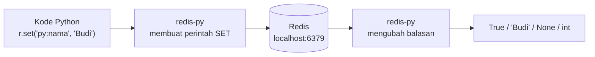

# Dasar redis-py

## Tujuan belajar

Setelah bab ini kamu bisa:

- [ ] Memasang `redis-py` di lingkungan virtual Python dan memeriksa versinya.
- [ ] Terhubung ke Redis, memeriksa koneksi dengan `ping()`, dan menjelaskan arti `decode_responses`.
- [ ] Menjalankan perintah dasar (`set`, `get`, `incr`, `expire`, `ttl`, `delete`) dan membaca tipe nilai baliknya.
- [ ] Menangani galat umum: `ConnectionError`, `TimeoutError`, dan `ResponseError`.
- [ ] Membaca alamat Redis dari variabel lingkungan tanpa menulis kredensial di kode.

## Prasyarat

- Sudah membaca [Key dan expiry](../pengenalan/key-dan-expiry.md) dan [String](../struktur-data/string.md). Bab ini tidak mengulang arti `SET`, `EX`, `NX`, `INCR`, dan `TTL`; kita hanya memindahkannya ke Python.
- Container Redis berjalan dan `docker exec -it redis redis-cli` bisa masuk (lihat [Instalasi dengan Docker](../pengenalan/instalasi-dengan-docker.md)). Port 6379 harus dipetakan ke komputermu, seperti pada perintah `docker run -p 6379:6379` di bab itu.
- Perangkat lunak: Python 3 (cek persyaratan versi di dokumentasi `redis-py`) dan `pip`.
- Pengetahuan dasar Python: variabel, fungsi, `try`/`except`, dan menjalankan skrip.
- Kondisi awal: tidak ada key berawalan `py:` yang kamu perlukan. Semua key di bab ini memakai awalan itu agar mudah dibersihkan.

## Konsep

`redis-cli` cocok untuk mencoba perintah, tetapi aplikasi menjalankan perintah dari kode. **`redis-py`** adalah pustaka resmi Redis untuk Python. Ia membuka koneksi ke server, mengirim perintah, lalu mengubah balasan Redis menjadi tipe Python.[^1]

Hampir semua perintah Redis punya metode dengan nama sama dalam huruf kecil: `SET` menjadi `r.set(...)`, `INCR` menjadi `r.incr(...)`. Karena itu kamu bisa memakai pengetahuan dari bab-bab sebelumnya langsung.

Dua hal yang perlu dipahami sejak awal:

1. **Redis menyimpan byte, bukan tipe Python.** Secara bawaan `redis-py` mengembalikan `bytes` (`b'Budi'`). Opsi `decode_responses=True` membuatnya mengembalikan `str`. Kita memakai opsi ini di seluruh materi karena lebih mudah dibaca.[^2]
2. **Redis tidak tahu tipe aplikasi.** Angka `25` yang kamu simpan akan kembali sebagai teks `'25'` saat dibaca dengan `get`. Perintah numerik seperti `incr` mengembalikan `int`.

### Analogi

`redis-py` seperti penerjemah di meja resepsionis. Kamu berbicara dalam Python (`r.set(...)`), penerjemah mengucapkannya dalam bahasa Redis (`SET ...`), lalu menerjemahkan jawaban kembali ke Python. `decode_responses` menentukan apakah jawaban disampaikan sebagai teks yang bisa dibaca atau sebagai byte mentah.

!!! note "Batas analogi"
    Penerjemah tidak memeriksa maksud kalimat. Jika kamu meminta `incr` pada teks, Redis yang menolak dan `redis-py` hanya meneruskan galatnya sebagai pengecualian.

## Cara kerja



| Perintah Redis | Metode `redis-py` | Tipe balikan |
|---|---|---|
| `PING` | `r.ping()` | `True` |
| `SET k v` | `r.set(k, v)` | `True` |
| `SET k v EX 10` | `r.set(k, v, ex=10)` | `True` |
| `SET k v NX` | `r.set(k, v, nx=True)` | `True`, atau `None` bila key sudah ada |
| `GET k` | `r.get(k)` | `str` (atau `bytes`), `None` bila tidak ada |
| `INCR k` | `r.incr(k)` | `int` |
| `EXPIRE k 10` | `r.expire(k, 10)` | `True`/`False` |
| `TTL k` | `r.ttl(k)` | `int` (`-1` tanpa expiry, `-2` tidak ada) |
| `EXISTS k` | `r.exists(k)` | `int` (jumlah key yang ada) |
| `DEL k` | `r.delete(k)` | `int` (jumlah key terhapus) |

Objek `redis.Redis` mengelola koneksi di balik layar lewat *connection pool*, sehingga satu objek bisa dipakai berulang untuk banyak perintah. Pembahasan lengkapnya ada di bab Pipeline dan connection pool (bab belum ditulis).

## Praktik langkah demi langkah

Output di bawah adalah output **terverifikasi**: dijalankan di Redis 8.10.3 pada 2026-10-27. Hasilmu bisa berbeda pada nilai yang berubah tiap eksekusi. Angka sisa TTL bisa sedikit berbeda.

### Langkah 1: Siapkan lingkungan virtual dan pasang `redis-py`

**Lingkungan: terminal**

```bash
python -m venv .venv
```

Aktifkan lingkungan virtual. Di Windows (PowerShell atau Command Prompt):

```bash
.venv\Scripts\activate
```

Di Linux atau macOS:

```bash
source .venv/bin/activate
```

Lalu pasang pustakanya dan periksa versinya:

```bash
pip install redis
pip show redis
```

| Bagian | Fungsi dan alasan |
|---|---|
| `python -m venv .venv` | Membuat lingkungan Python terpisah agar paket proyek ini tidak bercampur dengan paket sistem. |
| `activate` | Membuat `python` dan `pip` memakai lingkungan tadi. Tanda berhasil: prompt diawali `(.venv)`. |
| `pip install redis` | Memasang paket `redis` (nama paket `redis`, pustakanya bernama `redis-py`). |
| `pip show redis` | Menampilkan versi terpasang; catat untuk bahan pelaporan galat. |

**Terverifikasi:** `pip show redis` mencetak `Name: redis`, nomor `Version`, dan `Location` di dalam folder `.venv`. Nomor versinya bergantung pada saat kamu memasang.

!!! note "Jangan menaruh `.venv` di dalam repository materi"
    Buat folder proyek latihan di luar repository ini (mis. `latihan-redis-py`) agar `.venv` tidak ikut tercatat di Git.

### Langkah 2: Koneksi pertama dengan `ping()`

**Lingkungan: Python** · simpan sebagai `koneksi.py`

```python title="koneksi.py"
import redis

r = redis.Redis(host="localhost", port=6379, decode_responses=True)

print("ping:", r.ping())
```

Cara menjalankan: `python koneksi.py`.

| Baris | Penjelasan |
|---|---|
| `redis.Redis(...)` | Membuat klien. Belum membuka koneksi sampai perintah pertama dikirim. |
| `host="localhost", port=6379` | Alamat Redis di container yang memetakan port 6379 ke komputermu. |
| `decode_responses=True` | Balasan berupa `str`, bukan `bytes`. |
| `r.ping()` | Mengirim `PING`. Kita pakai ini karena membuat klien tidak membuktikan server hidup. |

**Terverifikasi:**

```text
ping: True
```

Cara membaca output: `True` artinya server menjawab `PONG` dan `redis-py` menerjemahkannya menjadi `True`.

### Langkah 3: Lihat bedanya `bytes` dan `str`

**Lingkungan: Python** · simpan sebagai `tipe_data.py`

```python title="tipe_data.py"
import redis

mentah = redis.Redis(host="localhost", port=6379)
teks = redis.Redis(host="localhost", port=6379, decode_responses=True)

teks.set("py:nama", "Budi")

print("tanpa decode:", mentah.get("py:nama"))
print("dengan decode:", teks.get("py:nama"))
print("key tidak ada:", teks.get("py:tidak-ada"))
```

Kenapa dua klien: untuk membandingkan perilaku keduanya pada key yang sama. **Terverifikasi:**

```text
tanpa decode: b'Budi'
dengan decode: Budi
key tidak ada: None
```

Cara membaca output: awalan `b'...'` menandakan `bytes`. Key yang tidak ada menghasilkan `None`, setara dengan `(nil)` di `redis-cli`.

!!! warning "`decode_responses=True` tidak cocok untuk data biner"
    Bila value berisi byte yang bukan teks UTF-8 yang valid (mis. gambar), pembacaan dengan `decode_responses=True` dapat memunculkan `UnicodeDecodeError`. Pakai klien tanpa opsi itu untuk data biner.

### Langkah 4: Tipe nilai balik perintah umum

**Lingkungan: Python** · simpan sebagai `perintah_dasar.py`

```python title="perintah_dasar.py"
import redis

r = redis.Redis(host="localhost", port=6379, decode_responses=True)

print("set:", r.set("py:umur", 25))
print("get:", repr(r.get("py:umur")))
print("incr:", r.incr("py:umur"))
print("exists:", r.exists("py:umur"))
print("ttl tanpa expiry:", r.ttl("py:umur"))
print("expire:", r.expire("py:umur", 30))
print("ttl:", r.ttl("py:umur"))
print("delete:", r.delete("py:umur"))
print("ttl key hilang:", r.ttl("py:umur"))
```

Kenapa `repr(r.get(...))`: agar tanda kutip terlihat dan kamu sadar nilainya `str` `'25'`, bukan angka. **Terverifikasi:**

```text
set: True
get: '25'
incr: 26
exists: 1
ttl tanpa expiry: -1
expire: True
ttl: 30
delete: 1
ttl key hilang: -2
```

Cara membaca output: `set` mengembalikan `True`. `get` mengembalikan teks `'25'`, tetapi `incr` mengembalikan `int` `26` karena Redis mengubah teks itu menjadi angka. Nilai `-1` dan `-2` pada `ttl` sama dengan di [Key dan expiry](../pengenalan/key-dan-expiry.md). `ttl` bisa `30` atau `29`.

!!! danger "`delete` tidak bisa dibatalkan"
    `r.delete("py:umur")` menghapus key permanen. Selalu sebut nama key lengkap, dan jangan membangun nama key dari input yang belum divalidasi.

### Langkah 5: Opsi `ex` dan `nx` pada `set`

**Lingkungan: Python** · simpan sebagai `set_opsi.py`

```python title="set_opsi.py"
import redis

r = redis.Redis(host="localhost", port=6379, decode_responses=True)

r.delete("py:kunci")

print("pertama:", r.set("py:kunci", "proses-A", nx=True, ex=30))
print("kedua:", r.set("py:kunci", "proses-B", nx=True, ex=30))
print("isi:", r.get("py:kunci"))
print("ttl:", r.ttl("py:kunci"))

r.delete("py:kunci")
```

| Baris | Penjelasan |
|---|---|
| `r.delete("py:kunci")` di awal | Memastikan key belum ada agar hasilnya sama setiap dijalankan. |
| `nx=True, ex=30` | Setara `SET ... NX EX 30`: simpan hanya bila belum ada, dengan expiry 30 detik. |
| `r.delete("py:kunci")` di akhir | Membersihkan key uji. |

**Terverifikasi:**

```text
pertama: True
kedua: None
isi: proses-A
ttl: 30
```

Cara membaca output: `True` berarti berhasil menyimpan. `None` berarti `SET ... NX` ditolak karena key sudah ada; ini bukan galat, hanya penanda gagal bersyarat.

### Langkah 6: Menangani `ResponseError`

**Lingkungan: Python** · simpan sebagai `galat_respons.py`

```python title="galat_respons.py"
import redis

r = redis.Redis(host="localhost", port=6379, decode_responses=True)

r.set("py:teks", "bukan angka")

try:
    r.incr("py:teks")
except redis.exceptions.ResponseError as e:
    print("ditolak Redis:", e)

r.delete("py:teks")
```

Kenapa langkah ini diperlukan: Redis menolak perintah yang tidak cocok dengan isi key, dan `redis-py` mengubah penolakan itu menjadi pengecualian `ResponseError`. Menangkapnya membuat aplikasi tidak berhenti mendadak. **Terverifikasi:** satu baris yang diawali `ditolak Redis:` diikuti pesan dari server, mirip `value is not an integer or out of range`. Teks persisnya bisa berbeda antarversi.

### Langkah 7: Menangani `ConnectionError` dan `TimeoutError`

**Lingkungan: Python** · simpan sebagai `galat_koneksi.py`

```python title="galat_koneksi.py"
import redis

r = redis.Redis(
    host="localhost",
    port=6390,  # sengaja salah
    decode_responses=True,
    socket_connect_timeout=2,
    socket_timeout=2,
)

try:
    r.ping()
except redis.exceptions.TimeoutError:
    print("waktu habis")
except redis.exceptions.ConnectionError as e:
    print("tidak bisa terhubung:", e)
```

| Baris | Penjelasan |
|---|---|
| `port=6390` | Port yang sengaja tidak dipetakan, untuk memicu galat. |
| `socket_connect_timeout=2` | Batas waktu membuka koneksi. Tanpa ini, koneksi ke alamat yang tidak menjawab bisa menunggu lama. |
| `socket_timeout=2` | Batas waktu menunggu balasan setelah terhubung. |
| `except ... TimeoutError` lebih dulu | Memeriksa waktu habis sebelum galat koneksi umum. |

**Terverifikasi:** satu baris `tidak bisa terhubung:` diikuti pesan penolakan koneksi ke `localhost:6390`. Kalimat persisnya bergantung pada sistem operasi, jadi cocokkan dengan hasilmu.

### Langkah 8: Alamat dari variabel lingkungan

Alamat dan kredensial tidak boleh ditulis di kode. Bacalah dari variabel lingkungan.

**Lingkungan: terminal** · di PowerShell:

```bash
$env:REDIS_URL = "redis://localhost:6379/0"
```

Di Linux atau macOS:

```bash
export REDIS_URL="redis://localhost:6379/0"
```

**Lingkungan: Python** · simpan sebagai `dari_env.py`

```python title="dari_env.py"
import os

import redis

url = os.environ.get("REDIS_URL", "redis://localhost:6379/0")
r = redis.Redis.from_url(url, decode_responses=True)

print("ping:", r.ping())
```

| Bagian | Penjelasan |
|---|---|
| `redis://localhost:6379/0` | Format URL: skema, host, port, dan nomor database (`0`).[^3] |
| `os.environ.get(..., default)` | Membaca variabel; memakai nilai bawaan lokal bila belum diatur. |
| `Redis.from_url(url, ...)` | Membuat klien dari URL, sehingga satu variabel cukup untuk host, port, database, dan kredensial. |

Bila Redis memakai kata sandi, URL berbentuk `redis://:KATA_SANDI@host:6379/0`. Gunakan **placeholder** `KATA_SANDI` di dokumentasi dan simpan nilai asli hanya di variabel lingkungan atau pengelola rahasia, bukan di kode atau Git. Keamanan Redis dibahas di bagian Operasi.

**Terverifikasi:** `ping: True`.

## Contoh lengkap

Contoh ini menyatukan koneksi dari lingkungan, pemeriksaan `ping`, perintah dasar, dan penanganan galat dalam satu skrip.

**Lingkungan: Python** · Kebutuhan: Python 3, paket `redis`, dan Redis berjalan di `localhost:6379` atau di alamat `REDIS_URL`.

```python title="dasar_redis_py.py"
import os

import redis


def buat_klien():
    url = os.environ.get("REDIS_URL", "redis://localhost:6379/0")
    return redis.Redis.from_url(
        url,
        decode_responses=True,
        socket_connect_timeout=2,
        socket_timeout=2,
    )


def main():
    r = buat_klien()

    try:
        r.ping()
    except redis.exceptions.ConnectionError as e:
        print("Redis tidak bisa dihubungi:", e)
        return

    r.delete("py:pengunjung", "py:salam")

    r.set("py:salam", "halo", ex=60)
    print("salam:", r.get("py:salam"))
    print("sisa ttl:", r.ttl("py:salam"))

    for _ in range(3):
        jumlah = r.incr("py:pengunjung")
    print("pengunjung:", jumlah)

    try:
        r.incr("py:salam")
    except redis.exceptions.ResponseError as e:
        print("ditolak Redis:", e)

    r.delete("py:pengunjung", "py:salam")


if __name__ == "__main__":
    main()
```

Penjelasan baris penting:

| Baris | Penjelasan |
|---|---|
| `buat_klien()` | Satu tempat membuat klien, jadi alamat dan batas waktu konsisten di seluruh kode. |
| `socket_connect_timeout=2, socket_timeout=2` | Mencegah program menggantung bila Redis tidak menjawab. |
| `r.ping()` di dalam `try` | Memastikan server hidup sebelum bekerja; pesan jelas bila tidak. |
| `r.delete("py:pengunjung", "py:salam")` di awal | Memulai dari kondisi bersih; menghapus kedua key itu. |
| `r.set("py:salam", "halo", ex=60)` | Menyimpan teks dengan expiry 60 detik. |
| `for ... r.incr(...)` | Menaikkan counter tiga kali; `incr` mengembalikan angka terbaru. |
| `except ... ResponseError` | Menangkap penolakan Redis saat `incr` dipakai pada teks `halo`. |
| `r.delete(...)` di akhir | Membersihkan key uji. |
| `if __name__ == "__main__"` | Memastikan `main()` hanya jalan bila file dieksekusi langsung. |

Cara menjalankan: `python dasar_redis_py.py`.

**Terverifikasi:**

```text
salam: halo
sisa ttl: 60
pengunjung: 3
ditolak Redis: value is not an integer or out of range
```

Nilai `sisa ttl` bisa `60` atau `59`. Teks `ditolak Redis:` bisa sedikit berbeda antarversi.

## Kesalahan umum dan troubleshooting

| Gejala | Penyebab dan solusi |
|---|---|
| `ModuleNotFoundError: No module named 'redis'` | `redis` belum terpasang di lingkungan yang aktif. Aktifkan `.venv` lalu `pip install redis`. Periksa dengan `pip show redis`. |
| `redis.exceptions.ConnectionError` | Container Redis belum berjalan, port belum dipetakan, atau alamat salah. Cek `docker ps` dan nilai `host`/`port`/`REDIS_URL`. |
| Program menggantung lama saat Redis tidak menjawab | Batas waktu tidak diatur. Tambahkan `socket_connect_timeout` dan `socket_timeout`. |
| `redis.exceptions.TimeoutError` | Redis tidak membalas dalam batas waktu. Periksa beban server atau naikkan batas wajar. |
| `redis.exceptions.ResponseError: WRONGTYPE ...` | Key bertipe lain dari yang diharapkan metode. Cek dengan `r.type("key")`. |
| `redis.exceptions.ResponseError: ... not an integer ...` | `incr`/`decr` pada isi bukan angka bulat. Periksa isi key dengan `r.get`. |
| Hasil `get` berbentuk `b'...'` | `decode_responses=True` belum dipakai. Tambahkan pada pembuatan klien. |
| `UnicodeDecodeError` saat `get` | Value berisi byte non-UTF-8 sementara `decode_responses=True`. Pakai klien tanpa opsi itu untuk data biner. |
| Angka yang kamu simpan kembali sebagai teks `'25'` | Perilaku normal; ubah dengan `int(...)` saat membaca, atau pakai `incr` untuk aritmetika. |
| `r.set(..., nx=True)` mengembalikan `None` | Key sudah ada. Bukan galat; tangani sebagai "gagal bersyarat". |
| Key `py:...` tertinggal setelah skrip berhenti di tengah | Hapus manual dengan `DEL` satu per satu, atau tunggu expiry bila ada. |

!!! note "Status verifikasi"
    Perintah, nilai balik, dan skrip di bab ini dijalankan di Redis 8.10.3 (`redis:latest`) pada 2026-10-27, dengan Python 3.12.3 dan redis-py 8.1.0, FastAPI 0.162.0, Uvicorn 0.54.0. Sintaks juga dicocokkan dengan dokumentasi resmi Redis. Nilai yang berubah tiap eksekusi (ID, TTL, waktu, urutan, alamat IP) bisa berbeda di komputermu, dan teks galat bisa berbeda antarversi. Tampilan prompt interaktif `redis-cli` (prompt, Tab, riwayat) tidak teramati karena pengujian berjalan tanpa terminal interaktif.

## Latihan

1. Buat `latihan1.py` yang menyimpan `py:kota` bernilai `"Bandung"` dengan expiry 20 detik, lalu mencetak nilai dan `ttl`-nya. Tunggu 20 detik dan jalankan ulang bagian pembacaan. Apa yang tercetak?
2. Sebelum menjalankan: apa tipe Python dari `r.incr("py:hitung")` dan dari `r.get("py:hitung")` (dengan `decode_responses=True`)? Buktikan dengan `type(...)`.
3. Ubah `galat_koneksi.py` agar membaca host dan port dari `REDIS_URL`, lalu coba dengan port yang benar dan yang salah. Pesan apa yang muncul pada masing-masing?
4. Tulis fungsi `ambil_atau_buat(key, nilai_awal)` yang memakai `set(..., nx=True)` lalu mengembalikan isi key. Apa yang terjadi jika dipanggil dua kali dengan nilai awal berbeda?
5. Jelaskan kenapa kita tidak menulis alamat Redis dengan kata sandi langsung di kode.

??? success "Petunjuk"
    1. Gunakan `r.set(..., ex=20)` dan `r.get`; key yang hilang menghasilkan `None`.
    2. `incr` mengembalikan angka, `get` mengembalikan teks.
    3. `redis.Redis.from_url(os.environ["REDIS_URL"])`.
    4. `set(..., nx=True)` tidak menimpa nilai yang sudah ada.
    5. Ingat bahwa kode ikut tersimpan di Git dan bisa dibaca banyak orang.

## Ringkasan

- `redis-py` adalah pustaka Python resmi untuk Redis; metodenya mengikuti nama perintah (`SET` menjadi `r.set`).
- Pasang di lingkungan virtual dengan `pip install redis`, lalu periksa koneksi dengan `r.ping()`.
- `decode_responses=True` membuat balasan berupa `str`; tanpa itu hasilnya `bytes`. Key yang tidak ada menghasilkan `None`.
- Nilai balik: `set` mengembalikan `True` (atau `None` pada `nx` yang ditolak), `incr` dan `ttl` mengembalikan `int`.
- Tangkap `ResponseError`, `ConnectionError`, dan `TimeoutError`; atur `socket_connect_timeout` dan `socket_timeout`.
- Baca alamat dari variabel lingkungan; jangan menulis kredensial di kode.

Berikutnya: [Struktur data di Python](struktur-data-di-python.md).

## Referensi resmi

[^1]: Redis, *redis-py guide (Python)*: <https://redis.io/docs/latest/develop/clients/redis-py/>
[^2]: Redis, *Connect to the server* (redis-py): <https://redis.io/docs/latest/develop/clients/redis-py/connect/>
[^3]: redis-py, *Connecting to Redis* dan *Redis.from_url*: <https://redis-py.readthedocs.io/en/stable/connections.html>

Bacaan tambahan: [`SET`](https://redis.io/docs/latest/commands/set/), [`INCR`](https://redis.io/docs/latest/commands/incr/), [`PING`](https://redis.io/docs/latest/commands/ping/).
