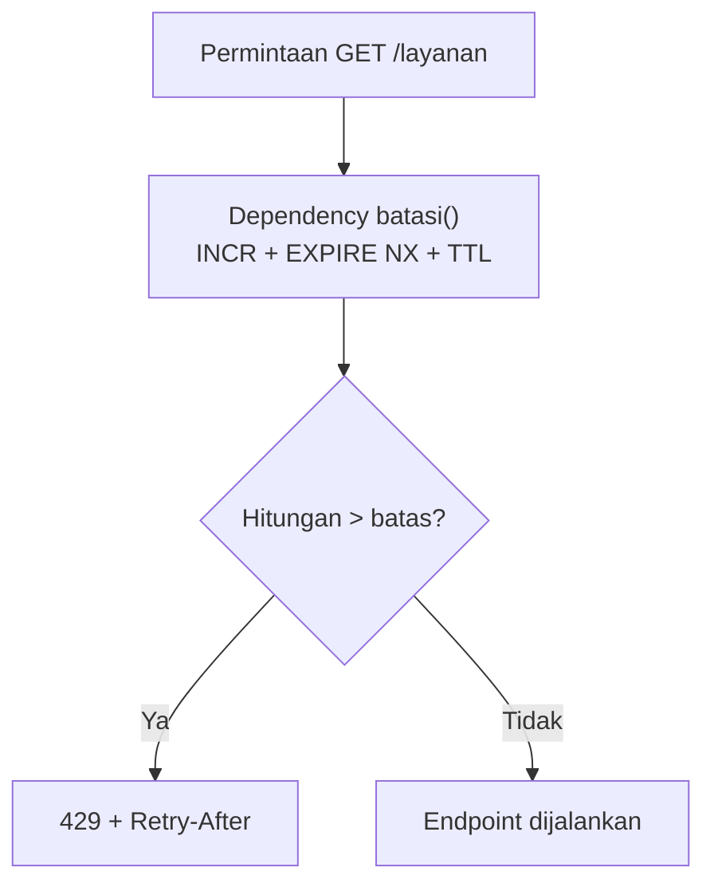
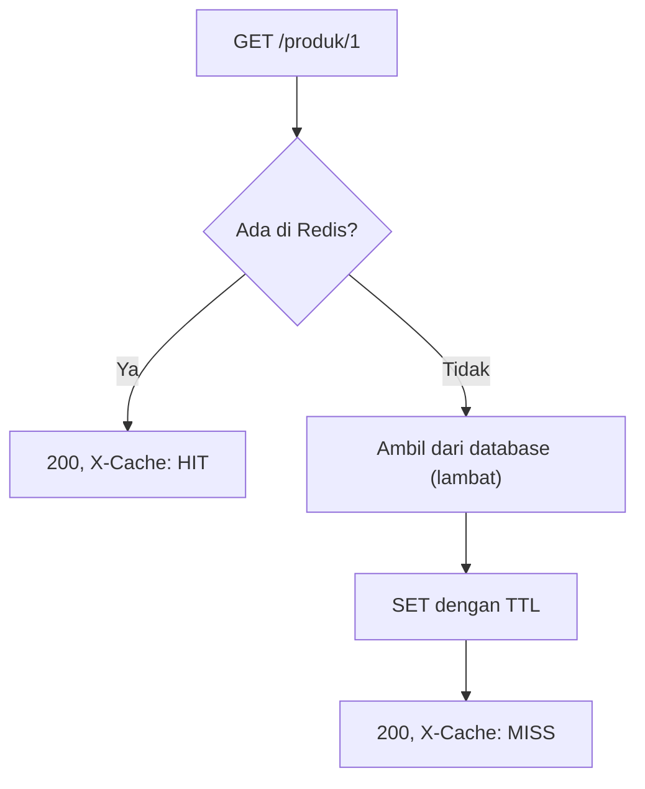

# FastAPI: caching dan rate limit

## Tujuan belajar

Setelah bab ini kamu bisa:

- [ ] Menerapkan cache-aside pada endpoint FastAPI dengan klien `redis.asyncio`.
- [ ] Menandai hasil cache dengan header `X-Cache` (HIT atau MISS) dan menghapus cache saat data berubah.
- [ ] Membuat pembatas laju (*rate limiter*) sebagai *dependency* yang bisa dipasang ke endpoint mana pun.
- [ ] Mengembalikan `429 Too Many Requests` dengan header `Retry-After` dan sisa kuota.
- [ ] Menyebut keterbatasan membatasi berdasarkan alamat IP.

## Prasyarat

- Sudah membaca [Dasar FastAPI dengan Redis](dasar-fastapi-dengan-redis.md): lifespan, `get_redis`, `Depends`, dan penanganan `503`. Bab ini memakai ulang semuanya tanpa menjelaskannya lagi.
- Sudah membaca [Caching](../pola-aplikasi/caching.md) dan [Session dan rate limiting](../pola-aplikasi/session-dan-rate-limiting.md). Konsep cache-aside, TTL, invalidasi, dan jendela tetap dengan `INCR` dan `EXPIRE` tidak diulang.
- Container Redis berjalan dan port 6379 dipetakan ke komputermu.
- Versi Redis: opsi `NX` pada `EXPIRE` membutuhkan Redis 7.0.0 atau lebih baru.[^3] Versi dari `redis:latest` memenuhi syarat ini.
- Perangkat lunak: folder `latihan-fastapi` dari bab sebelumnya dengan `fastapi[standard]` dan `redis` terpasang di lingkungan virtual yang aktif.
- Kondisi awal: tidak ada key berawalan `api:cache:` atau `api:rate:` yang kamu perlukan.

## Konsep

Bab [Caching](../pola-aplikasi/caching.md) dan [Session dan rate limiting](../pola-aplikasi/session-dan-rate-limiting.md) menunjukkan pola dengan `redis-cli` dan skrip. Di API nyata, kedua pola itu hidup di dalam endpoint HTTP, dan ada tiga hal baru yang perlu dipikirkan:

1. **Siapa yang diminta menunggu.** Endpoint asinkron tidak boleh memakai `time.sleep`, karena itu menahan semua permintaan. Kita memakai `await asyncio.sleep(...)` untuk mensimulasikan database lambat.
2. **Cache dan rate limit dibagi antar proses.** Aplikasi produksi sering dijalankan dengan beberapa proses *worker*. Counter yang disimpan di memori Python hanya terlihat oleh satu proses, sedangkan counter di Redis terlihat oleh semuanya. Itu alasan utama rate limit disimpan di Redis.
3. **Bahasa HTTP.** Hit atau miss cache diberi tahu lewat header (`X-Cache`), dan penolakan karena kuota habis memakai status `429 Too Many Requests` dengan header `Retry-After` (berapa detik klien harus menunggu).

Pada rate limit, kita memasang logika di *dependency* FastAPI. Dependency berjalan sebelum endpoint, jadi permintaan yang melebihi batas ditolak sebelum menyentuh database atau pekerjaan berat. Satu dependency bisa dipasang di banyak endpoint.[^1]

### Analogi

Cache seperti meja informasi yang menyimpan jawaban pertanyaan yang sering diajukan, supaya petugas tidak perlu ke arsip tiap kali. Rate limit seperti satpam di pintu yang mencatat berapa kali satu tamu masuk dalam sepuluh detik terakhir. Jika terlalu sering, tamu diminta menunggu sambil diberi tahu berapa lama.

!!! note "Batas analogi"
    Satpam mengenali tamu dari wajah. API hanya melihat alamat IP, yang bisa dipakai bersama banyak orang (kantor, kampus) atau diubah-ubah oleh penyerang.

## Cara kerja



Untuk cache:



| Bagian | Fungsi |
|---|---|
| `X-Cache: HIT`/`MISS` | Header kustom untuk melihat apakah jawaban datang dari cache |
| `await r.delete(kunci)` pada `PUT` | Invalidasi cache saat data sumber berubah |
| `batasi` | Dependency yang menghitung permintaan per klien dan menolak bila melebihi batas |
| `pipeline(transaction=True)` | Menjalankan `INCR`, `EXPIRE NX`, dan `TTL` sebagai satu paket `MULTI`/`EXEC` |
| `Retry-After` | Header standar berisi jumlah detik tunggu |

## Praktik langkah demi langkah

Output di bawah adalah output yang **diharapkan** berdasarkan dokumentasi, bukan hasil eksekusi di komputermu. Angka waktu pasti berbeda.

### Langkah 1: Siapkan berkas dasar

**Lingkungan: Python** · simpan sebagai `main.py` di folder `latihan-fastapi` (ganti berkas bab sebelumnya, atau simpan sebagai `main_cache.py` dan jalankan itu)

```python title="main.py"
import asyncio
import json
import os
from contextlib import asynccontextmanager

import redis.asyncio as redis
from fastapi import Depends, FastAPI, HTTPException, Request, Response
from fastapi.responses import JSONResponse
from pydantic import BaseModel, Field
from redis.exceptions import ConnectionError as RedisConnectionError
from redis.exceptions import TimeoutError as RedisTimeoutError


@asynccontextmanager
async def lifespan(app: FastAPI):
    url = os.environ.get("REDIS_URL", "redis://localhost:6379/0")
    app.state.redis = redis.from_url(
        url,
        decode_responses=True,
        socket_connect_timeout=2,
        socket_timeout=2,
    )
    yield
    await app.state.redis.aclose()


app = FastAPI(lifespan=lifespan)


def get_redis(request: Request) -> redis.Redis:
    return request.app.state.redis


async def redis_tidak_tersedia(request: Request, exc: Exception):
    return JSONResponse(status_code=503, content={"detail": "Redis tidak tersedia"})


for kelas in (RedisConnectionError, RedisTimeoutError):
    app.add_exception_handler(kelas, redis_tidak_tersedia)
```

Bagian ini sama dengan bab sebelumnya: klien dibuat di lifespan dan dibagikan lewat `get_redis`, dan galat koneksi menjadi `503`.[^4] Berkas ini akan kita lengkapi pada langkah-langkah berikutnya. **Diharapkan:** belum ada endpoint, jadi belum ada yang diuji.

### Langkah 2: Endpoint produk dengan cache-aside

Tambahkan di bawah:

**Lingkungan: Python**

```python
TTL_CACHE = 60

DB = {
    1: {"nama": "Kopi", "harga": 25000},
    2: {"nama": "Teh", "harga": 15000},
}
STATISTIK = {"panggilan_db": 0}


async def ambil_dari_db(produk_id: int):
    await asyncio.sleep(1)  # simulasi kueri lambat tanpa memblokir server
    STATISTIK["panggilan_db"] += 1
    return DB.get(produk_id)


def kunci_produk(produk_id: int) -> str:
    return f"api:cache:produk:{produk_id}"


@app.get("/produk/{produk_id}")
async def get_produk(
    produk_id: int, response: Response, r: redis.Redis = Depends(get_redis)
):
    kunci = kunci_produk(produk_id)

    tersimpan = await r.get(kunci)
    if tersimpan is not None:
        response.headers["X-Cache"] = "HIT"
        return json.loads(tersimpan)

    data = await ambil_dari_db(produk_id)
    if data is None:
        raise HTTPException(status_code=404, detail="Produk tidak ada")

    await r.set(kunci, json.dumps(data), ex=TTL_CACHE)
    response.headers["X-Cache"] = "MISS"
    return data


@app.get("/statistik")
async def statistik():
    return STATISTIK
```

| Baris | Penjelasan |
|---|---|
| `await asyncio.sleep(1)` | Mensimulasikan database lambat. Dengan `await`, server tetap melayani permintaan lain; `time.sleep` akan memblokirnya. |
| `produk_id: int` | FastAPI memvalidasi dan mengubah parameter jalur menjadi `int`, sehingga key yang terbentuk aman. |
| `kunci_produk(...)` | Satu fungsi pembentuk key agar penulisan dan penghapusan cache memakai nama yang sama persis. |
| `response: Response` | Objek respons yang bisa kita beri header sebelum dikembalikan. |
| `if tersimpan is not None` | Langkah "cek cache" dari bab [Caching](../pola-aplikasi/caching.md); `is not None` membedakan miss dari nilai kosong. |
| `json.loads` / `json.dumps` | Redis menyimpan String, jadi `dict` diubah ke JSON saat disimpan dan dikembalikan saat dibaca. |
| `ex=TTL_CACHE` | TTL 60 detik sebagai jaring pengaman bila invalidasi terlewat. |
| `/statistik` | Menghitung berapa kali "database" benar-benar dipanggil, untuk membuktikan cache bekerja. |

### Langkah 3: Invalidasi saat data berubah

Tambahkan:

**Lingkungan: Python**

```python
class HargaBaru(BaseModel):
    harga: int = Field(gt=0)


@app.put("/produk/{produk_id}/harga")
async def ubah_harga(
    produk_id: int, baru: HargaBaru, r: redis.Redis = Depends(get_redis)
):
    if produk_id not in DB:
        raise HTTPException(status_code=404, detail="Produk tidak ada")
    DB[produk_id]["harga"] = baru.harga
    await r.delete(kunci_produk(produk_id))
    return DB[produk_id]
```

Kenapa `delete` dan bukan menulis nilai baru ke cache: menghapus lebih sederhana dan aman, karena permintaan berikutnya mengisi cache dari sumber yang benar (alasan lengkapnya ada di bab [Caching](../pola-aplikasi/caching.md)).

!!! danger "`delete` tidak bisa dibatalkan"
    `r.delete(...)` menghapus key cache itu saja. Jangan membentuk nama key dari input yang belum divalidasi; di sini `produk_id` sudah dipastikan `int`.

### Langkah 4: Dependency pembatas laju

Tambahkan:

**Lingkungan: Python**

```python
BATAS = 5
JENDELA = 10  # detik


async def batasi(
    request: Request, response: Response, r: redis.Redis = Depends(get_redis)
):
    klien = request.client.host if request.client else "tidak-diketahui"
    kunci = f"api:rate:{klien}"

    async with r.pipeline(transaction=True) as pipe:
        pipe.incr(kunci)
        pipe.expire(kunci, JENDELA, nx=True)
        pipe.ttl(kunci)
        hitungan, _, sisa_waktu = await pipe.execute()

    sisa_kuota = max(0, BATAS - hitungan)
    header = {
        "X-RateLimit-Limit": str(BATAS),
        "X-RateLimit-Remaining": str(sisa_kuota),
    }

    if hitungan > BATAS:
        header["Retry-After"] = str(max(sisa_waktu, 1))
        raise HTTPException(
            status_code=429, detail="Terlalu banyak permintaan", headers=header
        )

    for nama, nilai in header.items():
        response.headers[nama] = nilai


@app.get("/layanan", dependencies=[Depends(batasi)])
async def layanan():
    return {"ok": True}
```

| Baris | Penjelasan |
|---|---|
| `request.client.host` | Alamat IP klien yang terhubung. Menjadi bagian nama key sehingga tiap klien punya hitungan sendiri. |
| `r.pipeline(transaction=True)` | Menjalankan tiga perintah sebagai satu paket `MULTI`/`EXEC`, jadi tidak ada saat counter ada tanpa expiry (celah yang dibahas di [Session dan rate limiting](../pola-aplikasi/session-dan-rate-limiting.md)).[^2] Perintah diantrekan tanpa `await`; hanya `execute()` yang di-`await`. |
| `pipe.expire(kunci, JENDELA, nx=True)` | Memasang TTL hanya bila belum ada, sehingga jendela dimulai dari permintaan pertama dan tidak diperpanjang. Butuh Redis 7.0+. |
| `pipe.ttl(kunci)` | Mengambil sisa detik jendela untuk header `Retry-After`. |
| `hitungan, _, sisa_waktu = ...` | Tiga hasil mengikuti urutan perintah; hasil `expire` tidak kita butuhkan (`_`). |
| `hitungan > BATAS` | Keputusan menolak ada di aplikasi, bukan di Redis. |
| `HTTPException(429, headers=...)` | Membatalkan permintaan dengan status 429 dan menyertakan `Retry-After`.[^5] |
| `dependencies=[Depends(batasi)]` | Memasang pembatas pada endpoint tanpa mengubah isi fungsinya. |

### Langkah 5: Uji cache dengan skrip

Jalankan server (`fastapi dev main.py`). Bersihkan key uji dulu agar hasil konsisten:

**Lingkungan: redis-cli**

```text
127.0.0.1:6379> DEL api:cache:produk:1 api:rate:127.0.0.1
```

**Lingkungan: Python** · simpan sebagai `uji_cache.py`

```python title="uji_cache.py"
import time

import httpx

with httpx.Client(base_url="http://127.0.0.1:8000") as c:
    for i in range(1, 4):
        mulai = time.perf_counter()
        r = c.get("/produk/1")
        lama = time.perf_counter() - mulai
        print(i, r.status_code, r.headers["x-cache"], r.json(), f"{lama:.2f} dtk")

    print("ubah harga:", c.put("/produk/1/harga", json={"harga": 30000}).json())

    for i in range(4, 6):
        r = c.get("/produk/1")
        print(i, r.status_code, r.headers["x-cache"], r.json())

    print("panggilan db:", c.get("/statistik").json())
```

**Diharapkan** (waktu dan jumlah panggilan db bergantung pada `STATISTIK` sejak server mulai; pada server yang baru dinyalakan):

```text
1 200 MISS {'nama': 'Kopi', 'harga': 25000} 1.0x dtk
2 200 HIT {'nama': 'Kopi', 'harga': 25000} 0.0x dtk
3 200 HIT {'nama': 'Kopi', 'harga': 25000} 0.0x dtk
ubah harga: {'nama': 'Kopi', 'harga': 30000}
4 200 MISS {'nama': 'Kopi', 'harga': 30000}
5 200 HIT {'nama': 'Kopi', 'harga': 30000}
panggilan db: {'panggilan_db': 2}
```

Cara membaca output: hanya dua dari lima permintaan benar-benar memanggil database (permintaan 1, dan permintaan 4 setelah cache dihapus). Permintaan 4 mengembalikan harga baru, bukan harga lama, berkat invalidasi.

### Langkah 6: Uji rate limit dengan skrip

**Lingkungan: Python** · simpan sebagai `uji_rate.py`

```python title="uji_rate.py"
import time

import httpx

with httpx.Client(base_url="http://127.0.0.1:8000") as c:
    for i in range(1, 8):
        r = c.get("/layanan")
        print(
            i,
            r.status_code,
            "sisa:", r.headers.get("x-ratelimit-remaining"),
            "tunggu:", r.headers.get("retry-after"),
        )

    time.sleep(11)
    r = c.get("/layanan")
    print("setelah jendela berakhir:", r.status_code)
```

**Diharapkan:**

```text
1 200 sisa: 4 tunggu: None
2 200 sisa: 3 tunggu: None
3 200 sisa: 2 tunggu: None
4 200 sisa: 1 tunggu: None
5 200 sisa: 0 tunggu: None
6 429 sisa: 0 tunggu: 10
7 429 sisa: 0 tunggu: 10
setelah jendela berakhir: 200
```

Cara membaca output: lima permintaan pertama lolos dengan sisa kuota menurun. Permintaan ke-6 dan ke-7 ditolak dengan `429` dan `Retry-After` berisi sisa detik jendela (angka sekitar 10 atau kurang tergantung kecepatan skrip). Setelah jendela 10 detik berakhir, key kedaluwarsa dan kuota pulih.

### Langkah 7: Periksa key di Redis

Sebelum jendela berakhir, di `redis-cli`:

**Lingkungan: redis-cli**

```text
127.0.0.1:6379> GET api:rate:127.0.0.1
127.0.0.1:6379> TTL api:rate:127.0.0.1
127.0.0.1:6379> TTL api:cache:produk:1
```

**Diharapkan:** hitungan (mis. `"7"`), sisa detik jendela (maksimal 10), dan sisa detik cache (maksimal 60). Ini membuktikan bahwa kuota dan cache memang tersimpan di Redis, bukan di memori Python.

### Langkah 8: Bersihkan data latihan

```text
127.0.0.1:6379> DEL api:cache:produk:1 api:rate:127.0.0.1
```

**Diharapkan:** `(integer)` sejumlah key yang masih ada (0 sampai 2). Hentikan server dengan Ctrl+C.

!!! danger "`DEL` tidak bisa dibatalkan"
    Perintah ini menyebut key satu per satu agar tidak ada key lain yang ikut terhapus.

## Contoh lengkap

Berkas `main.py` dari Langkah 1 sampai 4 digabung menjadi satu, ditambah penjelasan ringkas untuk bagian yang belum ditandai.

**Lingkungan: Python** · Kebutuhan: Python 3, `fastapi[standard]`, `redis`, dan Redis 7.0+ berjalan di `localhost:6379` (atau `REDIS_URL`).

```python title="main.py"
import asyncio
import json
import os
from contextlib import asynccontextmanager

import redis.asyncio as redis
from fastapi import Depends, FastAPI, HTTPException, Request, Response
from fastapi.responses import JSONResponse
from pydantic import BaseModel, Field
from redis.exceptions import ConnectionError as RedisConnectionError
from redis.exceptions import TimeoutError as RedisTimeoutError

TTL_CACHE = 60
BATAS = 5
JENDELA = 10

DB = {
    1: {"nama": "Kopi", "harga": 25000},
    2: {"nama": "Teh", "harga": 15000},
}
STATISTIK = {"panggilan_db": 0}


@asynccontextmanager
async def lifespan(app: FastAPI):
    url = os.environ.get("REDIS_URL", "redis://localhost:6379/0")
    app.state.redis = redis.from_url(
        url, decode_responses=True, socket_connect_timeout=2, socket_timeout=2
    )
    yield
    await app.state.redis.aclose()


app = FastAPI(lifespan=lifespan)


def get_redis(request: Request) -> redis.Redis:
    return request.app.state.redis


async def redis_tidak_tersedia(request: Request, exc: Exception):
    return JSONResponse(status_code=503, content={"detail": "Redis tidak tersedia"})


for kelas in (RedisConnectionError, RedisTimeoutError):
    app.add_exception_handler(kelas, redis_tidak_tersedia)


async def ambil_dari_db(produk_id: int):
    await asyncio.sleep(1)
    STATISTIK["panggilan_db"] += 1
    return DB.get(produk_id)


def kunci_produk(produk_id: int) -> str:
    return f"api:cache:produk:{produk_id}"


class HargaBaru(BaseModel):
    harga: int = Field(gt=0)


async def batasi(
    request: Request, response: Response, r: redis.Redis = Depends(get_redis)
):
    klien = request.client.host if request.client else "tidak-diketahui"
    kunci = f"api:rate:{klien}"

    async with r.pipeline(transaction=True) as pipe:
        pipe.incr(kunci)
        pipe.expire(kunci, JENDELA, nx=True)
        pipe.ttl(kunci)
        hitungan, _, sisa_waktu = await pipe.execute()

    header = {
        "X-RateLimit-Limit": str(BATAS),
        "X-RateLimit-Remaining": str(max(0, BATAS - hitungan)),
    }
    if hitungan > BATAS:
        header["Retry-After"] = str(max(sisa_waktu, 1))
        raise HTTPException(
            status_code=429, detail="Terlalu banyak permintaan", headers=header
        )
    for nama, nilai in header.items():
        response.headers[nama] = nilai


@app.get("/produk/{produk_id}")
async def get_produk(
    produk_id: int, response: Response, r: redis.Redis = Depends(get_redis)
):
    kunci = kunci_produk(produk_id)
    tersimpan = await r.get(kunci)
    if tersimpan is not None:
        response.headers["X-Cache"] = "HIT"
        return json.loads(tersimpan)

    data = await ambil_dari_db(produk_id)
    if data is None:
        raise HTTPException(status_code=404, detail="Produk tidak ada")
    await r.set(kunci, json.dumps(data), ex=TTL_CACHE)
    response.headers["X-Cache"] = "MISS"
    return data


@app.put("/produk/{produk_id}/harga")
async def ubah_harga(
    produk_id: int, baru: HargaBaru, r: redis.Redis = Depends(get_redis)
):
    if produk_id not in DB:
        raise HTTPException(status_code=404, detail="Produk tidak ada")
    DB[produk_id]["harga"] = baru.harga
    await r.delete(kunci_produk(produk_id))
    return DB[produk_id]


@app.get("/layanan", dependencies=[Depends(batasi)])
async def layanan():
    return {"ok": True}


@app.get("/statistik")
async def statistik():
    return STATISTIK
```

Cara menjalankan: `fastapi dev main.py`, lalu `python uji_cache.py` dan `python uji_rate.py` di terminal lain. Hasil yang diharapkan sama dengan Langkah 5 dan 6.

## Kesalahan umum dan troubleshooting

| Gejala | Penyebab dan solusi |
|---|---|
| Semua permintaan `MISS` | TTL terlalu pendek, key berbeda tiap permintaan (mis. mengandung waktu), atau `set` gagal. Periksa `GET api:cache:produk:1` di `redis-cli`. |
| Harga lama tetap tampil setelah `PUT` | Invalidasi lupa dipanggil atau memakai nama key yang berbeda. Gunakan satu fungsi `kunci_produk(...)` untuk menulis dan menghapus. |
| Server terasa membeku saat produk dimuat | Memakai `time.sleep` atau pekerjaan berat tanpa `await` di endpoint `async`. Ganti dengan `await asyncio.sleep(...)` atau pindahkan pekerjaan berat ke luar jalur permintaan. |
| `ResponseError: ... wrong number of arguments for 'expire' command` | `nx=True` pada Redis di bawah 7.0. Perbarui Redis, atau tambahkan `EXPIRE` hanya bila `INCR` mengembalikan `1`. |
| `429` padahal baru sekali memanggil | Key `api:rate:...` tersisa dari percobaan sebelumnya. Hapus dengan `DEL` atau tunggu jendela berakhir. |
| Semua pengguna berbagi satu kuota | Aplikasi di belakang proxy atau load balancer, sehingga `request.client.host` selalu IP proxy. Baca IP asli dari header yang dipercaya (mis. `X-Forwarded-For`) hanya bila proxy memang kamu kendalikan, karena header itu bisa dipalsukan. |
| Kuota bisa dihindari dengan mengganti IP | Pembatasan per IP lemah. Untuk aplikasi nyata, batasi per akun atau API key bila ada. |
| Pengguna bisa mengirim hingga 2 kali batas di batas dua jendela | Kelemahan jendela tetap, dibahas di [Session dan rate limiting](../pola-aplikasi/session-dan-rate-limiting.md). |
| `RuntimeWarning: coroutine ... was never awaited` | Ada `await` yang terlewat pada pemanggilan Redis asinkron. Perintah di dalam pipeline diantrekan tanpa `await`, tetapi `execute()` harus di-`await`. |
| `503 Redis tidak tersedia` | Redis berhenti atau alamat salah. Cek `docker ps` dan `REDIS_URL`. |
| Banyak permintaan serentak ke produk yang cache-nya baru habis menghantam database | *Cache stampede*. Mitigasi sederhana: TTL acak sedikit berbeda; pola yang lebih lengkap berada di luar bab ini. |

!!! warning "Data sensitif jangan di-cache sembarangan"
    Jangan menyimpan respons yang berbeda per pengguna (misalnya profil pribadi) dengan key yang sama untuk semua pengguna. Sertakan identitas pengguna di key, atau jangan di-cache.

!!! note "Status verifikasi"
    Nama fungsi, parameter, dan perilaku dicocokkan dengan dokumentasi FastAPI, Redis, dan `redis-py`. Kode hanya diperiksa sintaksnya; belum dijalankan di Redis atau FastAPI sungguhan saat bab ini ditulis. Perilaku header pada respons, urutan kunci JSON, angka waktu, dan teks galat bisa berbeda antarversi. Bandingkan dengan hasilmu sendiri.

## Latihan

1. Ubah `TTL_CACHE` menjadi 5 detik. Panggil `/produk/1` dua kali dengan jeda 6 detik. Apa nilai `X-Cache` pada panggilan kedua, dan kenapa?
2. Sebelum menjalankan: dengan `BATAS = 3` dan `JENDELA = 10`, berapa permintaan pertama yang lolos? Ubah, jalankan `uji_rate.py`, dan bandingkan.
3. Pasang `dependencies=[Depends(batasi)]` pada `/produk/{produk_id}`. Apa yang terjadi bila kamu menekan endpoint itu lebih dari lima kali dalam 10 detik, padahal datanya ada di cache?
4. Ubah `batasi` agar kunci mengandung nama jalur (`request.url.path`) sehingga tiap endpoint punya kuota sendiri. Apa untung ruginya?
5. Jelaskan kenapa menyimpan counter rate limit di variabel Python tidak cukup bila aplikasi dijalankan dengan beberapa worker.

??? success "Petunjuk"
    1. Setelah TTL habis, key hilang, jadi permintaan berikutnya adalah miss.
    2. Permintaan lolos selama hitungan tidak melebihi batas.
    3. Rate limit berjalan sebelum endpoint, jadi cache tidak mengubahnya.
    4. Pikirkan beban bila banyak jalur dengan parameter berbeda (jangan memakai nilai parameter di key).
    5. Tiap worker punya memori sendiri; Redis dipakai bersama.

## Ringkasan

- Cache-aside di FastAPI: cek Redis, bila miss ambil dari sumber, simpan dengan TTL, kembalikan; beri tanda dengan header `X-Cache`.
- Hapus key cache saat data sumber berubah; TTL menjadi jaring pengaman.
- Rate limiter dipasang sebagai dependency: `INCR`, `EXPIRE ... NX`, dan `TTL` dalam satu pipeline, lalu tolak dengan `429` dan `Retry-After` bila melebihi batas.
- Counter dan cache di Redis dibagi antar semua worker, berbeda dengan variabel di memori Python.
- Pembatasan per IP punya keterbatasan (proxy, banyak pengguna satu IP, IP berubah); header dari klien tidak boleh dipercaya begitu saja.

Berikutnya: [FastAPI: fitur realtime dengan SSE](fastapi-fitur-realtime-dengan-sse.md) (opsional).

## Referensi resmi

[^1]: FastAPI, *Dependencies* dan *Dependencies in path operation decorators*: <https://fastapi.tiangolo.com/tutorial/dependencies/>
[^2]: Redis, *INCR* (bagian *Pattern: Rate limiter*): <https://redis.io/docs/latest/commands/incr/>
[^3]: Redis, *EXPIRE*: <https://redis.io/docs/latest/commands/expire/>
[^4]: Redis, *redis-py guide (Python)* dan contoh asyncio: <https://redis.io/docs/latest/develop/clients/redis-py/> dan <https://redis-py.readthedocs.io/en/stable/examples/asyncio_examples.html>
[^5]: FastAPI, *Handling Errors* (`HTTPException` dengan `headers`): <https://fastapi.tiangolo.com/tutorial/handling-errors/>

Bacaan tambahan: [FastAPI: Response Headers](https://fastapi.tiangolo.com/advanced/response-headers/), [`TTL`](https://redis.io/docs/latest/commands/ttl/), [MDN: 429 Too Many Requests](https://developer.mozilla.org/en-US/docs/Web/HTTP/Status/429).
