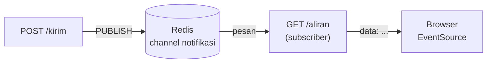

# FastAPI: fitur realtime dengan SSE

!!! info "Opsional"
    Bab ini boleh dilewati tanpa memutus alur belajar. Fitur realtime tidak dibutuhkan untuk bab Operasi dan Proyek Akhir yang berfokus pada Redis, kecuali proyekmu memang membutuhkan notifikasi langsung.

## Tujuan belajar

Setelah bab ini kamu bisa:

- [ ] Menjelaskan apa itu *Server-Sent Events* (SSE) dan kapan lebih cocok daripada polling atau WebSocket.
- [ ] Membuat endpoint FastAPI yang mengalirkan pesan dari Redis Pub/Sub ke klien lewat SSE.
- [ ] Mengirim pesan ke semua klien yang terhubung lewat `PUBLISH`.
- [ ] Menangani pemutusan klien dan menjaga koneksi tetap hidup dengan komentar *keep-alive*.
- [ ] Menyebut keterbatasan Pub/Sub untuk fitur realtime dan alternatifnya.

## Prasyarat

- Sudah membaca [Dasar FastAPI dengan Redis](dasar-fastapi-dengan-redis.md) dan [FastAPI: caching dan rate limit](fastapi-caching-dan-rate-limit.md): lifespan, `get_redis`, `Depends`, dan penanganan `503`. Bab ini memakai ulang semuanya.
- Sudah membaca [Pub/Sub](../pola-aplikasi/pub-sub.md), terutama bahwa pesan tidak disimpan dan dikirim paling banyak sekali. Bab ini tidak mengulang cara kerjanya.
- Container Redis berjalan dan port 6379 dipetakan ke komputermu.
- Perangkat lunak: folder `latihan-fastapi` dari bab sebelumnya dengan `fastapi[standard]` dan `redis` terpasang di lingkungan virtual yang aktif. `PubSub.aclose()` membutuhkan `redis-py` versi terbaru (lihat troubleshooting).
- Pengetahuan dasar HTML dan JavaScript membantu untuk Langkah 5, tetapi tidak wajib.
- Kondisi awal: tidak ada pelanggan lain pada channel `notifikasi`.

## Konsep

Kadang server perlu **mendorong** informasi ke klien tanpa diminta: notifikasi baru, status pekerjaan, atau skor pertandingan. Cara paling sederhana adalah *polling*: klien bertanya berulang kali, tetapi boros dan terlambat. **Server-Sent Events (SSE)** memungkinkan klien membuka satu permintaan HTTP biasa yang dibiarkan terbuka, lalu server menulis pesan ke dalamnya kapan pun ada.[^1]

SSE searah (server ke klien), memakai HTTP biasa, dan peramban sudah menyediakan objek `EventSource` yang otomatis menyambung ulang bila putus. Kalau kamu butuh komunikasi dua arah, WebSocket lebih cocok.

Peran Redis: aplikasi sering berjalan dengan beberapa proses atau server. Pesan harus sampai ke klien yang terhubung ke proses mana pun. Pub/Sub menyiarkan pesan ke semua pelanggan channel,[^3] jadi setiap proses yang menerima `PUBLISH` bisa meneruskannya ke klien SSE miliknya.

Format SSE adalah teks sederhana: tiap pesan diawali `data: `, diakhiri satu baris kosong. Baris yang diawali titik dua adalah komentar, tidak ditampilkan di klien, dan berguna sebagai *keep-alive*.[^1]

```text
data: {"teks": "halo"}

: ping

```

### Analogi

SSE seperti saluran radio: pendengar menyetel frekuensi sekali, lalu stasiun menyiarkan kapan pun ada kabar. Redis Pub/Sub adalah ruang siaran pusat: banyak reporter (proses) menaruh berita, dan semua stasiun yang menyetel ruang itu menyiarkannya ke pendengarnya.

!!! warning "Batas analogi yang penting"
    Siaran radio yang terlewat tidak bisa diulang. Pub/Sub juga tidak menyimpan pesan: pesan yang dikirim saat klien sedang menyambung ulang akan hilang. Kalau pesan tidak boleh hilang, gunakan Streams (lihat [Streams dan consumer group](../pola-aplikasi/streams-consumer-group.md)) dan baca ulang dari ID terakhir.

## Cara kerja



| Bagian | Fungsi |
|---|---|
| `GET /aliran` | Endpoint SSE yang memegang koneksi terbuka dan mengalirkan pesan |
| `StreamingResponse(..., media_type="text/event-stream")` | Respons yang terus mengirim potongan data dari sebuah generator |
| `r.pubsub()` + `subscribe` + `get_message` | Berlangganan channel Redis secara asinkron |
| `request.is_disconnected()` | Mendeteksi klien yang sudah pergi agar langganan Redis ditutup |
| `: ping` | Komentar SSE untuk menjaga koneksi agar tidak dianggap menganggur |
| `POST /kirim` | Menerima teks dan memanggil `PUBLISH` |

## Praktik langkah demi langkah

Output di bawah adalah output **terverifikasi**: dijalankan di Redis 8.10.3 pada 2026-10-27. Hasilmu bisa berbeda pada nilai yang berubah tiap eksekusi. Urutan baris `dikirim` dan `diterima` pada skrip bisa berselang-seling.

### Langkah 1: Fondasi aplikasi

**Lingkungan: Python** · simpan sebagai `main.py` (atau `main_sse.py`)

```python title="main.py"
import json
import os
from contextlib import asynccontextmanager

import redis.asyncio as redis
from fastapi import Depends, FastAPI, Request
from fastapi.responses import HTMLResponse, JSONResponse, StreamingResponse
from pydantic import BaseModel, Field
from redis.exceptions import ConnectionError as RedisConnectionError
from redis.exceptions import TimeoutError as RedisTimeoutError

CHANNEL = "notifikasi"


@asynccontextmanager
async def lifespan(app: FastAPI):
    url = os.environ.get("REDIS_URL", "redis://localhost:6379/0")
    app.state.redis = redis.from_url(url, decode_responses=True)
    yield
    await app.state.redis.aclose()


app = FastAPI(lifespan=lifespan)


def get_redis(request: Request) -> redis.Redis:
    return request.app.state.redis


async def redis_tidak_tersedia(request: Request, exc: Exception):
    return JSONResponse(status_code=503, content={"detail": "Redis tidak tersedia"})


for kelas in (RedisConnectionError, RedisTimeoutError):
    app.add_exception_handler(kelas, redis_tidak_tersedia)
```

Satu perbedaan dari bab sebelumnya: `socket_timeout` **tidak** diatur. Koneksi langganan sengaja dibiarkan menunggu lama untuk pesan berikutnya; batas waktu soket pendek akan memutusnya.

### Langkah 2: Endpoint pengirim

Tambahkan:

**Lingkungan: Python**

```python
class Pesan(BaseModel):
    teks: str = Field(min_length=1, max_length=200)


@app.post("/kirim")
async def kirim(pesan: Pesan, r: redis.Redis = Depends(get_redis)):
    penerima = await r.publish(CHANNEL, json.dumps({"teks": pesan.teks}))
    return {"penerima": penerima}
```

| Baris | Penjelasan |
|---|---|
| `Field(min_length=1, max_length=200)` | Membatasi ukuran pesan agar tidak membebani Redis dan klien. |
| `json.dumps({"teks": ...})` | Mengemas pesan sebagai JSON satu baris. Ini penting: karakter baris baru di dalam teks akan merusak format SSE, tetapi `json.dumps` meng-escape-nya. |
| `await r.publish(...)` | Mengembalikan jumlah pelanggan yang menerima, sama seperti `PUBLISH` di `redis-cli`.[^4] |

### Langkah 3: Endpoint SSE

Tambahkan:

**Lingkungan: Python**

```python
async def aliran_pesan(request: Request, r: redis.Redis):
    pubsub = r.pubsub()
    await pubsub.subscribe(CHANNEL)
    yield ": terhubung\n\n"

    kosong = 0
    try:
        while True:
            if await request.is_disconnected():
                break
            pesan = await pubsub.get_message(
                ignore_subscribe_messages=True, timeout=1.0
            )
            if pesan is None:
                kosong += 1
                if kosong % 15 == 0:
                    yield ": ping\n\n"
                continue
            kosong = 0
            yield f"data: {pesan['data']}\n\n"
    finally:
        await pubsub.unsubscribe(CHANNEL)
        await pubsub.aclose()


@app.get("/aliran")
async def aliran(request: Request, r: redis.Redis = Depends(get_redis)):
    return StreamingResponse(
        aliran_pesan(request, r),
        media_type="text/event-stream",
        headers={"Cache-Control": "no-cache", "X-Accel-Buffering": "no"},
    )
```

| Baris | Penjelasan |
|---|---|
| `async def aliran_pesan(...)` + `yield` | Generator asinkron: setiap `yield` mengirim satu potongan ke klien tanpa menutup koneksi.[^2] |
| `r.pubsub()` + `await subscribe(CHANNEL)` | Berlangganan channel. Setiap klien SSE memegang satu koneksi Redis selama terhubung.[^5] |
| `yield ": terhubung\n\n"` | Komentar awal agar klien langsung tahu koneksi terbuka, sebelum ada pesan pertama. |
| `request.is_disconnected()` | Memeriksa apakah klien sudah pergi. Tanpa ini langganan Redis tidak pernah ditutup. |
| `get_message(ignore_subscribe_messages=True, timeout=1.0)` | Menunggu paling lama 1 detik; mengembalikan `None` bila tidak ada pesan. Pesan konfirmasi langganan diabaikan. |
| `kosong % 15 == 0` → `: ping` | Setiap sekitar 15 detik sepi, kirim komentar agar perantara jaringan tidak memutus koneksi menganggur. |
| `yield f"data: {pesan['data']}\n\n"` | Format SSE: `data: ` lalu isi, diakhiri baris kosong. |
| `finally: unsubscribe + aclose` | Memastikan langganan ditutup walau klien pergi atau terjadi galat, supaya koneksi Redis tidak bocor. |
| `media_type="text/event-stream"` | Jenis konten SSE yang dikenali peramban. |
| `Cache-Control: no-cache`, `X-Accel-Buffering: no` | Meminta perantara (cache, proxy Nginx) tidak menahan alirannya. |

### Langkah 4: Uji dengan skrip

Jalankan server (`fastapi dev main.py`). Di terminal lain:

**Lingkungan: Python** · simpan sebagai `uji_sse.py`

```python title="uji_sse.py"
import threading

import httpx

BASE = "http://127.0.0.1:8000"
diterima = []
siap = threading.Event()


def dengarkan():
    with httpx.stream("GET", f"{BASE}/aliran", timeout=None) as r:
        for baris in r.iter_lines():
            if baris.startswith(":"):
                siap.set()
            elif baris.startswith("data:"):
                print("diterima:", baris)
                diterima.append(baris)
                if len(diterima) == 3:
                    break


t = threading.Thread(target=dengarkan)
t.start()
siap.wait(timeout=5)

for teks in ["satu", "dua", "tiga"]:
    r = httpx.post(f"{BASE}/kirim", json={"teks": teks})
    print("dikirim:", teks, r.json())

t.join(timeout=10)
```

| Baris | Penjelasan |
|---|---|
| `httpx.stream(..., timeout=None)` | Membuka koneksi SSE dan membiarkannya terbuka tanpa batas waktu baca. |
| `r.iter_lines()` | Membaca respons baris demi baris saat tiba. |
| `baris.startswith(":")` → `siap.set()` | Komentar `: terhubung` menandakan langganan server sudah aktif, jadi aman mulai mengirim. |
| `break` setelah 3 pesan | Keluar dari blok `with` menutup koneksi, yang akan memicu `is_disconnected()` di server. |

**Terverifikasi** (urutan baris `dikirim` dan `diterima` bisa berselang-seling):

```text
dikirim: satu {'penerima': 1}
diterima: data: {"teks": "satu"}
dikirim: dua {'penerima': 1}
diterima: data: {"teks": "dua"}
dikirim: tiga {'penerima': 1}
diterima: data: {"teks": "tiga"}
```

Cara membaca output: `penerima: 1` berarti satu pelanggan (klien SSE) menerima tiap pesan. Setiap pesan tiba di klien sebagai satu baris `data:` berisi JSON.

### Langkah 5: Uji dengan `curl` dan peramban

Pakai `curl` dengan opsi `-N` (tanpa buffer) agar pesan langsung tampil. Di PowerShell tulis `curl.exe`.

**Lingkungan: terminal**

```bash
curl -N http://127.0.0.1:8000/aliran
```

Biarkan berjalan. Dari terminal lain kirim pesan:

```bash
curl -X POST http://127.0.0.1:8000/kirim -H "Content-Type: application/json" -d '{"teks":"halo"}'
```

(Di PowerShell, kutip JSON bisa bermasalah; kirim pesan dari `/docs` atau pakai skrip `httpx`.)

**Terverifikasi** di terminal `curl -N`:

```text
: terhubung

data: {"teks": "halo"}

```

Untuk peramban, tambahkan halaman sederhana:

**Lingkungan: Python**

```python
HALAMAN = """<!doctype html>
<meta charset="utf-8">
<title>Notifikasi</title>
<h1>Notifikasi realtime</h1>
<ul id="daftar"></ul>
<script>
  const sumber = new EventSource("/aliran");
  sumber.onmessage = (e) => {
    const li = document.createElement("li");
    li.textContent = JSON.parse(e.data).teks;
    document.getElementById("daftar").appendChild(li);
  };
</script>
"""


@app.get("/", response_class=HTMLResponse)
async def beranda():
    return HALAMAN
```

Buka `http://127.0.0.1:8000/` di peramban, lalu kirim pesan lewat `http://127.0.0.1:8000/docs` (endpoint `POST /kirim`). **Terverifikasi:** pesan muncul di daftar halaman seketika tanpa memuat ulang.

Kenapa `textContent`, bukan `innerHTML`: isi pesan berasal dari pengguna. `textContent` memperlakukannya sebagai teks biasa sehingga skrip berbahaya di dalam pesan tidak dijalankan.

### Langkah 6: Pastikan langganan ditutup saat klien pergi

Setelah `uji_sse.py` selesai (atau tab peramban ditutup), tunggu beberapa detik, lalu di `redis-cli`:

**Lingkungan: redis-cli**

```text
127.0.0.1:6379> PUBSUB NUMSUB notifikasi
```

**Terverifikasi:**

```text
1) "notifikasi"
2) (integer) 0
```

Nol pelanggan berarti blok `finally` bekerja dan koneksi Redis tidak bocor. Jika masih `1`, klien mungkin belum benar-benar terputus (tunggu sejenak) atau `is_disconnected()` belum terdeteksi; lihat troubleshooting.

### Langkah 7: Bersihkan

Hentikan server dengan Ctrl+C. Pub/Sub tidak membuat key, jadi tidak ada data Redis yang perlu dihapus.

## Contoh lengkap

Seluruh Langkah 1 sampai 5 digabung dalam satu berkas.

**Lingkungan: Python** · Kebutuhan: Python 3, `fastapi[standard]`, `redis` terbaru, dan Redis berjalan di `localhost:6379` (atau `REDIS_URL`).

```python title="main.py"
import json
import os
from contextlib import asynccontextmanager

import redis.asyncio as redis
from fastapi import Depends, FastAPI, Request
from fastapi.responses import HTMLResponse, JSONResponse, StreamingResponse
from pydantic import BaseModel, Field
from redis.exceptions import ConnectionError as RedisConnectionError
from redis.exceptions import TimeoutError as RedisTimeoutError

CHANNEL = "notifikasi"

HALAMAN = """<!doctype html>
<meta charset="utf-8">
<title>Notifikasi</title>
<h1>Notifikasi realtime</h1>
<ul id="daftar"></ul>
<script>
  const sumber = new EventSource("/aliran");
  sumber.onmessage = (e) => {
    const li = document.createElement("li");
    li.textContent = JSON.parse(e.data).teks;
    document.getElementById("daftar").appendChild(li);
  };
</script>
"""


@asynccontextmanager
async def lifespan(app: FastAPI):
    url = os.environ.get("REDIS_URL", "redis://localhost:6379/0")
    app.state.redis = redis.from_url(url, decode_responses=True)
    yield
    await app.state.redis.aclose()


app = FastAPI(lifespan=lifespan)


def get_redis(request: Request) -> redis.Redis:
    return request.app.state.redis


async def redis_tidak_tersedia(request: Request, exc: Exception):
    return JSONResponse(status_code=503, content={"detail": "Redis tidak tersedia"})


for kelas in (RedisConnectionError, RedisTimeoutError):
    app.add_exception_handler(kelas, redis_tidak_tersedia)


class Pesan(BaseModel):
    teks: str = Field(min_length=1, max_length=200)


@app.get("/", response_class=HTMLResponse)
async def beranda():
    return HALAMAN


@app.post("/kirim")
async def kirim(pesan: Pesan, r: redis.Redis = Depends(get_redis)):
    penerima = await r.publish(CHANNEL, json.dumps({"teks": pesan.teks}))
    return {"penerima": penerima}


async def aliran_pesan(request: Request, r: redis.Redis):
    pubsub = r.pubsub()
    await pubsub.subscribe(CHANNEL)
    yield ": terhubung\n\n"

    kosong = 0
    try:
        while True:
            if await request.is_disconnected():
                break
            pesan = await pubsub.get_message(
                ignore_subscribe_messages=True, timeout=1.0
            )
            if pesan is None:
                kosong += 1
                if kosong % 15 == 0:
                    yield ": ping\n\n"
                continue
            kosong = 0
            yield f"data: {pesan['data']}\n\n"
    finally:
        await pubsub.unsubscribe(CHANNEL)
        await pubsub.aclose()


@app.get("/aliran")
async def aliran(request: Request, r: redis.Redis = Depends(get_redis)):
    return StreamingResponse(
        aliran_pesan(request, r),
        media_type="text/event-stream",
        headers={"Cache-Control": "no-cache", "X-Accel-Buffering": "no"},
    )
```

Cara menjalankan: `fastapi dev main.py`, lalu `python uji_sse.py`. Hasil yang diharapkan sama dengan Langkah 4. Untuk melihat hasilnya di peramban, buka `http://127.0.0.1:8000/`.

## Kesalahan umum dan troubleshooting

| Gejala | Penyebab dan solusi |
|---|---|
| `AttributeError: 'PubSub' object has no attribute 'aclose'` | `redis-py` terlalu lama. Jalankan `pip install --upgrade redis`, atau pakai `await pubsub.close()` pada versi lama. |
| Pesan baru muncul setelah beberapa lama atau sekaligus | Perantara (proxy, antivirus, peramban tertentu) menahan aliran. Pastikan header `Cache-Control: no-cache` dan `X-Accel-Buffering: no` ada, dan matikan buffering proxy. |
| `curl` tidak menampilkan apa pun sampai selesai | Lupa opsi `-N`. Gunakan `curl -N`. |
| `PUBSUB NUMSUB notifikasi` tetap lebih dari 0 | Klien belum benar-benar terputus, atau generator tidak mendeteksi putus. Tunggu beberapa detik; pastikan loop memeriksa `request.is_disconnected()`. |
| Koneksi Redis terus bertambah | Langganan tidak ditutup. Pastikan `unsubscribe` dan `aclose` berada di blok `finally`. Ingat tiap klien SSE memegang satu koneksi Redis, jadi ukur kapasitas pool (lihat [Pipeline dan connection pool](pipeline-dan-connection-pool.md)). |
| `ConnectionError` setelah beberapa waktu tanpa pesan | `socket_timeout` pendek memutus koneksi langganan yang menganggur. Jangan memasang `socket_timeout` pada klien Pub/Sub. |
| `PUBLISH` membalas `penerima: 0` | Tidak ada klien SSE yang terhubung saat pesan dikirim. Pesan hilang karena Pub/Sub tidak menyimpannya. |
| Pesan hilang saat peramban menyambung ulang | Keterbatasan Pub/Sub. Untuk pesan yang tidak boleh hilang, gunakan Streams dan kirim bidang `id:` agar klien bisa melanjutkan dari ID terakhir lewat header `Last-Event-ID`.[^1] |
| Pesan dengan baris baru merusak aliran | Isi `data:` mengandung `\n`. Kirim JSON satu baris seperti di contoh (`json.dumps`). |
| Peramban menolak lebih dari beberapa koneksi SSE ke domain yang sama | Batas koneksi per domain pada HTTP/1.1. Pakai HTTP/2 atau kurangi jumlah tab. |
| `503 Redis tidak tersedia` | Redis berhenti atau alamat salah. Cek `docker ps` dan `REDIS_URL`. |

!!! warning "Jangan membuka aliran tanpa autentikasi di produksi"
    Endpoint `/aliran` dan `/kirim` pada bab ini terbuka untuk siapa saja. Di aplikasi nyata, batasi akses (autentikasi) dan batasi laju, dan jangan menyiarkan data pribadi ke semua pelanggan channel.

!!! note "Status verifikasi"
    Perintah, nilai balik, dan skrip di bab ini dijalankan di Redis 8.10.3 (`redis:latest`) pada 2026-10-27, dengan Python 3.12.3 dan redis-py 8.1.0, FastAPI 0.162.0, Uvicorn 0.54.0. Sintaks juga dicocokkan dengan dokumentasi resmi Redis. Nilai yang berubah tiap eksekusi (ID, TTL, waktu, urutan, alamat IP) bisa berbeda di komputermu, dan teks galat bisa berbeda antarversi. Tampilan prompt interaktif `redis-cli` (prompt, Tab, riwayat) tidak teramati karena pengujian berjalan tanpa terminal interaktif.

## Latihan

1. Buka dua tab peramban ke `http://127.0.0.1:8000/`, lalu kirim satu pesan dari `/docs`. Berapa nilai `penerima` dan apa yang tampil di kedua tab?
2. Sebelum menjalankan: tutup semua tab dan jalankan `POST /kirim`. Berapa `penerima`, dan apa yang terjadi pada pesan itu?
3. Ubah interval *keep-alive* dari sekitar 15 detik menjadi sekitar 5 detik. Bagian kode mana yang kamu ubah?
4. Ubah pesan dari `{"teks": ...}` menjadi `{"teks": ..., "waktu": ...}` dengan cap waktu dari server, dan tampilkan keduanya di halaman.
5. Jelaskan kenapa SSE saja belum cukup untuk notifikasi yang tidak boleh terlewat, dan sebutkan struktur Redis yang bisa melengkapinya.

??? success "Petunjuk"
    1. Satu klien SSE satu pelanggan Redis.
    2. Lihat penjelasan Pub/Sub tentang pesan tanpa pelanggan.
    3. Ubah angka pada `kosong % 15 == 0` (satu iterasi kira-kira satu detik).
    4. Tambahkan `time.time()` saat membuat JSON dan ubah `li.textContent` di JavaScript.
    5. Pikirkan klien yang sedang terputus saat pesan dikirim, dan bab Streams.

## Ringkasan

- SSE membiarkan satu permintaan HTTP terbuka dan menulis pesan ke dalamnya; searah dari server ke klien, dengan penyambungan ulang otomatis di peramban.
- Di FastAPI, `StreamingResponse` dengan `media_type="text/event-stream"` dan generator asinkron mengalirkan pesan; format pesannya `data: ...` diikuti baris kosong.
- Redis Pub/Sub menyiarkan pesan ke semua proses; tiap klien SSE memegang satu langganan Redis yang harus ditutup di `finally`.
- Periksa `request.is_disconnected()` dan kirim komentar `: ping` berkala; kirim data sebagai JSON satu baris.
- Pub/Sub tidak menyimpan pesan, jadi pesan bisa hilang saat klien terputus; pakai Streams bila itu tidak boleh terjadi.

Berikutnya: bagian [Operasi](../operasi/index.md).

## Referensi resmi

[^1]: MDN, *Using server-sent events*: <https://developer.mozilla.org/en-US/docs/Web/API/Server-sent_events/Using_server-sent_events>
[^2]: FastAPI, *Custom Response: StreamingResponse*: <https://fastapi.tiangolo.com/advanced/custom-response/>
[^3]: Redis, *Redis Pub/Sub*: <https://redis.io/docs/latest/develop/interact/pubsub/>
[^4]: Redis, *PUBLISH*: <https://redis.io/docs/latest/commands/publish/>
[^5]: Redis, *redis-py guide (Python)* dan contoh asyncio (Pub/Sub): <https://redis.io/docs/latest/develop/clients/redis-py/> dan <https://redis-py.readthedocs.io/en/stable/examples/asyncio_examples.html>

Bacaan tambahan: [`PUBSUB NUMSUB`](https://redis.io/docs/latest/commands/pubsub-numsub/), [Redis Streams](https://redis.io/docs/latest/develop/data-types/streams/), [`SUBSCRIBE`](https://redis.io/docs/latest/commands/subscribe/).
