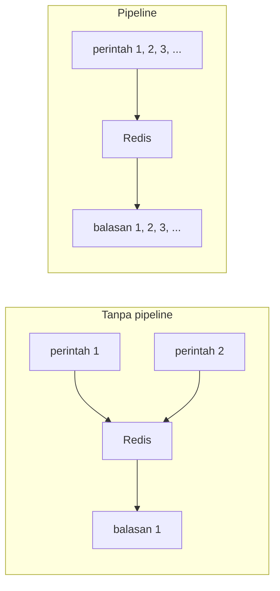

# Pipeline dan connection pool

## Tujuan belajar

Setelah bab ini kamu bisa:

- [ ] Menjelaskan kenapa mengirim banyak perintah satu per satu itu lambat (*round trip*).
- [ ] Memakai `pipeline()` untuk mengirim banyak perintah sekaligus dan membaca daftar hasilnya.
- [ ] Membedakan `pipeline(transaction=True)` (bawaan, memakai `MULTI`/`EXEC`) dari `transaction=False`.
- [ ] Menangani galat di dalam pipeline dengan `raise_on_error=False`.
- [ ] Menjelaskan connection pool, membuat pool sendiri, dan mengenali galat `Too many connections`.

## Prasyarat

- Sudah membaca [Dasar redis-py](dasar-redis-py.md) dan [Struktur data di Python](struktur-data-di-python.md).
- Sudah membaca [Transaksi](../pola-aplikasi/transaksi.md), karena pipeline bawaan `redis-py` memakai `MULTI`/`EXEC`.
- Container Redis berjalan dan port 6379 dipetakan ke komputermu.
- Perangkat lunak: Python 3 dan paket `redis` di lingkungan virtual yang aktif.
- Kondisi awal: tidak ada key berawalan `py:` yang kamu perlukan.

## Konsep

### Pipeline

Setiap perintah Redis melakukan satu *round trip*: kirim perintah, tunggu balasan. Redis sendiri sangat cepat, tetapi perjalanan jaringan (bahkan ke `localhost`) memakan waktu. Jika kamu mengirim 1000 perintah satu per satu, kamu menunggu 1000 kali perjalanan pulang-pergi.

**Pipeline** mengumpulkan banyak perintah, mengirimnya sekaligus, lalu menerima semua balasannya sekaligus. Jumlah perjalanan turun drastis, sehingga throughput naik. Pipeline tidak mengubah perintahnya, hanya cara mengirimnya.[^1]

Pada `redis-py`, `pipeline()` secara bawaan juga membungkus perintah dalam `MULTI`/`EXEC` (`transaction=True`), jadi semuanya dijalankan tanpa disela klien lain (lihat [Transaksi](../pola-aplikasi/transaksi.md)). Bila kamu hanya butuh kecepatan, dan tidak butuh jaminan itu, pakai `transaction=False`.[^2]

### Connection pool

Membuka koneksi TCP baru untuk setiap perintah itu mahal. **Connection pool** menyimpan beberapa koneksi yang sudah terbuka dan meminjamkannya ke perintah yang membutuhkan. Objek `redis.Redis` sudah memakai pool secara otomatis, jadi satu objek klien bisa dipakai berulang dan dibagi antar thread.[^3]

Aturan praktisnya: **buat satu klien per proses lalu pakai ulang**, jangan membuat `redis.Redis(...)` baru di setiap fungsi atau permintaan.

### Analogi

Pipeline seperti menitipkan daftar belanja ke kurir sekali jalan, bukan menyuruhnya bolak-balik untuk tiap barang. Connection pool seperti kumpulan sepeda kurir yang siap pakai: kurir mengambil satu saat dibutuhkan dan mengembalikannya setelah selesai, bukan membeli sepeda baru setiap kali.

!!! note "Batas analogi"
    Daftar belanja yang panjang bisa memakan memori di dua sisi. Dan jika semua sepeda sedang dipakai, kurir berikutnya harus menunggu atau gagal, tergantung jenis pool.

## Cara kerja



| Hal | Perilaku |
|---|---|
| `pipe = r.pipeline()` | Membuat pipeline; `transaction=True` secara bawaan (`MULTI`/`EXEC`) |
| `r.pipeline(transaction=False)` | Hanya mengirim berkelompok, tanpa `MULTI`/`EXEC` |
| `pipe.set(...)`, `pipe.incr(...)` | Perintah **diantrekan**, belum dijalankan; mengembalikan pipeline itu sendiri |
| `pipe.execute()` | Mengirim semua, mengembalikan **daftar** balasan sesuai urutan |
| `with r.pipeline() as pipe:` | Pipeline dibersihkan otomatis setelah blok selesai |
| `redis.ConnectionPool(...)` | Pool yang melempar `ConnectionError` bila `max_connections` habis |
| `redis.BlockingConnectionPool(...)` | Pool yang menunggu koneksi tersedia sampai `timeout` |

## Praktik langkah demi langkah

Output di bawah adalah output yang **diharapkan** berdasarkan dokumentasi, bukan hasil eksekusi di komputermu. Angka waktu pasti berbeda di komputermu.

### Langkah 1: Pipeline pertama

**Lingkungan: Python** · simpan sebagai `pipeline_dasar.py`

```python title="pipeline_dasar.py"
import redis

r = redis.Redis(host="localhost", port=6379, decode_responses=True)

r.delete("py:a")

with r.pipeline(transaction=False) as pipe:
    pipe.set("py:a", 1)
    pipe.incr("py:a")
    pipe.get("py:a")
    hasil = pipe.execute()

print(hasil)

r.delete("py:a")
```

| Baris | Penjelasan |
|---|---|
| `with r.pipeline(transaction=False) as pipe:` | Membuat pipeline tanpa `MULTI`/`EXEC`, hanya untuk mengirim berkelompok. Blok `with` membersihkan pipeline di akhir. |
| `pipe.set(...)`, `pipe.incr(...)`, `pipe.get(...)` | Hanya mengantre. Belum ada yang dikirim ke Redis. |
| `pipe.execute()` | Mengirim ketiganya sekaligus dan mengembalikan daftar balasan berurutan. |
| `r.delete("py:a")` di awal dan akhir | Memulai dan mengakhiri dari kondisi bersih. |

**Diharapkan:**

```text
[True, 2, '2']
```

Cara membaca output: elemen pertama `True` adalah balasan `set`, `2` adalah balasan `incr`, dan `'2'` adalah balasan `get`. Posisi sama dengan urutan perintah.

### Langkah 2: Pipeline berantai dan hasil yang dipakai

**Lingkungan: Python** · simpan sebagai `pipeline_rantai.py`

```python title="pipeline_rantai.py"
import redis

r = redis.Redis(host="localhost", port=6379, decode_responses=True)

r.delete("py:hitung", "py:nama")

with r.pipeline() as pipe:
    pipe.incr("py:hitung").incr("py:hitung").set("py:nama", "Budi")
    hasil = pipe.execute()

jumlah, _, status = hasil[1], hasil[0], hasil[2]
print("hasil:", hasil)
print("hitungan akhir:", jumlah)

r.delete("py:hitung", "py:nama")
```

Kenapa berantai: setiap metode pipeline mengembalikan pipeline itu sendiri, sehingga bisa ditulis dalam satu ekspresi. Karena kita tidak menulis `transaction=False`, pipeline ini memakai `MULTI`/`EXEC`. **Diharapkan:**

```text
hasil: [1, 2, True]
hitungan akhir: 2
```

Catatan: hasil dari perintah di dalam pipeline **tidak tersedia sampai `execute()`**. Kamu tidak bisa memakai hasil `incr` pertama untuk menentukan perintah kedua di pipeline yang sama. Untuk logika seperti itu, pakai `WATCH` (lihat [Transaksi](../pola-aplikasi/transaksi.md)) atau Lua script.

### Langkah 3: Galat di dalam pipeline

**Lingkungan: Python** · simpan sebagai `pipeline_galat.py`

```python title="pipeline_galat.py"
import redis

r = redis.Redis(host="localhost", port=6379, decode_responses=True)

r.set("py:teks", "bukan angka")

with r.pipeline(transaction=False) as pipe:
    pipe.set("py:x", 1)
    pipe.incr("py:teks")
    pipe.set("py:y", 2)
    hasil = pipe.execute(raise_on_error=False)

for i, h in enumerate(hasil, start=1):
    print(i, type(h).__name__)

print("py:y =", r.get("py:y"))

r.delete("py:teks", "py:x", "py:y")
```

| Bagian | Penjelasan |
|---|---|
| `execute(raise_on_error=False)` | Mengembalikan pengecualian sebagai elemen daftar, bukan melemparkannya. Tanpa ini, galat pertama membuat `execute()` melempar pengecualian. |
| `type(h).__name__` | Menampilkan jenis tiap hasil: `bool` untuk sukses, `ResponseError` untuk galat. |
| `r.get("py:y")` | Membuktikan perintah setelah yang gagal tetap dijalankan. |

**Diharapkan:**

```text
1 bool
2 ResponseError
3 bool
py:y = 2
```

Cara membaca output: perintah kedua gagal, tetapi yang ketiga tetap berjalan. Tidak ada rollback, sama seperti di bab Transaksi.

!!! danger "Pipeline tidak membatalkan perintah yang sudah berhasil"
    Jika satu perintah di pipeline gagal, perintah lain tetap dijalankan. Periksa seluruh daftar hasil, jangan hanya menganggap semuanya sukses.

### Langkah 4: Ukur perbedaan kecepatan

**Lingkungan: Python** · simpan sebagai `pipeline_waktu.py`

```python title="pipeline_waktu.py"
import time

import redis

r = redis.Redis(host="localhost", port=6379, decode_responses=True)

JUMLAH = 1000

mulai = time.perf_counter()
for i in range(JUMLAH):
    r.set(f"py:uji:{i}", i)
satu_satu = time.perf_counter() - mulai

mulai = time.perf_counter()
with r.pipeline(transaction=False) as pipe:
    for i in range(JUMLAH):
        pipe.set(f"py:uji:{i}", i)
    pipe.execute()
pipeline = time.perf_counter() - mulai

print(f"satu per satu : {satu_satu:.3f} detik")
print(f"pipeline      : {pipeline:.3f} detik")

for i in range(JUMLAH):
    r.delete(f"py:uji:{i}")
```

Kenapa langkah ini diperlukan: supaya kamu melihat sendiri efek jumlah round trip. **Diharapkan:** waktu pipeline lebih kecil daripada satu per satu. Angka dan selisihnya tergantung komputermu, jadi tidak ada nilai pasti. Skrip menghapus 1000 key uji di akhir.

### Langkah 5: Pool sendiri dan klien yang dipakai ulang

**Lingkungan: Python** · simpan sebagai `pool_bersama.py`

```python title="pool_bersama.py"
import redis

pool = redis.ConnectionPool(
    host="localhost",
    port=6379,
    max_connections=10,
    decode_responses=True,
)


def tulis(nilai):
    r = redis.Redis(connection_pool=pool)
    return r.set("py:bersama", nilai)


def baca():
    r = redis.Redis(connection_pool=pool)
    return r.get("py:bersama")


tulis("halo")
print("dibaca:", baca())

redis.Redis(connection_pool=pool).delete("py:bersama")
pool.disconnect()
```

| Baris | Penjelasan |
|---|---|
| `redis.ConnectionPool(..., max_connections=10, ...)` | Membuat satu pool dengan batas 10 koneksi. Opsi seperti `decode_responses` ditetapkan di pool. |
| `redis.Redis(connection_pool=pool)` | Klien baru yang meminjam koneksi dari pool yang sama; murah dibuat karena tidak membuka koneksi baru. |
| `pool.disconnect()` | Menutup semua koneksi saat program selesai. |

**Diharapkan:** `dibaca: halo`.

### Langkah 6: Memicu `Too many connections`

**Lingkungan: Python** · simpan sebagai `pool_penuh.py`

```python title="pool_penuh.py"
import redis

pool = redis.ConnectionPool(
    host="localhost", port=6379, max_connections=1, decode_responses=True
)
r = redis.Redis(connection_pool=pool)

ps = r.pubsub()
ps.subscribe("uji")  # langganan memegang satu koneksi

try:
    r.ping()
except redis.exceptions.ConnectionError as e:
    print("pool penuh:", e)

ps.close()
pool.disconnect()
```

Kenapa dipakai `pubsub`: klien yang berlangganan memegang satu koneksi selama aktif (lihat [Pub/Sub](../pola-aplikasi/pub-sub.md)). Karena pool hanya punya satu koneksi, `ping()` tidak mendapat bagian. **Diharapkan:**

```text
pool penuh: Too many connections
```

Teks persis bisa berbeda antarversi. Solusinya: naikkan `max_connections`, atau pakai `BlockingConnectionPool` yang menunggu koneksi kosong sampai `timeout` alih-alih langsung gagal, dengan galat `No connection available.` bila waktunya habis.[^3]

## Contoh lengkap

Memuat banyak produk ke Hash dengan satu pipeline, lalu membacanya lagi dengan satu pipeline, memakai satu klien bersama dari pool.

**Lingkungan: Python** · Kebutuhan: Python 3, paket `redis`, dan Redis berjalan di `localhost:6379`.

```python title="pipeline_pool_lengkap.py"
import redis

pool = redis.BlockingConnectionPool(
    host="localhost",
    port=6379,
    max_connections=10,
    timeout=2,
    decode_responses=True,
)
r = redis.Redis(connection_pool=pool)

PRODUK = {
    1: {"nama": "Kopi", "harga": 25000},
    2: {"nama": "Teh", "harga": 15000},
    3: {"nama": "Roti", "harga": 12000},
}


def muat_semua():
    with r.pipeline(transaction=False) as pipe:
        for pid, data in PRODUK.items():
            pipe.hset(f"py:produk:{pid}", mapping=data)
        return pipe.execute()


def baca_semua():
    with r.pipeline(transaction=False) as pipe:
        for pid in PRODUK:
            pipe.hgetall(f"py:produk:{pid}")
        return pipe.execute()


def bersihkan():
    r.delete(*[f"py:produk:{pid}" for pid in PRODUK])


if __name__ == "__main__":
    bersihkan()
    print("hset:", muat_semua())
    for baris in baca_semua():
        print(baris)
    bersihkan()
    pool.disconnect()
```

Penjelasan baris penting:

| Baris | Penjelasan |
|---|---|
| `redis.BlockingConnectionPool(..., timeout=2)` | Pool yang menunggu sampai 2 detik bila semua koneksi sedang dipakai, lebih ramah daripada langsung gagal. |
| `r = redis.Redis(connection_pool=pool)` | Satu klien bersama untuk seluruh modul. Tidak dibuat ulang di tiap fungsi. |
| `with r.pipeline(transaction=False) as pipe:` | Pipeline untuk kecepatan; tidak butuh `MULTI`/`EXEC` karena tiap key terpisah. |
| `return pipe.execute()` | Mengembalikan daftar balasan; `return` di dalam `with` tetap membersihkan pipeline. |
| `bersihkan()` di awal dan akhir | Memulai dan mengakhiri dari kondisi bersih; hanya menghapus tiga key `py:produk:*`. |
| `pool.disconnect()` | Menutup koneksi saat selesai. |

Cara menjalankan: `python pipeline_pool_lengkap.py`.

**Diharapkan** (urutan field `dict` bisa berbeda):

```text
hset: [2, 2, 2]
{'nama': 'Kopi', 'harga': '25000'}
{'nama': 'Teh', 'harga': '15000'}
{'nama': 'Roti', 'harga': '12000'}
```

## Kesalahan umum dan troubleshooting

| Gejala | Penyebab dan solusi |
|---|---|
| `execute()` mengembalikan daftar, bukan nilai tunggal | Perilaku normal. Hasil sesuai urutan perintah; ambil dengan indeks. |
| Hasil pipeline `None` atau kosong | Lupa memanggil `execute()`. Tanpa itu perintah tidak pernah dikirim. |
| Satu perintah di pipeline gagal tetapi yang lain sukses | Tidak ada rollback. Pakai `raise_on_error=False` dan periksa tiap hasil.[^2] |
| `redis.exceptions.ConnectionError: Too many connections` | Pool dengan `max_connections` kecil sudah habis, mis. karena pubsub atau perintah blocking memegang koneksi. Naikkan batas atau pakai `BlockingConnectionPool`. |
| `ConnectionError: No connection available.` | `BlockingConnectionPool` kehabisan koneksi sampai `timeout`. Naikkan `max_connections` atau percepat pemakaian koneksi. |
| Pipeline sangat besar membuat memori naik | Ribuan perintah diantrekan sekaligus. Kirim per kelompok (mis. 500 perintah) lalu `execute()` berulang. |
| Membuat `redis.Redis(...)` di setiap permintaan | Setiap klien membuat pool sendiri. Buat satu klien dan pakai ulang. |
| Hasil perintah pertama dibutuhkan untuk perintah kedua | Hasil baru ada setelah `execute()`. Gunakan `WATCH` atau Lua script. |
| `redis.exceptions.ConnectionError` saat start | Container Redis belum berjalan atau port 6379 tidak terbuka. Cek `docker ps`. |

!!! note "Status verifikasi"
    Nama metode, parameter pool, dan perilaku pipeline dicocokkan dengan dokumentasi resmi Redis dan `redis-py`. Skrip hanya diperiksa sintaksnya; belum dijalankan di Redis sungguhan saat bab ini ditulis. Angka waktu, teks galat `Too many connections`, dan perilaku `BlockingConnectionPool` bergantung pada versi `redis-py`. Bandingkan dengan hasilmu sendiri.

## Latihan

1. Jalankan `pipeline_waktu.py` dengan `JUMLAH = 100`, `1000`, dan `5000`. Bagaimana perbandingan waktunya berubah?
2. Sebelum menjalankan: apa isi `hasil` dari pipeline `set`, `get`, `incr` pada key yang tidak ada? Jalankan lalu bandingkan.
3. Ubah `pipeline_galat.py` agar memakai `transaction=True` (hapus argumen). Apakah perintah ketiga tetap berjalan? Kenapa?
4. Ubah `pool_penuh.py` memakai `BlockingConnectionPool(timeout=1)`. Berapa lama programnya menunggu dan galat apa yang muncul?
5. Jelaskan kenapa membuat klien baru di setiap fungsi web bukan praktik yang baik.

??? success "Petunjuk"
    1. Selisih relatif biasanya makin terasa pada jumlah besar, tetapi hasilmu yang menentukan.
    2. Perhatikan urutan: `get` pada key kosong menghasilkan `None`.
    3. Ingat bahwa `EXEC` tetap menjalankan perintah lain saat satu gagal di waktu eksekusi.
    4. Perhatikan tulisan galat dan ukur waktunya dengan `time.perf_counter()`.
    5. Pikirkan jumlah koneksi dan biaya membukanya.

## Ringkasan

- Pipeline mengirim banyak perintah dalam satu kali kirim sehingga mengurangi round trip; hasil berupa daftar berurutan setelah `execute()`.
- `pipeline()` bawaan memakai `MULTI`/`EXEC` (`transaction=True`); `transaction=False` hanya untuk kecepatan.
- Satu perintah yang gagal tidak membatalkan perintah lain; pakai `raise_on_error=False` dan periksa semua hasil.
- Connection pool meminjamkan koneksi yang sudah terbuka. Buat satu klien per proses dan pakai ulang.
- `ConnectionPool` gagal bila habis (`Too many connections`); `BlockingConnectionPool` menunggu sampai `timeout`.

Berikutnya: [Dasar FastAPI dengan Redis](dasar-fastapi-dengan-redis.md).

## Referensi resmi

[^1]: Redis, *Pipelining (optimizing round-trip times)*: <https://redis.io/docs/latest/develop/using-commands/pipelining/>
[^2]: Redis, *Pipelines and transactions* (redis-py): <https://redis.io/docs/latest/develop/clients/redis-py/transpipe/>
[^3]: Redis, *Connect to the server* (redis-py, termasuk connection pool): <https://redis.io/docs/latest/develop/clients/redis-py/connect/>

Bacaan tambahan: [Dokumentasi `redis-py`: connections](https://redis-py.readthedocs.io/en/stable/connections.html), [`MULTI`](https://redis.io/docs/latest/commands/multi/), [`EXEC`](https://redis.io/docs/latest/commands/exec/).
