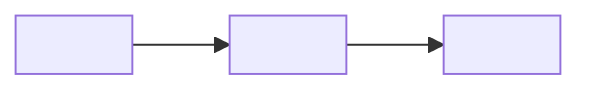

<!--
TEMPLATE BAB REDIS (tidak diterbitkan: dikecualikan lewat `exclude_docs` di mkdocs.yml).

CARA PAKAI
1. Salin file ini ke docs/<bagian>/<nama-bab>.md (huruf kecil, pakai tanda hubung).
2. Ganti semua <placeholder>. Hapus komentar HTML ini dan semua petunjuk berbentuk
   "(Petunjuk: ...)". Jangan menyalin petunjuk atau placeholder ke isi yang terbit.
3. Daftarkan bab di `nav` pada mkdocs.yml (hanya file yang sudah ada).
4. Jalankan `mkdocs build --strict`.

ATURAN ISI (ringkasan CLAUDE.md)
- Seluruh penjelasan dalam bahasa Indonesia, untuk pemula. Perintah dan kode tetap bahasa Inggris.
- Jelaskan KENAPA sebuah perintah dipakai, bukan hanya APA fungsinya.
- Konsep dijelaskan sebelum perintah. Jangan mengulang penjelasan bab lain; beri tautan relatif.
- Tautan ke bab yang belum ada ditulis sebagai teks biasa, bukan tautan.
- Jangan mengarang output. Output yang belum dijalankan di Redis nyata ditulis sebagai "diharapkan".
- Tandai perintah destruktif dan risiko kehilangan data. Secret selalu placeholder.
- Cocokkan sintaks dan perilaku dengan dokumentasi resmi (redis.io) untuk versi yang dituju.
- Bab opsional diberi `!!! info "Opsional"` di bawah judul.
- Diagram Mermaid hanya bila memperjelas.
-->

# <Judul bab>

(Petunjuk: satu judul `#` per halaman. Untuk bab opsional, tambahkan di sini:)

!!! info "Opsional"
    Bab ini boleh dilewati tanpa memutus alur belajar. <Alasan singkat>.

## Tujuan belajar

Setelah bab ini kamu bisa:

- [ ] <Kemampuan 1, kata kerja yang bisa diuji: menjelaskan, menjalankan, membedakan>
- [ ] <Kemampuan 2>
- [ ] <Kemampuan 3>

## Prasyarat

- Sudah membaca [<Judul bab sebelumnya>](<bab-sebelumnya>.md).
- Perangkat lunak dan versi: <contoh: Docker terpasang; Redis <versi minimum> atau lebih baru>.
- Kondisi awal: <contoh: container `redis` berjalan; database kosong>.

## Konsep

(Petunjuk: jelaskan ide sebelum perintah. Satu atau dua paragraf pendek.)

<Penjelasan sederhana: apa ini dan kenapa dibutuhkan.>

### Analogi

<Analogi sehari-hari yang mudah dipahami pemula.>

!!! note "Batas analogi"
    <Bagian mana dari analogi yang tidak tepat, bila ada.>

## Cara kerja

(Petunjuk: jelaskan mekanisme di balik perintah. Gunakan diagram hanya bila memperjelas.)



| <Istilah> | <Arti> |
|---|---|
| <istilah 1> | <arti 1> |

## Praktik langkah demi langkah

(Petunjuk: nyatakan lingkungan eksekusi di setiap blok: terminal, redis-cli, Python, YAML, atau shell. Blok kecil dan bisa dijalankan.)

Output di bawah adalah output yang **diharapkan** berdasarkan dokumentasi, kecuali disebut terverifikasi. Bandingkan dengan hasilmu sendiri.

### Langkah 1: <Tujuan langkah>

**Lingkungan: <terminal | redis-cli | Python | YAML | shell>**

```<bahasa>
<perintah atau kode>
```

Kenapa langkah ini diperlukan: <alasan>.

| Bagian | Fungsi dan alasan |
|---|---|
| `<perintah/parameter>` | <apa yang dilakukan dan kenapa dipakai> |

**Diharapkan:**

```text
<output yang diharapkan>
```

Cara membaca output: <arti setiap bagian output>.

!!! danger "Risiko kehilangan data"
    (Petunjuk: pakai hanya bila ada perintah destruktif seperti `DEL`, `FLUSHDB`, `docker rm`. Sebutkan apa yang hilang dan cara menghindarinya.)

### Langkah 2: <Tujuan langkah>

<Ulangi pola Langkah 1 untuk setiap langkah.>

## Contoh lengkap

(Petunjuk: sertakan hanya bila contoh utuh memang sesuai. Berikan kode yang bisa langsung dijalankan beserta prasyaratnya. Hapus bagian ini bila tidak relevan.)

**Lingkungan: <Python | shell | YAML>** · Kebutuhan: <perangkat lunak dan versi>

```<bahasa> title="<nama-file>"
<kode lengkap>
```

Penjelasan baris penting:

| Baris | Penjelasan |
|---|---|
| `<baris/blok>` | <tujuan, parameter, perilaku yang diharapkan> |

Cara menjalankan: <perintah>. Hasil yang diharapkan: <output>.

## Kesalahan umum dan troubleshooting

| Gejala | Penyebab dan solusi |
|---|---|
| `<pesan galat atau gejala>` | <penyebab; cara memperbaiki> |

!!! note "Status verifikasi"
    <Nyatakan apa yang sudah diuji dan apa yang belum. Contoh: sintaks dicocokkan dengan dokumentasi resmi; blok output belum dijalankan di Redis nyata.>

## Latihan

1. <Latihan 1: menerapkan langkah praktik>
2. <Latihan 2: memprediksi hasil sebelum menjalankan>
3. <Latihan 3: memperbaiki kesalahan atau memodifikasi contoh>

??? success "Petunjuk"
    1. <Petunjuk tanpa membocorkan jawaban>

## Ringkasan

- <Poin 1: konsep utama>
- <Poin 2: perintah atau kode utama dan fungsinya>
- <Poin 3: risiko atau hal yang perlu diingat>

Berikutnya: <[Judul bab berikutnya](<bab-berikutnya>.md) bila sudah ada; bila belum, tulis teks biasa>.

## Referensi resmi

(Petunjuk: pakai footnote `[^n]` di isi bab, definisikan di sini. Utamakan halaman perintah dan panduan di redis.io.)

[^1]: Redis, *<Judul halaman>*: <https://redis.io/docs/latest/<jalur>/>
[^2]: <Sumber resmi lain>

Bacaan tambahan: [`<PERINTAH>`](https://redis.io/docs/latest/commands/<perintah>/).

<!--
CEKLIS SEBELUM SELESAI
- [ ] 10 unsur wajib ada: tujuan, prasyarat, konsep dan analogi, contoh bertahap, kode lengkap bila sesuai,
      penjelasan perintah, output dan cara membacanya, troubleshooting, latihan, ringkasan.
- [ ] Setiap perintah penting dijelaskan kenapa dipakai, dengan parameter dan perilaku yang diharapkan.
- [ ] Output ditandai diharapkan atau terverifikasi dengan jujur.
- [ ] Perintah destruktif ditandai; tidak ada kredensial asli.
- [ ] Sintaks dan versi dicocokkan dengan redis.io; versi minimum disebut bila relevan.
- [ ] Tidak ada placeholder atau petunjuk tersisa.
- [ ] Terdaftar di `nav`; tautan relatif valid; `mkdocs build --strict` lolos.
-->
