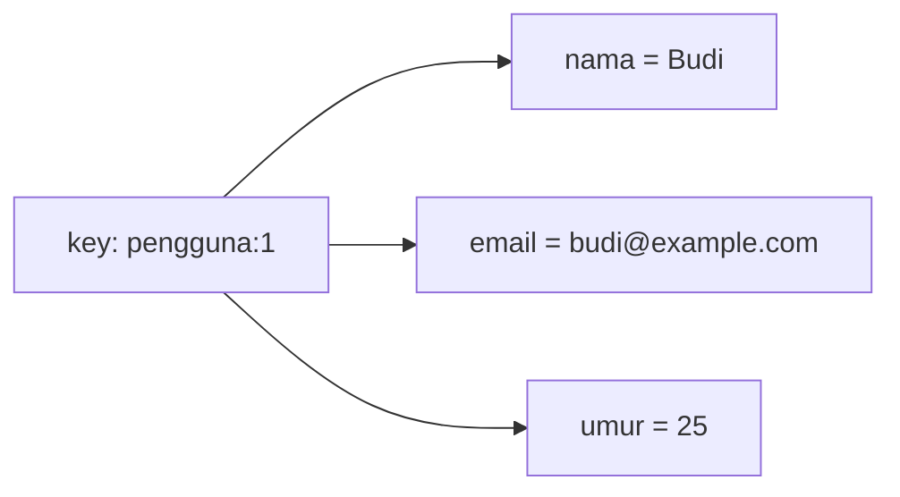

# Hash

## Tujuan belajar

Setelah bab ini kamu bisa:

- [ ] Menjelaskan apa itu Hash dan kapan lebih cocok dipakai daripada beberapa String.
- [ ] Menyimpan satu objek dengan `HSET` dan membacanya dengan `HGET`, `HMGET`, dan `HGETALL`.
- [ ] Mengubah, memeriksa, dan menghapus field dengan `HSET`, `HEXISTS`, dan `HDEL`.
- [ ] Menaikkan angka di dalam field dengan `HINCRBY`.
- [ ] Mengenali galat `WRONGTYPE` dan menjelaskan risiko `HGETALL` pada Hash besar.

## Prasyarat

- Sudah membaca [String](string.md), terutama `INCR` dan arti `(nil)`.
- Sudah membaca [Key dan expiry](../pengenalan/key-dan-expiry.md) untuk skema nama key `jenis:id`.
- Container Redis berjalan dan kamu bisa masuk dengan `docker exec -it redis redis-cli` (lihat [Instalasi dengan Docker](../pengenalan/instalasi-dengan-docker.md)).
- Versi Redis: `HSET` dengan beberapa pasangan field-value sekaligus tersedia sejak Redis 4.0.0.[^2] Versi dari `redis:latest` memenuhi syarat ini.
- Kondisi awal: tidak ada key berawalan `pengguna:`, `produk:`, dan `catatan:` yang kamu perlukan.
- Opsional untuk contoh Python: Python 3 dan paket `redis` (`pip install redis`).

## Konsep

Hash adalah value yang berisi kumpulan pasangan **field** dan **value**, seperti satu baris data dengan beberapa kolom.[^1] Satu key Hash mewakili satu objek, misalnya satu pengguna atau satu produk, dan field-nya adalah atribut objek itu: nama, email, umur.

Kenapa tidak cukup dengan String? Dengan String kamu bisa menyimpan `pengguna:1:nama`, `pengguna:1:email`, dan seterusnya sebagai key terpisah ([Key dan expiry](../pengenalan/key-dan-expiry.md) memakai pola ini). Cara itu jalan, tetapi:

- atribut satu objek tercecer di banyak key, sehingga sulit dibaca atau dihapus bersama,
- kamu harus memberi expiry atau menghapus tiap key satu per satu,
- kamu perlu `MGET` dengan daftar key panjang untuk membaca satu objek.

Dengan Hash, semua atribut ada di satu key. Kamu bisa membaca seluruh objek, atau hanya satu field, dan menghapus objek dengan satu `DEL`.

### Analogi

Hash seperti formulir biodata: nomor formulir adalah key (`pengguna:1`), sedangkan tiap kolom (nama, email, umur) adalah field. Kamu bisa membaca satu kolom saja tanpa mengambil seluruh formulir.

!!! note "Batas analogi"
    Hash di Redis datar: value sebuah field adalah String, bukan Hash atau List lain. Kalau butuh objek bersarang, kamu harus memecahnya jadi beberapa key atau menyimpan teks seperti JSON di field.

## Cara kerja



| Perintah | Fungsi | Balasan |
|---|---|---|
| `HSET key field value [field value ...]` | Menyimpan satu atau lebih field.[^2] | Jumlah field **baru** yang ditambahkan |
| `HGET key field` | Membaca satu field.[^3] | Nilainya, atau `(nil)` |
| `HMGET key field [field ...]` | Membaca beberapa field.[^4] | Daftar nilai, `(nil)` untuk field yang tidak ada |
| `HGETALL key` | Membaca semua field dan value.[^5] | Daftar selang-seling field, value |
| `HEXISTS key field` | Memeriksa field.[^6] | `1` ada, `0` tidak |
| `HDEL key field [field ...]` | Menghapus field.[^7] | Jumlah field yang terhapus |
| `HINCRBY key field n` | Menambah angka di field.[^8] | Angka baru |
| `HLEN key` | Menghitung jumlah field.[^9] | Jumlah field |

Setiap field disimpan sebagai String, jadi angka seperti `25` juga String yang baru dianggap angka saat dipakai `HINCRBY`, sama seperti `INCR` pada bab [String](string.md). Satu Hash dapat menampung hingga 2^32 - 1 (sekitar 4 miliar) pasangan field-value.[^1]

## Praktik langkah demi langkah

Output di bawah adalah output **terverifikasi**: dijalankan di Redis 8.10.3 pada 2026-10-27. Hasilmu bisa berbeda pada nilai yang berubah tiap eksekusi. Bandingkan dengan hasilmu sendiri.

**Lingkungan: terminal**

```bash
docker exec -it redis redis-cli
```

Semua langkah berikutnya di **redis-cli**.

### Langkah 1: Simpan objek dengan `HSET`

```text
127.0.0.1:6379> HSET pengguna:1 nama "Budi" email "budi@example.com" umur 25
```

Kenapa langkah ini diperlukan: satu perintah membuat key sekaligus mengisi tiga field, jadi objek tersimpan utuh.

| Bagian | Fungsi dan alasan |
|---|---|
| `pengguna:1` | Key Hash, memakai skema `jenis:id`. |
| `nama "Budi"` | Pasangan field dan value pertama. Tanda kutip dipakai karena kita ingin teks; `25` tidak perlu kutip. |
| Pasangan lain | `HSET` menerima banyak pasangan sekaligus.[^2] |

**Terverifikasi:**

```text
(integer) 3
```

Cara membaca output: `3` adalah jumlah field **baru** yang ditambahkan, bukan jumlah field yang kamu tulis ulang.

### Langkah 2: Baca satu field, beberapa field, atau semuanya

```text
127.0.0.1:6379> HGET pengguna:1 nama
127.0.0.1:6379> HMGET pengguna:1 nama umur alamat
127.0.0.1:6379> HGETALL pengguna:1
```

Kita membaca tiga cara untuk melihat bedanya: `HGET` untuk satu field, `HMGET` saat hanya butuh beberapa field, dan `HGETALL` untuk seluruh objek.

**Terverifikasi:**

```text
"Budi"
1) "Budi"
2) "25"
3) (nil)
1) "nama"
2) "Budi"
3) "email"
4) "budi@example.com"
5) "umur"
6) "25"
```

Cara membaca output: `HMGET` membalas berurutan sesuai field yang diminta; `(nil)` untuk `alamat` berarti field itu tidak ada. `HGETALL` menampilkan field dan value selang-seling (baris ganjil nama field, baris genap nilainya). Urutan pasangan tidak dijamin, jadi jangan bergantung padanya.

!!! warning "Hati-hati dengan `HGETALL` pada Hash besar"
    `HGETALL` mengembalikan semua field sekaligus dan bekerja sebanding dengan jumlah field.[^5] Pada Hash dengan ribuan field, ia bisa memperlambat server. Untuk objek kecil seperti ini aman; untuk Hash besar, baca field yang dibutuhkan saja dengan `HMGET`.

### Langkah 3: Ubah field dan tambah field baru

```text
127.0.0.1:6379> HSET pengguna:1 umur 26 kota "Bandung"
127.0.0.1:6379> HGET pengguna:1 umur
```

Kenapa penting: `HSET` pada field yang sudah ada **menimpa** nilainya, dan pada field baru **menambahkannya**, dalam satu perintah.

**Terverifikasi:**

```text
(integer) 1
"26"
```

Cara membaca output: `1` karena hanya `kota` yang baru; `umur` sudah ada sehingga hanya diperbarui dan tidak dihitung.

### Langkah 4: Periksa dan hapus field

```text
127.0.0.1:6379> HEXISTS pengguna:1 kota
127.0.0.1:6379> HDEL pengguna:1 kota
127.0.0.1:6379> HEXISTS pengguna:1 kota
127.0.0.1:6379> HLEN pengguna:1
```

**Terverifikasi:**

```text
(integer) 1
(integer) 1
(integer) 0
(integer) 3
```

`HDEL` membalas jumlah field yang benar-benar terhapus. `HLEN` kembali `3` karena `kota` sudah hilang.

!!! danger "Risiko kehilangan data"
    `HDEL` menghapus field permanen. Jika field terakhir dihapus, key Hash ikut hilang dari Redis. `DEL pengguna:1` menghapus seluruh objek. Keduanya tidak bisa dibatalkan.

### Langkah 5: Counter di dalam objek dengan `HINCRBY`

```text
127.0.0.1:6379> HSET produk:7 nama "Kopi" stok 10
127.0.0.1:6379> HINCRBY produk:7 stok -3
127.0.0.1:6379> HINCRBY produk:7 terjual 3
```

Kenapa dipakai: seperti `INCR`, `HINCRBY` mengubah angka secara atomik, tetapi di dalam satu field, sehingga stok dan data produk lain tetap menyatu di satu key.[^8] Kita memakai angka negatif untuk mengurangi. Field yang belum ada (`terjual`) dianggap `0` dulu.

**Terverifikasi:**

```text
(integer) 2
(integer) 7
(integer) 3
```

### Langkah 6: Expiry berlaku untuk seluruh Hash

```text
127.0.0.1:6379> EXPIRE produk:7 60
127.0.0.1:6379> TTL produk:7
```

`EXPIRE` dari bab [Key dan expiry](../pengenalan/key-dan-expiry.md) bekerja pada key, jadi seluruh Hash hilang saat waktunya habis. **Terverifikasi:** `(integer) 1`, lalu angka sekitar `60`.

### Langkah 7: Bersihkan data latihan

```text
127.0.0.1:6379> DEL pengguna:1 produk:7
```

**Terverifikasi:** `(integer) 2` (atau `1` jika `produk:7` sudah kedaluwarsa).

## Contoh lengkap

**Lingkungan: Python** · Kebutuhan: Python 3, paket `redis` (`pip install redis`), dan Redis berjalan di `localhost:6379`.

```python title="hash_objek.py"
import redis

r = redis.Redis(host="localhost", port=6379, decode_responses=True)

KEY = "pengguna:1"

r.delete(KEY)

# 1. Simpan objek (HSET dengan mapping)
r.hset(KEY, mapping={"nama": "Budi", "email": "budi@example.com", "umur": 25})

# 2. Baca satu field dan seluruh objek
print("nama:", r.hget(KEY, "nama"))
print("semua:", r.hgetall(KEY))

# 3. Naikkan angka di dalam field
print("login ke-", r.hincrby(KEY, "login", 1))

# 4. Bersihkan
r.delete(KEY)
```

Penjelasan baris penting:

| Baris | Penjelasan |
|---|---|
| `decode_responses=True` | Balasan berupa `str`, bukan `bytes`. |
| `r.delete(KEY)` di awal | Memulai dari kondisi bersih; menghapus key itu bila ada. |
| `r.hset(KEY, mapping={...})` | Memanggil `HSET` dengan banyak pasangan. Angka `25` dikirim sebagai String. |
| `r.hgetall(KEY)` | Mengembalikan `dict` Python berisi semua field. |
| `r.hincrby(KEY, "login", 1)` | Memanggil `HINCRBY`; field `login` belum ada sehingga mulai dari 0. |

Cara menjalankan: `python hash_objek.py`.

**Terverifikasi:**

```text
nama: Budi
semua: {'nama': 'Budi', 'email': 'budi@example.com', 'umur': '25'}
login ke- 1
```

Perhatikan `umur` kembali sebagai `'25'` (String), sesuai aturan bahwa semua value Hash adalah String. Urutan kunci pada `dict` bisa berbeda.

## Kesalahan umum dan troubleshooting

| Gejala | Penyebab dan solusi |
|---|---|
| `(error) WRONGTYPE Operation against a key holding the wrong kind of value` | Key bukan Hash (misalnya String). Cek `TYPE key`, pakai key lain, atau hapus bila memang salah. |
| `(error) ERR wrong number of arguments for 'hset' command` | Field dan value tidak berpasangan. Pastikan jumlah argumen setelah key genap. |
| `HGET` membalas `(nil)` | Key atau field tidak ada. Bedakan dengan `EXISTS key` dan `HEXISTS key field`. |
| `HGETALL` membalas `(empty array)` | Key tidak ada atau Hash kosong. Redis menghapus Hash yang kehilangan semua field.[^7] |
| `(error) ERR hash value is not an integer` | Field yang dipakai `HINCRBY` berisi teks non-angka. Periksa dengan `HGET`. |
| `HSET` membalas `0` | Semua field yang kamu tulis sudah ada, sehingga hanya diperbarui. Itu normal. |
| Perintah `HMSET` ditemukan di tutorial lama | `HMSET` deprecated sejak Redis 4.0.0; gunakan `HSET` dengan banyak pasangan.[^10] |
| Python: `redis.exceptions.DataError` saat `hset` | Value bertipe tidak didukung (misalnya `None` atau `dict`). Ubah ke `str`, `int`, atau `float`. |

!!! note "Status verifikasi"
    Perintah, nilai balik, dan skrip di bab ini dijalankan di Redis 8.10.3 (`redis:latest`) pada 2026-10-27, dengan Python 3.12.3 dan redis-py 8.1.0. Sintaks juga dicocokkan dengan dokumentasi resmi Redis. Nilai yang berubah tiap eksekusi (ID, TTL, waktu, urutan, alamat IP) bisa berbeda di komputermu, dan teks galat bisa berbeda antarversi. Tampilan prompt interaktif `redis-cli` (prompt, Tab, riwayat) tidak teramati karena pengujian berjalan tanpa terminal interaktif.

## Latihan

1. Simpan produk `produk:1` dengan field `nama`, `harga`, dan `stok` dalam satu `HSET`. Berapa balasannya?
2. Sebelum menjalankan: apa balasan `HSET produk:1 harga 15000 diskon 10` jika `harga` sudah ada? Jalankan lalu bandingkan.
3. Kurangi `stok` sebanyak 2 dengan `HINCRBY`. Lalu coba `HINCRBY produk:1 nama 1` dan jelaskan galatnya.
4. Jalankan `SET produk:2 "teks"` lalu `HGET produk:2 nama`. Apa galatnya dan bagaimana memperbaikinya?
5. Jelaskan kapan kamu memilih Hash dan kapan beberapa key String untuk menyimpan data pengguna.

??? success "Petunjuk"
    1. Hitung berapa field yang baru.
    2. Hanya field baru yang dihitung.
    3. `nama` berisi teks, bukan angka.
    4. Gunakan `TYPE produk:2`.
    5. Pikirkan membaca seluruh objek sekaligus dan menghapusnya bersama.

## Ringkasan

- Hash menyimpan banyak pasangan field-value dalam satu key, cocok untuk satu objek. Semua value adalah String.
- `HSET` menyimpan dan memperbarui; balasannya jumlah field baru. `HGET`, `HMGET`, dan `HGETALL` membaca. `HDEL` dan `HEXISTS` mengelola field.
- `HINCRBY` menaikkan atau menurunkan angka di dalam field secara atomik.
- `EXPIRE` berlaku untuk seluruh Hash. Hash yang kehilangan semua field ikut terhapus.
- Hindari `HGETALL` pada Hash besar; `HMSET` sudah deprecated.

Berikutnya: [List](list.md), untuk antrean dan tumpukan.

## Referensi resmi

[^1]: Redis, *Redis hashes*: <https://redis.io/docs/latest/develop/data-types/hashes/>
[^2]: Redis, *HSET*: <https://redis.io/docs/latest/commands/hset/>
[^3]: Redis, *HGET*: <https://redis.io/docs/latest/commands/hget/>
[^4]: Redis, *HMGET*: <https://redis.io/docs/latest/commands/hmget/>
[^5]: Redis, *HGETALL*: <https://redis.io/docs/latest/commands/hgetall/>
[^6]: Redis, *HEXISTS*: <https://redis.io/docs/latest/commands/hexists/>
[^7]: Redis, *HDEL*: <https://redis.io/docs/latest/commands/hdel/>
[^8]: Redis, *HINCRBY*: <https://redis.io/docs/latest/commands/hincrby/>
[^9]: Redis, *HLEN*: <https://redis.io/docs/latest/commands/hlen/>
[^10]: Redis, *HMSET*: <https://redis.io/docs/latest/commands/hmset/>

Bacaan tambahan: [`HSETNX`](https://redis.io/docs/latest/commands/hsetnx/), [`HKEYS`](https://redis.io/docs/latest/commands/hkeys/), [`HVALS`](https://redis.io/docs/latest/commands/hvals/).
