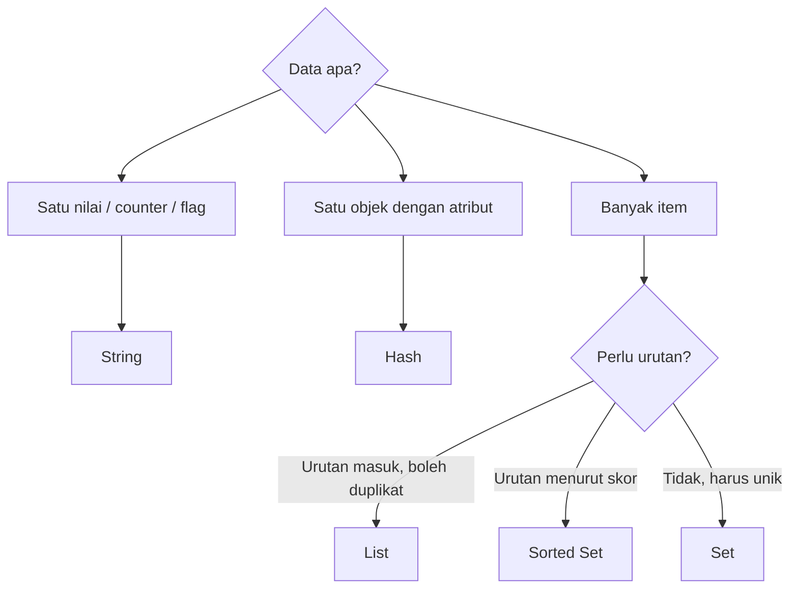

# Memilih struktur data yang tepat

## Tujuan belajar

Setelah bab ini kamu bisa:

- [ ] Menjelaskan perbedaan String, Hash, List, Set, dan Sorted Set dengan satu kalimat masing-masing.
- [ ] Memilih struktur data berdasarkan pertanyaan tentang bentuk data dan cara membacanya.
- [ ] Menyebut kapan Bitmap, HyperLogLog, atau Geo lebih tepat.
- [ ] Mengenali pilihan yang salah dan risikonya, lalu memperbaikinya.

## Prasyarat

- Sudah membaca bab [String](string.md), [Hash](hash.md), [List](list.md), [Set](set.md), dan [Sorted Set](sorted-set.md). Bab ini tidak mengulang cara memakai perintahnya.
- Bab [Bitmap, HyperLogLog, dan Geo](bitmap-hyperloglog-geo.md) bersifat opsional, tetapi dirujuk di sini.
- Container Redis berjalan dan kamu bisa masuk dengan `docker exec -it redis redis-cli` (lihat [Instalasi dengan Docker](../pengenalan/instalasi-dengan-docker.md)).
- Versi Redis: sama seperti bab sebelumnya; `ZRANGE ... REV` butuh Redis 6.2.0+.[^4]

## Konsep

Di Redis, struktur data dipilih berdasarkan **cara kamu akan membaca data**, bukan hanya cara menyimpannya.[^1] Struktur yang cocok membuat perintah Redis menyelesaikan pekerjaan sendiri (menghitung, mengurutkan, mengiris). Struktur yang salah memaksa aplikasimu mengambil banyak data lalu mengolahnya sendiri, yang lebih lambat dan lebih rumit.

Tiga pertanyaan penuntun:

1. **Apa bentuk datanya?** Satu nilai, satu objek dengan atribut, atau kumpulan banyak item?
2. **Apakah urutan atau duplikat penting?** Urutan masuk, urutan berdasarkan skor, atau cukup unik saja?
3. **Bagaimana aku akan membacanya?** Satu item, rentang, seluruh isi, atau hasil hitungan?

### Analogi

Memilih struktur data seperti memilih wadah di dapur: toples untuk satu bahan (String), rak bersekat untuk satu set bumbu lengkap (Hash), tabung antrean sendok (List), keranjang tanpa urutan yang tidak boleh ada dua yang sama (Set), dan rak peringkat bernomor (Sorted Set). Memasukkan semuanya ke satu karung tetap bisa, tetapi mencarinya jadi sulit.

!!! note "Batas analogi"
    Wadah dapur tidak menghitung sendiri. Struktur Redis menghitung irisan, peringkat, dan jumlah di server. Itulah alasan utama memilih dengan hati-hati.

## Cara kerja



Tabel keputusan:

| Kebutuhan | Pilih | Perintah kunci | Kenapa |
|---|---|---|---|
| Satu nilai, teks, atau counter | String | `SET`, `GET`, `INCR` | Paling sederhana; `INCR` atomik[^2] |
| Satu objek dengan beberapa atribut | Hash | `HSET`, `HGET`, `HINCRBY` | Atribut menyatu di satu key |
| Antrean atau tumpukan | List | `RPUSH`, `LPOP`, `BRPOP` | Urutan masuk terjaga |
| Daftar unik, keanggotaan, irisan | Set | `SADD`, `SISMEMBER`, `SINTER` | Tanpa duplikat, operasi himpunan |
| Peringkat atau prioritas | Sorted Set | `ZADD`, `ZRANGE`, `ZINCRBY` | Selalu terurut menurut skor |
| Status ya/tidak per nomor | Bitmap | `SETBIT`, `BITCOUNT` | Satu bit per status |
| Hitung unik perkiraan | HyperLogLog | `PFADD`, `PFCOUNT` | Memori tetap |
| Lokasi dan jarak | Geo | `GEOADD`, `GEOSEARCH` | Pencarian radius |

Satu aturan praktis tambahan: bila ragu antara beberapa key String dan satu Hash untuk satu objek, pilih Hash agar atribut terkumpul dan dihapus bersama; bila ragu antara List dan Sorted Set, tanyakan apakah urutan ditentukan waktu masuk (List) atau nilai (Sorted Set).

## Praktik langkah demi langkah

Kita menyelesaikan satu skenario, **toko online kecil**, dengan memilih struktur untuk tiap kebutuhan lalu mencobanya. Output di bawah adalah output **terverifikasi**: dijalankan di Redis 8.10.3 pada 2026-10-27. Hasilmu bisa berbeda pada nilai yang berubah tiap eksekusi. Bandingkan dengan hasilmu sendiri.

**Lingkungan: terminal**

```bash
docker exec -it redis redis-cli
```

Semua langkah berikutnya di **redis-cli**.

### Langkah 1: Counter pengunjung halaman → String

```text
127.0.0.1:6379> INCR toko:pengunjung
127.0.0.1:6379> INCR toko:pengunjung
```

Kenapa String: hanya satu angka yang terus naik. **Terverifikasi:** `(integer) 1`, lalu `(integer) 2`.

### Langkah 2: Data produk → Hash

```text
127.0.0.1:6379> HSET toko:produk:1 nama "Kopi" harga 25000 stok 10
127.0.0.1:6379> HINCRBY toko:produk:1 stok -1
```

Kenapa Hash: satu produk punya banyak atribut, dan stok perlu diubah tanpa menulis ulang yang lain. **Terverifikasi:** `(integer) 3`, lalu `(integer) 9`.

### Langkah 3: Antrean pesanan → List

```text
127.0.0.1:6379> RPUSH toko:antrean "pesanan-1" "pesanan-2"
127.0.0.1:6379> LPOP toko:antrean
```

Kenapa List: pesanan diproses berdasarkan urutan masuk. **Terverifikasi:** `(integer) 2`, lalu `"pesanan-1"`.

### Langkah 4: Pelanggan unik dan irisan → Set

```text
127.0.0.1:6379> SADD toko:beli:kopi "budi" "sari"
127.0.0.1:6379> SADD toko:beli:teh "sari" "tono"
127.0.0.1:6379> SINTER toko:beli:kopi toko:beli:teh
```

Kenapa Set: kita ingin tahu siapa yang membeli keduanya, tanpa duplikat. **Terverifikasi:** `(integer) 2`, `(integer) 2`, lalu `1) "sari"`.

### Langkah 5: Produk terlaris → Sorted Set

```text
127.0.0.1:6379> ZINCRBY toko:terlaris 3 "kopi"
127.0.0.1:6379> ZINCRBY toko:terlaris 5 "teh"
127.0.0.1:6379> ZRANGE toko:terlaris 0 0 REV WITHSCORES
```

Kenapa Sorted Set: peringkat harus selalu terurut menurut jumlah terjual. **Terverifikasi:** `"3"`, `"5"`, lalu `1) "teh"` dan `2) "5"`.

### Langkah 6: Verifikasi pilihan dengan `TYPE`

```text
127.0.0.1:6379> TYPE toko:pengunjung
127.0.0.1:6379> TYPE toko:produk:1
127.0.0.1:6379> TYPE toko:antrean
127.0.0.1:6379> TYPE toko:beli:kopi
127.0.0.1:6379> TYPE toko:terlaris
```

`TYPE` membantu memastikan tiap key bertipe sesuai niatmu dan mencegah galat `WRONGTYPE`.[^3] **Terverifikasi:** `string`, `hash`, `list`, `set`, lalu `zset`.

### Langkah 7: Lihat akibat pilihan yang salah

Misalkan kamu menyimpan papan peringkat di Set, lalu ingin tahu juaranya:

```text
127.0.0.1:6379> SADD toko:salah "kopi" "teh"
127.0.0.1:6379> SMEMBERS toko:salah
```

**Terverifikasi:** `(integer) 2`, lalu dua anggota **tanpa skor dan tanpa urutan terjamin**. Set tidak menyimpan jumlah terjual, jadi aplikasimu harus menyimpannya di tempat lain. Itu tanda struktur yang salah: Sorted Set seharusnya dipakai.

### Langkah 8: Bersihkan data latihan

```text
127.0.0.1:6379> DEL toko:pengunjung toko:produk:1 toko:antrean toko:beli:kopi toko:beli:teh toko:terlaris toko:salah
```

**Terverifikasi:** `(integer) 7` (atau lebih kecil bila ada key yang sudah tidak ada).

!!! danger "`DEL` tidak bisa dibatalkan"
    Perintah ini menyebut key satu per satu dan semuanya berawalan `toko:` milik latihan ini. Jangan mengganti dengan pola yang bisa menghapus data lain.

## Kesalahan umum dan troubleshooting

| Gejala | Penyebab dan solusi |
|---|---|
| `(error) WRONGTYPE Operation against a key holding the wrong kind of value` | Perintah tidak cocok dengan tipe key. Cek `TYPE key`, lalu pakai perintah yang sesuai atau key lain. |
| Seluruh objek disimpan sebagai satu String JSON, lalu satu atribut diubah | Harus membaca dan menulis ulang seluruhnya, dan dua klien bisa saling menimpa. Pertimbangkan Hash untuk objek datar. |
| Papan peringkat di List atau Set | Harus mengurutkan di aplikasi. Pindahkan ke Sorted Set. |
| Daftar unik di List | Harus mengecek duplikat sendiri. Pakai Set. |
| Hitung pengunjung unik dengan Set jutaan anggota memakan memori besar | Bila perkiraan cukup, pertimbangkan HyperLogLog. |
| `HGETALL`, `SMEMBERS`, atau `LRANGE 0 -1` memperlambat server | Koleksi terlalu besar. Baca bertahap (`HSCAN`, `SSCAN`, atau `LRANGE` per halaman). |
| Banyak key kecil untuk satu entitas | Sulit dikelola. Gabungkan jadi satu Hash. |

!!! note "Status verifikasi"
    Perintah, nilai balik, dan skrip di bab ini dijalankan di Redis 8.10.3 (`redis:latest`) pada 2026-10-27, dengan Python 3.12.3 dan redis-py 8.1.0. Sintaks juga dicocokkan dengan dokumentasi resmi Redis. Nilai yang berubah tiap eksekusi (ID, TTL, waktu, urutan, alamat IP) bisa berbeda di komputermu, dan teks galat bisa berbeda antarversi. Tampilan prompt interaktif `redis-cli` (prompt, Tab, riwayat) tidak teramati karena pengujian berjalan tanpa terminal interaktif.

## Latihan

1. Pilih struktur untuk: (a) jumlah login gagal per pengguna, (b) profil pengguna dengan nama dan email, (c) 10 artikel terakhir yang dibaca, (d) tag unik sebuah artikel, (e) peringkat pemain. Sebutkan alasannya.
2. Jalankan perintah yang sesuai untuk (a) dan (e), lalu cek hasilnya dengan `TYPE`.
3. Aplikasi menyimpan daftar teman di List dan sering mengecek apakah seseorang sudah berteman. Struktur apa yang lebih baik dan kenapa?
4. Kamu perlu menghitung pengunjung unik harian dari jutaan pengguna dan perkiraan sudah cukup. Struktur apa yang kamu pilih?
5. Jelaskan akibatnya bila papan peringkat game disimpan sebagai String JSON.

??? success "Petunjuk"
    1. Gunakan tiga pertanyaan penuntun dan tabel keputusan.
    2. Pilih nama key dengan awalan `latihan:` agar mudah dibersihkan.
    3. Pikirkan pengecekan keanggotaan dan duplikat.
    4. Lihat bab opsional Bitmap, HyperLogLog, dan Geo.
    5. Pikirkan siapa yang mengurutkan dan apa yang terjadi saat dua pemain menambah skor bersamaan.

## Ringkasan

- Pilih struktur menurut bentuk data, kebutuhan urutan atau keunikan, dan cara membacanya.
- String untuk nilai dan counter, Hash untuk objek, List untuk antrean dan tumpukan, Set untuk data unik dan irisan, Sorted Set untuk peringkat.
- Bitmap, HyperLogLog, dan Geo adalah pilihan khusus untuk status per nomor, hitungan unik perkiraan, dan lokasi.
- `TYPE` memeriksa tipe key dan membantu menghindari `WRONGTYPE`.
- Struktur yang salah memindahkan pekerjaan ke aplikasi dan memperbesar risiko performa dan kesalahan.

Berikutnya: bagian [Pola Penerapan](../pola-aplikasi/index.md).

## Referensi resmi

[^1]: Redis, *Understand Redis data types*: <https://redis.io/docs/latest/develop/data-types/>
[^2]: Redis, *Redis strings*: <https://redis.io/docs/latest/develop/data-types/strings/>
[^3]: Redis, *TYPE*: <https://redis.io/docs/latest/commands/type/>
[^4]: Redis, *ZRANGE*: <https://redis.io/docs/latest/commands/zrange/>

Bacaan tambahan: [Redis hashes](https://redis.io/docs/latest/develop/data-types/hashes/), [Redis sorted sets](https://redis.io/docs/latest/develop/data-types/sorted-sets/), [`HSCAN`](https://redis.io/docs/latest/commands/hscan/).
