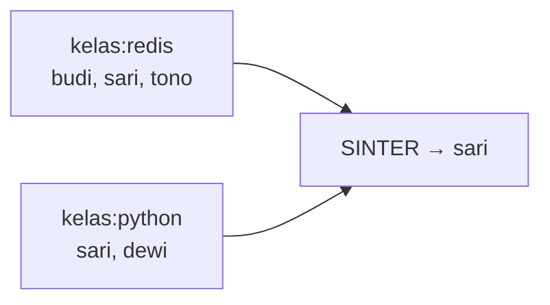

# Set

## Tujuan belajar

Setelah bab ini kamu bisa:

- [ ] Menjelaskan apa itu Set di Redis dan kenapa isinya selalu unik dan tidak berurutan.
- [ ] Menambah, memeriksa, menghitung, dan menghapus anggota dengan `SADD`, `SISMEMBER`, `SCARD`, dan `SREM`.
- [ ] Membaca isi Set dengan `SMEMBERS` dan menjelaskan risikonya pada Set besar.
- [ ] Menghitung irisan, gabungan, dan selisih dengan `SINTER`, `SUNION`, dan `SDIFF`.
- [ ] Menyimpan hasil irisan ke key baru dengan `SINTERSTORE`.

## Prasyarat

- Sudah membaca [List](list.md), terutama perbedaan List yang berurutan dan boleh duplikat.
- Sudah membaca [Key dan expiry](../pengenalan/key-dan-expiry.md) untuk skema nama key.
- Container Redis berjalan dan kamu bisa masuk dengan `docker exec -it redis redis-cli` (lihat [Instalasi dengan Docker](../pengenalan/instalasi-dengan-docker.md)).
- Versi Redis: semua perintah di bab ini tersedia di Redis yang kamu pasang lewat `redis:latest`. `SMISMEMBER` (bacaan tambahan) butuh Redis 6.2.0+.[^4]
- Kondisi awal: tidak ada key berawalan `kelas:`, `hobi:`, `tag:`, atau `pembaca:` yang kamu perlukan.
- Opsional untuk contoh Python: Python 3 dan paket `redis` (`pip install redis`).

## Konsep

Set adalah kumpulan String **unik** dan **tidak berurutan**.[^1] Menambahkan anggota yang sudah ada tidak mengubah apa-apa dan tidak menimbulkan galat. Redis memeriksa keanggotaan dengan cepat, bahkan pada Set besar.

Kenapa berguna:

- **Data unik otomatis.** Mencatat pengunjung unik, tag artikel, atau daftar teman tanpa menulis kode pengecekan duplikat.
- **Operasi himpunan.** Redis bisa menghitung irisan (anggota yang ada di semua Set), gabungan, dan selisih langsung di server. Misalnya "siapa yang mengikuti kedua kelas ini?"

Jika kamu butuh urutan atau duplikat, gunakan [List](list.md).

### Analogi

Set seperti daftar hadir kelas: nama tiap siswa hanya muncul sekali, dan daftar itu tidak peduli siapa yang datang duluan. Irisan dua daftar hadir menunjukkan siswa yang hadir di kedua kelas.

!!! note "Batas analogi"
    Urutan tampil saat membaca Set tidak dijamin dan bisa berbeda antarversi atau antarkondisi. Jangan menulis kode yang bergantung pada urutan itu. Untuk data berurutan berdasarkan skor, ada Sorted Set (bab berikutnya).

## Cara kerja



| Perintah | Fungsi | Balasan |
|---|---|---|
| `SADD key m [m ...]` | Tambah anggota.[^2] | Jumlah anggota **baru** |
| `SISMEMBER key m` | Cek apakah `m` anggota.[^3] | `1` ya, `0` bukan |
| `SCARD key` | Hitung anggota.[^5] | Jumlah |
| `SMEMBERS key` | Lihat semua anggota.[^6] | Daftar anggota |
| `SREM key m [m ...]` | Hapus anggota.[^7] | Jumlah yang terhapus |
| `SINTER key [key ...]` | Irisan.[^8] | Daftar anggota |
| `SUNION key [key ...]` | Gabungan.[^9] | Daftar anggota |
| `SDIFF key [key ...]` | Selisih: anggota key pertama yang tidak ada di key lain.[^10] | Daftar anggota |
| `SINTERSTORE tujuan key [key ...]` | Simpan irisan ke key `tujuan`.[^11] | Jumlah anggota hasil |

Satu Set dapat menampung hingga 2^32 - 1 (sekitar 4 miliar) anggota.[^1]

## Praktik langkah demi langkah

Output di bawah adalah output **terverifikasi**: dijalankan di Redis 8.10.3 pada 2026-10-27. Hasilmu bisa berbeda pada nilai yang berubah tiap eksekusi. Urutan anggota pada daftar tidak dijamin; bandingkan isinya, bukan urutannya.

**Lingkungan: terminal**

```bash
docker exec -it redis redis-cli
```

Semua langkah berikutnya di **redis-cli**.

### Langkah 1: Tambah anggota dengan `SADD`

```text
127.0.0.1:6379> SADD kelas:redis "budi" "sari" "tono"
127.0.0.1:6379> SADD kelas:redis "budi" "rina"
```

Kenapa dua kali: untuk melihat bahwa anggota yang sudah ada diabaikan.

**Terverifikasi:**

```text
(integer) 3
(integer) 1
```

Cara membaca output: `SADD` membalas jumlah anggota **baru**. Pada perintah kedua hanya `rina` yang baru; `budi` sudah ada sehingga tidak dihitung dan tidak digandakan.

### Langkah 2: Periksa dan hitung

```text
127.0.0.1:6379> SISMEMBER kelas:redis "sari"
127.0.0.1:6379> SISMEMBER kelas:redis "dewi"
127.0.0.1:6379> SCARD kelas:redis
```

**Terverifikasi:** `(integer) 1`, `(integer) 0`, lalu `(integer) 4`.

Kita memakai `SISMEMBER` ketimbang membaca semua anggota karena jauh lebih ringan: cukup bertanya "apakah ada?".

### Langkah 3: Lihat dan hapus anggota

```text
127.0.0.1:6379> SMEMBERS kelas:redis
127.0.0.1:6379> SREM kelas:redis "rina"
127.0.0.1:6379> SREM kelas:redis "rina"
```

**Terverifikasi** (urutan bisa berbeda):

```text
1) "budi"
2) "sari"
3) "tono"
4) "rina"
(integer) 1
(integer) 0
```

`SREM` membalas `1` untuk penghapusan pertama dan `0` untuk yang kedua karena `rina` sudah tidak ada.

!!! warning "Hati-hati dengan `SMEMBERS` pada Set besar"
    `SMEMBERS` mengembalikan seluruh anggota sekaligus dan bekerja sebanding dengan ukuran Set.[^6] Untuk Set besar, gunakan `SSCAN` yang bertahap (cara kerjanya sama seperti `SCAN` di [Key dan expiry](../pengenalan/key-dan-expiry.md)).

!!! danger "Risiko kehilangan data"
    `SREM` menghapus anggota permanen. Jika anggota terakhir dihapus, key Set ikut hilang. Keduanya tidak bisa dibatalkan.

### Langkah 4: Irisan, gabungan, dan selisih

Siapkan Set kedua:

```text
127.0.0.1:6379> SADD kelas:python "sari" "dewi" "tono"
127.0.0.1:6379> SINTER kelas:redis kelas:python
127.0.0.1:6379> SUNION kelas:redis kelas:python
127.0.0.1:6379> SDIFF kelas:redis kelas:python
```

Kenapa dipakai: Redis menghitung ini di server, jadi aplikasi tidak perlu mengambil dua daftar besar lalu membandingkannya sendiri.

**Terverifikasi** (urutan bisa berbeda):

```text
(integer) 3
1) "sari"
2) "tono"
1) "budi"
2) "sari"
3) "tono"
4) "dewi"
1) "budi"
```

Cara membaca output: `SINTER` hanya anggota di kedua Set (`sari`, `tono`). `SUNION` semua anggota tanpa duplikat. `SDIFF` anggota `kelas:redis` yang **tidak** ada di `kelas:python` (`budi`). Urutan key pada `SDIFF` penting: kebalikannya akan menghasilkan `dewi`.

### Langkah 5: Simpan hasil dengan `SINTERSTORE`

```text
127.0.0.1:6379> SINTERSTORE kelas:keduanya kelas:redis kelas:python
127.0.0.1:6379> SMEMBERS kelas:keduanya
```

Kenapa dipakai: bila hasil irisan sering dibutuhkan, simpan sekali sebagai key baru daripada menghitung ulang. **Terverifikasi:** `(integer) 2`, lalu `sari` dan `tono`.

!!! danger "`*STORE` menimpa key tujuan"
    Jika `kelas:keduanya` sudah ada, isinya diganti tanpa peringatan.[^11]

### Langkah 6: Contoh pemakaian: pengunjung unik

```text
127.0.0.1:6379> SADD pembaca:artikel-1 "u1" "u2" "u1" "u3" "u2"
127.0.0.1:6379> SCARD pembaca:artikel-1
```

**Terverifikasi:** `(integer) 3`, lalu `(integer) 3`. Meski ada lima kunjungan, hanya tiga pembaca unik. Inilah kenapa Set cocok untuk menghitung yang unik.

### Langkah 7: Bersihkan data latihan

```text
127.0.0.1:6379> DEL kelas:redis kelas:python kelas:keduanya pembaca:artikel-1
```

**Terverifikasi:** `(integer) 4`.

!!! danger "`DEL` tidak bisa dibatalkan"
    Perintah ini menyebut key satu per satu agar tidak ada key lain yang ikut terhapus.

## Contoh lengkap

**Lingkungan: Python** · Kebutuhan: Python 3, paket `redis` (`pip install redis`), dan Redis berjalan di `localhost:6379`.

```python title="set_irisan.py"
import redis

r = redis.Redis(host="localhost", port=6379, decode_responses=True)

R = "kelas:redis"
P = "kelas:python"

r.delete(R, P)

r.sadd(R, "budi", "sari", "tono")
r.sadd(P, "sari", "dewi", "tono")

print("jumlah kelas redis:", r.scard(R))
print("sari di kelas redis:", r.sismember(R, "sari"))
print("irisan:", sorted(r.sinter(R, P)))
print("gabungan:", sorted(r.sunion(R, P)))
print("hanya redis:", sorted(r.sdiff(R, P)))

r.delete(R, P)
```

Penjelasan baris penting:

| Baris | Penjelasan |
|---|---|
| `r.delete(R, P)` di awal dan akhir | Memulai dan mengakhiri dari kondisi bersih; menghapus kedua key itu. |
| `r.sadd(R, "budi", "sari", "tono")` | Menambah beberapa anggota sekaligus. |
| `r.sismember(R, "sari")` | Mengembalikan `1` atau `0` (teramati di redis-py 8.1.0 dengan Redis 8.10.3); versi lain bisa mengembalikan `True`/`False`, jadi jangan membandingkan dengan `is True`. |
| `sorted(...)` | Redis mengembalikan `set` Python yang tidak berurutan; `sorted` membuat output stabil untuk dibandingkan. |

Cara menjalankan: `python set_irisan.py`.

**Terverifikasi:**

```text
jumlah kelas redis: 3
sari di kelas redis: 1
irisan: ['sari', 'tono']
gabungan: ['budi', 'dewi', 'sari', 'tono']
hanya redis: ['budi']
```

## Kesalahan umum dan troubleshooting

| Gejala | Penyebab dan solusi |
|---|---|
| `(error) WRONGTYPE Operation against a key holding the wrong kind of value` | Key bukan Set (misalnya List atau String). Cek `TYPE key` dan pakai key lain. |
| `SADD` membalas `0` | Semua anggota sudah ada. Normal, bukan galat. |
| Urutan `SMEMBERS` berubah-ubah | Set tidak berurutan.[^1] Urutkan di aplikasi atau pakai Sorted Set. |
| `SINTER` mengembalikan `(empty array)` | Tidak ada anggota yang sama, atau salah satu key tidak ada (key tidak ada dianggap Set kosong).[^8] |
| `SDIFF` hasilnya berbeda saat urutan key dibalik | Memang begitu: selisih bergantung pada key pertama.[^10] |
| Server terasa lambat setelah `SMEMBERS` | Set terlalu besar. Pakai `SSCAN` atau `SISMEMBER`. |
| `SINTERSTORE` menghapus isi key tujuan | Perilaku normal: key tujuan ditimpa, dan dihapus bila hasil kosong.[^11] |

!!! note "Status verifikasi"
    Perintah, nilai balik, dan skrip di bab ini dijalankan di Redis 8.10.3 (`redis:latest`) pada 2026-10-27, dengan Python 3.12.3 dan redis-py 8.1.0. Sintaks juga dicocokkan dengan dokumentasi resmi Redis. Nilai yang berubah tiap eksekusi (ID, TTL, waktu, urutan, alamat IP) bisa berbeda di komputermu, dan teks galat bisa berbeda antarversi. Tampilan prompt interaktif `redis-cli` (prompt, Tab, riwayat) tidak teramati karena pengujian berjalan tanpa terminal interaktif.

## Latihan

1. Buat Set `hobi:budi` berisi `membaca`, `renang`, `gim` dan `hobi:sari` berisi `renang`, `musik`. Hobi apa yang sama?
2. Sebelum menjalankan: berapa balasan `SADD hobi:budi renang musik`? Jalankan lalu bandingkan.
3. Cari hobi `budi` yang tidak dimiliki `sari`, lalu kebalikannya. Kenapa hasilnya berbeda?
4. Simpan gabungan kedua hobi dengan `SUNIONSTORE hobi:semua hobi:budi hobi:sari`. Berapa anggotanya?
5. Jelaskan kapan memilih Set dan kapan List untuk menyimpan daftar tag artikel.

??? success "Petunjuk"
    1. Gunakan `SINTER`.
    2. Hanya anggota baru yang dihitung.
    3. Tukar urutan key pada `SDIFF`.
    4. `SUNIONSTORE` bekerja seperti `SINTERSTORE`; lihat halaman `SUNIONSTORE` di bacaan tambahan.
    5. Pikirkan duplikat dan urutan.

## Ringkasan

- Set adalah kumpulan String unik tanpa urutan; menambah anggota yang sudah ada tidak berpengaruh.
- `SADD`, `SISMEMBER`, `SCARD`, dan `SREM` mengelola anggota. `SMEMBERS` membaca semuanya, tetapi hindari pada Set besar (pakai `SSCAN`).
- `SINTER`, `SUNION`, dan `SDIFF` menghitung irisan, gabungan, dan selisih di server; `SINTERSTORE` menyimpan irisan ke key baru dan menimpa key tujuan.
- Set cocok untuk data unik seperti pembaca unik, tag, dan keanggotaan.

Berikutnya: [Sorted Set](sorted-set.md), untuk papan peringkat.

## Referensi resmi

[^1]: Redis, *Redis sets*: <https://redis.io/docs/latest/develop/data-types/sets/>
[^2]: Redis, *SADD*: <https://redis.io/docs/latest/commands/sadd/>
[^3]: Redis, *SISMEMBER*: <https://redis.io/docs/latest/commands/sismember/>
[^4]: Redis, *SMISMEMBER*: <https://redis.io/docs/latest/commands/smismember/>
[^5]: Redis, *SCARD*: <https://redis.io/docs/latest/commands/scard/>
[^6]: Redis, *SMEMBERS*: <https://redis.io/docs/latest/commands/smembers/>
[^7]: Redis, *SREM*: <https://redis.io/docs/latest/commands/srem/>
[^8]: Redis, *SINTER*: <https://redis.io/docs/latest/commands/sinter/>
[^9]: Redis, *SUNION*: <https://redis.io/docs/latest/commands/sunion/>
[^10]: Redis, *SDIFF*: <https://redis.io/docs/latest/commands/sdiff/>
[^11]: Redis, *SINTERSTORE*: <https://redis.io/docs/latest/commands/sinterstore/>

Bacaan tambahan: [`SSCAN`](https://redis.io/docs/latest/commands/sscan/), [`SUNIONSTORE`](https://redis.io/docs/latest/commands/sunionstore/), [`SRANDMEMBER`](https://redis.io/docs/latest/commands/srandmember/).
