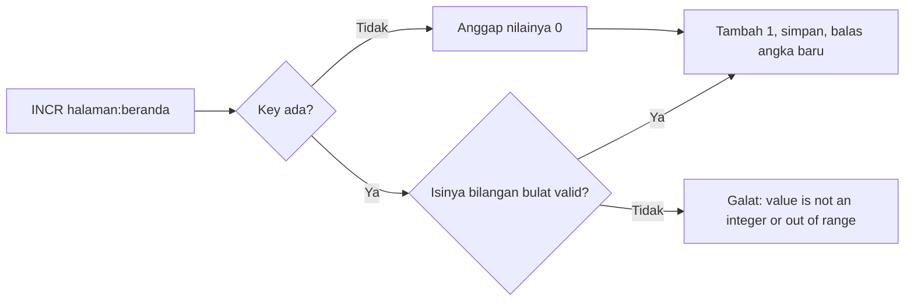

# String

## Tujuan belajar

Setelah bab ini kamu bisa:

- [ ] Menjelaskan apa itu String di Redis dan kenapa angka juga disimpan sebagai String.
- [ ] Membuat counter dengan `INCR`, `INCRBY`, `DECR`, dan `DECRBY`.
- [ ] Menyimpan dan membaca banyak key sekaligus dengan `MSET` dan `MGET`.
- [ ] Menyimpan nilai hanya jika key belum ada dengan `SET ... NX` dan `SETNX`, serta menjelaskan kenapa `SET ... NX` lebih disarankan.
- [ ] Mengenali galat `not an integer` dan `WRONGTYPE`, lalu memperbaikinya.

## Prasyarat

- Sudah membaca [Key dan expiry](../pengenalan/key-dan-expiry.md), terutama `SET`, `TTL`, dan aturan bahwa `SET` yang menimpa key menghapus expiry.
- Container Redis berjalan dan kamu bisa masuk dengan `docker exec -it redis redis-cli` (lihat [Instalasi dengan Docker](../pengenalan/instalasi-dengan-docker.md)).
- Versi Redis: semua perintah di bab ini tersedia di Redis yang kamu pasang lewat `redis:latest`. `SET ... NX` tersedia sejak Redis 2.6.12.[^3]
- Kondisi awal: database kosong atau tidak memakai key berawalan `halaman:`, `antrean:`, `suhu:`, `kunci:`, dan `nama:` yang dipakai di bab ini.
- Opsional untuk contoh Python: Python 3 dan paket `redis` (`pip install redis`).

## Konsep

String adalah tipe value paling dasar di Redis. Sebuah String menyimpan deretan byte, jadi bisa berisi teks, angka, JSON, bahkan data biner seperti gambar kecil. Ukuran maksimumnya 512 MB.[^1]

Karena itu angka di Redis tidak punya tipe terpisah. Angka `42` disimpan sebagai String `"42"`. Redis baru menafsirkannya sebagai angka ketika kamu menjalankan perintah numerik seperti `INCR`.[^2] Kalau isinya bukan angka bulat yang valid, perintah itu ditolak dengan galat.

Dua kegunaan String yang akan kita latih:

1. **Counter.** Menghitung kunjungan halaman, jumlah percobaan login, atau nomor antrean. `INCR` menaikkan angka **secara atomik**: Redis menjalankan satu perintah sampai selesai sebelum perintah klien lain, sehingga dua klien yang menaikkan bersamaan tidak saling menimpa.[^2]
2. **Menyimpan hanya jika belum ada.** Berguna untuk "siapa yang pertama menang", misalnya mengambil kunci agar hanya satu proses yang mengerjakan tugas tertentu.

### Analogi

Bayangkan String seperti satu kotak berlabel (label = key) yang isinya kertas. Untuk counter, kertas itu bertuliskan angka dan petugas di loket (Redis) selalu melayani satu orang pada satu waktu. Saat dua orang meminta "tambah satu" berbarengan, petugas mengerjakannya bergantian, sehingga angka akhirnya benar.

!!! note "Batas analogi"
    Redis tidak benar-benar "mengantre orang" dengan cara ini untuk semua kasus. Jaminan atomik berlaku **per perintah**. Dua perintah terpisah, misalnya `GET` lalu `SET`, bisa disela klien lain di antaranya. Itu sebabnya ada perintah khusus seperti `INCR`.

## Cara kerja



| Perintah | Fungsi | Balasan |
|---|---|---|
| `INCR key` | Tambah 1. Key yang belum ada dianggap `0` dulu.[^2] | Angka baru |
| `INCRBY key n` | Tambah `n` (boleh negatif).[^4] | Angka baru |
| `DECR key` / `DECRBY key n` | Kurangi 1 / kurangi `n`.[^5] | Angka baru |
| `MSET k1 v1 k2 v2 ...` | Set banyak key sekaligus dalam satu langkah atomik.[^6] | `OK` |
| `MGET k1 k2 ...` | Baca banyak key sekaligus.[^7] | Daftar nilai, `(nil)` bila key tidak ada |
| `SET key value NX` | Set hanya jika key **belum ada**.[^3] | `OK` bila berhasil, `(nil)` bila tidak |
| `SETNX key value` | Versi lama dari `SET ... NX`.[^8] | `1` bila berhasil, `0` bila tidak |

Batas angka: nilai harus muat dalam bilangan bulat bertanda 64-bit, yaitu antara -9223372036854775808 dan 9223372036854775807.[^2]

## Praktik langkah demi langkah

Output di bawah adalah output **terverifikasi**: dijalankan di Redis 8.10.3 pada 2026-10-27. Hasilmu bisa berbeda pada nilai yang berubah tiap eksekusi. Bandingkan dengan hasilmu sendiri.

**Lingkungan: terminal**

```bash
docker exec -it redis redis-cli
```

Semua langkah berikutnya di **redis-cli**.

### Langkah 1: Buat counter dengan `INCR`

```text
127.0.0.1:6379> INCR halaman:beranda
127.0.0.1:6379> INCR halaman:beranda
127.0.0.1:6379> GET halaman:beranda
```

Kenapa langkah ini diperlukan: kita ingin melihat bahwa key yang belum ada langsung bisa dipakai sebagai counter, tanpa perlu `SET halaman:beranda 0` lebih dulu.

**Terverifikasi:**

```text
(integer) 1
(integer) 2
"2"
```

Cara membaca output: `INCR` membalas angka baru sebagai `(integer)`. `GET` membalas `"2"` dengan tanda kutip karena isi yang tersimpan tetap String, bukan tipe angka.

### Langkah 2: Naik atau turun lebih dari satu

```text
127.0.0.1:6379> INCRBY halaman:beranda 10
127.0.0.1:6379> DECR halaman:beranda
127.0.0.1:6379> DECRBY halaman:beranda 5
```

| Bagian | Fungsi dan alasan |
|---|---|
| `INCRBY ... 10` | Menambah 10 sekaligus. Dipakai saat satu kejadian bernilai lebih dari 1, misalnya menambah stok 10 barang. |
| `DECR` | Mengurangi 1, misalnya stok berkurang satu per pembelian. |
| `DECRBY ... 5` | Mengurangi 5 sekaligus. |

**Terverifikasi:** `(integer) 12`, lalu `(integer) 11`, lalu `(integer) 6`.

### Langkah 3: Lihat galat bila isinya bukan angka

```text
127.0.0.1:6379> SET nama:toko "Toko Maju"
127.0.0.1:6379> INCR nama:toko
```

Kita sengaja memicu galat agar kamu mengenali pesannya. **Terverifikasi:** `OK`, lalu:

```text
(error) ERR value is not an integer or out of range
```

Artinya isi key tidak bisa ditafsirkan sebagai bilangan bulat 64-bit.[^2] Redis tidak mengubah isi key saat galat ini muncul.

### Langkah 4: Counter yang kedaluwarsa

Counter sering hanya berlaku sementara, misalnya jumlah request per menit. Gabungkan `INCR` dengan `EXPIRE` yang sudah kamu kenal:

```text
127.0.0.1:6379> INCR antrean:hari-ini
127.0.0.1:6379> EXPIRE antrean:hari-ini 60
127.0.0.1:6379> INCR antrean:hari-ini
127.0.0.1:6379> TTL antrean:hari-ini
```

**Terverifikasi:** `(integer) 1`, `(integer) 1`, `(integer) 2`, lalu angka sekitar `60` atau sedikit lebih kecil.

Kenapa expiry tetap ada setelah `INCR` kedua: `INCR` hanya mengubah isi, sedangkan `SET` menimpa isi dan menghapus expiry (lihat [Key dan expiry](../pengenalan/key-dan-expiry.md)). Jadi jangan menaikkan counter dengan pola `GET` lalu `SET`: selain bisa disela klien lain, `SET` juga menghapus expiry.

!!! warning "Celah kecil pada pola `INCR` lalu `EXPIRE`"
    Jika aplikasi berhenti tepat di antara `INCR` pertama dan `EXPIRE`, counter akan hidup tanpa expiry. Untuk latihan ini tidak masalah. Pola yang lebih aman untuk produksi (misalnya memakai skrip atau transaksi) dibahas di bagian berikutnya.

### Langkah 5: Banyak key sekaligus dengan `MSET` dan `MGET`

```text
127.0.0.1:6379> MSET suhu:jakarta "31" suhu:bandung "24" suhu:medan "33"
127.0.0.1:6379> MGET suhu:jakarta suhu:bandung suhu:surabaya
```

Kenapa dipakai: satu perintah berarti satu kali perjalanan jaringan ke server, lebih efisien daripada tiga `SET` atau tiga `GET` terpisah. `MSET` juga atomik: tidak ada klien yang melihat sebagian key sudah berubah dan sebagian belum.[^6]

**Terverifikasi:**

```text
OK
1) "31"
2) "24"
3) (nil)
```

Cara membaca output: `MGET` membalas daftar berurutan sesuai urutan key yang kamu minta. `(nil)` untuk `suhu:surabaya` berarti key itu tidak ada.[^7]

!!! danger "`MSET` menimpa tanpa bertanya"
    Seperti `SET`, `MSET` mengganti nilai lama dan menghapus expiry key yang ditimpa. Pastikan nama key benar.

### Langkah 6: Simpan hanya jika belum ada dengan `SET ... NX`

```text
127.0.0.1:6379> SET kunci:laporan "proses-A" NX EX 30
127.0.0.1:6379> SET kunci:laporan "proses-B" NX EX 30
127.0.0.1:6379> GET kunci:laporan
```

| Bagian | Fungsi dan alasan |
|---|---|
| `NX` | "Not eXists": hanya menyimpan bila key belum ada. Dipakai agar hanya satu pemanggil yang menang.[^3] |
| `EX 30` | Expiry 30 detik, diatur **dalam perintah yang sama**. Jika proses A mati, kunci tetap hilang sendiri dan tidak macet selamanya. |

**Terverifikasi:**

```text
OK
(nil)
"proses-A"
```

Cara membaca output: `OK` berarti proses A berhasil mengambil kunci. `(nil)` berarti proses B ditolak karena key sudah ada, dan nilainya tetap milik A.

### Langkah 7: Kenalan dengan `SETNX` (perintah lama)

```text
127.0.0.1:6379> DEL kunci:cetak
127.0.0.1:6379> SETNX kunci:cetak "siap"
127.0.0.1:6379> SETNX kunci:cetak "lain"
127.0.0.1:6379> GET kunci:cetak
```

`SETNX` ("SET if Not eXists") mengatur nilai hanya bila key belum ada.[^8] Balasannya `1` bila berhasil dan `0` bila key sudah ada.

**Terverifikasi:** `(integer) 0` (key belum ada, jadi `DEL` tidak menghapus apa pun), `(integer) 1`, `(integer) 0`, lalu `"siap"`.

!!! danger "`DEL` tidak bisa dibatalkan"
    `DEL kunci:cetak` di langkah ini aman karena key itu milik latihan. Jangan mengetik `DEL` untuk key data yang kamu perlukan.

!!! info "Kenapa `SET ... NX` lebih disarankan"
    Dokumentasi resmi menandai `SETNX` sebagai deprecated sejak Redis 2.6.12 dan menyarankan `SET` dengan opsi `NX`.[^8] Alasannya praktis: `SETNX` tidak bisa memberi expiry, sehingga butuh `EXPIRE` terpisah. Bila proses mati di antara keduanya, key tersisa selamanya. Kamu tetap perlu mengenali `SETNX` karena masih muncul di kode lama.

### Langkah 8: Bersihkan data latihan

```text
127.0.0.1:6379> DEL halaman:beranda nama:toko antrean:hari-ini suhu:jakarta suhu:bandung suhu:medan kunci:laporan kunci:cetak
```

**Terverifikasi:** `(integer)` sejumlah key yang benar-benar ada saat itu (maksimal 8; `antrean:hari-ini` dan `kunci:laporan` mungkin sudah kedaluwarsa).

!!! danger "Risiko kehilangan data"
    `DEL` menghapus permanen. Perintah di atas menyebut key satu per satu, bukan memakai pola, agar tidak ada key lain yang ikut terhapus.

## Contoh lengkap

**Lingkungan: Python** · Kebutuhan: Python 3, paket `redis` (`pip install redis`), dan Redis berjalan di `localhost:6379` seperti pada [Instalasi dengan Docker](../pengenalan/instalasi-dengan-docker.md).

```python title="string_counter.py"
import redis

r = redis.Redis(host="localhost", port=6379, decode_responses=True)

KEY_COUNTER = "halaman:beranda"
KEY_KUNCI = "kunci:laporan"

# 1. Counter: INCR atomik, key baru dimulai dari 0
r.delete(KEY_COUNTER)
for _ in range(3):
    nilai = r.incr(KEY_COUNTER)
    print("counter sekarang:", nilai)

# 2. SET ... NX EX: hanya satu pemanggil yang menang
r.delete(KEY_KUNCI)
a = r.set(KEY_KUNCI, "proses-A", nx=True, ex=30)
b = r.set(KEY_KUNCI, "proses-B", nx=True, ex=30)
print("A dapat kunci:", a)
print("B dapat kunci:", b)
print("pemilik kunci:", r.get(KEY_KUNCI))

# 3. Bersihkan data contoh
r.delete(KEY_COUNTER, KEY_KUNCI)
```

Penjelasan baris penting:

| Baris | Penjelasan |
|---|---|
| `decode_responses=True` | Membuat balasan berupa `str`, bukan `bytes`, sehingga mudah dibaca saat dicetak. |
| `r.delete(KEY_COUNTER)` | Memastikan contoh mulai dari kondisi bersih agar hasilnya sama setiap dijalankan. Ini menghapus key tersebut. |
| `r.incr(KEY_COUNTER)` | Memanggil `INCR`. Mengembalikan angka baru sebagai `int`. |
| `r.set(..., nx=True, ex=30)` | Memanggil `SET key value NX EX 30`. Mengembalikan `True` bila berhasil dan `None` bila key sudah ada. |
| `r.delete(KEY_COUNTER, KEY_KUNCI)` | Membersihkan key contoh di akhir. |

Cara menjalankan: `python string_counter.py`.

**Terverifikasi:**

```text
counter sekarang: 1
counter sekarang: 2
counter sekarang: 3
A dapat kunci: True
B dapat kunci: None
pemilik kunci: proses-A
```

## Kesalahan umum dan troubleshooting

| Gejala | Penyebab dan solusi |
|---|---|
| `(error) ERR value is not an integer or out of range` | Isi key bukan bilangan bulat 64-bit (teks, desimal seperti `"3.5"`, atau angka kebesaran).[^2] Periksa dengan `GET`; timpa dengan `SET key 0` bila memang perlu mengulang. |
| `(error) WRONGTYPE Operation against a key holding the wrong kind of value` | Key itu bukan String (misalnya Hash atau List). Cek dengan `TYPE key` dan pakai nama key lain. |
| `(error) ERR increment or decrement would overflow` | Hasil melewati batas 64-bit.[^2] |
| Counter kembali ke 1 setelah beberapa waktu | Key kedaluwarsa, atau ditimpa `SET`. Cek `TTL` dan kode yang menulis key itu. |
| `SET ... NX` selalu `(nil)` | Key sudah ada. Cek `GET` dan `TTL`; tunggu kedaluwarsa atau pakai key lain. |
| `SETNX` membalas `0` | Key sudah ada. Itu perilaku normal, bukan galat. |
| `MGET` membalas `(nil)` untuk sebuah key | Key tidak ada, atau sudah kedaluwarsa. Bila key bertipe selain String, `MGET` juga membalas `(nil)` untuknya.[^7] |
| Python: `redis.exceptions.ConnectionError` | Container Redis belum berjalan atau port 6379 tidak terbuka. Cek dengan `docker ps`. |

!!! warning "String bukan kunci terdistribusi yang lengkap"
    `SET ... NX EX` cocok untuk latihan dan kasus sederhana. Untuk kunci yang aman di sistem produksi (misalnya agar proses tidak menghapus kunci milik proses lain), ada pertimbangan tambahan yang dibahas di bagian Pola Penerapan.

!!! note "Status verifikasi"
    Perintah, nilai balik, dan skrip di bab ini dijalankan di Redis 8.10.3 (`redis:latest`) pada 2026-10-27, dengan Python 3.12.3 dan redis-py 8.1.0. Sintaks juga dicocokkan dengan dokumentasi resmi Redis. Nilai yang berubah tiap eksekusi (ID, TTL, waktu, urutan, alamat IP) bisa berbeda di komputermu, dan teks galat bisa berbeda antarversi. Tampilan prompt interaktif `redis-cli` (prompt, Tab, riwayat) tidak teramati karena pengujian berjalan tanpa terminal interaktif.

## Latihan

1. Buat counter `kunjungan:artikel-1` dengan `INCR` sebanyak tiga kali, lalu naikkan 100 sekaligus dengan `INCRBY`. Berapa nilai akhirnya?
2. Sebelum menjalankan: apa balasan `INCR` pada key yang belum ada? Apa balasan `MGET` jika salah satu key tidak ada? Jalankan lalu bandingkan dengan prediksimu.
3. Jalankan `SET catatan "halo"` lalu `INCR catatan`. Jelaskan pesan galatnya, lalu perbaiki agar `INCR` berhasil.
4. Pakai `SET kunci:tugas "saya" NX EX 20` dua kali berurutan. Apa bedanya balasan pertama dan kedua? Apa yang terjadi setelah 20 detik?
5. Tulis ulang `SETNX kunci:tugas "saya"` plus `EXPIRE kunci:tugas 20` menjadi satu perintah, dan jelaskan risiko versi dua perintah.

??? success "Petunjuk"
    1. Hitung: 3 + 100.
    2. Ingat diagram "Cara kerja": key yang tidak ada dianggap `0`.
    3. Galat muncul karena isi bukan angka. Timpa dengan angka, misalnya `SET catatan 5`.
    4. Perhatikan `OK` versus `(nil)`, lalu cek `GET` dan `TTL`.
    5. Pikirkan apa yang terjadi bila aplikasi berhenti di antara dua perintah itu.

## Ringkasan

- String menyimpan deretan byte (maksimal 512 MB). Angka juga String, dan baru dianggap angka saat dipakai perintah numerik.
- `INCR`, `INCRBY`, `DECR`, dan `DECRBY` membuat counter yang atomik; key yang belum ada dimulai dari `0`. Isi yang bukan bilangan bulat 64-bit menghasilkan galat.
- `MSET` dan `MGET` mengurangi jumlah perjalanan jaringan; `(nil)` pada `MGET` berarti key tidak ada.
- `SET ... NX` (dengan `EX`) menyimpan hanya bila key belum ada dan memberi expiry dalam satu langkah. `SETNX` adalah versi lama yang sudah deprecated.
- Hati-hati: `SET`, `MSET`, dan `DEL` menimpa atau menghapus data tanpa bisa dibatalkan.

Berikutnya: [Hash](hash.md), untuk menyimpan objek dengan beberapa field.

## Referensi resmi

[^1]: Redis, *Redis strings*: <https://redis.io/docs/latest/develop/data-types/strings/>
[^2]: Redis, *INCR*: <https://redis.io/docs/latest/commands/incr/>
[^3]: Redis, *SET*: <https://redis.io/docs/latest/commands/set/>
[^4]: Redis, *INCRBY*: <https://redis.io/docs/latest/commands/incrby/>
[^5]: Redis, *DECR* dan *DECRBY*: <https://redis.io/docs/latest/commands/decr/> dan <https://redis.io/docs/latest/commands/decrby/>
[^6]: Redis, *MSET*: <https://redis.io/docs/latest/commands/mset/>
[^7]: Redis, *MGET*: <https://redis.io/docs/latest/commands/mget/>
[^8]: Redis, *SETNX*: <https://redis.io/docs/latest/commands/setnx/>

Bacaan tambahan: [`INCRBYFLOAT`](https://redis.io/docs/latest/commands/incrbyfloat/), [`APPEND`](https://redis.io/docs/latest/commands/append/), [`STRLEN`](https://redis.io/docs/latest/commands/strlen/).
